# Signed dependency-chain performance, 2026-11-15

The signed dependency-chain study is **accepted on this finite range**.
The latest retained optimization builds overwrite maps from natural ordered
runs. Timing, growth and confidence checks use one source-qualified cohort;
finite-range fitted exponents do not prove asymptotic complexity.

## Latest retained optimization: natural-run maps, 2026-11-17

Evidence is under `.mlf-build/signed-chain-remaining-growth-20261117`.
The preceding producer and final audit were authenticated before work: 230
source pins and 666 evidence pins. Builds, controls, profiling, timing and memory
runs are serialized. No samples are pooled across selection and formal cohorts.

### Measured target and implementation

A fresh 96-module profiling compiler, built from an empty object directory,
runs twice at N=0/256/1024. All six interface/object/LLVM outputs exactly match
the previous qualified producer. Exclusive allocation growth in Map is
104.773 MB and sampled CPU growth is 25.5 ms; balance alone accounts for
49.322 MB. These are profiling diagnostics, not elapsed timing or a complexity
proof. The largest business owners include package construction and query
encoding; map-node rebuilding is spread across several owners.

Previously `Map.fromList` used an ascending-prefix fast path and switched to
persistent insertion after the first decrease. It now collects ascending and
descending runs, merges pairs of ordered entry lists, and builds the balanced
tree once. Equal keys retain the newest comparator-equivalent representative
and its lazy value. For n entries and r natural runs, this construction takes
O(n log(r+1)) comparisons in the worst case for those runs and remains
O(n log n) on arbitrary input. That bound describes this constructor, not the
whole compiler. `fromListWith` retains its existing sequential combination:
an arbitrary combiner need not be associative.

The alternative builds a map per run and joins those maps. Its separate N1024
memory experiment saves 24,012,432 allocated bytes, but maximum live heap rises
14,688 bytes. The retained list variant saves 15,945,488 allocated bytes,
191,744 maximum-live bytes and 3,244,032 observed RSS bytes in its private
experiment. It has the more consistent paired timing signal in the one fixed
three-lane confirmation. These private memory runs use the same old external
artifact identity only to isolate data structures; they are not release builds.

### Selection and preserved behavior

Each variant passes 19,581 existing independent ordered-map cases, 16,745
union pairs, and 19,611 frozen/current and independent content, key-representative
and nonassociative-combiner cases. Explicit demand controls cover discarded
values, cross-run duplicates, selected failures, the first key and comparator.
The actual old/new Map bodies then pass 38 interpreter, 198 native O0 and
198 native O2 cases against a Python dictionary oracle. These finite controls
do not assert that arbitrary partial comparators observe the same call order.

Each corrected variant has one fixed six-pair screen. One additional fixed
confirmation uses twelve triplets at each of N=0/256/1024, rotating through all
six lane orders. Its 117 compiles preserve interface/object/LLVM bytes and
produce 351 exact native results. At N1024 the retained list variant's paired
median delta is -4.268875 ms; a diagnostic 10,000-resample median interval with
seed 51017 is [-10.034771, -0.448938] ms. The compiler-only paired median delta
is -5.278521 ms; the Clang delta is -0.002021 ms. This selection result is
separate from formal GHC acceptance.

An initial private tree candidate still contained the previous generated
Prelude map shape. Its source-value inventory check rejected that literal,
the compiler used its fallback, and the first candidate warmup emitted a larger
LLVM module. The screen stopped before measured pairs. An explicit admission
probe reproduced the failure. Regenerating the private literal restored
admission and exact LLVM while all three serialized builtin images remained
identical. No admission check was relaxed. The initial probe's expected
diagnostic named the wrong metadata field, and a bounded build wrapper rejected
existing GHC warnings despite exit 0; both failed records are preserved.
The first two portable fixtures also had a typed-pattern syntax error and an
unqualified comparator name; corrected v3 fixtures passed. These fixture
failures are not presented as compiler regressions.

### Current-source qualification

Maintained Map source is byte-identical to the selected candidate. Independent
maintained controls now cover 19,611 host cases, 11 demand checks, 100 native
map cases, and the existing union gate. Builtin data, lock and source migration
receipts are regenerated before all 137 shared modules and 18 build actions.
The current builtin source identity is `builtin-source-v1:b54f095675c2c7bd91b804689ab3de3775c0461ab982dc24bfc8d08477d88b6f`.
The primitive ABI remains `mlf-primitive-137-v12` and builtin interface remains
`mlf-primitive/shared-haskell-v1/16`.

The direct gate has 19 actions, package/cache regression 17, query controls 13,
and CLI controls 18 (13 positive and five specific type/name failures with no
artifacts). Artifact modular Python controls pass 46 tests; open-file controls
pass 78. Six disk reopens reproduce exact fused LLVM and complete normalized
interface/body/type/scope semantics; 42 extra native integer-boundary results
pass. Native compiler self-bootstrap, installed CLI and prior native codec /
QuerySnapshotProbe gaps remain unqualified.

### One fixed formal GHC cohort

Use the existing `crate-fused-v1` whole-worker boundary, 32 fresh pairs at each
size: 448 successful compiles and 1,344 exact native results. Neither deleted
samples nor an unchanged-source formal retry is used.

| Functions | MLF, s | GHC, s |
| ---: | ---: | ---: |
| 0 | 0.302439 | 0.508258 |
| 32 | 0.305769 | 0.511759 |
| 64 | 0.314987 | 0.519847 |
| 128 | 0.318446 | 0.518608 |
| 256 | 0.345311 | 0.547845 |
| 512 | 0.379536 | 0.580380 |
| 1024 | 0.472469 | 0.685223 |

| Estimate | MLF | GHC |
| --- | ---: | ---: |
| OLS, ms/function | 0.164982 | 0.171310 |
| Endpoint, ms/function | 0.166044 | 0.172817 |
| Offset power exponent | 1.081226 | 1.232971 |

Paired 95% OLS delta interval (MLF minus GHC), ms/function:
`[-0.011376646698288763, -0.0017641501512570541]`.
Paired 95% fitted-exponent delta interval:
`[-0.2491862592322912, -0.06568029032906772]`.

All six declared checks pass together, and neither fitted exponent reaches a parameter bound.

Acceptance is for the declared elapsed, slope and fitted-exponent checks.
Baseline-subtracted growth is still higher for MLF at N=64/128/256/512 in this
cohort; the plots do not establish pointwise growth dominance at every size.

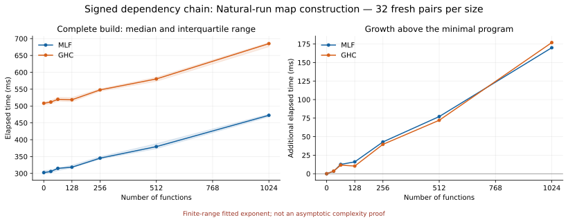

### Separate retained-source memory experiment

Three alternating pairs per size use each producer's own qualified builtin
and exact cohort artifacts. Allocation is cumulative, live heap is an RTS
high-water observation, and RSS is an observed process peak; they are distinct.

| Functions | Lane | Allocated bytes | Maximum live bytes | Peak RSS bytes |
| ---: | --- | ---: | ---: | ---: |
| 0 | before | 269,670,936 | 1,412,848 | 35,471,360 |
| 0 | after | 269,577,184 | 1,418,480 | 35,291,136 |
| 1024 | before | 935,590,928 | 8,672,720 | 68,173,824 |
| 1024 | after | 919,711,840 | 8,670,816 | 65,929,216 |

## Latest retained optimization: parser state worker, 2026-11-17

Evidence is under `.mlf-build/signed-chain-parser-errors-20261117`.
The preceding source-location investigation and the qualified Fresh/ordinary-tail
producer were authenticated before mutation: 227 source pins and 684 preceding
evidence pins. Builds, controls, memory and timings run serially.

### Mechanism and preserved behavior

Tracing actual parser calls at N=0/256/1024 counts 108/6,250/24,682 successes,
504/46,030/182,734 token failures and 20 EOF failures at each size. No traced
failure message is rendered on these successful programs. Diagnostic text is
lazy; eager error-string concatenation is not the measured hotspot.

Optimized host Core/STG instead shows two deferred diagnostic-prefix closures
outside the returned state lambda in the original `pSatisfy`. Extracting the
same case expression into `pSatisfyState predicate expected state` keeps it
in a saturated worker. The generated worker puts those message expressions in
the actual failure alternatives. The measured allocation reduction need not
come exclusively from those two closures: surrounding optimizer decisions can
also change. No new primitive, strictness annotation or inlining pragma is used.

The public parser signature, all six state fields, token predicates, exact
error messages, consumption flags and backtracking behavior are unchanged.
The maintained source is byte-identical to the screened worker candidate.

### Private selection evidence

Frozen prior modules provide 3,270 identifier/backtracking cases, 104 full
module AST/error comparisons, 5,220 complete combinator cases and 13 explicit
demand cases. All pass. The module corpus includes 99 maintained shared
libraries, the candidate Parsec module and four negative syntax inputs.

An initial fixed screen uses one warmup plus six measured alternating pairs
per size: 42 compiles and 126 exact native outputs. Its elapsed results are
mixed, so one predeclared confirmation uses one warmup plus twelve measured
pairs: 78 compiles and 234 exact native outputs. Every compile preserves exact
interface, object and LLVM bytes. These are compiler-plus-Clang subprocess
timings, distinct from the formal whole-worker boundary below.

| Functions | Before, s | Worker, s |
| ---: | ---: | ---: |
| 0 | 0.253916 | 0.253542 |
| 256 | 0.294725 | 0.294422 |
| 1024 | 0.427280 | 0.423889 |

At N=1024, the lane median falls by 3.39 ms. Separate three-pair RTS runs
reduce cumulative allocation from 948,341,512 to 935,696,120 bytes: 12,645,392
bytes, or 1.33%. Maximum live heap is effectively unchanged (8,667,232 to
8,672,752 bytes). This is an allocation improvement, not a comparable peak
memory reduction.

A second candidate also executes `pMany` through a direct recursive worker.
It passes the same frozen controls plus 756 custom-state cases and nine demand
checks. One fixed three-lane screen (63 compiles, 189 native outputs) gives
N=1024 medians of 0.427144 s before, 0.423441 s for `pSatisfy` alone and
0.426798 s with the direct repetition loop. Separate memory runs show another
5,343,640 allocated bytes and 379,784 maximum-live bytes saved, but the loop is
3.36 ms slower than the simpler worker. Reject the `pMany` candidate; it is not
in maintained source. No additional confirmation is run for it.

### Current-source qualification

After retention, regenerate builtin data and its source identity, refresh the
lock and migration identity, and rebuild all 137 shared modules with 18 build
actions. The primitive ABI remains `mlf-primitive-137-v12` and the builtin
interface remains `mlf-primitive/shared-haskell-v1/16`.
The new builtin source identity is `builtin-source-v1:fb5bd8091f9a6d212fff530a67d8195e8dabb5abb379788c5de02e008ed471f0`.

Independent portable controls embed the actual old and new Parsec bodies,
with exact Lexer token declarations, and compare complete results and state
against a closed-case Python oracle. The old reference comes from the frozen
pre-retention snapshot, not the changed source. Interpreter 20, native O0 270
and native O2 270 results pass. Additional unused-argument/error/token/state
demand checks pass 6 interpreter and 16 per native optimization level.
Both sets are also checked using the retained producer.

Early private fixture attempts fail before execution: the initial portable
fixture lacks a declaration delimiter at the append boundary, and the first
two demand fixtures leave a discarded string literal ambiguous. Correcting
the fixture delimiter and explicitly typing that literal resolves them. The
original failed drivers, logs and receipts remain preserved; they are not
compiler optimization regressions or silently relabeled successful runs.

The active direct gate now includes a maintained independent pre-worker
`pSatisfy` reference: 7,560 complete result/error/state cases and 11 demand
checks. The full direct gate passes 19 actions; package/cache and compiler
regression passes 17; query/index/offline controls pass 13; the signed CLI
corpus passes 13 positive native results and five required rejections.
Artifact modular tests pass 46 cases and file-comparison tests pass 78.
Six disk reopens with semantic audit reproduce fused LLVM exactly. Complete
interface/body/type/scope comparisons pass after normalizing checked dependency
identities, and emitted LLVM remains byte-identical across old/new producers.
Forty-two additional native outputs include Int wraparound boundaries.

### Fixed formal GHC cohort

One fresh `crate-fused-v1` whole-worker cohort uses the unchanged sizes
0/32/64/128/256/512/1024, 32 interleaved pairs per size, fresh caches and native
output validation. All 448 compiles and 1,344 native outputs pass. No sample
is removed or pooled with an earlier cohort. Values below are lane medians.

| Functions | MLF, s | GHC, s |
| ---: | ---: | ---: |
| 0 | 0.299533 | 0.502971 |
| 32 | 0.306156 | 0.510232 |
| 64 | 0.314462 | 0.505217 |
| 128 | 0.318456 | 0.515241 |
| 256 | 0.343530 | 0.544522 |
| 512 | 0.377802 | 0.575867 |
| 1024 | 0.477592 | 0.681364 |

| Metric | MLF | GHC |
| --- | ---: | ---: |
| OLS slope, ms/function | 0.170236 | 0.173739 |
| Endpoint slope, ms/function | 0.173886 | 0.174212 |
| Offset-power exponent | 1.125680 | 1.208714 |

The paired 95% bootstrap interval for MLF-minus-GHC OLS slope is
[-0.011384498, 0.002075467] ms/function; the exponent-difference interval is
[-0.209888, 0.014792]. Both fits include a startup offset. Checks:
`all_positive_medians_lower=true, lower_ols_point=true, lower_endpoint_point=true, lower_power_point=true, lower_ols_95=false, lower_power_95=false`.

The elapsed advantage is 203.44 ms at N=0 and 203.77 ms at N=1024.
After subtracting each lane's N=0 median, MLF growth is still higher at
N=64/128/256/512, and only 0.334 ms lower at N=1024. Most of the observed
elapsed advantage remains a fixed-cost difference; these data do not establish
stable dominance of the growth curve.

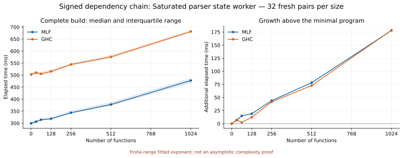

The shape remains open because at least one predeclared check fails. Retain the independently justified parser allocation improvement, but do not advance to another shape or make an acceptance commit. Do not rerun an unchanged-source cohort to seek a passing result.

### Retained producer memory

Separate memory runs use each producer's own qualified builtin and cohort
artifacts, three alternating pairs at N=0/1024, with `-s -F4`. Every run
preserves its own exact interface/object/LLVM bytes. Values are medians;
cumulative allocation, maximum live heap and peak child RSS are distinct.

| Functions | Cumulative allocation, bytes | Maximum live heap, bytes | Peak child RSS, bytes |
| ---: | ---: | ---: | ---: |
| 0 | 269,709,960 → 269,667,664 | 1,404,216 → 1,414,384 | 35,454,976 → 35,471,360 |
| 1024 | 948,337,632 → 935,588,328 | 8,667,232 → 8,672,720 | 66,125,824 → 68,173,824 |

At N=1024 the retained producer allocates 12,749,304 fewer bytes (1.34%).
Maximum live heap rises by 5,488 bytes and peak child RSS by 2,048,000 bytes
(3.10%) in these runs. There is no measured peak-memory saving. The isolated
private experiment above distinguishes the parser change from the regenerated
builtin and updated cache identities in this retained-producer comparison.

Native compiler self-bootstrap, installed CLI and the prior native codec and
QuerySnapshotProbe qualification gaps remain outside these completed checks.
Finite-range timings and fitted exponents are not a proof of asymptotic Big-O.

Qualification SHA-256: `4c6cc5eda73f1e55b60eba0ddd5c409e982542284e8d08a7eb2985a67c513b0a`.

## Latest investigation: source-location pooling, 2026-11-17

Evidence is under `.mlf-build/signed-chain-source-locations-20261117`.
This investigation retains **no new compiler change**. The private candidate
reduces the original Prepared query-input text but increases allocation and
elapsed growth. The Fresh/ordinary-tail producer and its fixed formal GHC
cohort remain authoritative. Authentication checks all 227 preceding source
pins and the 527 qualification evidence pins; experiments run serially.

### Lossless candidate and controls

The candidate places each exact package/module/file triple in a table local
to one Prepared input. Every call label and all four coordinates stay in the
syntax, with an explicit table index. No hash substitutes for exact equality.
The original SourceKey grammar is factored with a span renderer, while its
ordinary rendering remains unchanged. Prepared v2 is selected only if it is
shorter and the complete old input satisfies the unchanged conservative codec
envelope. Other inputs retain exact v1 encoding and validation. Lowered-syntax
memoization is unchanged; there is no shared mutable table or global cache.

An independent scalar-framing decoder restores the complete original v1
Prepared value and compares it with frozen pre-candidate modules. The controls
cover syntax variants, IEEE bits, scope/annotation fields, Unicode and NUL,
each provenance coordinate and carrier independently, call labels, hash
separation, 126 complete resource-envelope cases and large/deep fallbacks.
All 54 existing query checks, 9,904 syntax checks and 508 new checks pass.

The original driver ends with a mistaken stdout assertion: it expects
`Query encoding checks: 54`, while the existing corpus prints
`Query encoding audit: 54 checks passed`. Both build and executable commands
had already exited zero. The failed driver/receipt are preserved unchanged;
`location-controls/qualification.json` authenticates their inputs and exact
outputs in a bounded continuation. No test command is rerun or silently relabeled.

### Actual text size, allocation and elapsed time

Three trace-only compiles record the selected text, with exact interface,
object and LLVM equality. Tracing forces both encodings and is not timed as
an optimization result.

| Functions | Original text bytes | Selected text bytes | v2 groups / all groups |
| ---: | ---: | ---: | ---: |
| 0 | 2,157 | 1,362 | 1 / 3 |
| 256 | 257,825 | 173,267 | 258 / 259 |
| 1024 | 1,036,169 | 695,391 | 1026 / 1027 |

The large input text shrinks by 340,778 bytes, or 32.89%. This is ephemeral
original-syntax input to query hashing. It does **not** make `.mlfci`, `.mlfco`
or LLVM smaller; those outputs remain byte-identical.

One fixed screen uses a warmup plus six measured alternating pairs at each
size, fresh caches, compiler-plus-Clang subprocess time and three native
results per compile. All 42 compiles and 126 native outputs pass. No sample
is removed, pooled with earlier screens or used as a formal GHC result.

| Functions | Before, s | Pooling, s |
| ---: | ---: | ---: |
| 0 | 0.254251 | 0.251819 |
| 256 | 0.294542 | 0.297354 |
| 1024 | 0.428185 | 0.449916 |

The large-case lane median increases by 21.73 ms; the paired median increases
by 19.88 ms, with all six pairs slower (+8.46 to +39.52 ms). Compiler-only
medians increase from 0.302937 to 0.322532 s. Endpoint growth rises from
0.169858 to 0.193454 ms/function. No confirmation run is justified.

Separate memory runs use three alternating pairs at N=0/1024 with `-s -F4`.
All twelve compiles preserve exact artifact/LLVM bytes. Values are medians.

| Functions | Cumulative allocation, bytes | Maximum live heap, bytes | Peak child RSS, bytes |
| ---: | ---: | ---: | ---: |
| 0 | 269,716,768 → 269,896,656 | 1,445,992 → 1,526,744 | 34,078,720 → 34,144,256 |
| 1024 | 948,344,744 → 1,032,259,000 | 8,667,248 → 8,667,264 | 64,782,336 → 64,733,184 |

Cumulative allocation increases by 83,914,256 bytes (8.85%) at N=1024.
The sampled maximum live heap is effectively unchanged; the small RSS
difference does not compensate for extra allocation and worse elapsed growth.
Reject this implementation. The experiment does not isolate how much cost
belongs to table construction, tree materialization or each extra traversal.

### Next allocation target

A new analysis of the six existing authenticated profiles reconciles all
own allocation/tick totals; it runs no new compiler timing. `Parsec.pSatisfy`
owns 34.228 MB of N=1024-minus-N=0 allocation and 4.05 ms of sampled CPU growth.
Investigate how much comes from failed alternatives and diagnostic construction
before designing a change. Error text is lazy, so eager message rendering must
not be presumed. Preserve full parser values, states, exact errors, consumption
and backtracking. This is a separate hypothesis from the earlier rejected
identifier/`pMap`/`pBySyntax` dispatch prototype.

The signed shape remains open: the retained formal cohort's paired OLS interval
still crosses zero. No unchanged-source GHC cohort is rerun, no next shape is
entered, and no acceptance commit/push occurs. Rejected pooling has no full
retained-source cache-invalidation or interpreter/native compiler qualification.
Native self-bootstrap, installed CLI and prior codec/QuerySnapshotProbe gaps
remain unqualified. Finite-range fits do not prove asymptotic complexity.

Investigation SHA-256: `4c928bc4e7c3e0bccc9fbbaa7f61f387b2119cef58411e2410bc2a38ba4a3ffd`.

## Latest investigation: index layout and prepared input, 2026-11-17

Evidence is under `.mlf-build/signed-chain-query-growth-20261117`.
This investigation retains **no new compiler change**. The Fresh/ordinary-tail
producer and its fixed GHC cohort below remain authoritative. Authentication
verified 226 unchanged maintained source pins and 527 preceding qualification
evidence pins. Builds, controls, profiles, memory and timing ran serially.

Six fresh cost-centre runs, two at each N=0/256/1024, preserve exact interface,
object and LLVM bytes, with query phase timers disabled. Own costs reconcile
to each profile total. Package assembly owns 15.45 ms / 75.23 MB of the
N=1024-minus-N=0 growth, and query encoding 11.45 ms / 57.66 MB. Prepared value
construction and syntax encoding own another 22.42 MB and 22.02 MB. These are
instrumented diagnostic costs, not uninstrumented acceptance timings.

### Rejected arity/tag-major shallow index

A private codec prototype moves the existing two arity bits and constructor tag
above the child-ID fields. The eligibility limits and disjoint bit ranges stay
identical; all keys fit in a nonnegative 63-bit integer. Canonical node order,
full-key equality, fallback indexing, resource admission and wire bytes remain.
The hypothesis is that repeated constructors share more Patricia prefixes.

An independent replay of the actual package and stored query nodes supports
that structural hypothesis. At N=1024, short-key lookup visits fall from
443,219 to 322,129, and rebuilt branch counts from 140,187 to 107,581. Hit/miss
counts are identical. These counts do not predict whole-compiler speed.

Controls pass 5,364 complete frozen plan cases, 16,092 root-budget cases,
166 main generic and 166 production-root exact wires, seven demand cases,
ten error-priority cases, twelve depth/frame groups and eight additional
nullary groups. Independent integer arithmetic checks 16,126 key cases,
1,024 distinct admitted sampled keys and four demand boundaries.

The initial screen has one warmup plus six measured alternating pairs per
size. Its mixed result triggered the single predeclared confirmation: one
warmup plus twelve measured alternating pairs. Both use fresh directories,
compiler-plus-Clang subprocess time, exact interface/object/LLVM comparison
and three native results per compile. All 120 compiles and 360 native outputs
pass. No sample is deleted and the two screens are not pooled.

| Screen | Functions | Before, s | Prototype, s |
| --- | ---: | ---: | ---: |
| Initial | 0 | 0.254296 | 0.251359 |
| Initial | 256 | 0.292943 | 0.296728 |
| Initial | 1024 | 0.431524 | 0.426602 |
| Fixed confirmation | 0 | 0.250640 | 0.252351 |
| Fixed confirmation | 256 | 0.296902 | 0.295283 |
| Fixed confirmation | 1024 | 0.426639 | 0.432252 |

The confirmation's large-case median rises by 5.61 ms; its median paired
difference is +4.03 ms (individual pairs -6.56 to +13.84 ms). Compiler-only
medians also rise, 0.300475 to 0.306176 s. The endpoint slope rises. This does
not establish a growth benefit and is not followed by another confirmation.

Separate memory measurements use three alternating pairs at N=0/1024 and
`-s -F4`. All twelve compiles preserve exact artifacts and LLVM.

| Functions | Cumulative allocation, bytes | Maximum live heap, bytes | Peak child RSS, bytes |
| ---: | ---: | ---: | ---: |
| 0 | 269,709,960 → 269,582,416 | 1,404,216 → 1,445,688 | 34,062,336 → 34,062,336 |
| 1024 | 948,337,632 → 947,408,224 | 8,667,232 → 8,667,232 | 64,782,336 → 64,782,336 |

The large-case allocation saving is 929,408 bytes (0.098%), with unchanged
sampled live heap and RSS. That small saving does not justify the observed
timing direction. Reject the prototype; the maintained index is unchanged.
There is no new primitive, ABI, schema, builtin or lock change.

### Next measured target: repeated source-location content

Three diagnostic compiles trace the current original/lowered Prepared text at
N=0/256/1024, again preserving exact artifacts and LLVM. The trace contains
3/259/1027 complete pairs. Source provenance is present in original syntax;
it must not be dropped merely because the lowered syntax can be reused.

| Functions | Original text bytes | Lowered text bytes | Call sites | Package/module/file carrier bytes | Carrier bytes repeated within groups |
| ---: | ---: | ---: | ---: | ---: | ---: |
| 0 | 2,157 | 663 | 7 | 1,225 | 875 |
| 256 | 257,825 | 81,046 | 775 | 151,125 | 100,815 |
| 1024 | 1,036,169 | 322,198 | 3,079 | 606,563 | 404,441 |

Carrier counts include the exact framing of package/module/file fields and
exclude coordinates and the surrounding span wrapper. Repeated bytes are a
content census, not a predicted artifact-size or timing saving: a replacement
would need its own reference/table framing and validation. Investigate bounded
sharing or pooling while preserving every source label, coordinate, identity
and cache-invalidation dependency. No such optimization is implemented here.

The signed shape remains open because the retained formal cohort's paired
slope interval still crosses zero. No unchanged-source GHC cohort was rerun,
no next shape was entered, and there is no acceptance commit/push. Native
compiler self-bootstrap, installed CLI and prior native O0 codec/QuerySnapshotProbe
qualification gaps remain separate. Finite-range exponents are not Big-O proofs.

Investigation SHA-256: `0ba433006ad41b424ac7b7f3f56d8ffde4ea0373d44b32f83551d90e515290a3`.

## Latest retained changes: reservation and tail returns, 2026-11-17

Evidence is under `.mlf-build/signed-chain-fresh-reservation-20261117`.
Before mutation, the qualified producer, 222 maintained source pins and 2,871
preceding evidence pins were authenticated. Builds, controls, timing and memory
measurements were serialized. Independent oracles were not regenerated.

### Changes and the failure that blocked them

`Fresh.runFresh` now retains the existing exact String set when a reserved
name is already present. New keys rebuild only their balanced insertion path.
The ascending-prefix builder remains linear, including adjacent duplicates.
Unicode comparison, generated names, counter bounds and demand order remain.
This is immutable tree reuse; it introduces no global cache or hash identity.

The earlier large native O0 Fresh failure was minimized through set size,
repeated-list length and finally a strict integer accumulator loop. It was
an ordinary-worker codegen defect: the recursive call returned through a
join, retaining native stack frames. A named LLVM replay shows repeated
`mlf.worker` frames and a stack write fault. An IR-only change to direct
branch returns plus `musttail` passes five exact O0 cases through 262,144
iterations, with unchanged arithmetic, arguments and ABI.

`LLVM.Codegen.worker` now uses branch-local returns for ordinary tail
positions. Only matching all-pointer arities use `musttail`; other ABIs keep
ordinary calls. The existing operand-demand schedule, outlining limits and
numeric/producer/result specialization choices remain. `test_ordinary_tail.py`
preserves the deep-recursion, closure, lazy-default and GC regressions.

The primitive ABI remains `mlf-primitive-137-v12`, builtin interface
`mlf-primitive/shared-haskell-v1/16`. Binary schemas, serialization and runtime
layout are unchanged. Builtin source identity and the lock were refreshed.
These changes do not introduce a smaller wire encoding.

### One fixed GHC comparison

The predeclared `crate-fused-v1` cohort contains 32 fresh alternating pairs
per size: 448 successful compiles and 1,344 checked native outputs. Every
sample remains in the cohort. Fit bounds, bootstrap seed and 2,000 draws are
unchanged; no prior cohort or private screen is pooled into this result.

| Functions | MLF median, s | GHC median, s |
| ---: | ---: | ---: |
| 0 | 0.302460 | 0.505168 |
| 32 | 0.306113 | 0.508479 |
| 64 | 0.312918 | 0.506920 |
| 128 | 0.321322 | 0.516877 |
| 256 | 0.343468 | 0.545497 |
| 512 | 0.386986 | 0.581582 |
| 1024 | 0.479395 | 0.682901 |

| Metric | MLF | GHC |
| --- | ---: | ---: |
| OLS slope, ms/function | 0.173223676 | 0.175639931 |
| Endpoint slope, ms/function | 0.172788391 | 0.173567790 |
| Offset-power exponent | 1.060529999 | 1.156197520 |

Paired differences are MLF minus GHC; slope differences use ms/function.

```json
{
  "paired_bootstrap": {
    "iterations": 2000,
    "seed": 20261115,
    "ols_delta_ms_95": [
      -0.00796479580347357,
      0.0037870546659618458
    ],
    "p_delta_95": [
      -0.19268962665982453,
      -0.03469828874434828
    ]
  },
  "checks": {
    "all_positive_medians_lower": true,
    "lower_ols_point": true,
    "lower_endpoint_point": true,
    "lower_power_point": true,
    "lower_ols_95": false,
    "lower_power_95": true
  },
  "growth_fit_qualified": true
}
```

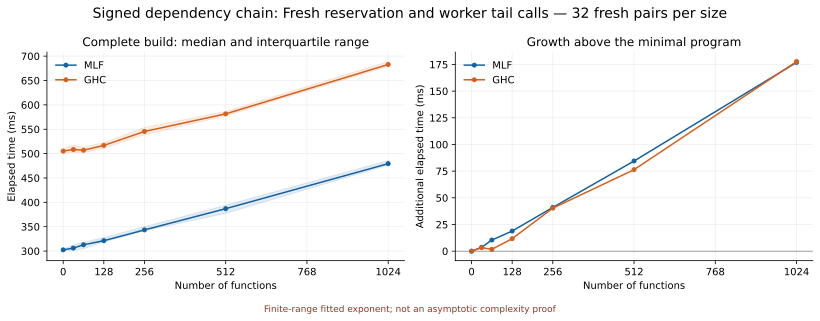

The shape remains open. Failed criteria: lower_ols_95.
No next shape or completion commit is claimed. The coefficients and
exponents describe this size range and include startup, IO, code generation
and linking; they are not a proof of a lower complexity class.

The baseline-subtracted MLF growth is above GHC at N=32 through 512,
and only slightly below at N=1024. The absolute elapsed advantage is
about 0.203 s at both N=0 and N=1024. In this cohort, that supports a
mostly fixed-overhead advantage, not a demonstrated lower marginal
compilation cost. The next investigation should target growth owners
rather than interpreting the lower exponent alone as completion.

### Separate memory evidence and retention decision

A separate three-pair before/after measurement at N=0/1024 uses `-s -F4`.
Each immutable producer uses its own qualified builtin and reproduces its own
formal interface, object and LLVM bytes. These runs do not enter elapsed-time
or growth fits.

| Functions | Cumulative allocation, bytes | Maximum live heap, bytes | Peak child RSS, bytes |
| ---: | ---: | ---: | ---: |
| 0 | 269,806,208 → 269,712,456 | 1,424,504 → 1,444,504 | 35,307,520 → 35,438,592 |
| 1024 | 954,221,424 → 948,339,320 | 8,666,744 → 8,667,232 | 65,912,832 → 66,142,208 |

The combined N=1024 allocation change is -5,882,104 bytes (-0.616%).
Allocation volume, maximum live heap and process RSS are different metrics.
Matching-ABI tail transfers remove repeated machine frames; a lazy heap
accumulator can still grow and require deep evaluation later.

The previously declared Fresh-only confirmation was executed once after
native correctness was established: one warmup plus 12 alternating pairs at
N=0/256/1024, 78 compiles and 234 native outputs. Interface/object/LLVM bytes
match the old producer exactly in this isolated screen. At N=1024, per-lane
medians are 0.444365 s before and 0.442916 s after; the median paired delta is
+0.923 ms, with individual deltas from -14.05 to +10.86 ms. N=256 includes
a +372.53 ms paired outlier, retained in full. No timing speedup is claimed
from this noisy screen. Retention is based on the independently observed
6,067,400-byte Fresh-only allocation saving and no material observed timing
regression, plus the separate O0 correctness repair.

### Validation and explicit limits

The new producer completes 18 build actions with 137 resolved shared modules.
Actual maintained Fresh objects pass 108 set invariants, 432 complete frozen
and independent state comparisons, six demand controls and six counter-bound
controls. Maintained-source portable checks pass 30 interpreter, 110 native
O0 and 110 native O2 results, including the previously failing 65,536-item
inputs. The ordinary-tail gate passes 60 exact native results and two GC
controls; both GC controls disable interior-pointer recognition and observe
actual collections.

The exact private codegen candidate also passes 79 interpreter and 158 native
demand/order controls. Its minimum matrix passes 78 of 80 cases; the two
remaining cases are the unforced accumulator at 262,144 iterations. Both old
and new compilers fail that deeper case at O0 and O2. Its IR retains a lazy
accumulator chain; this patch does not claim to repair general thunk forcing.
The earlier strict counter and all original Fresh failures are repaired.

Current maintained validation also completes the direct gate (18 actions),
package/cache/compiler regression (17 actions), query-host controls (13),
18 signed CLI cases, 46 artifact Python tests and 78 open-file Python tests.
Independent before/after artifact inspection compares complete normalized
types, identities, bodies and scopes for N=0/256/1024. Six actual readers
reopen and audit their own artifacts with exact disk/fused LLVM equality;
42 additional native results cover negative and Int64 boundary inputs.
Cross-version LLVM byte equality is deliberately not required after changing
tail-return control flow.

The original diagnostic GC wrapper produced the correct result and observed
nine collections, but its stderr statistics were rejected by the test harness.
The corrected wrapper reports statistics on stdout and uses the supported
16 MiB initial heap with divisor 64. Original logs and the continuation remain;
no failed case is silently deleted. A wrong Python discovery filename was
caught by the zero-test guard before formal timing; the corrected entry ran
the full 46 cases. An initial ambiguous-string minimum was
also retained and corrected with an explicit local String-list signature.

Full native compiler self-bootstrap, installed CLI, the older native O0
planner/long-symbol codec controls and QuerySnapshotProbe remain unqualified.
This finite gate does not replace those broader checks.

## Previous investigation: allocation and encoding growth, 2026-11-17

Evidence is under `.mlf-build/signed-chain-encode-growth-20261117`.
This bounded investigation retains **no new compiler change**. The adaptive
name-reservation candidate is deferred; the other private prototypes are
rejected. The current qualified byte-length producer and its GHC cohort below
remain authoritative. No unchanged-source formal cohort was repeated, no
cohorts were combined, and no next shape or completion commit is claimed.

Before experimentation, authentication verified the qualified producer, 222
maintained source pins and 143 preceding qualification pins. All builds,
controls, profiling, ordinary timing and RTS memory runs were serialized.
The only maintained change in this investigation is this report.

### Profile and growth evidence

Six current-source cost-centre runs, two each at N=0/256/1024, reproduce the
qualified interface, object and LLVM bytes. Own ticks and allocations reconcile
to each profile total. N=1024-minus-N=0 business owners include package assembly
(20.90 ms / 75.23 MB), query encoding (15.50 ms / 57.68 MB), prepared values
(7.05 ms / 22.42 MB), prepared syntax (5.75 ms / 21.89 MB), and rebuilt-value
hashing (4.10 ms / 12.84 MB). These sampled CPU figures are diagnostics, not
ordinary elapsed time.

Across N=0→256 and N=256→1024, package assembly allocates about 68.96 and
74.97 KB per additional function respectively; query encoding allocates
53.69 and 57.21 KB. A separate independent DAG occurrence census reconciles
expanded node/text work to the encoded header. It finds 4,112 occurrences
of package nullary tag 1 and 2,055 of query nullary tag 436 at N=1024.
This identifies repeated work without treating a hash as structural equality.

### Four separate private screens

Each screen has one warmup plus six alternating measured pairs at N=0/256/1024,
42 compiles and 126 checked native outputs. All interface/object/LLVM bytes
remain identical. Three separate RTS pairs per lane at N=0/1024 add 12 memory
compiles per candidate, with F4 unchanged. Total: 168 screen compiles, 504
native outputs and 48 memory compiles. The timing boundary sums compiler and
Clang subprocess time; it excludes formal worker-launch overhead.

| Candidate | N=0 before → after, s | N=256 | N=1024 | N=1024 fewer allocated bytes |
| --- | ---: | ---: | ---: | ---: |
| Separate nullary tag index | 0.288828 → 0.280468 | 0.333383 → 0.329901 | 0.483619 → 0.487308 | 46,784 |
| Immutable string SHA-256 | 0.279120 → 0.277036 | 0.334719 → 0.336889 | 0.495309 → 0.499592 | 3,657,864 |
| Duplicate reservation, first version | 0.252240 → 0.248953 | 0.304728 → 0.294517 | 0.436353 → 0.433672 | 6,514,360 |
| Duplicate reservation, adaptive version | 0.272751 → 0.279827 | 0.324580 → 0.323765 | 0.470231 → 0.470874 | 6,067,400 |

The nullary index partitions exact zero-child constructor tags away from
mixed short keys. Complete frozen planner controls pass: 5,364 plans, 16,092
root-budget cases, 166 generic plus 166 production-root exact wires, seven
demand orders, ten targeted priorities, twelve depth/frame groups and eight
additional nullary-tag boundary groups. Its allocation reduction is negligible
and the large-case/endpoint-growth screen is worse, so it is rejected.

The immutable string hash borrows a live immutable UTF-8 ByteString for the
existing safe SHA-256 kernel, avoiding a mutable array and its snapshot.
Framing, budgets, fallbacks and output allocation remain. The private host
control passes 160 independent Python-hashlib vectors, mutable-array
independence, three IO-demand checks and 32 concurrent-GC hashes. It saves
3,657,864 allocated bytes at N=1024, with essentially unchanged live heap,
but the large-case and endpoint-growth screen are worse. It is rejected;
no public primitive or portable ABI change is introduced.

### Deferred adaptive reservation candidate

`Fresh.runFresh` currently constructs a set of reserved names. Repeated
names can rebuild immutable search paths even though the reserved set does
not change. The private candidate uses exact String comparisons and returns
the existing tree for duplicates. New names still rebuild and balance their
insertion path; counter and name-collision rules remain unchanged.

The first version passed 60 set invariants, 240 complete frozen/independent
fresh-state comparisons, six demand checks and six counter boundaries, but
code review found it had lost the existing linear ascending-prefix builder.
It is rejected despite its finite control results. The adaptive second
version restores that path; its expanded controls pass 108 set invariants,
432 complete fresh-state comparisons and the same demand/counter checks.

At N=1024 the adaptive version allocates 954,226,872 → 948,159,472 bytes,
a reduction of 6,067,400 bytes (about 0.64%). Maximum live heap is
8,666,760 → 8,667,240 bytes and peak RSS 64,946,176 → 64,897,024 bytes,
so neither establishes a meaningful peak-memory improvement. At N=0,
allocation is 269,810,512 → 269,724,544 bytes. Its six-pair large-case time
differences range from -31.82 to +40.59 ms; a sub-millisecond difference of
medians does not establish a speedup. One fixed twelve-pair confirmation was
prepared, but **not run** after the portable qualification gap below.

Exact candidate and frozen Fresh bodies were also compiled as separate
modules. Every successful case is checked against an independent Python
name/counter/full-sorted-set oracle, including ascending, descending,
duplicate-heavy and mixed-name inputs.

| Backend | Candidate passed / failed | Frozen passed / failed |
| --- | ---: | ---: |
| Interpreter | 15 / 0 | 15 / 0 |
| Native O0 | 50 / 5 | 49 / 6 |
| Native O2 | 55 / 0 | 55 / 0 |

The frozen O0 implementation first exits with signal 11 at 4,096 distinct
names repeated four times; the candidate passes that exact case. At 65,536
names, all five O0 input styles fail for both versions. The original stopped
receipt and a continuation covering every remaining predeclared case are
preserved; no failed point is replaced. O2 passes every size/style through
65,536 for both versions. Matrix completion is not full qualification.

One bounded LLDB replay of a failed candidate stops with `EXC_BAD_ACCESS`
in `GC_clear_stack_inner`/`GC_clear_stack`, reached from `text_chars_step`,
with repeated generated frames below. This location does not identify the
root cause or establish a collector defect. LLDB's own zero exit status is
not a successful program result. Large native O0 behavior remains unresolved,
so adaptive reservation stays outside maintained compiler sources.

### Evidence integrity and remaining work

The first immutable-hash host fixture had a generated Haskell indentation
error and failed before any timing. Its source, receipt and stderr remain;
the corrected fixture passes. A copied evaluation driver also overwrote a
prior diagnostic log. The new failed log was preserved separately, and the
old log was recovered from its retained command stdout with the exact original
SHA-256. `diagnostic-log-recovery.json` records both hashes and the recovery.

The current formal signed-chain result still has lower elapsed medians and
OLS/endpoint slopes than GHC, but fails the fitted-exponent point and interval
criteria. Finite-window exponents are not asymptotic complexity proofs.
The next step is to isolate the large native O0 failures before retaining
adaptive reservation, or pursue another measured growth hotspot. Native
compiler self-bootstrap, installed CLI and the previously documented native
codec/QuerySnapshotProbe gaps remain unqualified. No resource limit was raised.

Investigation receipt: `investigation.json`, SHA-256 `2f8228963bccbc4786a69140fe334000a2c8a0663a880d8c65438cadd5621f7c`.
The final audit separately pins this report and its preserved history.

---

## Earlier retained change: cached UTF-8 lengths, 2026-11-17

Evidence is under `.mlf-build/signed-chain-plan-frames-20261117`.
Before mutation, authentication verified the prior qualified producer, 204
maintained source pins, 84 qualification pins and 675 preceding investigation
pins. Builds, controls, memory and time measurements were serial.

### Implementation and compatibility

`Bitstream.utf8Size` keeps its scalar-length precheck and then obtains the
cached UTF-8 byte count instead of rescanning each scalar. The separate
`utf8SizeAt` helper is unchanged. The GHC host reads its validated private
text metadata. Native strings establish Unicode validation/indexes lazily;
a standalone first call can scan, while the codec precheck has already
established that cache. String layout and GC ownership do not change.

`PStringUtf8Length` is opcode 136; codes 0–135 retain their meaning.
The primitive ABI is `mlf-primitive-137-v12`, builtin interface
`mlf-primitive/shared-haskell-v1/16`. Builtins and the lock were regenerated;
existing caches follow identity invalidation. Binary schemas and bitstream
encoding are unchanged. This change does not introduce a smaller encoding.

### One fixed GHC comparison

The predeclared `crate-fused-v1` cohort has 32 alternating fresh pairs at
each original size: 448 successful compiles and 1,344 checked native outputs.
No points are dropped or replaced, no cohorts are pooled, and the original
fit bounds and paired-bootstrap seed/draw count remain.

| Functions | MLF median, s | GHC median, s |
| ---: | ---: | ---: |
| 0 | 0.320056 | 0.532273 |
| 32 | 0.323653 | 0.535773 |
| 64 | 0.336336 | 0.544873 |
| 128 | 0.342230 | 0.548497 |
| 256 | 0.376035 | 0.614977 |
| 512 | 0.442101 | 0.684689 |
| 1024 | 0.515720 | 0.752484 |

| Metric | MLF | GHC |
| --- | ---: | ---: |
| OLS slope, ms/function | 0.197564545 | 0.229156075 |
| Endpoint slope, ms/function | 0.191078470 | 0.215049336 |
| Offset-power exponent | 0.834632765 | 0.748715347 |

Paired-bootstrap differences and all individual acceptance checks are
preserved below (MLF minus GHC; OLS in ms/function):

```json
{
  "paired_bootstrap": {
    "iterations": 2000,
    "seed": 20261115,
    "ols_delta_ms_95": [
      -0.04194868352913535,
      -0.022807677574796473
    ],
    "p_delta_95": [
      -0.006949974124440727,
      0.16140279778864047
    ]
  },
  "checks": {
    "all_positive_medians_lower": true,
    "lower_ols_point": true,
    "lower_endpoint_point": true,
    "lower_power_point": false,
    "lower_ols_95": true,
    "lower_power_95": false
  }
}
```

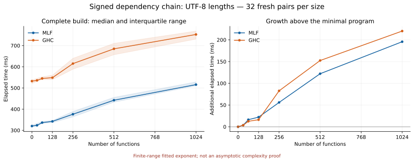

No power fit reaches its bound: true.
The shape remains open. All elapsed medians and both slope point
estimates pass; the paired OLS interval also stays below zero.
The exponent point estimate and its paired interval do not pass.
Every declared criterion must pass in the same cohort; an earlier
cohort's exponent result cannot be combined with this cohort's slopes.
No next shape or completion commit is claimed for this result.

Both fitted exponents are below one. They describe this measured
window, not sublinear source-reading complexity. The fitted exponent
also changes substantially when the smallest sizes are excluded;
the complete range-sensitivity results remain in `candidate-analysis.json`.

### Separate diagnostic alternatives and memory

Before integration, each private prototype had one warmup and six measured
alternating pairs at N=0/256/1024: 42 compiles and 126 checked outputs.
Every interface, object and LLVM byte matched its baseline. These screens
sum compiler and linker subprocess time and exclude the formal worker
launch overhead; they are not pooled into the GHC cohort.

| Prototype | N=0 before → after, s | N=256 | N=1024 |
| --- | ---: | ---: | ---: |
| Constructor frames | 0.269747 → 0.270232 | 0.318780 → 0.316956 | 0.471058 → 0.473465 |
| Cached byte length | 0.273034 → 0.276262 | 0.319473 → 0.324848 | 0.443173 → 0.436689 |

The frame prototype traverses sibling lists directly and keeps one frame
per open constructor. It saves 13,101,408 allocated bytes at N=1024
(about 1.37%) but does not improve the large-case median or endpoint
growth. It is rejected and absent from maintained sources. The byte-length
screen improves the large-case median by about 6.49 ms, with slower small
and middle medians. That mixed diagnostic result justified full qualification;
it does not establish an improvement at every size.

The retained before/after memory cohort uses three separate alternating
pairs at N=0/1024 with `-s -F4`. Each producer uses its own authenticated
builtin and exactly reproduces its own formal interface/object/LLVM bytes.

| Size | Cumulative allocation, bytes | Maximum live heap, bytes | Peak child RSS, bytes |
| ---: | ---: | ---: | ---: |
| 0 | 269,598,712 → 269,800,416 | 1,436,840 → 1,427,576 | 35,340,288 → 35,307,520 |
| 1024 | 954,118,320 → 954,215,544 | 8,665,488 → 8,666,728 | 66,142,208 → 66,191,360 |

These are separate memory metrics. Cached byte length is a traversal
optimization, not an established allocation reduction.

### Validation and preserved failures

The fresh producer completes 18 build actions and resolves 137 modules.
The maintained direct gate passes all 18 actions, including Unicode length
checks in the host, interpreter and generated native O0/O2 paths; direct
native probes cover demand, invalid Unicode/type, overflow, ABI dispatch
and collection with ordinary and disabled interior-pointer recognition.
Separate maintained field-framing and concatenation controls pass.

Actual maintained codec objects pass 5,364 frozen plan cases, 16,092
root-budget cases, 166 generic plus 166 production-root exact wires,
seven demand orders, ten error priorities and twelve frame/depth groups
(including depth 65,535). Independent Unicode controls cover 783
length/slice/concat cases, six demand cases and twelve invalid scalars.
The original frame fixture had an incorrect work-versus-list-count error
priority; the original Unicode fixture had an incorrect comparison-operand
demand expectation. Corrected fixtures pass both frozen and candidate code.
Those failures remain preserved; production candidates were not changed
to satisfy the incorrect expectations.

The older artifact fixture rejected new opcode 136 as unknown. The
independent contract and fixtures were manually extended by one explicit
opcode, with 137 now rejected; all previous schemas and entries remain.
Actual emitted constructor bytes match the independent canonical encoder,
including all 137 primitive roots.
The first concat command used an unsupported argument and exited before
testing. Its corrected invocation passes; completed earlier gates are
authenticated and reused. The native concat fixture then exposed another
old 0–135 inventory assertion; extending it to 0–136 makes the affected
finite control pass with unchanged compiler/runtime code. Original failed
receipts are kept.

Additional completed checks include 17 regression actions, 13 query/host
actions, 18 signed CLI cases, 46 artifact Python tests and 78 open-file
Python tests. Six before/after independent pair and actual-reader audits
cover N=0/256/1024, including exact disk/fused equality within each lane.
Across lanes, dependency hashes and already-verified stamps are normalized;
LLVM differs only by one unused declaration for the appended helper.

Native compiler self-bootstrap, installed CLI, the previously identified
planner/long-symbol O0 codec controls and QuerySnapshotProbe gaps remain.
No qualification of those paths is implied. Larger chains still encounter
the unchanged query-depth bound and are not fitted as successful samples.

The next investigation remains on this signed shape: profile the retained
byte-length implementation at N=0/256/1024 and identify remaining costs
that grow with input. Do not repeat an unchanged-source formal cohort
to seek a passing exponent or combine separate cohorts' favorable metrics.

---

## Previous investigation: field streams and snapshot scratch, 2026-11-17

Evidence is under `.mlf-build/signed-chain-package-plan-20261117`.
Authentication verified the preceding retained producer, 204 maintained source
pins and 84 qualification evidence pins before this investigation. All maintained
compiler sources remain identical to that qualified snapshot. Both prototypes
below are rejected; only this report is updated. Builds, controls, profiles,
memory measurements and elapsed-time cohorts were serial.

### Current profiles and hypotheses

Six current-source cost-centre runs, two each at N=0/256/1024, preserve every
interface, object and LLVM byte. Query phase timers are disabled and F4 stays
fixed. Own ticks and allocation reconcile to the profile totals. The diagnostic
N=1024-minus-N=0 owner deltas are 21.50 ms/75.16 MB for package creation and
16.20 ms/57.62 MB for query-index encoding. Package/query packed-field and
packed-byte loops remain visible. Per-group rebuilt-input hashing also spends
sampled time in the temporary-buffer allocation/exception brackets.
These instrumented times are not acceptance measurements.

The **whole field stream** prototype represents planned fields as a lazy stream
of width/value pairs and writes a lane in one GHC-host IO loop. It preserves
planning, all budgets, layout, symbol output, CRC and every wire byte. This is
larger batching than the previously rejected per-field C writer and word buffer.
It is a private diagnostic module, never a portable primitive or maintained ABI.

The **bounded snapshot scratch** prototype uses scoped allocation for snapshots
up to 4,096 bytes and for the fixed 65-byte digest output. Larger snapshots keep
malloc/free. It preserves a distinct copy of mutable input, safe foreign calls
and callback ownership. It does not borrow a concurrently mutable array for SHA.

### Separate fixed screens and memory measurements

Each predeclared elapsed screen has one warmup and six measured alternating
pairs at N=0/256/1024: 42 compiles and 126 correct native outputs. Every interface,
object and LLVM byte equals the qualified baseline. The two screens are separate
cohorts; each sums compiler and Clang subprocesses, excluding formal-worker
launch overhead. No screen is pooled into the GHC comparison.

| Prototype | N=0 before → after (s) | N=256 | N=1024 |
| --- | ---: | ---: | ---: |
| Whole field stream | 0.262490 → 0.257404 | 0.306848 → 0.305215 | 0.449355 → 0.451181 |
| Bounded snapshot scratch | 0.263421 → 0.262517 | 0.299123 → 0.296430 | 0.438461 → 0.442373 |

Each separate memory cohort has three alternating pairs at N=0/1024 and
uses `-s -F4`. The N=1024 medians below distinguish cumulative RTS
allocation, sampled maximum live heap and peak individual-child RSS. Scoped
scratch moves some temporary storage into the RTS heap, so its RTS allocation
change alone does not measure total memory formerly allocated by C malloc.

| Prototype | Cumulative allocation, bytes | Maximum live heap, bytes | Peak child RSS, bytes |
| --- | ---: | ---: | ---: |
| Whole field stream | 954,124,360 → 922,353,720 | 8,665,496 → 8,665,512 | 64,880,640 → 64,978,944 |
| Bounded snapshot scratch | 954,126,400 → 957,263,464 | 8,665,512 → 8,665,528 | 64,978,944 → 64,995,328 |

Whole-stream batching saves **31,770,640 allocated bytes (3.33%)**, with essentially
unchanged maximum live heap. Its N=1024 elapsed median rises about 1.83 ms;
the diagnostic endpoint slope also rises. This does not establish a large-case
speed or growth benefit that justifies introducing a portable primitive and its
contracts. Reject it. Bounded scratch adds 3,137,064 RTS-allocated bytes and its
N=1024 median rises about 3.91 ms. Reject that prototype too. Six diagnostic
pairs do not prove a timing regression or equivalence; the decisions are based
on the absence of an established benefit and the added implementation cost.
Artifact size is unchanged in both prototypes because exact bytes are preserved.

### Controls and preserved failures

The field-stream codec passes 5,364 frozen plan cases, 16,092 root-budget cases,
166 generic and 166 actual production-root exact wires, seven demand-order
checks and ten targeted error priorities. A separate unbounded-integer bit
oracle passes 18,784 full-buffer/end-position cases covering all offsets and
widths 0–64, sign extremes and multi-field streams, plus two zero-demand and
eight error-order checks.

The original V1 full field fixture fails at a boundary-error assertion. A small
standalone probe and two full probes with richer exception reporting pass using
the same V1 implementation. Those observations do not identify the original
wrong exception or establish a compiler defect. V2 explicitly places field-list
spine demand inside IO and passes the unchanged original fixture before any
measurement. Both versions, the failure and all three diagnostic probes remain
preserved. No V1 elapsed or memory cohort was run.

Snapshot controls pass 30 independent SHA256/snapshot/mutation/GC/exception
cases at and around both small and large allocation sizes, including empty and
binary input, plus delayed argument demand. The first fixture compiled with
exit 0 but its partial `head` use triggered the warning gate. A new fixture
uses pattern matching and passes; the production prototype is unchanged and the
failed warning-gate receipt remains preserved.

The retained compiler, builtin identity, ABI, schemas and source reconciliation
pins are unchanged. No new formal GHC cohort is run for unchanged source. The
latest qualified cohort below still has lower MLF elapsed medians and a lower
fitted exponent, but **its OLS and endpoint slopes remain higher than GHC**.
This shape remains unaccepted; there is no commit/push or transition to the next
shape. Earlier native self-bootstrap, installed CLI and O0/QuerySnapshotProbe
qualification gaps remain open. Finite-range fitted exponents are not Big-O
proofs. Further investigation remains on the signed dependency chain.

Investigation receipt SHA256:
`62e2b8b7e489aae8f4ff5d2226eb432d445936643c6811cdd30f7b6379fd2da9`.
The receipt pins source, profile, controls, screens and separate memory evidence;
`final-audit.json` additionally pins this report and its preserved history.

## Latest retained follow-up: empty evidence contexts, 2026-11-17

Evidence is under `.mlf-build/signed-chain-source-preparation-20261117`.
Before editing, authentication verified the current producer, 203 source pins,
719 preceding qualification pins and 702 preceding investigation pins.
The preceding turn made progress through rejected prototypes and refreshed
profiles. Those profiles redirected this investigation to source preparation.
No unchanged-source formal cohort was repeated.

### Retained code structure

`Classes.qualifiedKnown` previously built a plain reference and then wrapped
it in a `QualifiedContext` even when its class list was empty. Both nodes
entered the demand graph, although rendering the context returned the same
reference. The empty-list branch now makes only the plain node. It still
consumes the previous two fresh IDs and keeps the old final node ID, so later
generated names and checked output remain stable. Nonempty class lists keep
the complete evidence path, including ordinary and managed arguments.
No class-solving guard, type check, candidate scope or reference lookup is
removed. There is no new cache, primitive, ABI or wire format.

The maintained source exactly equals the screened empty-reference prototype.
Its builtin source identity, lock and reconciliation pins were regenerated:
`builtin-source-v1:6973e829ab9c6f51788e9b2efaad6511a8ad7fce2eb4bf2e8cadb8f63e561add`. Primitive ABI `mlf-primitive-136-v11`;
builtin interface `mlf-primitive/shared-haskell-v1/15`.

### Separate diagnostic screens

Each predeclared screen has one warmup and six measured alternating pairs
at N=0/256/1024: 42 compiles and 126 checked native outputs. Every interface,
object and LLVM byte equals the baseline. Timings sum compiler and Clang
subprocesses and exclude the full-worker overhead of formal comparison.
The two screens are separate cohorts.

| Prototype | N=0 before → after (s) | N=256 | N=1024 |
| --- | ---: | ---: | ---: |
| Empty known-reference context (retained) | 0.270998 → 0.269077 | 0.317859 → 0.316504 | 0.465615 → 0.463327 |
| Plus empty/singleton joins (rejected) | 0.270931 → 0.269985 | 0.319250 → 0.320731 | 0.464569 → 0.465941 |

The retained prototype reduces N=1024 cumulative allocation by 4,147,824
bytes with unchanged sampled maximum live heap. Its medians are slightly
lower at all three sizes, with about 2.29 ms saved at N=1024. This small
diagnostic difference is not itself a formal speedup claim.

The second prototype directly represents an empty join as `Empty` and a
singleton join as `RefNode`, avoiding singleton list and merge wrappers.
It saves 4,850,216 allocated bytes against its own baseline, but its middle
and large elapsed medians rise. The extra branch specialization is rejected.
Both prototypes pass 3,294 complete frozen-lowering comparisons. The join
prototype also passes direct empty/singleton/multiple demand-shape checks.

### Final separate memory measurement

Three alternating RTS pairs per size use each immutable producer with its
own builtin and exactly reproduce that producer’s formal interface/object/LLVM
bytes. F4 stays fixed. Allocation, sampled live heap and peak child RSS are
distinct measurements; all figures below are bytes.

| N | Metric | Before | Retained |
| ---: | --- | ---: | ---: |
| 0 | Cumulative allocation | 269,609,600 | 269,603,688 |
| 0 | Maximum live heap | 1,432,232 | 1,435,304 |
| 0 | Peak child RSS | 35,405,824 | 35,323,904 |
| 1024 | Cumulative allocation | 958,128,536 | 954,124,360 |
| 1024 | Maximum live heap | 8,665,488 | 8,665,496 |
| 1024 | Peak child RSS | 66,060,288 | 65,961,984 |

The final producer saves **4,004,176 allocated bytes** at N=1024.
This does not imply an equal reduction in peak memory.

### Fixed full-build GHC comparison

Seven sizes and 32 alternating pairs per size give 448 complete compiles
and 1,344 correct native results. The existing `crate-fused-v1` full-worker
launch-to-completion boundary, fresh query/output directories, source inputs
and 2,000 paired bootstrap draws (seed 20261115) remain unchanged.
No failed samples are dropped or replaced and no cohorts are pooled.

| Functions | MLF median (s) | GHC median (s) |
| ---: | ---: | ---: |
| 0 | 0.303193 | 0.506605 |
| 32 | 0.304726 | 0.508476 |
| 64 | 0.315920 | 0.511269 |
| 128 | 0.320226 | 0.512383 |
| 256 | 0.345990 | 0.543616 |
| 512 | 0.390419 | 0.574549 |
| 1024 | 0.483365 | 0.678536 |

| Growth metric | MLF | GHC |
| --- | ---: | ---: |
| OLS ms/function | 0.177209 | 0.169036 |
| Endpoint ms/function | 0.175949 | 0.167901 |
| Offset-power fitted exponent | 1.043022 | 1.258268 |

Paired MLF-minus-GHC 95% intervals:

- OLS ms/function: `[-0.0001755008820879959, 0.011911328281152166]`.
- Fitted exponent: `[-0.29521705089944195, -0.11884824689884674]`.

| Acceptance check | Result |
| --- | --- |
| `all_positive_medians_lower` | pass |
| `lower_ols_point` | fail |
| `lower_endpoint_point` | fail |
| `lower_power_point` | pass |
| `lower_ols_95` | fail |
| `lower_power_95` | pass |
| Fits avoid parameter bounds | pass |

The joint measured gate is **not passed**; continue this signed shape before committing/pushing acceptance or moving to another shape.
An offset-power exponent over this finite range is not a Big-O proof.

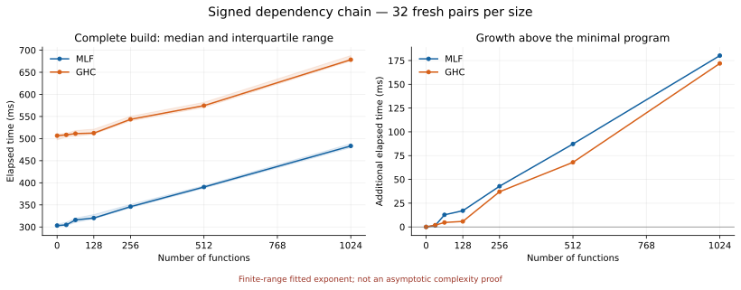

### Validation and qualification limits

- Fresh hosted producer: 18 build actions and 137 shared modules; builtin
  verification and locked package planning pass.
- Authenticated maintained `Classes` objects pass 3,294 comparisons against
  the complete frozen prior module: final AST including IEEE bits, wanted
  classes, fresh counters, reserved names and errors. Inputs include plain
  and constrained references, managed call stacks, shadowing, local bindings,
  signatures, recursion, source wrappers and nested applications. Independent
  checks assert the empty-reference result, final ID, and ignored-argument demand.
- Relevant regressions: 18 actions; 17 direct commands including ordered-map,
  CRC, JSON, byte-copy and candidate controls; 13 query/cache/offline actions.
  The signed CLI corpus passes 13 native cases and five expected rejections.
- Independent artifact/open-file suites pass 45 and 78 tests. Six actual
  reader/audit runs compare complete interfaces, identities, bodies, types and
  scopes; disk and fused LLVM remain equal to each other and the prior producer.

Qualification covers the GHC-hosted compiler and generated native programs.
Native compiler self-bootstrap and installed CLI remain unqualified. Previous
native O0 planner/long-symbol and QuerySnapshotProbe gaps remain open; those
unchanged components were not requalified by this experiment. Larger signed
chains still have the previously observed query-depth contract limit.
No resource limit was raised to obtain timing points.

Qualification SHA-256: `0341be9d39d48427c92746dd4ff9e1d3f553453befb31df923af4920fd7786f3`.

## Previous investigation: planner state, name prefixes and entry fields, 2026-11-17

Evidence is under `.mlf-build/signed-chain-intmap-intern-20261117`; the directory
retains the initial investigation name. Three isolated prototypes are rejected.
No maintained compiler, test, primitive, ABI, builtin, lock or format changes
are retained. Authentication checks the current producer, 203 source pins and
719 preceding qualification pins. The pure-continuation producer and its formal
GHC cohort remain authoritative.

The initial integer-index idea was checked against earlier evidence before
implementation. Existing int-route/direct/strict experiments already showed
higher allocation; the same lookup/insertion designs were not rerun.

### Fresh hotspot evidence

Six instrumented compiles, two each at N=0/256/1024, use the current retained
source and reproduce its exact interface, object and LLVM bytes. Query phase
timers are disabled, F4 remains fixed, and own ticks/allocation reconcile to
each profile total. N=1024-minus-N=0 costs attributed to package assembly are
21.15 ms / 75.16 MB, and to query encoding 15.65 ms / 57.62 MB. These sampled
ownership figures are diagnostic, not elapsed acceptance measurements.

Within those owners, planner dispatch accounts for 26.08 MB of allocation.
Packed byte/field writing remains visible in both. Declaration-name construction
owns another 3.15 ms / 12.07 MB; its Text append subcost has 30,720 extra calls,
about 0.70 ms and 1.15 MB. This led to three bounded structural experiments.

### Fixed screens and memory

Each screen uses one warmup plus six measured alternating pairs at
N=0/256/1024: 42 compiles and 126 checked native program results. The elapsed
boundary sums compiler and Clang subprocess times; it excludes the Python
worker overhead of formal full builds. The three cohorts are not pooled.

| Prototype | N=0 before → after (s) | N=256 | N=1024 |
| --- | ---: | ---: | ---: |
| Separate planner-state arguments | 0.281244 → 0.284066 | 0.325359 → 0.326045 | 0.458278 → 0.477425 |
| Shared complete name prefixes | 0.257380 → 0.254032 | 0.305739 → 0.309868 | 0.456374 → 0.452170 |
| Combined adjacent entry fields | 0.258655 → 0.255345 | 0.303814 → 0.306069 | 0.444644 → 0.446497 |

Memory is measured separately: three alternating pairs at N=0/1024, with
`-s -F4`. N=1024 medians are below. Cumulative allocation, maximum sampled
live heap and peak child RSS are separate measurements.

| Prototype | Allocated bytes, before → after | Maximum live heap | Peak child RSS |
| --- | ---: | ---: | ---: |
| Separate planner-state arguments | 958,127,576 → 952,408,016 | 8,665,488 → 8,665,504 | 64,913,408 → 64,765,952 |
| Shared complete name prefixes | 958,126,856 → 958,109,352 | 8,665,488 → 8,665,440 | 64,913,408 → 64,897,024 |
| Combined adjacent entry fields | 958,127,816 → 954,355,464 | 8,665,488 → 8,665,504 | 64,667,648 → 64,700,416 |

All 126 screen compiles, 378 native outputs and 36 memory compiles preserve
the reference interface/object/LLVM bytes. No unchanged-source formal GHC
cohort was rerun.

### Decisions and controls

- **Planner-state arguments:** the private loop passes `SymbolState`,
  `NodeState` and work separately, retaining `PlanState` at result boundaries.
  Public `charge`, the exact index and depth-before-work error ordering remain.
  Allocation falls by 5,719,560 bytes at N=1024, but the full median rises
  about 19.15 ms. Compiler-only medians also rise, 322.59 → 338.02 ms. Reject.
- **Name prefixes:** complete type/value prefixes are formed before the entity
  argument; stable and managed builtin branches retain their short circuits.
  N=1024 allocation falls only 17,504 bytes, less than the N=0 saving of
  148,808 bytes. The middle point gets slower; the large point is inconclusive
  for growth improvement. The extra factory/helper is not retained.
- **Entry fields:** adjacent kind/small-integer, kind/symbol, or small tag/arity
  fields are combined before the existing bit writer. The pending-byte state
  and wide fallback remain; this is distinct from the rejected 64-bit word
  buffer. N=1024 allocation falls by 3,772,352 bytes, but N=256/1024 full and
  compiler-only medians rise. The extra branches are not retained.

Planner-state and entry-field controls each pass 5,364 frozen complete plans,
16,092 root-budget cases, 166 generic and 166 production-root exact wires,
seven demand checks and ten targeted error-priority/ignored-field checks.
The entry-field suite additionally checks 4,464 private writer cases against
the frozen raw writer at all eight starting bit offsets, including surrounding
byte preservation and width/sign/varint thresholds. Seventy additional threshold
input cases each check both generic and production-root wire paths.

Name-prefix controls compare 7,488 crate/entity cases across four functions
with exact frozen originals, plus an independent compact-codec/role oracle
outside Prelude, seven long-name boundaries and eleven demand checks.
The initial Haskell harness failed at case-expression layout; V2 fixes that
layout and Boolean qualification before the successful run. Its original
source, driver, failed log and receipt remain preserved.

These are hosted diagnostic controls and generated-program checks. No portable
native/compiler/interpreter qualification is claimed for rejected shadows.
Current native O0 planner/long-symbol, native self-bootstrap, installed CLI
and QuerySnapshotProbe gaps remain open.

The authoritative formal medians remain 0.517514 s (MLF) versus 0.751684 s
(GHC) at N=1024. OLS slopes are 0.180822 versus 0.186731 ms/function and fitted
exponents 1.149834 versus 1.401144. Point criteria pass, but the paired slope
95% interval still crosses zero. The signed dependency chain remains active;
there is no acceptance commit/push or transition to another shape. Finite-range
fits are not asymptotic complexity proofs.

Investigation receipt: `investigation.json`, SHA-256 `0b6186d575b1c832c1e846c5ca570c35d66400ae57728a92025026edb78d28d8`.
A separate final audit pins the report and verifies the final source snapshot.

## Retained baseline: pure planner continuation, 2026-11-17

Evidence is under `.mlf-build/signed-chain-prelude-demand-20261117`.
Before mutation, authentication checked 202 source pins, 95 preceding
qualification pins and 746 pins from the owned-index investigation.
Builds, regressions, native controls, timing and memory measurements were serial.

### Retained code structure and memory change

`Bootstrap.Bitstream` now uses private `planText` and `planEntry` helpers that
resume `planTasks` directly. Successful interning no longer creates an
`Either`/pair that the caller immediately unpacks. Existing nodes reuse the
matched `PlanState`. The immutable exact-key index, canonical node ordering,
explicit task stack, occurrence-work charging, error priority and all resource
limits remain. This is distinct from the rejected mutable owned-index variants
and the earlier EncodeOne-only task-elision experiment.

The maintained planner source is byte-for-byte the measured pure prototype.
No cache, new hash table, admission shortcut or wire-format change is added.
The required builtin source identity/data, lock and migration authentication
pins were regenerated. The producer build has 18 actions and 137 modules.
Primitive ABI `mlf-primitive-136-v11`; builtin interface `mlf-primitive/shared-haskell-v1/15`.
Builtin identity: `builtin-source-v1:ed5afd91afb68daa08078d0954302c26b7dc66a9318d6daf0a4dc0fd2e619874`.

The existing Prelude-selection pass was also investigated. A private prototype
used the checked fresh-ID boundary to collect only possible Prelude references
into an IntSet. At N=1024 it saved 7,325,776 allocated bytes, but its timing was
essentially unchanged and its maximum live heap did not improve. The extra
traversal is rejected; `BuiltinPreludeContext.hs` remains unchanged.

Each separately declared diagnostic screen has one warmup plus six measured
alternating pairs at N=0/256/1024: 42 compiles and 126 native results.
The boundary sums compiler and Clang subprocess times and excludes the Python
worker overhead of the formal cohort. Screens are not pooled.

| Prototype | N=0 before → after (s) | N=256 | N=1024 |
| --- | ---: | ---: | ---: |
| Prelude reference filtering (rejected) | 0.253740 → 0.259947 | 0.307220 → 0.301172 | 0.447640 → 0.447553 |
| Pure planner continuation (retained) | 0.260950 → 0.266963 | 0.307347 → 0.307799 | 0.450427 → 0.446027 |

Separate prototype memory measurements use three alternating pairs at N=0/1024
and `-s -F4`. The retained prototype saves 8,190,864 allocated bytes at N=1024
(about 0.85%), with essentially unchanged maximum live heap. Its preliminary
large-case median improves by about 4.4 ms; smaller cases do not show a timing
gain. Retention is based on simpler control flow and allocation savings, without
claiming that all sizes become faster. The rebuilt producer was measured again
with its own source-matched builtin and cohort artifacts:

| N | Metric | Before | Retained |
| ---: | --- | ---: | ---: |
| 0 | Allocated bytes | 270,429,440 | 269,605,704 |
| 0 | Maximum sampled live heap | 1,404,088 | 1,432,232 |
| 0 | Peak individual-child RSS | 34,308,096 | 35,422,208 |
| 1024 | Allocated bytes | 966,187,720 | 958,123,712 |
| 1024 | Maximum sampled live heap | 8,665,472 | 8,665,488 |
| 1024 | Peak individual-child RSS | 66,174,976 | 66,306,048 |

Allocation is cumulative, live heap is an RTS sample, and RSS includes more
than heap. A smaller allocation total is not proof of a lower peak requirement.

### Correctness and portability evidence

Frozen host controls pass 5,364 complete planner comparisons, 16,092 root-budget
cases, 166 generic and 166 production-root exact wires, and seven demand checks.
They cover full-hash and slot collisions, capacity boundaries, repeated entries,
limits and error ordering. The rejected Prelude prototype separately passes
22,088 collector cases, 1,048 spine cases, 25 final acceptances, five final
rejections and ten ignored-field demand checks.

The exact retained and frozen planner bodies were also isolated into shared
source fixtures. Complete tables and error strings from the frozen GHC planner
are the oracle for 78 vectors. Both native O2 versions pass all 78. Under O0,
the frozen implementation fails four vectors with signal 11; the retained
implementation fails one of those same vectors, the generic 1024-root case.
All remaining retained O0 cases pass. There are no newly failing vectors, but
this is **not an all-pass O0 qualification**. Eight small retained interpreter
cases pass. These results do not qualify a native compiler self-bootstrap.

The first portable harness had a negative-number expression rejected by the
shared parser; its corrected suffix expresses the same value by subtraction.
An earlier Prelude host harness referred to the wrong Boolean module.
Both failed harnesses remain preserved. The original O0 failure receipt also
remains unchanged; the paired diagnostic reuses already executed cases rather
than replacing the failed sample. No production body was changed for the fixtures.

Rebuilt-producer regressions pass 18 actions, including codec admission, prior
compiler shapes, fused package controls and package smoke. The direct suite
passes 17 commands; query/index/offline validation passes 13. Signed CLI checks
cover 13 native successes and five expected semantic rejections. The artifact
Python suite passes 45 tests and the open-file suite passes 78. Six retained
artifact-pair audits at N=0/256/1024 independently compare complete interfaces,
identities, bodies, types and scopes. Actual disk loading with semantic audit
matches fused LLVM; the before/after LLVM is also identical.

### Fresh formal full-build comparison

The predeclared original range remains N=0/32/64/128/256/512/1024, with 32
alternating pairs at every size: 448 compiles and 1,344 checked native results.
All cases pass, using fresh query/output directories and the existing
`crate-fused-v1` full-worker launch-to-completion boundary. No failed samples
are removed and no earlier cohorts are pooled.

| Functions | MLF median (s) | GHC median (s) |
| ---: | ---: | ---: |
| 0 | 0.326795 | 0.552187 |
| 32 | 0.337828 | 0.568749 |
| 64 | 0.340102 | 0.559379 |
| 128 | 0.353941 | 0.580071 |
| 256 | 0.369725 | 0.587715 |
| 512 | 0.411226 | 0.629001 |
| 1024 | 0.517514 | 0.751684 |

| Metric | MLF | GHC |
| --- | ---: | ---: |
| OLS slope (ms/function) | 0.180822 | 0.186731 |
| Endpoint slope (ms/function) | 0.186249 | 0.194822 |
| Offset-power fitted exponent | 1.149834 | 1.401144 |

Paired 95% slope-difference interval (MLF − GHC), ms/function: [-0.014913, 0.005255].
Paired 95% exponent-difference interval: [-0.526503, -0.052409].
Fits include a startup offset; these are finite-range estimates, not asymptotic
complexity proofs. The N=2048+ query-depth failures from the prior investigation
remain outside the successful timing range; the depth contract is unchanged.

| Acceptance check | Result |
| --- | --- |
| all_positive_medians_lower | pass |
| lower_ols_point | pass |
| lower_endpoint_point | pass |
| lower_power_point | pass |
| lower_ols_95 | **unmet** |
| lower_power_95 | pass |
| Fit avoids parameter bounds | pass |

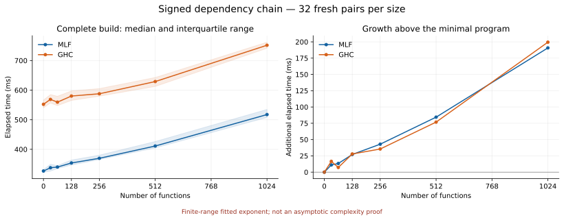

The signed dependency chain remains active. No acceptance commit/push or
transition to another shape is justified yet. This cohort is retained as-is;
another unchanged-source rerun to seek significance is not justified.

Native compiler self-bootstrap and installed CLI qualification, native O0
planner/long-symbol codec failures and the QuerySnapshotProbe gap remain open.

Qualification receipt: `qualification.json`, SHA-256 `f03b9386a2f619b7a14cf951ee36975fc5e77e5ce4a60df9c3b6aa6e5ce69155`.
A separate final audit pins this report and verifies the final source snapshot.

## Previous investigation: owned probing and the query-depth boundary, 2026-11-17

Evidence is under `.mlf-build/signed-chain-owned-index-20261117`. Three isolated
owned-index prototypes are rejected; no maintained compiler, test, ABI, builtin
or build changes are retained. This investigation includes allocation, live-heap
and process-memory measurements. The current candidate-ID-sharing producer and
its original-range formal GHC cohort remain authoritative. Authentication checks
202 source pins, 95 qualification pins and 71 pins from the preceding investigation.

### Owned index experiments

The first prototype gives the encoder a private mutable open-addressed table.
Each occupied cell holds the hash, full shallow entry key and canonical node ID.
Lookup probes at most 16 slots, then uses a balanced exact-key overflow map.
The table grows from 32 to at most 65,536 cells at half occupancy; rehashing
preserves canonical IDs. Hashes only select candidates: full-key comparison still
establishes equality. Text retains the existing fused symbol/text interner.
Only the production root-bounded path with at least 64 roots selects this planner;
generic planning and smaller root lists retain their existing paths.

A two-run diagnostic trace reports no owned table at N=0. At N=1024 the table has
32,768 cells, 10,303 entries and 438 overflow entries. The next prototype applies
an avalanche mixer to the existing entry hash to test low-bit clustering. It
retains the same exact-key checks, probe bound, overflow behavior and capacity.
These are encoder-local tables, not persistent caches or changes to the wire.

Four fresh instrumented profiles, compared with the authenticated current-source
profiles, attribute N=1024-minus-N=0 own allocation in the mixed prototype to
planner task dispatch (28.40 MB), suspended planner-step variants (18.75 MB),
lookup and probing (21.03 MB). Profiling is diagnostic, not elapsed-time acceptance.
The third prototype removes the intermediate planner-step representation and
returns directly through a private continuation after interning. It retains the
same admission order and table policy. This reduces prototype overhead but does
not beat the current persistent index.

Each separately declared screen has one warmup plus six measured alternating
pairs at N=0/256/1024: 42 compilations and 126 checked native outputs. The timing
boundary sums compiler and Clang subprocess times; it excludes setup and the
Python worker overhead present in the formal full-build cohort. Separate screens
are not pooled or treated as a direct comparison between prototypes.

| Prototype | N=0 before → after (s) | N=256 before → after (s) | N=1024 before → after (s) |
| --- | ---: | ---: | ---: |
| Bounded owned probing | 0.273807 → 0.275476 | 0.326606 → 0.323595 | 0.489603 → 0.501087 |
| Avalanche-mixed hash | 0.266952 → 0.267397 | 0.320873 → 0.319350 | 0.464791 → 0.469003 |
| Direct planner continuation | 0.266445 → 0.267172 | 0.319597 → 0.321167 | 0.483802 → 0.483497 |

Memory is measured separately with three alternating pairs at N=0/1024 and
`-s -F4`. The following N=1024 medians distinguish cumulative allocation,
maximum sampled live heap and peak individual-child RSS.

| Prototype | Allocated bytes, before → after | Maximum live heap, before → after | Peak child RSS, before → after |
| --- | ---: | ---: | ---: |
| Bounded owned probing | 966,187,736 → 1,016,298,608 | 8,665,472 → 8,665,480 | 64,684,032 → 64,978,944 |
| Avalanche-mixed hash | 966,187,736 → 1,010,546,520 | 8,665,472 → 8,665,480 | 64,798,720 → 64,716,800 |
| Direct planner continuation | 966,187,736 → 1,002,045,040 | 8,665,472 → 8,665,480 | 64,897,024 → 64,880,640 |

The three prototypes add respectively 50,110,872, 44,358,784 and 35,857,304
allocated bytes at N=1024. None reduces maximum live heap. The first two are
slower at the large point; the last differs by only about 0.3 ms. The extra owned
state and lookup paths are not justified by these results and remain unretained.

Each prototype passes 5,364 frozen-plan comparisons, 16,092 root-budget cases,
166 exact generic wires and 166 exact production-root wires, plus seven demand
checks. Cases cover slot collisions, genuine full-hash collisions, growth edges,
the capacity limit, repeated entries, errors and order. Mixed/fused controls also
construct colliding slots through the inverse hash mixer. All 126 screen compiles,
378 native results and 36 memory compiles preserve exact reference interface,
object and LLVM bytes. These are host diagnostic controls, not qualification for
native compiler deployment.

### Larger-range diagnostic: failed cases retained

A separate, predeclared diagnostic uses the unchanged qualified producer and
existing `compiler-shapes` driver at N=1024/2048/4096/8192, with four alternating
pairs per size and the first pair designated warmup. It preserves the original
N=0/32/64/128/256/512/1024 acceptance range and all of its criteria. The planned
32 compilations and 96 native checks were conditional on successful compilation.

The actual run finishes with **`all_cases_passed: false`**: nine successful
compilations and 27 checked native outputs, plus three failed MLF compilations.
N=1024 completes four pairs; GHC at N=8192 completes once. MLF at N=2048/4096/8192
returns `cyclic/deep query graph`. The existing fail-case rule skips the remaining
legs of those cases. There are no replacement samples, and no larger-range slope
or exponent is fitted. The driver process exiting zero and receipt `complete`
being true mean that failure recording completed; they do not indicate all-pass.

A separate diagnostic shadow changes only the existing dense-DFS failure messages
and reproduces the N=2048 failure once. It reports:

```text
query-depth trace: completed suffix depth=4096 height=1 limit=4096
```

This identifies the longest-path admission check, rather than the DFS cycle
branch or a resource timeout. The existing 4096/4097 boundary tests and independent
query readers enforce this depth contract. The failed diagnostic publishes no
`CURRENT`. The limit and traversal are unchanged in maintained source; simply
raising it would neither demonstrate faster compilation nor establish better
complexity. The larger failed programs cannot supply successful timing samples.

The diagnostic harness initially raised on the expected exit status 1, as its
resource guard raises for any failed child. A bounded postprocessor authenticates
that already-written terminal receipt and records the exact error; the failed
command is not rerun or replaced. The original incomplete harness receipt remains.

### Current status

Formal N=1024 medians remain 0.483401 s (MLF) versus 0.678379 s (GHC), OLS slopes
0.175333 versus 0.172073 ms/function, and fitted exponents 1.012015 versus 1.206343.
Elapsed time and exponent criteria pass; the slope criterion is still unmet.
The signed dependency chain remains active, with no acceptance commit/push or
transition to another shape. Finite-range exponents are not asymptotic Big-O proofs.

The measured remaining allocation is distributed across package planning and
higher-level persistent-map construction. Eliminating repeated assembly is a
possible next investigation, not a validated improvement. Further unchanged-source
acceptance reruns or another unconstrained probe-parameter sweep are not justified.

Native compiler self-bootstrap and installed-CLI qualification, the existing
native O0 long-symbol codec failures and the QuerySnapshotProbe gap remain open.
No new interpreter/native qualification was run for these rejected paths.

Investigation receipt: `investigation.json`, SHA-256 `ed387b49c6f37750d60b92dcbd0cb1830f451baa82fb112fdcb4e43c0334bcd8`.
A separate final audit pins the updated report and verifies the final source snapshot.

## Previous investigation: reference columns and combined source scanning, 2026-11-17

Evidence is under `.mlf-build/signed-chain-column-plan-20261116` (the directory
retains its starting date). Three shadow prototypes were tested and rejected.
No maintained compiler, test, build, ABI or builtin changes are retained.
The qualified candidate-ID-sharing producer and its formal GHC cohort remain
authoritative. Authentication verifies 202 source pins, 95 preceding qualification
pins and 64 pins from the immediately preceding investigation.

### Fixed screens and memory

Each separately declared screen has one warmup and six measured alternating
pairs at N=0/256/1024: 42 compilations and 126 checked native outputs. Its elapsed
boundary is the sum of compiler and Clang subprocess times, excluding setup,
authentication and output checks. It is not the formal full-worker GHC boundary.
Separate screens are not pooled or compared as one cohort.

| Prototype | N=0 before → after (s) | N=256 before → after (s) | N=1024 before → after (s) |
| --- | ---: | ---: | ---: |
| Direct reference-column planning | 0.273081 → 0.272222 | 0.319308 → 0.318761 | 0.464311 → 0.463485 |
| Character dispatch in source validation | 0.273703 → 0.271341 | 0.318195 → 0.317149 | 0.458133 → 0.463679 |
| Combined simple-source validation and scanning | 0.272069 → 0.272726 | 0.321070 → 0.322395 | 0.477128 → 0.477688 |

Each memory experiment uses three alternating pairs at N=0/1024 and `-s -F4`.
The N=1024 medians below distinguish cumulative allocation, maximum live heap
and peak individual-child RSS; allocation savings alone do not establish a
lower peak-memory requirement or faster compilation.

| Prototype | Allocated bytes, before → after | Maximum live heap, before → after | Peak child RSS, before → after |
| --- | ---: | ---: | ---: |
| Direct reference-column planning | 966,192,656 → 963,484,424 | 8,665,488 → 8,665,504 | 64,929,792 → 64,978,944 |
| Character dispatch in source validation | 966,191,560 → 946,802,968 | 8,665,480 → 9,038,416 | 64,913,408 → 67,092,480 |
| Combined simple-source validation and scanning | 966,187,736 → 942,647,216 | 8,665,472 → 9,066,528 | 64,897,024 → 69,140,480 |

The three screens total 126 compilations and 378 checked native results, with
36 additional memory compilations. Every measured interface, object and LLVM
output equals the retained reference. No unchanged formal cohort was rerun.

### Direct reference-column planning

Query closure already resolves references to dense row positions. The prototype
records each earlier key descriptor's canonical wire-node ID and exact expanded
work, then reuses that ID for later references at the same absolute depth.
Ordinals refer only to this call's validated key inventory, never arbitrary wire
IDs. Every reuse still charges its complete occurrence work. Original interning,
resource bounds, ordering and owned byte writing remain; QueryGraph preparation
is factored behind a builder callback so the existing value-tree API is available.
Publication and cache-retention checks remain in their existing order.

Frozen original Bitstream and QueryGraph controls pass 13,267 complete plans,
158 exact wires, three invalid-ordinal cases, six demand checks and 19 query
cases, including publication/reuse and rejection. The prototype saves 2,708,232
allocated bytes (0.28%), with unchanged maximum live heap. Its roughly 0.8 ms
large-case median reduction is also present at N=0, so the screen does not
establish a growth reduction. The additional encoder path is rejected.

Three initial control-harness failures are preserved: Haskell layout syntax,
use of a private/non-exported work-limit helper, and a partial-`head` warning
rejected by the harness despite a successful compiler exit. The corrected
completed run alone is counted as passing; these were not compiler regressions.

### Source validation and scanning

Reanalysis of the authenticated preceding profiles attributes about 2.70 ms /
19.84 MB of N=1024-minus-N=0 cost to `Lexer.textStartsAt` and its descendants.
This is sampled diagnostic ownership, not a fresh timing result.

The **character-dispatch** prototype changes only the three comment/pragma
probes in `validateSharedSource`, checking the already-read character and bounded
lookahead instead of creating short substrings. Public `textStartsAt` is unchanged;
this differs from the earlier rejected general prefix-loop experiment. Frozen
Lexer comparison passes 17,154 validation cases, 11,436 source-profile cases and
three raw-cursor outcomes, including exact error text/positions. Allocation falls
by 19,388,592 bytes (2.01%), but the large-case screen slows by about 5.55 ms and
maximum live heap increases. Reject. An initial builder assertion selected a
call site instead of the exact function declaration; it failed before compilation
and the original driver is preserved.

The **combined scanner** uses one body traversal to construct tokens and prove
shared-source character restrictions for ordinary source. It conservatively
falls back to the original complete validation/scanning sequence for body
comments, strings, disallowed whitespace and ambiguous operator/comment
boundaries. The prologue still receives full validation. Layout consumes the
same resulting token stream; there are no benchmark-name or input-size tests.
This source refactor is independent of the rejected character-dispatch prototype.

Its frozen original `sourceSyntax`-then-`scanSourceTokens` oracle passes 12,108
exact profile/token/error/position cases, 113 current repository sources and
explicit fast/fallback branch checks. Allocation falls by 23,540,520 bytes
(2.44%), but full elapsed time is effectively unchanged and maximum live heap
increases. Reject the second scanner path without an established benefit.
These checks qualify the host experiments only, not portable/native deployment.

### Current status

The formal N=1024 medians remain 0.483401 s (MLF) and 0.678379 s (GHC), OLS
slopes 0.175333 and 0.172073 ms/function, and fitted exponents 1.012015 and
1.206343. The slope criterion is still unmet. The shape remains active, with
no acceptance commit/push or transition to another shape. Finite-range fitted
exponents do not prove a strictly lower asymptotic complexity class.

Native compiler self-bootstrap and installed-CLI qualification, the native O0
long-symbol codec failures and the QuerySnapshotProbe gap remain open. No
new interpreter/native qualification was run for these rejected paths.

Investigation receipt: `investigation.json`, SHA-256 `23008ff35559e784fab3ba6c24fe177a6d2a223754a93a61c72aaaf05735c17f`.
A separate final audit pins the updated report and verifies the final source snapshot.

## Previous investigation: string hashing, directional insertion and shallow planning, 2026-11-16

Evidence is under `.mlf-build/signed-chain-assembly-followup-20261116`.
All four new prototypes are rejected. No maintained compiler, test or build
source changes are retained. The candidate-ID-sharing producer and its formal
GHC cohort remain authoritative; no unchanged formal cohort was rerun.
Authentication covers 202 unchanged source pins, 95 preceding qualification
pins and 68 pins from the immediately preceding investigation.

### Hotspots and experiment boundaries

Reanalysis of the preceding current-source profiles (no new profiling run)
attributes N=1024-minus-N=0 own costs of 11.90 ms / 52.65 MB to `Map.balance`,
7.65 ms to its main host string-comparison worker, and 6.05 ms / 32.20 MB to
`Bitstream.planTasks`. Another string-comparison wrapper has separate own cost;
these figures are exclusive sampled cost centres, not complete-build timings.
Of the map-balance cost, private binary interning owns about 2.30 ms / 8.73 MB.

Each prototype has a separately declared screen: one warmup plus six measured
alternating pairs at N=0/256/1024. The elapsed boundary sums the compiler and
Clang subprocess times, excluding setup, authentication and output checks.
Each screen has 42 compilations and 126 checked native results. Screens remain
separate; their timing boundary is not the formal full-worker GHC boundary.

| Prototype | N=0 before → after (s) | N=256 before → after (s) | N=1024 before → after (s) |
| --- | ---: | ---: | ---: |
| Cached full-string hash | 0.253537 → 0.249957 | 0.299362 → 0.295259 | 0.430876 → 0.436744 |
| Uncached full-string hash | 0.250923 → 0.253968 | 0.296571 → 0.295486 | 0.431895 → 0.435132 |
| Directional map insertion | 0.250441 → 0.255058 | 0.298839 → 0.297549 | 0.432579 → 0.434841 |
| Bounded shallow planner | 0.250691 → 0.254425 | 0.296098 → 0.295044 | 0.432599 → 0.432909 |

Memory is measured separately with the current `-F4` policy and RTS statistics:
three alternating pairs at N=0/1024 per prototype. N=1024 medians below are bytes;
cumulative allocation, maximum live heap and peak process RSS are distinct.

| Prototype | Allocated bytes, before → after | Maximum live heap, before → after | Peak child RSS, before → after |
| --- | ---: | ---: | ---: |
| Cached full-string hash | 966,199,680 → 981,821,936 | 8,665,496 → 10,764,864 | 64,634,880 → 72,155,136 |
| Uncached full-string hash | 966,202,072 → 957,996,368 | 8,665,504 → 8,665,528 | 64,634,880 → 65,781,760 |
| Directional map insertion | 966,199,680 → 966,212,368 | 8,665,496 → 8,665,520 | 64,651,264 → 64,684,032 |
| Bounded shallow planner | 966,193,824 → 955,802,224 | 8,665,488 → 8,665,496 | 64,651,264 → 64,602,112 |

### What was tried and why it was rejected

- **Cached full-string hash:** the private host String stores a lazy complete
  UTF-8 FNV-1a hash. The binary symbol index uses integer buckets, retaining
  complete strings and a balanced exact-string map on collisions. Hashes never
  determine equality. This adds 15,622,256 allocated bytes at N=1024, increases
  live heap and RSS, and slows the large case. Reject the representation change.
- **Uncached full-string hash:** a separately declared follow-up holds the hash
  algorithm and exact symbol buckets constant but removes the extra String
  field. It saves 8,205,704 allocated bytes (about 0.85%), with effectively
  unchanged maximum live heap. The large-case screen is still slower. Reject;
  neither hash prototype justifies a new portable primitive or ABI migration.
  Their successful compiler artifacts do not qualify all collision, demand or
  cross-engine primitive boundaries; no such broader qualification is claimed.
- **Directional map insertion:** after insertion into a valid map, test only
  the rotation on the side that can have grown. Both child sizes and the small
  tree case remain. General `balance`, deletion and arbitrary joins are
  unchanged, including general balance's ordered Int64 tests. Private codec
  interning also uses the one-sided helpers. The actual shadow map objects pass
  19,581 independent ordered-map cases, 16,745 union pairs and 14 demand checks
  through six host commands. Allocation is effectively unchanged and the
  large-case screen is slower. Reject; no full portable qualification follows.
- **Bounded shallow planner:** direct traversal avoids the general task stack
  for the first 63 levels; at depth 64 the unchanged explicit-stack planner
  handles the complete remaining subtree. Child/root list traversal remains
  tail-recursive. This differs from the earlier task-elision and owned-state
  experiments, which retained general child-list/closing tasks for every node.
  It saves 10,391,600 allocated bytes (about 1.08%), but maximum live heap and
  full-compilation elapsed time are effectively unchanged. Reject the additional
  planner path without an established speed or peak-memory benefit.

### Planner validation and preserved failure

The shallow planner is compared with a frozen copy of the current planner,
not an oracle regenerated from the candidate. Tests include deep chains at
62/63/64/65/66/127/128/1024 levels, wide lists and limits around the transition.
Two successful host commands check 5,211 complete plans, 15,633 root-budget
results, 149 exact wire encodings and seven demand-order cases. Tables, failure
messages, occurrence work and bytes must match the frozen implementation.
These are host controls; interpreter/native planner qualification was not run
for this rejected prototype.

The first control driver expected a relative Main.hs argument, while the current
producer command records an absolute path. It failed during staging before
compiler execution. Its driver, failed receipt and log are preserved. Selecting
the actual absolute entry path fixes the harness; only the subsequent completed
control run is counted as passing.

The four screens total 168 compilations and 504 native outputs; the four memory
experiments total 48 separate runs. Every checked interface, object and LLVM
output matches the retained reference. Final auditing authenticates compiler
binaries, original/shadow sources, drivers, stored command logs and reference
artifacts. No timing result is pooled or used as a formal GHC acceptance result.

Review also found that the GHC LLVM backend had already been tested and rejected
in the earlier prepared-source investigation below. No duplicate backend build,
dependency installation or backend performance claim is added here.

### Current status

The formal N=1024 medians remain 0.483401 s (MLF) and 0.678379 s (GHC), OLS
slopes 0.175333 and 0.172073 ms/function, and fitted exponents 1.012015 and
1.206343. The slope criterion is still unmet, so the signed dependency chain
remains active. No acceptance commit/push or transition to another shape occurs.
Finite-range fits do not prove a strictly lower asymptotic complexity class.

Native compiler self-bootstrap and installed-CLI qualification, the native O0
long-symbol codec failures and the QuerySnapshotProbe gap remain open.
Direct generation of typed query columns is a possible next investigation,
not a measured or retained optimization. It must preserve full semantic/resource
admission and persistent-cache correctness; these rejected local variants are
not evidence that such a redesign will help.

Investigation receipt: `investigation.json`, SHA-256 `b48f8fc05267434d773b92e720cd68f2daf409ad083d90b50f8da4fb6865168b`.
The separate final snapshot audit pins this report.

## Previous investigation: dependency projection, node indexes and GC, 2026-11-16

Evidence is under `.mlf-build/signed-chain-scope-projection-20261116`.
The retained candidate-ID implementation and its qualified producer are unchanged.
All 202 source pins and 95 preceding evidence pins were authenticated before and
after the investigation. No maintained compiler, test or build source changed.
The experiments below are rejected; they do not replace the formal GHC cohort.

### Fresh hotspot evidence

Two current profiles at each N=0/256/1024, with query phase timers disabled,
reproduce the qualified interface, object and LLVM bytes. For N=1024 minus N=0,
`OpenFragment.makePackage` owns 17.95 ms / 78.79 MB, `QueryGraph.encodeHashed`
12.90 ms / 60.54 MB, and `Dependency.resolvedGroupsWith` 2.60 ms / 12.39 MB.
Within package assembly, `planTasks` accounts for 3.55 ms / 16.35 MB;
balanced-map maintenance and private integer indexes remain visible costs.
These are profiling measurements, not formal elapsed-time acceptance results.

A separate encoder trace at N=0/32 observed 8,688 and 11,155 entries, a net
increase of 2,467. Its positive-only Counter difference sums to 2,479 because
negative key differences are omitted. Trace timings are not performance evidence.
Both traced runs reproduce the qualified artifacts and LLVM.

### Structural prototypes and memory

Each prototype uses an ignored shadow source tree. Each memory experiment has
three alternating pairs at N=0/1024. Values below are the N=1024 medians;
before/after pairs belong to their own experiment and are not pooled.

| Prototype | Allocated bytes, before → after | Maximum live heap, before → after | Decision |
| --- | ---: | ---: | --- |
| Project dependency candidates before ranking | 966,202,072 → 961,342,424 | 8,665,504 → 8,665,536 | Reject: 0.50% allocation saving, no established speed gain |
| Put tags before children in private short-node keys | 966,194,832 → 965,074,368 | 8,665,488 → 8,665,504 | Reject: 0.12% allocation saving, no established speed gain |
| Mutable 32-bucket node index for large root plans | 966,193,824 → 977,889,160 | 8,665,488 → 8,665,504 | Reject: more allocation and no speed gain |

The dependency projection keeps all inference candidates. It computes active
source/generated IDs once and filters only dependency edges that ranking already
drops. For validated inventories of at most 256 entries, it intersects kept
ordinals with each scope; larger inventories filter the existing selector.
This requires a stored projection and changes across `Classes` and
`SourceInference`. The shadow selector passed 25,632 independent positional
Set-oracle cases and two demand checks (three host commands). Its small saving
does not justify that extra structure. An initial staging failure used the wrong
`IntSet` import alias; it occurred before compiler execution and is preserved.

The tag-first prototype changes only private packed-key locality; eligible
arities and field widths stay the same. The bucket prototype uses a private
32-slot mutable array for plans with at least 64 roots, retaining exact keys
inside each bucket. Neither changes measured interface/object/LLVM bytes.
Neither received full portable, demand-boundary or resource-limit qualification:
their performance evidence did not justify proceeding to integration.

### Fixed timing screens and confirmations

Diagnostic elapsed time sums the compiler and Clang subprocess times. It excludes
setup, authentication and output checks, and differs from the formal driver
boundary. It must not be compared directly with the formal GHC table below.
Each screen used one warmup plus four measured alternating pairs at each size.

| Prototype | N=0 before → after (s) | N=256 before → after (s) | N=1024 before → after (s) |
| --- | ---: | ---: | ---: |
| Dependency projection | 0.254973 → 0.255405 | 0.296231 → 0.292507 | 0.434593 → 0.432695 |
| Tag-first keys | 0.250113 → 0.251304 | 0.293919 → 0.295010 | 0.431524 → 0.427371 |
| Mutable buckets | 0.248277 → 0.250074 | 0.294742 → 0.296398 | 0.430774 → 0.430859 |

Projection and tag-first keys each received one separately declared confirmation:
one warmup plus 12 measured alternating pairs at N=0/256/1024. These confirmations
are not pooled with the screens. No further repeat was used to seek significance.

| Confirmation | N=0 before → after (s) | N=256 before → after (s) | N=1024 before → after (s) |
| --- | ---: | ---: | ---: |
| Dependency projection | 0.252072 → 0.251043 | 0.295343 → 0.296928 | 0.432417 → 0.432190 |
| Tag-first keys | 0.252625 → 0.252481 | 0.296327 → 0.293186 | 0.432672 → 0.429251 |

With 10,000 bootstrap resamples of within-pair differences (seed 20261116),
both confirmations include zero at every size. At N=1024, the projection's
paired time difference has a 95% interval of [-2.802, +3.114] ms; tag-first keys
have [-9.760, +2.910] ms. Endpoint growth-difference intervals are respectively
[-0.006720, +0.007368] and [-0.010011, +0.003066] ms/function.
Neither establishes a timing or growth advantage.

### GC after the retained live-heap reduction

The preceding retained change reduced maximum live heap by about 40%, so a fixed
2×2 experiment re-evaluated GC settings against the current immutable object
inventory. Earlier GC screens preceded that reduction and did not test the
combination. One entry compilation and eight links produced four timing and four
memory binaries, all preserving `-rtsopts=ignoreAll`. The memory binaries add only
`-s` to their corresponding setting.

There are three rotating memory repeats at N=0/1024, and one timing warmup plus
four measured rotating rounds at N=0/256/1024. Every timing lane occupies every
measured order position once. N=1024 results:

| Embedded settings | Diagnostic elapsed (s) | Allocated bytes | Maximum live heap | Copied bytes | GC elapsed (s) | Peak child RSS |
| --- | ---: | ---: | ---: | ---: | ---: | ---: |
| `-F4` (current) | 0.430788 | 966,192,656 | 8,665,488 | 94,437,120 | 0.051 | 65,961,984 |
| `-F8` | 0.442476 | 966,192,656 | 10,726,648 | 92,455,384 | 0.050 | 70,172,672 |
| `-F4 -A8m` | 0.436123 | 966,194,912 | 10,113,944 | 85,024,104 | 0.047 | 72,253,440 |
| `-F8 -A8m` | 0.436350 | 966,194,912 | 12,077,040 | 85,547,800 | 0.047 | 75,399,168 |

All three alternatives have slower large-case elapsed time and higher RSS.
Keep the current `-F4` setting. Less copying and a slightly smaller GC-time
component do not establish a full-compilation improvement. These settings affect
the GHC-hosted runtime, not the frontend's asymptotic algorithm or native MLF GC.

### Evidence boundary and current acceptance

The three screens, two confirmations and GC screen total 306 compilations and
918 checked native outputs. The separate memory experiments total 60 runs.
All checked interface, object and LLVM bytes match the retained producer's
reference. Six profile runs and two trace runs are separate diagnostics, not
additional native-output checks. The final audit authenticates the stored logs,
binaries, shadow sources, drivers, input pins and reference artifacts.

There is no new retained implementation and therefore no new formal GHC cohort
or growth plot. The current formal N=1024 medians remain 0.483401 s (MLF) and
0.678379 s (GHC). OLS slopes remain 0.175333 and 0.172073 ms/function; fitted
exponents remain 1.012015 and 1.206343. Compilation time and fitted exponent
are lower, but the slope criterion is still not met. Finite-range fitting does
not establish a strictly lower Big-O class. Continue the signed dependency chain;
do not advance to another shape or commit/push it as accepted.

Native compiler self-bootstrap and the installed CLI remain unqualified. The
existing native O0 long-symbol codec failures and QuerySnapshotProbe gap remain.
These rejected shadow experiments do not close those validation gaps.

Investigation receipt: `investigation.json`, SHA-256 `6b475538f3a0f1760529977b45f9f8cf93adeaf2fc4d9894b0f56d76b1260dbf`.
The report itself is pinned by the separate final snapshot audit.

## Retained baseline: shared candidate IDs, 2026-11-16

Evidence is under `.mlf-build/signed-chain-query-index-20261116`.
The preceding qualified producer, 198 source pins and 70 evidence pins were
authenticated before mutation. Builds, tests, timing and memory runs were serial.

### Hotspot and retained implementation

Fresh profiles (two each at N=0/256/1024) preserve the prior artifacts and LLVM.
At N=1024 minus N=0, scope mapping accounts for 211,968 repeated name-map
lookups. Package assembly and query encoding remain larger overall owners:
about 17.70 ms / 78.79 MB and 12.95 ms / 60.55 MB respectively. These are
profiled ownership measurements, not formal elapsed-time acceptance results.

`Bootstrap.Classes.prepareClassesWithImports` now resolves each validated
candidate name to its ID once. Each scope selects from that shared sequence.
Last-name role/ID mapping, order, multiplicity, superclass suffixes and all
candidate IDs are preserved. No candidate filtering or inference shortcut is added.

`selectCandidateValues` shares the complete result when the inventory has at
most 256 entries and the scope contains all valid ordinals. Extra invalid
ordinals remain ignored. Empty scopes return the suffix immediately. Larger
inventories and partial scopes use the bounded-gap ordinal walk.

The maintained implementation differs from the measured bounded prototype
only by two explanatory comments. Shared compiler source changed, so builtin
source identity, generated data, lock and migration authentication were refreshed.
The new producer has 18 build actions and 137 modules.
Primitive ABI `mlf-primitive-136-v11`; builtin interface `mlf-primitive/shared-haskell-v1/15`.
Builtin identity: `builtin-source-v1:85dfeb9b0fcef316ed341028d1332986e6be8babf313ca824fe1cd6bab1abffd`.

### Diagnostic comparisons and rejected attempt

Three prototypes were measured separately. The first only shares resolved IDs;
the second also shares complete inventories without a size bound; the retained
third bounds that construction and short-circuits empty scopes. Two screens
(one warmup and four measured pairs) and two fixed confirmations (one warmup
and 12 measured pairs), each at N=0/256/1024, total 216 compiles and 648 checked
native outputs. All preserve the prior exact interface/object/LLVM bytes.
These diagnostic compiler-plus-Clang sums exclude the formal worker boundary.

| Diagnostic cohort | N=0 before / after, s | N=256 | N=1024 |
| --- | ---: | ---: | ---: |
| candidate-ids-screen | 0.254721 / 0.250156 | 0.297808 / 0.294560 | 0.444715 / 0.432449 |
| candidate-shared-screen | 0.254374 / 0.252779 | 0.298100 / 0.296071 | 0.446320 / 0.435815 |
| candidate-shared-confirmation | 0.249661 / 0.250059 | 0.298625 / 0.296911 | 0.443688 / 0.431534 |
| candidate-bounded-confirmation | 0.253290 / 0.253049 | 0.299125 / 0.294926 | 0.447123 / 0.433408 |

The retained bounded prototype has N=1024 paired median delta -11.890 ms,
with a 95% bootstrap interval of [-15.642208, -3.699771] ms.
The smaller-case intervals include zero. Its paired endpoint-growth delta
interval is [-0.017771, -0.002996] ms/function
(10,000 resamples, seed 20261116). Three separate prototype memory experiments
add 36 runs; the retained producer is measured again below with its own builtin.

The unbounded second prototype is rejected: its portable native O0 control
exited with signal 11 at 65,536 inventory entries. Two attempts to raise the
stack limit were rejected by setrlimit before program execution. Deep-stack
exhaustion is a hypothesis, not an established backtrace. The retained bounded
version passes the same controls at default stack limits, including 65,536
and 131,072 entries and full/superset selections around the 256-entry boundary.
An initial second-prototype confirmation driver also failed on an existing
output directory before compilation; its corrected driver used a fresh path.
Failed receipts are retained and no failed timing points are silently dropped.

### Final allocation, live heap and RSS

Three alternating RTS pairs per lane at N=0/1024 use `-s -F4`. Each producer
uses its own builtin and preserves its exact formal-cohort artifacts and LLVM.
These measurements are separate from ordinary timing. Values are medians;
MB means 1,000,000 bytes. Maximum live heap is sampled RTS residency.

| Functions | Allocation before / after, MB | Maximum live heap before / after, MB | Peak RSS before / after, MB |
| ---: | ---: | ---: | ---: |
| 0 | 270.458 / 270.426 | 1.396 / 1.404 | 34.357 / 34.275 |
| 1024 | 981.235 / 966.184 | 14.518 / 8.665 | 76.481 / 65.962 |

| N=1024 measurement | Reduction |
| --- | ---: |
| Allocated bytes | 15,051,664 bytes (1.534%) |
| Maximum live heap | 5,852,360 bytes (40.312%) |
| Peak RSS | 10,518,528 bytes (13.753%) |

Copied bytes and GC CPU/elapsed time remain in the receipt.

### One fresh GHC cohort

The unchanged `crate-fused-v1` boundary includes a fresh worker, MLF plus
Clang or `ghc --make`, through executable creation. Independent oracle checks
follow the clock. Before integration, the sample count was fixed at 32 fresh
alternating pairs for each of seven sizes to reduce the earlier exponent
uncertainty. All 448 compiles and 1,344 native outputs pass. No cohorts are
pooled, no points removed and no unchanged-source formal rerun seeks acceptance.

| Functions | MLF median, s | GHC median, s |
| ---: | ---: | ---: |
| 0 | 0.300561 | 0.496758 |
| 32 | 0.305188 | 0.509774 |
| 64 | 0.318007 | 0.509778 |
| 128 | 0.328882 | 0.513264 |
| 256 | 0.345700 | 0.540662 |
| 512 | 0.388826 | 0.573684 |
| 1024 | 0.483401 | 0.678379 |

| Metric | MLF | GHC |
| --- | ---: | ---: |
| OLS slope, ms/function | 0.175333 | 0.172073 |
| Endpoint slope, ms/function | 0.178555 | 0.177364 |
| Fitted exponent p | 1.012015 | 1.206343 |
| Bootstrap 95% interval for p | [0.974726, 1.069898] | [1.133744, 1.281342] |

Paired MLF-minus-GHC OLS interval: **[-0.002590, 0.008182] ms/function**.
Paired exponent interval: **[-0.271548, -0.099391]**.
The offset power model is `T(n) = a + b * (n/max(n))^p`, with nonnegative a/b
and `0.1 <= p <= 3`; 2,000 paired bootstrap draws use seed 20261115.
Fits avoid parameter boundaries: True.
These finite-range estimates do not prove asymptotic time complexity.

| Predeclared check | Pass |
| --- | --- |
| `all_positive_medians_lower` | True |
| `lower_ols_point` | False |
| `lower_endpoint_point` | False |
| `lower_power_point` | True |
| `lower_ols_95` | False |
| `lower_power_95` | True |

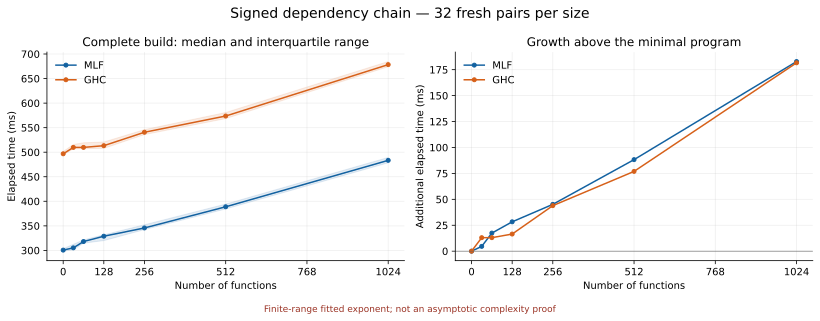

### Validation and qualification limits

- Fresh authenticated producer, regenerated builtin, locked plan, historical
  migration authentication (47 paths), and `git diff --check` pass.
- Serial regressions pass 18 actions; the maintained direct suite passes 17
  commands, including candidate-selection 279, ordered-map 153, CRC 200,
  query-JSON 123 and byte-copy four child commands. Query/cache/offline checks
  pass 13 actions. Signed CLI passes 18 cases: 13 native successes and five
  expected rejections. Python artifact/open-file suites pass 45/78 tests.
- Candidate controls use independent positional Data.Map/Data.Set and Python
  oracles against actual selector code: 8,254 named plus 12,369 ID host cases,
  seven demand controls, 24 interpreter cases and 124 cases each at native
  O0/O2. Duplicates, role overrides, Unicode/NUL, invalid ordinals, empty,
  complete, partial and very large candidate inventories are covered.
- Six independent interface/object audits at N=0/256/1024 compare complete
  decoded values after explicit dependency identity/path, object hash and
  fragment-stamp normalization. The actual semantic reader rechecks each
  pair. Disk/fused LLVM is exact within each producer and across producers.

This qualifies the GHC-hosted compiler and generated native programs only.
Native compiler self-bootstrap and installed `emlf SOURCE` remain unqualified;
older native O0 raw-codec long-symbol failures and the QuerySnapshotProbe gap
remain. No compatibility admission or checker condition was relaxed.

### Evidence

`qualification.json` binds final sources and evidence. The producer is
`producer-candidates`; rejected prototypes and failed receipts remain available.

| Path under this follow-up root | SHA256 |
| --- | --- |
| `qualification.json` | `212b400f4ee349b24c70accd41ce8e7d030ee4c3d5e523ff6b9f5cd0c3ceb4ef` |
| `producer-candidates/receipt.json` | `e78b5a3fd394e11b6287241ceab97c8f6252d0254116e987425146fae02aed11` |
| `retained-validation.json` | `e7ff048f09d3098ddbf414225b81934d4e0d7a2d85c0f60e194d1b1558fbbabd` |
| `bounded-direct-tests/candidate-selection/receipt.json` | `3bfa4ed79decd333164991a632ca6430b12b5d75096ed5287f4bd8f837a910d7` |
| `retained-memory/receipt.json` | `14dd689ca7b19c85e82fff462741a634d31c95c4d09e422a9cff8cbd38fba9d9` |
| `retained-semantic-controls/receipt.json` | `1ffb6a3f15540da65fc885f7035be437c3b9b8e53515b101b11e2a62d2706be1` |
| `candidate-comparison/cohorts/confirmation/receipt.json` | `6b93f05356451bb66539fbc8de5cfe4bab4eea274526319f9bfea4928dc6359d` |
| `candidate-analysis.json` | `0dafb469d9dac3495c82335d4d34f078b8d0bf7c40bd72ac27e31ce455b6a9cb` |
| `candidate-bounded-confirmation/receipt.json` | `fe8fa44fdff20dab8b3db9869471dc85e7bcd89bef87e5d971c0d780a8c294ab` |
| `candidate-bounded-confirmation-analysis.json` | `56a4bbcedafef9c7fb937cf0c5b31d5251dab4e07c226dfe7411e4b1486ff5fe` |

## Previous retained follow-up: borrowed byte input, 2026-11-16

Evidence is under `.mlf-build/signed-chain-digest-stream-20261116`.
The previous qualified producer, 195 source pins and the preceding evidence
were authenticated before mutation. Builds, checks and measurements were serial.

### Retained implementation and diagnostics

`MLF.Host.IO.bytesArray` uses `Data.ByteString.Unsafe.unsafeUseAsCStringLen`
to borrow the immutable input during the existing copy into an independent
pinned mutable array. The callback reads exactly the supplied length and
retains no pointer. The installed bytestring 0.12.2.0 Core confirms that the
former `useAsCStringLen` makes another length-plus-one pinned allocation,
copies the input and adds a NUL terminator that this callback does not need.
The destination still owns its own bytes and cannot mutate the source.

The measured shadow and maintained implementation differ only by an
explanatory comment. This changes no primitive, wire format or cache identity.
Builtin interface/object bytes, generated builtin source and the lock are
unchanged. The authenticated producer has 18 build actions and 137 modules.
Primitive ABI `mlf-primitive-136-v11`, builtin interface `mlf-primitive/shared-haskell-v1/15`.
Builtin identity: `builtin-source-v1:277a5874e021ea447afc3a9223cff1def8aefb01fa1fa9cc47eca4eed3a65e45`.

Two diagnostic screens use one warmup and four measured alternating pairs at
N=0/256/1024. A single predeclared byte-copy confirmation adds one warmup and
12 measured alternating pairs. Together, 138 compiles preserve the exact
reference interface/object/LLVM bytes and all 414 native oracle outputs pass.
These compiler-plus-Clang sums exclude the formal worker boundary.

| Screen | N=0 before / after, s | N=256 | N=1024 |
| --- | ---: | ---: | ---: |
| borrowed-copy-screen | 0.254648 / 0.248480 | 0.298348 / 0.295998 | 0.442714 / 0.449117 |
| borrowed-copy-confirmation | 0.254152 / 0.250053 | 0.299956 / 0.300724 | 0.446633 / 0.448243 |
| fields-digest-screen | 0.254499 / 0.253347 | 0.299545 / 0.298980 | 0.439077 / 0.439274 |

The N=1024 paired elapsed delta in the byte-copy confirmation is +2.679 ms,
with a 95% bootstrap interval of [-7.909, +5.051] ms (10,000 draws, seed
20261116). This does not prove faster compilation or timing equivalence.
Retention is based on removing a demonstrably redundant copy and allocation.

The rejected private `fields-digest` prototype avoids materializing framed
text and a mutable byte array before hashing. It saves about 8.294 MB of RTS
allocation at N=1024, but provides no established large-case timing gain to
justify a new host interface. Its C malloc buffer is outside the RTS heap,
so this is not a claim about lower total memory. No new digest primitive
or ABI change was retained. The two prototypes have 24 separate memory runs.

### Final allocation and residency

Three alternating RTS pairs per lane at N=0/1024 use `-s -F4`. Every memory
run preserves its own formal cohort artifacts and LLVM. Values are medians;
these runs are separate from ordinary timing.

| Functions | Allocation before / after, MB | Maximum live heap before / after, MB | Peak RSS before / after, MB |
| ---: | ---: | ---: | ---: |
| 0 | 270.512 / 270.459 | 1.391 / 1.396 | 34.324 / 34.341 |
| 1024 | 985.387 / 981.236 | 14.515 / 14.518 | 76.481 / 76.481 |

N=1024 saves 4,150,912 allocated bytes (0.421%). Peak RSS does not fall.
The receipt separately records copied bytes and GC CPU/elapsed time.

### One fresh GHC cohort

The unchanged `crate-fused-v1` boundary covers the fresh worker, MLF plus
Clang or `ghc --make`, through executable creation. Independent checks follow
the clock. Seven sizes and eight fresh alternating pairs per size give
**112 compiles and 336 correct native outputs**. No data points were removed,
no cohorts were pooled and no unchanged-source formal rerun sought acceptance.

| Functions | MLF median, s | GHC median, s |
| ---: | ---: | ---: |
| 0 | 0.301975 | 0.498037 |
| 32 | 0.315196 | 0.502216 |
| 64 | 0.314342 | 0.505168 |
| 128 | 0.330615 | 0.513271 |
| 256 | 0.346558 | 0.538812 |
| 512 | 0.393174 | 0.571620 |
| 1024 | 0.498342 | 0.674734 |

| Metric | MLF | GHC |
| --- | ---: | ---: |
| OLS slope, ms/function | 0.186980 | 0.171477 |
| Endpoint slope, ms/function | 0.191765 | 0.172556 |
| Fitted exponent p | 1.106615 | 1.182322 |
| Bootstrap 95% interval for p | [0.976643, 1.203282] | [1.068914, 1.350671] |

Paired MLF-minus-GHC OLS interval: **[0.006997, 0.027538] ms/function**.
Paired exponent interval: **[-0.299062, 0.060376]**. The offset power model is
`T(n) = a + b * (n/max(n))^p`, with nonnegative a/b and `0.1 <= p <= 3`.
Neither point fit reaches a parameter bound. The fixed 2,000 paired bootstrap
draws use seed 20261115. Finite-range fits do not prove asymptotic Big-O.

| Predeclared check | Pass |
| --- | --- |
| `all_positive_medians_lower` | True |
| `lower_ols_point` | False |
| `lower_endpoint_point` | False |
| `lower_power_point` | True |
| `lower_ols_95` | False |
| `lower_power_95` | False |

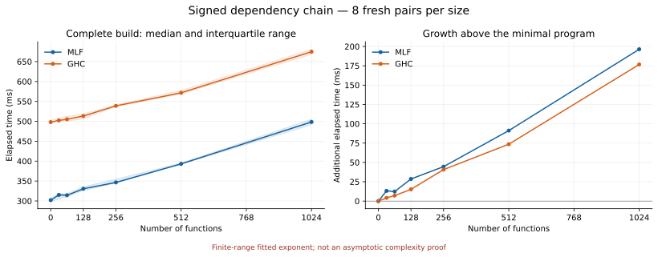

### Validation, failed attempts and limits

- Fresh authenticated producer, locked plan, unchanged builtin pair, 47-path
  historical migration authentication and `git diff --check` pass.
- Serial regressions qualify 18 actions. The final direct suite passes all
  16 commands, including ordered-map 153, CRC 200, query-JSON 123 and byte-copy
  four child commands. Query/cache/offline checks pass 13 actions; signed CLI
  passes 18 cases, including 13 native successes and five expected rejections.
  Modular artifact and open-file Python suites pass 45 and 78 tests.
- New copy controls exercise the actual host adapter and a copy with forced
  GC after destination allocation: 128 slice/ownership/GC cases, eight UTF-8
  vectors, three temporary-source lifetime cases and four demand comparisons
  against the former adapter. Slice offsets, destination mutation, source
  independence, NUL, scalar boundaries and empty/large arrays are covered.
- Six independent interface/object audits at N=0/256/1024 pass the actual
  semantic reader and exact disk/fused LLVM comparison. Across producers,
  object, LLVM and builtin bytes are identical; all decoded interface values
  match except the verified absolute path of the identical builtin file.

Failed attempts remain in the evidence. The initial forced-GC module met an
unrelated existing `ByteString.hGetLine` deprecation; only deprecations for
that copied test module are suppressed. Three temporary-source cases were
added after an initial direct-suite input snapshot, invalidating that run.
SIGINT cleanup completed and the full direct suite reran against final files;
the 17 earlier passed regression commands retain their original authenticated
logs. The first semantic audit also required identical absolute fixture paths
and failed. A fresh audit admits only those two verified builtin paths and
preserves every other value. It did not rerun the timing or memory cohort.

Qualification covers the GHC-hosted compiler and generated native programs.
Native compiler self-bootstrap and installed `emlf SOURCE` remain unqualified;
older native O0 raw-codec long-symbol failures and the QuerySnapshotProbe gap
remain. No cache admission or compatibility condition was relaxed.

### Evidence

`qualification.json` binds this result to final sources and evidence. The
retained producer is `producer-copy`; all rejected shadows and failed or
superseded receipts remain under the same ignored evidence root.

| Path under this follow-up root | SHA256 |
| --- | --- |
| `qualification.json` | `f368ec7de867393db84b7caca1228bbc959e9d1093eb7954a11a1cb598a4cd53` |
| `producer-copy/receipt.json` | `ee648c83dfb554865d8c6563345339654f2c706034b697bcef3e3a227aaed73c` |
| `retained-validation-recovery.json` | `284d52569c495b4f01f47fa9608dc68b8da4d57583ec8d78c0df210151ce0c2b` |
| `regression-recovery/receipt.json` | `3ebfcb17f43a77b1ec0fe649a8ba1f35dee851f9939010a0e79050530cc42942` |
| `bounded-direct-final/byte-array-copy/receipt.json` | `09c1e88c4f5e95709888b2175ba56fc3ab6b0ad872905e014257868c4b3e7dd6` |
| `retained-memory/receipt.json` | `1ad523daa0589ac71264284535ddb68466b073bfc51e89cf378cad6263041843` |
| `retained-semantic-controls-final/receipt.json` | `746d78cda8f6a61dc150a6438366b4ee6fc8cf032a64b57b05b4975d3371380a` |
| `copy-comparison/cohorts/confirmation/receipt.json` | `6e1bd359c9f339b5669f715ad777e9e07082f6ad66f6eae6288a926673bc8dff` |
| `copy-analysis.json` | `483a1fd250b9625e90e8276b1bb86f1e22dc7bbd6cdd62b1c29c6c6e80667b36` |
| `borrowed-copy-confirmation/receipt.json` | `72b2f1f7c0f3cec0c1659a6d540bf922a98baef818c81a4afb3e4c73e7d0833f` |

## Previous investigation: four rejected prototypes, 2026-11-16

Evidence is under `.mlf-build/signed-chain-post-narrow-20261116`.
The current narrow-field producer, all 195 source pins and 71 previous evidence
pins were authenticated. No compiler, ABI, builtin, lock or maintained test
source changed. This investigation adds diagnostic evidence only; the retained
implementation and its one formal GHC cohort below remain authoritative.

Six fresh profiling runs, two each at N=0/256/1024, preserve F4 and exactly
match the reference interface/object/LLVM. Own ticks and allocation reconcile
to each profile total. N=1024 minus N=0 attributes about 17.30 ms / 79.09 MB
to package assembly, 12.75 ms / 60.87 MB to query encoding, and 6.55 ms /
22.42 MB to prepared values excluding separately attributed prepared-syntax
work. These profiled values diagnose ownership, not acceptance timing.

### Paired diagnostic screens

Each alternative has one warmup and four alternating measured pairs at
N=0/256/1024: 30 compiles and 90 independent native outputs. All interface,
object and LLVM bytes match the current producer. The 120 total compiles and
360 native results pass. The numbers are compiler-plus-Clang subprocess sums;
they exclude the worker overhead used in the formal GHC cohort. Separate
screens are not pooled or compared across different baselines.

| Prototype | N=0 before / after, s | N=256 | N=1024 |
| --- | ---: | ---: | ---: |
| `row-targets` | 0.249831 / 0.248311 | 0.298522 / 0.300959 | 0.452483 / 0.447355 |
| `parser-expected` | 0.250388 / 0.251383 | 0.297906 / 0.301831 | 0.445310 / 0.442559 |
| `subtree-memo` | 0.254312 / 0.251758 | 0.293910 / 0.297447 | 0.448436 / 0.450201 |
| `word-store` | 0.248161 / 0.252071 | 0.296952 / 0.298487 | 0.437507 / 0.441655 |

### Allocation and decisions

Three independent, alternating RTS pairs per alternative at N=0/1024 use
`-s -F4`. All 48 memory compiles also preserve exact interface/object/LLVM
bytes. N=1024 medians below distinguish cumulative allocation from sampled
maximum live heap; the receipts separately retain copied bytes and peak RSS.

| Prototype | Allocation before / after, MB | Maximum live heap before / after, MB |
| --- | ---: | ---: |
| `row-targets` | 985.388 / 986.028 | 14.515 / 14.397 |
| `parser-expected` | 985.392 / 973.089 | 14.515 / 13.480 |
| `subtree-memo` | 985.390 / 992.138 | 14.515 / 15.939 |
| `word-store` | 985.387 / 967.085 | 14.515 / 14.515 |

- `row-targets` writes already resolved dense row numbers instead of typed
  target descriptors, with a private format-4 reader. This creates new integer
  nodes where the existing format reuses descriptor nodes. The N=1024 query
  index grows from 218,039 to 223,178 bytes (2.36%). Allocation rises and the
  N=256 screen regresses. Reject; no query format migration is retained.
- `parser-expected` defers error-message concatenation by carrying an expected
  token separately through parser combinators. Allocation falls by 12,303,216
  bytes, but the screen establishes no speed improvement and the added error
  variant needs diagnostic-equivalence qualification. Reject for this study.
- `subtree-memo` retains at most one structurally compared small subtree per
  constructor tag, capped at 64 entries and 256 work units per entry. Reuse
  still charges complete occurrence work and conservatively checks depth.
  Allocation rises by 6,748,880 bytes and timing does not improve. Reject.
- `word-store` buffers bits into 64-bit words and uses a private GHC-host
  checked little-endian word store. It saves 18,302,256 allocated bytes, but
  every measured size is slower. Reject; no primitive or ABI change is made.

These successful-source diagnostic checks do not qualify parser error behavior,
the proposed query format, all codec limits, a portable word-store primitive or
native compiler self-bootstrap. Rejected shadows were not put through the full
retained-source suite. Existing native O0 long-symbol and QuerySnapshotProbe
gaps remain; no installed `emlf SOURCE` qualification is claimed.

A read-only follow-up confirms that `hashRebuiltValue` materializes framed text,
then a mutable byte array, before the host digest takes its own snapshot.
Avoiding those materializations remains an unmeasured idea, not an optimization
result or a new Skill.

No unchanged-source formal cohort was rerun. The latest OLS slope remains
0.186932 ms/function for MLF versus 0.173654 for GHC; the fitted exponent is
1.094282 versus 1.243667. The slope condition still fails. No acceptance
commit/push or transition to the next shape occurred. Finite-range fits do not
prove asymptotic time complexity.

Investigation receipt: `investigation.json`; its source and evidence hashes
bind the completed diagnostics to the unchanged qualified producer.

## Previous retained follow-up: narrow bit fields, 2026-11-16

Evidence is under `.mlf-build/signed-chain-shared-fields-20261116`.
The preceding aligned-prefix producer, all 193 source pins and 94 evidence pins
were verified before mutation. Measurement, builds and checks were serialized.

### Retained implementation

`Bootstrap.Bitstream.packedBits` combines fields up to 56 bits with the pending
byte once, then `packedField` flushes complete bytes. At most seven pending bits
plus 56 source bits fit in a nonnegative Int64. The input field is masked before
the shift. Wider fields use the existing bounded split; zero-width fields retain
their immediate continuation behavior. This avoids repeated per-byte masks,
minimum calculations and reconstruction from the original input field.

Public raw writers, planning, interning, resource admission, varint encoding,
wire bytes, padding and CRC semantics are unchanged. The prototype produced
byte-identical interface, object and LLVM files at every screen and memory size.
The maintained source differs from the measured shadow only by an explanatory
comment. Builtin data was regenerated for its changed source identity; the final
producer and artifact comparisons use the corresponding current builtin.

Primitive ABI `mlf-primitive-136-v11`, builtin interface `mlf-primitive/shared-haskell-v1/15`.
Builtin source identity: `builtin-source-v1:277a5874e021ea447afc3a9223cff1def8aefb01fa1fa9cc47eca4eed3a65e45`.

### Rejected source-location factoring

Two private prepared-input prototypes separated call-site labels and full spans
from repeated normalized syntax. The first still built a complete key tree on
each hit. A separate trace-only N=32 probe confirmed 30 hits, four misses and
one cold entry, so the poor allocation result was not a lack of reuse. A second
prototype compared source syntax directly and retained a bounded location plan.
Neither version was integrated; no location-insensitive equality API or new
prepared-input representation remains in the maintained source.

| Prototype, N=1024 | Allocation before / after, MB | Decision |
| --- | ---: | --- |
| `located-original` | 1003.571 / 1012.000 | Reject: extra intermediate tree allocation |
| `located-direct` | 1003.569 / 998.061 | Reject: little timing gain for additional cache logic |
| `narrow-fields` | 1003.568 / 985.557 | Retain: stable lower allocation and simple writer change |

The direct-location screen measured 0.254960 / 0.247038 s at N=0,
0.298522 / 0.300316 s at N=256 and 0.447961 / 0.447292 s at N=1024.
Its cumulative allocation saving was only about 5.5 MB at N=1024. These prototypes
have host diagnostic evidence, not full retained-source/native qualification.

### Isolated writer screens

Both use the same preceding builtin to isolate the writer. The first has one
warmup and four measured alternating pairs per size. One follow-up was fixed
before execution, with one warmup and eight measured alternating pairs.
All 84 compiles preserve exact interface/object/LLVM bytes; all 252 generated
native outputs match the independent oracle. These compiler-plus-Clang sums
exclude the worker boundary and are diagnostics, separate from the GHC cohort.

| Screen | N=0, before / after (s) | N=256 | N=1024 |
| --- | ---: | ---: | ---: |
| narrow-fields-screen | 0.253293 / 0.252181 | 0.301375 / 0.300082 | 0.448899 / 0.444628 |
| narrow-fields-confirmation | 0.255301 / 0.254171 | 0.302446 / 0.298145 | 0.449612 / 0.448184 |

### Final allocation and residency

Three alternating RTS runs per lane at N=0/1024; both use `-s -F4`.
Each immutable producer uses its own qualified builtin, and every run matches
its own formal cohort interface/object/LLVM bytes. Memory runs are separate
from ordinary timing. Values below are medians.

| Functions | Allocation before / after, MB | Maximum live heap before / after, MB | Peak RSS before / after, MB |
| ---: | ---: | ---: | ---: |
| 0 | 272.446 / 270.511 | 1.525 / 1.391 | 34.193 / 34.324 |
| 1024 | 1003.563 / 985.386 | 14.098 / 14.515 | 76.349 / 76.464 |

Lower cumulative allocation does not imply lower maximum residency or RSS.
The receipt retains copied bytes and GC CPU/elapsed time as separate metrics.

### One fresh GHC cohort

The unchanged `crate-fused-v1` boundary includes the fresh worker, MLF compiler
plus Clang, or `ghc --make`, through complete executable creation. Parent-side
artifact/oracle checks follow timing. Seven sizes, eight fresh alternating pairs
per size: **112 compiles and 336 native outputs passed**. No cohort is pooled,
no point is removed, and this source snapshot has only one formal cohort.

| Functions | MLF median, s | GHC median, s |
| ---: | ---: | ---: |
| 0 | 0.306073 | 0.494922 |
| 32 | 0.311457 | 0.504063 |
| 64 | 0.316424 | 0.509377 |
| 128 | 0.328222 | 0.507452 |
| 256 | 0.349902 | 0.534935 |
| 512 | 0.394672 | 0.571153 |
| 1024 | 0.498395 | 0.676565 |

| Metric | MLF | GHC |
| --- | ---: | ---: |
| OLS slope, ms/function | 0.186932 | 0.173654 |
| Endpoint slope, ms/function | 0.187815 | 0.177385 |
| Fitted exponent p | 1.094282 | 1.243667 |
| Bootstrap 95% interval for p | [0.996849, 1.192406] | [1.144837, 1.342253] |

Paired MLF-minus-GHC OLS interval: **[0.002925, 0.020402] ms/function**.
Paired exponent interval: **[-0.294714, -0.007148]**. The fixed 2,000 paired
bootstrap draws use seed 20261115. The model is
`T(n) = a + b * (n/max(n))^p`, with nonnegative a/b and `0.1 <= p <= 3`.

| Predeclared check | Pass |
| --- | --- |
| `all_positive_medians_lower` | True |
| `lower_ols_point` | False |
| `lower_endpoint_point` | False |
| `lower_power_point` | True |
| `lower_ols_95` | False |
| `lower_power_95` | True |

A fitted finite-range exponent cannot establish an asymptotic Big-O class.
The signed-chain target remains active until elapsed time and both growth
conditions are met; this report makes no claim about another program shape.


### Validation and limits

- Fresh authenticated 18-action, 137-module producer build, regenerated builtin,
  lock refresh and locked plan; migration endpoints refreshed without changing
  frozen predecessors or independent oracles.
- Frozen codec byte/resource controls: five commands. Maintained packed writer:
  480 commands, 65,280 exhaustive byte states, 10,920 independent field states,
  20 interpreter and 224 each native O0/O2 vectors. The 55/56/57-bit transition
  supplements existing zero/full-width, signed-value and sentinel coverage.
- Symbol prefixes: 117 commands, 16 interpreter and 48 each native O0/O2 vectors.
- Serial regression: 18 actions; authenticated direct suite: 15 commands,
  including ordered-map 153, CRC 200 and query-JSON 123 child commands.
  Query/cache/offline controls: 13 actions; signed CLI: 18 cases (13 native
  successes and five expected rejections). Modular artifact and open-file
  Python suites: 45 and 78 tests.
- Six independent interface/object audits and actual semantic-reader
  disk/fused LLVM comparisons, 12 final memory runs, fresh GHC cohort and
  final source/evidence pins; `git diff --check` passed.

Qualification covers the GHC-hosted compiler and generated native programs.
Native compiler self-bootstrap and installed `emlf SOURCE` remain unqualified.
The older native O0 raw-codec long-symbol failures and QuerySnapshotProbe gap
are still unresolved. No compatibility or cache admission condition was relaxed.

### Evidence

The retained producer is `producer-narrow`; `narrow-comparison/commands.json`
records setup and the single formal run. `qualification.json` authenticates
source and evidence pins. Prototype drivers and failed-selection results are
preserved in the same ignored evidence root.

| Path under this follow-up root | SHA256 |
| --- | --- |
| `qualification.json` | `a52f6e31a6a8b36aa86bf17ff6f19efbfa209d850904eefab3168d149e0775f5` |
| `producer-narrow/receipt.json` | `8909d21efad44485f258855568fbfa5809cc14fe3b8fd4a3ddf33c4dd982276e` |
| `retained-validation.json` | `8304b235a0d4f7a2ff11ee16249ad5841e0a364f7c13569c7c4d02ceb7bf35c4` |
| `packed-writer-controls/receipt.json` | `f69be521eb9b4757a879ba4cdc5fb88f4618b9d04fc80f24f23885c98660d823` |
| `retained-memory/receipt.json` | `6f73943d9dbee418f1a65e9cc0fed5155a4a9b043c4f2f8304a869d5754bc18b` |
| `retained-semantic-controls/receipt.json` | `e0f22520682b179ec365456aa89c73c04faaad035003fdf90381175188107f06` |
| `narrow-comparison/cohorts/confirmation/receipt.json` | `a33a8df3a9292a3ed27c0b71e001a9b3516ca623eab64da5bc8776074c1fd818` |
| `narrow-analysis.json` | `6c800717a61b0725aa282eda3225550de850e352232c811df67cec3f7244c976` |
| `narrow-fields-confirmation/receipt.json` | `90b964c84065364de0a158f9a69046e75df7a9dae6ef768ab0dfe72d818c409d` |
| `located-counts/receipt.json` | `a9d0c6a964d7e1b85909ee50f81d023454e7e1869cb0f962afbbb1c793d050c0` |

## Previous retained follow-up: aligned symbol length prefixes, 2026-11-16

Evidence is under `.mlf-build/signed-chain-profile-refresh-20261116`.
The preceding packed-byte producer, source pins and all 54 evidence pins were
authenticated before mutation. This round refreshed the profile, rejected three
integer-index variants, and retained the smaller owned-writer change.

### Refreshed profile and implementation

Six profiling runs use the actual preceding qualified source, disabled query
phase timers, F4, and exact preceding interface/object/LLVM checks at N=0/256/1024.
The N=1024-minus-N=0 allocation attributed to `OpenFragment.makePackage` is
87.68 MB and to `QueryGraph.encodeHashed` is 69.45 MB. Their sampled owned costs
are 23.45 and 17.85 ms; these are profiling locations, not uninstrumented wall
times or predictions of an optimization's benefit.

`putOwnedSymbolSizes` and `putOwnedSymbols` begin at byte boundaries in a
completed finite layout. They now call the existing `packedVar` with zero
pending bits, then continue from its resulting byte index. This avoids the
general bit-position writer and its intermediate result for each length prefix.
The bulk path skips the already populated UTF-8 region; the fallback writes
the text through the existing owned text writer.

There is no new primitive or changed wire format, public raw writer, CRC,
planner admission, resource bound or node-index representation. For identical
inputs, the prototype reproduces preceding interface, object and LLVM bytes.
Primitive ABI `mlf-primitive-136-v11` and builtin interface `/15` remain unchanged.
The shared source change requires a regenerated builtin identity, embedded data,
lock and reconciliation pins. The retained producer was then rebuilt from source.

### Diagnostic selection

Each initial screen has one warmup and four measured alternating pairs at
N=0/256/1024, 30 compiles and 90 checked native outputs. Screens sum the compiler
and Clang subprocess times, excluding the formal worker startup. They are
separate diagnostics, not pooled GHC evidence or direct randomized comparisons
among variants.

| Variant | N=0 before / after (s) | N=256 before / after (s) | N=1024 before / after (s) |
| --- | ---: | ---: | ---: |
| int-route | 0.269847 / 0.274859 | 0.320193 / 0.321030 | 0.480993 / 0.483642 |
| int-direct | 0.273085 / 0.269830 | 0.331042 / 0.322215 | 0.488735 / 0.481985 |
| int-strict | 0.269476 / 0.272348 | 0.325935 / 0.331090 | 0.491814 / 0.488971 |
| aligned-prefix | 0.279170 / 0.274547 | 0.324694 / 0.328855 | 0.502783 / 0.502512 |

- `int-route` keeps an insertion continuation after an exact integer lookup.
  At N=1024 it adds 18.73 MB of allocation and shows no compiler-time gain.
- `int-direct` constructs the missing branch directly. It has a tentative
  large-case timing benefit but adds 15.22 MB; the extra index machinery and
  deferred allocations are not retained.
- `int-strict` forces missing branches while preserving lazy values. It still
  adds 6.79 MB and regresses the baseline and middle diagnostic medians.
- `aligned-prefix` removes 3.43 MB of allocation in its prototype. Its initial
  middle-size time is higher while large compiler time and Clang time move in
  opposite directions. One fixed follow-up was declared before running it.

The aligned-prefix follow-up has one warmup and eight measured pairs per size
(54 compiles, 162 checked outputs), with no further rerun. Its before/after
medians are:

| Functions | Before (s) | Aligned prefix (s) |
| ---: | ---: | ---: |
| 0 | 0.278033 | 0.277456 |
| 256 | 0.326753 | 0.323768 |
| 1024 | 0.499321 | 0.495802 |

The three medians improve by about 0.58/2.98/3.52 ms. Together with lower
allocation and reuse of an existing writer, this justifies retaining the small
change. It does not establish the final GHC growth gate. The three integer-index
prototypes remain outside the maintained sources.

An artifact-only check also explains the weakness of the earlier sampled-string
index: 1,038 interface symbols produce just 15 length-plus-last-three-scalar
buckets, with 901 symbols in the largest bucket. Several larger fixed samples
still leave that same large bucket. This is an observation about these actual
symbols, not a new hash/index implementation or a claim about all program shapes.

### Final separate memory measurements

Three alternating RTS pairs at each size retain F4 in both executables. Each
producer uses its own qualified builtin and reproduces its own cohort's exact
interface/object/LLVM output. Figures below are decimal MB.

| N | Metric | Before | Retained |
| ---: | --- | ---: | ---: |
| 0 | Cumulative allocation | 272.726 | 272.447 |
| 0 | Sampled maximum live heap | 1.525 | 1.525 |
| 0 | Maximum individual RSS | 34.210 | 34.193 |
| 1024 | Cumulative allocation | 1007.133 | 1003.564 |
| 1024 | Sampled maximum live heap | 15.038 | 14.098 |
| 1024 | Maximum individual RSS | 76.399 | 76.382 |

At N=1024, cumulative allocation falls by 3,569,880 bytes
(0.35%). Sampled maximum live heap
falls by 939,208 bytes, but RSS is effectively unchanged. Median GC CPU time is
0.055/0.057 s before/after and GC elapsed time is 0.060/0.062 s. Lower allocation
does not establish lower peak process memory or lower GC time.

### Frozen fresh GHC cohort and fit limitation

The timing boundary is unchanged: a fresh Python worker encloses MLF plus Clang
or `ghc --make`, including worker startup and stage bookkeeping. Correctness
checks run afterward in the parent. There is one fresh cohort, eight interleaved
pairs per size, 112 successful compiles and 336 checked native outputs. No sample
was removed, cohort pooled, or unchanged-source formal comparison rerun.

| Functions | MLF median (s) | GHC median (s) |
| ---: | ---: | ---: |
| 0 | 0.323091 | 0.526488 |
| 32 | 0.401480 | 0.545730 |
| 64 | 0.417237 | 0.546988 |
| 128 | 0.410492 | 0.555177 |
| 256 | 0.348588 | 0.581305 |
| 512 | 0.393144 | 0.612344 |
| 1024 | 0.505394 | 0.711669 |

| Growth measure | MLF | GHC |
| --- | ---: | ---: |
| OLS ms/function | 0.114924 | 0.170914 |
| Endpoint ms/function | 0.178030 | 0.180841 |
| Offset-power exponent | 3.000000 | 1.031869 |
| Exponent bootstrap 95% interval | [0.121910, 3.000000] | [0.100000, 2.611217] |

Paired MLF-minus-GHC OLS 95% interval: `[-0.09185787542929587, 0.019999819563067765]` ms/function; exponent interval: `[-0.8848305835786697, 2.8025225258378734]`.

**The MLF power fit reaches its configured upper bound, p=3. This is not
evidence of cubic complexity.** The N=32/64/128 medians are elevated and even
exceed N=256. The low OLS point estimate is also influenced by these elevated
small-size measurements; its paired interval still crosses zero. Neither the
lower slope point estimates nor any selected subrange establishes acceptance.

The existing per-stage records localize substantial variation outside source
compilation as well. At N=64, one MLF link takes 1.389600 s (0.189616 s aggregate
child CPU), and a GHC leg takes 1.663424 s inside its worker. Compiler elapsed
times and the worker residual also vary. The external cause has not been
established. Aggregate child CPU can exceed elapsed time for parallel descendants
and is not an idle-time measure. This audit reuses the frozen measurements only.

| Frozen acceptance check | Pass |
| --- | --- |
| `all_positive_medians_lower` | True |
| `lower_ols_point` | True |
| `lower_endpoint_point` | True |
| `lower_power_point` | False |
| `lower_ols_95` | False |
| `lower_power_95` | False |

This finite-range offset-power fit includes startup, IO, backend and linking;
it cannot prove an asymptotic complexity class. This particular cohort does not
provide a qualified complexity estimate. The signed chain remains unaccepted.

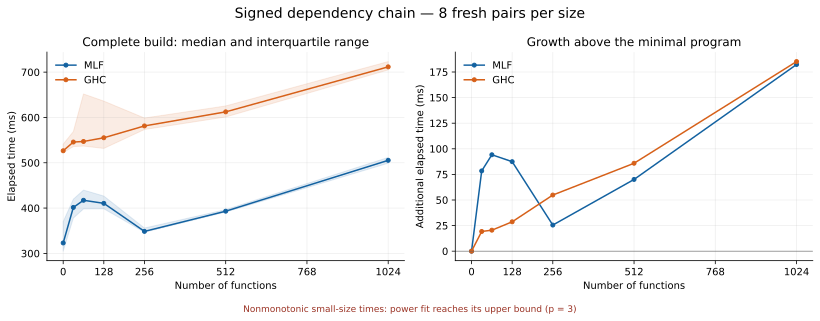

### Validation and scope

- Fresh producer: 18 actions / 137 shared modules; locked plan passes.
- New maintained source-extraction checks: 16 interpreter, 48 native O0 and
  48 native O2 vectors, 117 commands including build/link. Independent Python
  UTF-8/varint bytes check empty values, ASCII, three/four-byte scalars, embedded
  NUL, length boundaries 127/128 and 16383/16384, repeated symbols, prefix-only
  writes, full writes, returned bit positions and untouched buffer regions.
- Existing packed-writer controls: 65,280 exhaustive host states, 425 commands,
  including 16 interpreter and 200 native cases at each of O0/O2.
- Frozen codec controls: five commands preserving exact bytes, collision
  handling, resource limits and rejection behavior. Historical oracles unchanged.
- Compiler/package regression: 18 actions; direct suite: 15 commands; ordered
  map: 153; CRC: 200; query JSON: 123; query/cache/offline: 13.
- Signed CLI: 18 cases, 13 successful native programs and five expected
  rejections. Python artifact/open-file suites pass 45/78 tests.
- Six independent pair audits and actual disk semantic-audit readers agree
  with fused outputs. Final source/evidence hashes and `git diff --check` pass.

Run the maintained focused checks with:

```sh
python3 -B tools/shared/test_symbol_prefix.py \
  --build-receipt /absolute/path/to/producer/receipt.json \
  --clang /absolute/path/to/clang --output /absolute/path/to/fresh-controls
```

Three harness mistakes were corrected and preserved: the first integer-route
source generator turned a lambda escape into a newline; its first controls
driver selected a nonexistent producer path; the first new prefix extraction
guard counted recursive calls as definitions and stopped before compilation.
The final guard matches definition lines. Final controls all pass; these failed
attempts are not represented as passing tests or performance measurements.

Qualification covers the GHC-hosted compiler and generated native programs,
including the actual private prefix writers. Native compiler self-bootstrap
and installed `emlf SOURCE` remain unqualified. Earlier native O0 raw-codec
long-symbol failures and the QuerySnapshotProbe gap remain unresolved.

### Evidence pins

| Path under `.mlf-build/signed-chain-profile-refresh-20261116` | SHA-256 |
| --- | --- |
| `qualification.json` | `f0cd9b66cff323d1830d792cb63a3b389987efcad1cb63c2d57ce57404e5fa0b` |
| `producer-aligned/receipt.json` | `13fcc261d47b39b02ca337d2485207aed1739febc5016c52f7b517c9a6c803fe` |
| `builtin-generation-final/receipt.json` | `e70982a010ca1a397411155698a7c0ad7816a29f16db12684acbb70867106417` |
| `retained-build-final.json` | `931291ec41b5e73c42cea4bd9bee2c1e3d34a19d07857861604c50237ce4a782` |
| `symbol-prefix-controls-final/receipt.json` | `51bf47f9af94433b1395634b0c4968179b7ec02df323a4681f68982c6dadfb14` |
| `packed-writer-controls/receipt.json` | `b418486249717721fbb7bd1923f4617d41e1c1e1595bf508b9ba1819546ad3a2` |
| `retained-codec-controls/receipt.json` | `1c8557d0f56ae1ff2a1ba167103255da5a178d371a7fedb90e11796644b5868b` |
| `retained-validation.json` | `99d20f5d6dd462f1ed6ec625ebc59de041e23af6af8d799d1015f21af6445d9b` |
| `validation-suite.json` | `c159b902818773a61772b318d2a3fad2d103eb566f67c230fda7092ea5cf9dc7` |
| `retained-semantic-controls/receipt.json` | `62eea0d9580f8a2b11be6c136d5d1249c986943e7ec0742f6a3897992502d79c` |
| `retained-memory/receipt.json` | `0bfff65864f788efc054b358e649f9c248b60976491308293ea73f22bc6084e3` |
| `aligned-comparison/cohorts/confirmation/receipt.json` | `b9dd04384ab5c245764c3b7a9704adc48f8124746233dfb4e07c5f3f07e5bad8` |
| `aligned-analysis.json` | `1716e5e2d4fb8d2191670545778e853f3a683a77c249f436e4e362a86d3cf9fa` |
| `cohort-stage-audit.json` | `04aafc1e4ad944b12cc26b994d81417208ac71d1e3248c23bf437785acc4e853` |
| `profile-current/receipt.json` | `cc5b5c48d426146c5309ecd9307e6d6702650830c42297b78003830965c9e9c8` |
| `aligned-prefix-confirmation/receipt.json` | `07886807eb4097ad29bd0023d584b99b5bad310e195d33d749aa991064cc4f29` |
| `selection.json` | `7a8be864870895a5092a27346942f9b6603da9ed97ec00b8d9149ed1c4d4ba3b` |

## Previous retained follow-up: packed varint-byte writing, 2026-11-16

Evidence is under `.mlf-build/signed-chain-packed-byte-followup-20261116`.
The preceding qualified field-prefix producer, sources and evidence were
authenticated before mutation. Its still-failing growth slope motivated
another change in the measured serialization path.

### Retained implementation

The private `packedByte` helper in `Bootstrap.Bitstream` writes an already
bounded varint byte at any of the eight pending-bit offsets. It flushes exactly
one output byte, keeps the same occupied-bit count and passes the remaining
high bits to the continuation. `packedVar` uses this helper instead of entering
the general-width loop again for the byte's remaining bits. The computed byte
and following pending value are forced at the corresponding transition.

`packedBits`, public read/modify/write operations, planning/resource checks,
CRC and wire layout retain their preceding behavior. The private helper has no
public admission bypass. Primitive ABI `mlf-primitive-136-v11` and builtin
interface `/15` stay unchanged. Because a shared compiler source changed, the
embedded builtin, source identity, lock and historical reconciliation pins
were regenerated, followed by a fresh 18-action / 137-module producer build.

The source for native/interpreter controls is extracted from the actual
maintained definitions, with checked extraction boundaries and source hashes.
It is compared with a separate Python arbitrary-precision arithmetic oracle,
not with expected bytes regenerated by the candidate compiler.

### Prototype selection

Two separate screens each used one warmup and four measured alternating
pairs per size, complete compilation/linking and 90 checked native outputs.
Both prototypes reproduce the preceding interface/object/LLVM bytes exactly.
These are diagnostic screens, not formal GHC acceptance cohorts or a direct
randomized comparison between the two prototypes.

| Prototype | N=0 before / after (s) | N=256 before / after (s) | N=1024 before / after (s) |
| --- | ---: | ---: | ---: |
| packed-byte | 0.260000 / 0.255272 | 0.301953 / 0.302804 | 0.453843 / 0.446383 |
| byte-finish | 0.256224 / 0.256610 | 0.301625 / 0.300024 | 0.451663 / 0.450143 |

The `packed-byte` prototype removes about 7.32 MB of allocation at N=1024.
Its large-case diagnostic median is about 7.5 ms lower; the middle size is
about 0.85 ms higher. The extra `byte-finish` branch skips a general-width
zero-length recursive step and removes a further roughly 1.3 MB, but its
separate screen does not demonstrate additional timing benefit. The simpler
`packed-byte` implementation is retained; `byte-finish` is not integrated.

### Final separate memory measurements

Three alternating RTS pairs per size preserve F4 in both links. Each producer
uses its own builtin and reproduces its own formal cohort interface/object/LLVM
bytes. Figures are decimal MB. Cumulative allocation, sampled maximum live heap
and maximum individual process RSS are different measures.

| N | Metric | Before | Retained |
| ---: | --- | ---: | ---: |
| 0 | Cumulative allocation | 273.545 | 272.730 |
| 0 | Sampled max live heap | 1.525 | 1.525 |
| 0 | Max individual RSS | 35.242 | 34.210 |
| 1024 | Cumulative allocation | 1014.345 | 1007.138 |
| 1024 | Sampled max live heap | 14.518 | 15.038 |
| 1024 | Max individual RSS | 76.382 | 76.399 |

At N=1024, cumulative allocation falls by 7.21 MB (0.71%).
This does not imply the same reduction in peak memory.

### Frozen fresh GHC comparison

Both lanes time a fresh Python worker, including its startup and stage
bookkeeping. MLF encloses the compiler plus Clang; GHC encloses `ghc --make`.
Correctness checks run afterward in the parent. This boundary is unchanged.
One fresh cohort has eight interleaved
pairs at each of seven sizes, 112 successful compiles and 336 checked native
outputs. No points were removed, cohorts pooled, or unchanged formal source
rerun to seek acceptance.

| Functions | MLF median (s) | GHC median (s) |
| ---: | ---: | ---: |
| 0 | 0.305700 | 0.519531 |
| 32 | 0.307349 | 0.515342 |
| 64 | 0.322406 | 0.525867 |
| 128 | 0.329984 | 0.526700 |
| 256 | 0.354366 | 0.555434 |
| 512 | 0.393288 | 0.590029 |
| 1024 | 0.500272 | 0.689804 |

| Growth measure | MLF | GHC |
| --- | ---: | ---: |
| OLS ms/function | 0.187502 | 0.169454 |
| Endpoint ms/function | 0.190011 | 0.166282 |
| Offset-power exponent | 1.066127 | 1.193201 |
| Exponent bootstrap 95% interval | [0.993513, 1.181183] | [1.036394, 1.476235] |

Paired bootstrap MLF-minus-GHC OLS interval: `[-0.013583590019971859, 0.02858492939379697]` ms/function; exponent interval: `[-0.3719285035501111, 0.07240640784643694]`.

| Frozen acceptance check | Pass |
| --- | --- |
| `all_positive_medians_lower` | True |
| `lower_ols_point` | False |
| `lower_endpoint_point` | False |
| `lower_power_point` | True |
| `lower_ols_95` | False |
| `lower_power_95` | False |

The offset-power exponent describes this measured finite range, including
startup, IO, backend and linking. It is not a proof of a lower asymptotic
complexity class.

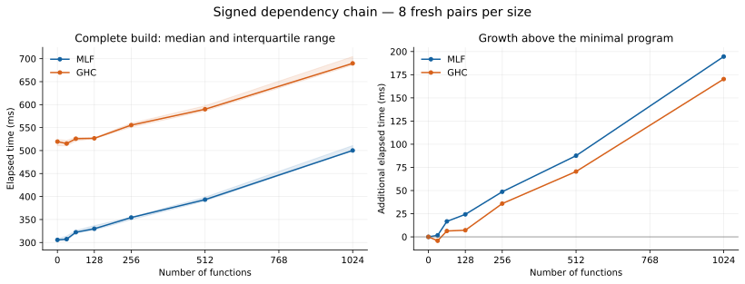

### Validation and scope

- Fresh producer: 18 actions / 137 shared modules; locked package plan passes.
- Exhaustive host controls: all 65,280 valid pending-byte/next-byte states
  match independent arithmetic and the general-width writer. Continuation
  state, untouched sentinel bytes, final padding and bit position are checked.
- The actual private writer definitions pass 16 interpreter, 200 native O0
  and 200 native O2 vectors, covering all offsets, zero/full widths, varint
  boundaries, signed-64 bit patterns and untouched buffer regions.
- Frozen codec controls preserve exact encoding and finite limit/failure
  behavior. The historical codec oracle remains unchanged.
- Compiler/package regression: 18 actions; direct suite: 15 commands, ordered
  map: 153, bulk CRC: 200, query JSON: 123, query/cache/offline: 13.
- Signed CLI corpus: 18 cases, 13 successful native programs and five expected
  rejections. Artifact and open-file Python suites pass (45 and 78 tests).
- Six independent pair audits and actual semantic-audit disk readers agree
  with fused output. Both prototype memory/screens preserve exact preceding
  artifacts and LLVM; retained memory reproduces each lane's own cohort.

Run the focused maintained writer controls with:

```sh
python3 -B tools/shared/test_packed_writer.py \
  --build-receipt /absolute/path/to/producer/receipt.json \
  --clang /absolute/path/to/clang --output /absolute/path/to/fresh-controls
```

Qualification covers the GHC-hosted compiler and generated native programs.
It does not claim a native compiler self-bootstrap or installed `emlf SOURCE`
qualification. The helper's native O0 checks do not resolve older native O0
raw-codec long-symbol failures or the QuerySnapshotProbe gap.

### Evidence pins

| Path under `.mlf-build/signed-chain-packed-byte-followup-20261116` | SHA-256 |
| --- | --- |
| `qualification.json` | `70de2f016e437741eebc953631ecaa71c12e173e18250152af9ed4f36bc3d61b` |
| `producer-packed/receipt.json` | `36c57d98456e5ca3e213306425656ea162020b60c8b8472455e9c7771ff73cd7` |
| `builtin-generation-final/receipt.json` | `cd8e27af52ee8fb7c943097e9eb9f4d91cf67568de397b35ff66056f1f13957e` |
| `retained-build-final.json` | `5afbc18aa3de8d4fb28b524ebb0fdd5bbcfd7ea453e0345e7285c331960a83f5` |
| `packed-writer-controls/receipt.json` | `67e36fc96a6702c4f5e6e91f5a0c8145b2a0091d2ccbb7fec9321ec3fd9de8dd` |
| `retained-codec-controls/receipt.json` | `236e30cb07adc443169ebefa0175aa31674637b6e4574e7eaf733aad4ca60361` |
| `validation-suite.json` | `ae9871cfb9ca4758e6558c7201c32898ca7f264f4338e8f3dae1f3f2d0f40adc` |
| `retained-semantic-controls/receipt.json` | `16ba7d3b616e03b96c53481170dbc0e45310912121867d8b7c147bba3c9a4b7a` |
| `retained-memory/receipt.json` | `f952d36917c0f2453600b2407c9e596b7bf5d30502e53a0dcfd40c92ddd946a8` |
| `packed-comparison/cohorts/confirmation/receipt.json` | `908470ff186e9a19714a5752a27c6675be773bfe5ad0cbc6069a1f8039efd3b1` |
| `packed-analysis.json` | `011a6ed1b39af81003e74161579d6c73c6645fd9dbef77c537aa986d3a9fce92` |
| `packed-byte-controls/receipt.json` | `41019a180689e8c805d12890d1829e06fb0764728e8eba92aa12efb1a9564b1b` |
| `packed-byte-screen/receipt.json` | `f995b358b40bd91e5c9ee105fc14d29a8d24d40d20780cbc07d79a5e46fb7d1b` |
| `byte-finish-controls/receipt.json` | `cd9985e982504f01c6ecd2fa41dc93a55807e78f36cbe93b1f0bc47170a4195a` |
| `byte-finish-screen/receipt.json` | `b0bad21b6de38b0bfb7f96d4ce593f953e4c918c7106d84d797d23d0174783c3` |

## Previous retained follow-up: bounded field-prefix sharing, 2026-11-16

Evidence is under `.mlf-build/signed-chain-framing-followup-20261116`.
The preceding qualified producer and all of its pinned source/evidence inputs
were authenticated before mutation. A fresh two-run-per-size profile at
N=0/256/1024, with query phase timers disabled, reproduced the previous
interface/object/LLVM bytes. At N=1024 minus N=0, costs owned by
`OpenFragment.makePackage` were about 18.95 ms / 91.02 MB; those owned by
`QueryGraph.encodeHashed1` were about 14.50 ms / 71.99 MB. These are profiling
diagnostics, not complete-build timing results.

### Retained implementation and limits

`host/ghc/MLF/Host/Base.hs` now shares each complete decimal scalar-length plus
colon prefix for lengths 0 through 1023. A fixed lazy array bounds retained
headers independently of input count; it retains no payloads. Larger lengths
use the same decimal framing directly. Each field adds two Text fragments
instead of three. Head-before-tail demand, Unicode scalar counts, UTF-8 bytes,
overflow checks and the output format remain unchanged.

This changes cumulative temporary allocation, not artifact size. Primitive ABI
`mlf-primitive-136-v11`, builtin interface `/15`, embedded builtin bytes, builtin
source identity and `mlf.lock` are unchanged. Historical source reconciliation
pins were refreshed only for the changed host implementation. The current
producer was rebuilt from all 137 shared modules in 18 actions.

The byte-write inlining idea was stopped at compilation: `v_writeByteArray`
already has an INLINE pragma. GHC rejected the duplicate. That failed prototype
receipt is preserved; no byte-write change or timing claim is retained.

### Diagnostic screens and intermittent link delays

The first alternating screen retained one warmup and four measured pairs per
size. Some identical LLVM inputs had Clang link durations between roughly
0.128 and 0.867 seconds. An observed busy filesystem-event process does not
establish the cause. A subsequent fixed-input probe performed 36 links and
108 native output checks, alternating repository and temporary-directory
outputs; its median link times were about 0.125–0.128 seconds, with no
established location penalty. No process was killed or system setting changed.

One diagnostic confirmation was predeclared as one warmup plus eight measured
pairs per size. Both screens, including noisy observations, remain separate.
The diagnostic confirmation is not a repeated GHC acceptance cohort.

| Diagnostic screen | N=0 before / after (s) | N=256 before / after (s) | N=1024 before / after (s) |
| --- | ---: | ---: | ---: |
| field-prefix-screen | 0.284957 / 0.291223 | 0.324292 / 0.407031 | 0.547214 / 0.526446 |
| field-prefix-confirmation-screen | 0.256491 / 0.258112 | 0.310640 / 0.304917 | 0.469717 / 0.462876 |

The confirmation reduced complete-build medians by about 5.7 ms at N=256 and
6.8 ms at N=1024, with a roughly 1.6 ms higher N=0 median. It motivates retaining
the allocation improvement; it does not establish a speedup at every size.

### Separate retained memory measurements

Three alternating RTS pairs per size preserve F4 in both links. Each lane uses
its authenticated producer and exactly reproduces its own formal cohort
interface/object/LLVM bytes. Figures are decimal MB. Allocation is cumulative;
sampled maximum live heap and maximum individual process RSS are distinct.

| N | Metric | Before | Retained |
| ---: | --- | ---: | ---: |
| 0 | Cumulative allocation | 276.096 | 273.541 |
| 0 | Sampled max live heap | 1.482 | 1.525 |
| 0 | Max individual RSS | 33.145 | 35.226 |
| 1024 | Cumulative allocation | 1032.883 | 1014.340 |
| 1024 | Sampled max live heap | 15.199 | 14.518 |
| 1024 | Max individual RSS | 76.349 | 76.382 |

At N=1024, cumulative allocation falls by 18.54 MB
(1.80%). This is not an equivalent peak-memory claim.

### Frozen fresh GHC comparison

The same complete-build boundary is used: compiler plus Clang for MLF, complete
GHC compilation for the comparison. One fresh cohort has eight interleaved
pairs at each of N=0/32/64/128/256/512/1024, 112 successful compiles and 336
checked native outputs. No points were removed, cohorts pooled, or unchanged
formal source rerun to seek acceptance.

| Functions | MLF median (s) | GHC median (s) |
| ---: | ---: | ---: |
| 0 | 0.306202 | 0.512833 |
| 32 | 0.306645 | 0.522251 |
| 64 | 0.319198 | 0.522773 |
| 128 | 0.331876 | 0.521708 |
| 256 | 0.353003 | 0.549641 |
| 512 | 0.396172 | 0.582492 |
| 1024 | 0.502705 | 0.689938 |

| Growth measure | MLF | GHC |
| --- | ---: | ---: |
| OLS ms/function | 0.191089 | 0.169757 |
| Endpoint ms/function | 0.191897 | 0.172954 |
| Offset-power exponent | 1.058144 | 1.328637 |
| Exponent bootstrap 95% interval | [0.938070, 1.186344] | [1.219521, 1.485010] |

Paired bootstrap MLF-minus-GHC OLS interval: `[0.008328264739485308, 0.032580130120711995]` ms/function; exponent interval: `[-0.4666331806416114, -0.10834103543946126]`.

| Frozen acceptance check | Pass |
| --- | --- |
| `all_positive_medians_lower` | True |
| `lower_ols_point` | False |
| `lower_endpoint_point` | False |
| `lower_power_point` | True |
| `lower_ols_95` | False |
| `lower_power_95` | True |

The offset-power fit includes a startup floor and estimates a finite measured
range. Its exponent is not a proof of an asymptotic Big-O class. The bounded
prefix table reduces repeated work; it does not by itself change the general
complexity of compilation.

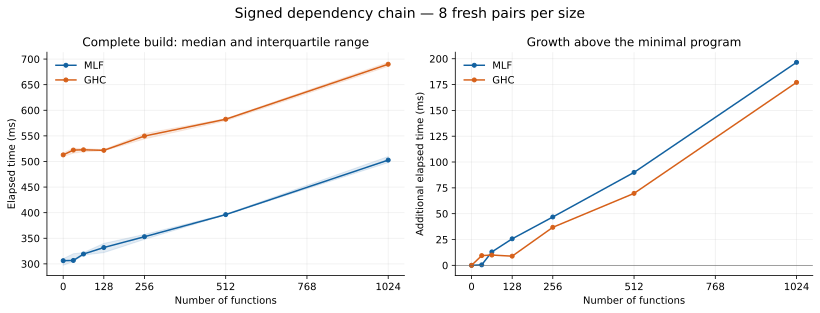

### Validation and scope

- Fresh producer: 18 actions / 137 shared modules; locked package plan passes.
- Field framing: 241 independent host cases in three lanes; 2,236 prefix cases
  in four paths, including all cached lengths and the 1023/1024/1025 boundary;
  65 nested/shared cases. Unicode scalar counts, exact bytes, indexing and
  failure demand order pass.
- Maintained field suite: 42 host, 14 interpreter, 42 native O0 and 42 native
  O2 vectors, 12 demand checks per lane, and 26 direct runtime controls.
- Compiler/package regression: 18 actions; direct suite: 15 commands, ordered
  map: 153, bulk CRC: 200, query JSON: 123, query/cache/offline: 13.
- Signed CLI corpus: 18 cases, 13 successful native programs and five expected
  rejections. Artifact and open-file Python suites pass (45 and 78 tests).
- Actual new compiler reproduces the previous interface/object/LLVM bytes at
  N=0/256/1024 on identical inputs. Six independent pair audits and actual
  semantic-audit disk readers agree with fused output.

Qualification covers the GHC-hosted compiler and generated native programs.
It does not claim a native compiler self-bootstrap or installed `emlf SOURCE`
qualification. Older native O0 raw-codec long-symbol failures and the
QuerySnapshotProbe gap remain unresolved.

### Evidence pins

| Path under `.mlf-build/signed-chain-framing-followup-20261116` | SHA-256 |
| --- | --- |
| `qualification.json` | `ab6d72c1cb85596623e33b2c42c69b2c3e4a3c0a2331613b29853625cb40b84b` |
| `producer-framing/receipt.json` | `f44e317c6a92046bfeed31b1d5438297008e82fa60ce8e3c8997551141f96c38` |
| `retained-build-final.json` | `c7bf5b3c89faa724dca1a06f51627f63f31ef20bceacc87636d56401936388dc` |
| `retained-fields-controls/receipt.json` | `6f4c9c5bbdaa066124014288788c217620f3391fb4aad7906a605678993a48c9` |
| `retained-fields-controls/cross-backend/receipt.json` | `b7d932dc43cf3956f8a97494144e4eaaf2bb853975d0d430efe5bbf1894e29ea` |
| `validation-suite.json` | `9c409cec78c4dc69936dbea1499c908808583f94a22ec909b9323b827765be7f` |
| `retained-exact-controls/receipt.json` | `f89160a5ace179591f7195f9c62a7ab217140ee954a2c212f0f945af325be909` |
| `retained-semantic-controls/receipt.json` | `960c96256a04365c54d555ed809e8e616f52c494bc4b963e6e37706978015263` |
| `retained-memory/receipt.json` | `dc19459883ea191a763a3dedc92924ab374a7e0be7e409654ede0adc61d24bc0` |
| `framing-comparison/cohorts/confirmation/receipt.json` | `439aafa81cf29eec8c3840eeb4976cb44176f75c0948e6e58e7a33ec17b1d6be` |
| `framing-analysis.json` | `419443ac9b2d5425f0468181cdb73ef0ad1c385d89372358c79408c33507b5fe` |
| `field-prefix-screen/receipt.json` | `032638c95272d7cd5af5024a3138dbabce44cbb932ed5de2f8ea28c4e153189b` |
| `field-prefix-confirmation-screen/receipt.json` | `7c90d373fceacc59913a0b6d776cc80384449872375e67e761373bc6792b9d11` |
| `link-location-probe/receipt.json` | `c24040703ce8480beb05b75f6eb0d741b6a8a804b2dcf3c7ec5313fe2b8a60ac` |
| `byte-inline/receipt.json` | `f5a83ae88685ac09c9137b7346364f12522818887842521c9409b7d8708ece02` |

## Previous retained follow-up: bounded lowered-syntax reuse, 2026-11-16

Evidence is under `.mlf-build/signed-chain-prepared-reuse-20261116`.
The preceding F4 producer and prior source/evidence pins were authenticated
before the experiment. The prepared-metadata hotspot was about 15.05 ms and
66.54 MB of N=1024-minus-N=0 profiled work in the preceding diagnostic run.

### What changed and why

The first prototype cached the whole original/lowered pair. Exact tracing of
the 32-function case found 35 groups and no whole-pair hits: source locations
and call-site labels differ. The lowered lane had only five distinct encodings
and 30 adjacent repeats. The whole-pair prototype added allocation and time,
so it is rejected. This is a measured miss mechanism, not a license to omit
source positions or other semantic inputs.

`CrateGraph` now retains only the previous canonical lowered members and their
exact legacy encoded text. A hit compares all encoded structural fields.
`SourceEquality.eqSExprBits` propagates a bitwise Double policy through every
recursive expression position; existing `eqSExpr`, alternative and statement
equality keep their numerical Double policy. Thus negative zero and NaN
payloads remain distinct where the serialized input requires it.

On a miss, retention is limited to 256 key nodes, depth 32, 16,384 scalar
characters across key leaves and 65,536 encoded scalar characters. Larger
values use the uncached encoder and clear the memo; a later small group can
resume reuse. This is one compilation-local entry. It does not cache current
declaration identities, authority metadata, checked results or resource-admission
decisions. The prepared-query representation, artifact format, primitive ABI
and builtin interface are unchanged. Builtin source identity and the package
lock were regenerated for the changed shared source:
`builtin-source-v1:03b634785d9b4881951416c820e098bec173f253a3804d501f47780288380930`.

### Isolated screens

Each variant has one warmup and four alternating measured pairs at N=0/256/1024:
30 compiles and 90 independently checked native results. Every interface,
object and LLVM byte equals the reference. These compiler-plus-Clang sums
are diagnostic; they are not pooled with full-worker GHC measurements.

| Variant | N=0 before / after, seconds | N=256 before / after, seconds | N=1024 before / after, seconds |
| --- | ---: | ---: | ---: |
| `prepared-cache` | 0.257473 / 0.251625 | 0.301480 / 0.312587 | 0.460424 / 0.465525 |
| `lowered-cache` | 0.251499 / 0.256152 | 0.297268 / 0.297739 | 0.461976 / 0.449971 |

The whole-pair prototype allocates about 29.0 MB more at N=1024.
The lowered-only prototype removes about 14.2 MB and its large-case screen
is about 12.0 ms faster, with the middle size almost unchanged. Its baseline
is about 4.7 ms slower. These small screens motivate validation, not a claim
that all sizes have an established speedup.

### Final separate memory measurements

Three alternating RTS pairs per size preserve F4 in both links. Each lane
uses its own authenticated producer and builtin, and exactly reproduces its
formal cohort interface/object/LLVM bytes. Figures are decimal MB.

| N | Metric | Before | Retained |
| ---: | --- | ---: | ---: |
| 0 | Cumulative allocation | 276.071 | 276.093 |
| 0 | Sampled max live heap | 1.499 | 1.486 |
| 0 | Max individual RSS | 33.079 | 33.145 |
| 1024 | Cumulative allocation | 1046.596 | 1032.880 |
| 1024 | Sampled max live heap | 15.196 | 15.199 |
| 1024 | Max individual RSS | 76.366 | 76.349 |

The retained producer removes 13.72 MB (1.31%) of cumulative allocation
at N=1024. This is not a claim of a comparable peak-memory reduction: sampled
maximum residency and process RSS measure different things.

### Frozen fresh GHC comparison

The predeclared sizes and eight alternating pairs per size give 112 complete
compiles and 336 correct native results. No failed points are removed and no
unchanged-source repeat is used to seek acceptance.

| Functions | MLF median, seconds | GHC median, seconds |
| ---: | ---: | ---: |
| 0 | 0.305941 | 0.544433 |
| 32 | 0.313674 | 0.523825 |
| 64 | 0.317337 | 0.535318 |
| 128 | 0.337933 | 0.541072 |
| 256 | 0.349553 | 0.568892 |
| 512 | 0.407156 | 0.615431 |
| 1024 | 0.505362 | 0.700407 |

| Metric | MLF | GHC |
| --- | ---: | ---: |
| OLS growth, ms/function | 0.193843 | 0.168601 |
| Endpoint growth, ms/function | 0.194747 | 0.152318 |
| Fitted exponent in offset + scale × N^p | 1.014086 | 1.118154 |
| Exponent bootstrap 95% interval | [0.9393, 1.1073] | [0.9649, 1.2757] |

Paired bootstrap intervals for MLF minus GHC:
OLS ms/function `[0.01424323246054586, 0.04190412234394576]`;
exponent `[-0.27504803936080396, 0.0819214442583191]`.

| Acceptance condition | Result |
| --- | --- |
| `all_positive_medians_lower` | pass |
| `lower_ols_point` | fail |
| `lower_endpoint_point` | fail |
| `lower_power_point` | pass |
| `lower_ols_95` | fail |
| `lower_power_95` | fail |

The joint gate is **not passed**. Finite-range exponents do not establish
an asymptotic complexity class. Reduced allocation and faster large-case
diagnostics alone do not satisfy the full growth criterion.

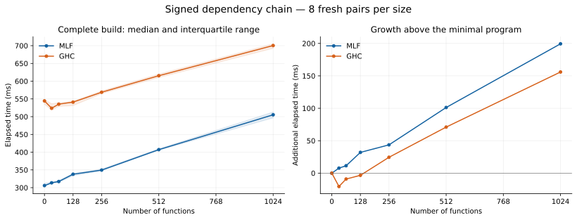

### Validation and scope

- Fresh hosted build: 18 actions and 137 shared modules; builtin verification
  and locked package planning pass.
- New prepared-syntax controls: 9,904 host checks across 53 syntax variants,
  pairwise original/lowered transitions, key budgets, oversized fallback and
  recovery, changing current identity/authority metadata, and nested IEEE bits.
- Actual shared equality source: 25 interpreter vectors and 90 vectors each
  under native O0/O2, with independent expected bit/numerical equality results.
- Existing regression: 18 actions, 15 direct commands, 153 ordered-map, 200
  CRC, 123 query-JSON commands, and 13 query/cache/offline actions. The separate
  CLI corpus checks 13 native cases and five expected rejections.
- Independent artifact reader plus actual semantic audit compares complete
  interfaces, identities, bodies, types and scopes at N=0/256/1024; six disk
  compilations equal the corresponding fused LLVM.
- The 45 artifact and 78 open-file Python suites pass.

Two initial harness failures remain recorded: the first prototype compile
exited zero but emitted GHC warnings, which the strict runner rejects; the
first retained native check lacked the language-core module search root.
Corrected final controls pass. Neither is represented as a passing first attempt.

Qualification covers the GHC-hosted compiler and generated native programs,
including the actual shared equality implementation. Native compiler
self-bootstrap and installed `emlf SOURCE` remain outside this qualification.
Earlier native O0 raw-codec long-symbol failures and the QuerySnapshotProbe
gap remain unresolved. Source-path factoring is only a possible later study;
no new span representation was implemented or measured in this follow-up.

Reproduce the focused controls with:
```sh
python3 -B tools/shared/test_prepared_syntax.py --build-receipt BUILD/receipt.json --output FRESH_OUTPUT --clang /path/to/clang
```

Qualification SHA-256: `eac506322e5a44edaba1faa0444fadbd59180c860058efb161b5561082dc70ba`.

## Prior follow-up: rejected allocation prototypes, 2026-11-16

Evidence is under `.mlf-build/signed-chain-open-package-followup-20261116`.
The qualified F4 producer and all source/evidence pins were authenticated before
work. Six fresh profiling runs, two each at N=0/256/1024, preserve F4 and match
the reference interface, object and LLVM bytes. N=1024-minus-N=0 attribution
places about 19.00 ms / 91.02 MB under package assembly, 15.05 ms / 66.54 MB under
prepared metadata and 14.25 ms / 71.96 MB under query encoding. These profiled
times diagnose work ownership; they are not acceptance timings.

### Alternatives and complete-build screens

`word-buffer` keeps up to 63 pending bits, flushing eight existing byte writes
at a time. It preserves every wire byte and introduces no primitive. The two
host-string alternatives retain validated field fragments before materializing
text: `deferred-fields` uses a Text Builder; `fragment-fields` uses a simpler
tree of Text leaves and reversed field lists. Each bounds deferred values to
32 levels and 64 KiB; larger values flatten immediately. Ordinary constructors
still validate text eagerly, and field heads are checked before later list cells.
All three variants remain isolated prototypes; maintained source is unchanged.

Each screen uses N=0/256/1024, one warmup and four alternating measured pairs:
30 compiles and 90 native results per variant. Every interface/object/LLVM byte
matches the qualified reference. Compiler-plus-Clang subprocess sums below are
separate from complete-worker GHC timing and are not pooled across screens.

| Prototype | N=0 before / after, seconds | N=256 before / after, seconds | N=1024 before / after, seconds |
| --- | ---: | ---: | ---: |
| `word-buffer` | 0.250193 / 0.251807 | 0.294211 / 0.305270 | 0.457322 / 0.456732 |
| `deferred-fields` | 0.255800 / 0.260383 | 0.300534 / 0.311487 | 0.463073 / 0.469012 |
| `fragment-fields` | 0.252725 / 0.252822 | 0.295428 / 0.309431 | 0.462546 / 0.461289 |

The word writer saves allocation but only about 0.6 ms in the largest case;
the middle case is about 11 ms slower. Builder deferral is slower at every
screened size. The simpler fragment tree is almost unchanged at N=0/1024 and
about 14 ms slower at N=256. These small screens do not establish a statistical
speedup, and none supplies enough benefit to retain the extra representation.

### Memory evidence

Three alternating RTS pairs at N=0/1024 run separately from timing, with F4
preserved in both instrumented links. All output bytes still match. Numbers
below are decimal MB at N=1024. Sampled maximum live heap is not process RSS.

| Prototype | Allocated MB before / after | Sampled max live MB before / after | Max individual RSS MB before / after |
| --- | ---: | ---: | ---: |
| `word-buffer` | 1046.606 / 1023.198 | 15.196 / 15.196 | 75.137 / 75.104 |
| `deferred-fields` | 1046.609 / 1113.001 | 15.196 / 10.544 | 75.071 / 77.660 |
| `fragment-fields` | 1046.609 / 1053.627 | 15.196 / 10.310 | 75.137 / 76.595 |

Word buffering removes 23.41 MB of cumulative allocation, with almost unchanged
live heap and RSS. Both deferred representations lower sampled live heap by
about 31–32%, but increase cumulative allocation and process RSS. They therefore
do not establish a peak-memory saving. Reduced copying or a lower sampled GC
statistic alone is insufficient evidence to replace the current representation.

### Validation and decision

- The word writer passes five frozen-codec build/control commands, including
  exact wire, reference-width, expanded-work and collision controls.
- Each deferred representation passes 238 independent framing cases through
  three call paths, Unicode scalar indexing/slicing and existing demand controls.
- Each also passes 11,664 codepoint comparison pairs through host/primitive
  paths, their demand/error controls, and 65 additional nested, size-boundary
  and shared-subtree cases with four nested-error/bounds controls.
- Across all prototypes: 90 diagnostic compiles, 270 correct native program
  outputs and 36 separate memory runs, with exact reference artifact/LLVM bytes.

The first deferred control link accidentally included unrelated stale copied
test objects after the private host String representation changed. Its failed
receipt is preserved. Rebuilding each fixture's actual dependency closure with
`--make` fixes the harness; all final controls pass for both deferred variants.
This is not counted as a passing first attempt or a compiler semantic failure.

No prototype is integrated, no builtin/lock/ABI/wire changes are made, and the
unchanged maintained compiler is not rerun against GHC to seek a passing cohort.
The F4 comparison below remains the current status. Qualification remains the
GHC-hosted compiler and generated native programs; these isolated host controls
do not qualify native compiler self-bootstrap or installed `emlf SOURCE`.
Earlier native O0 raw-codec long-symbol and QuerySnapshotProbe gaps remain open.
Finite-range fits still do not establish an asymptotic complexity class.

Diagnostic qualification SHA-256: `89987c97d16abc69bfa21161a1eccf885ac80ed3bc6fcb8c0396b73c24101372`.
Retained F4 qualification SHA-256: `1bf8bee5ea34a627b651b6a819d71c6e2b0f1971424446df0d249a45b78fe0e7`.

## Prior retained follow-up: hosted compiler GC headroom, 2026-11-16

Evidence is under `.mlf-build/signed-chain-gc-followup-20261116`. The preceding
candidate-selection producer, sources and evidence were authenticated before this
change. All prototypes relink the same immutable compiler objects; only the
embedded RTS setting differs. No compiler algorithm, wire representation or
native MLF runtime setting changes in this follow-up.

### Isolated time and memory screens

Each four-lane screen uses N=0/256/1024, one warmup and four measured rounds per
size. Rotation gives every lane each measured position once. Each screen contains
60 compiles and 180 correct native results, with exact interface/object/LLVM
equality to the reference producer. Three rotating memory repeats at N=0/1024
produce 24 runs per screen. Memory and timing run separately. The timing boundary
is the compiler-plus-Clang subprocess sum, distinct from formal complete-worker
timing. These screens are diagnostic and are not pooled into acceptance.

| Setting | N=0 seconds | N=256 seconds | N=1024 seconds | N=1024 copied MB | N=1024 RSS MB |
| --- | ---: | ---: | ---: | ---: | ---: |
| allocation_area / default | 0.254722 | 0.313303 | 0.468050 | 131.244 | 67.944 |
| allocation_area / a8m | 0.254678 | 0.306860 | 0.465625 | 111.404 | 72.172 |
| allocation_area / a16m | 0.253763 | 0.308247 | 0.475387 | 97.533 | 81.576 |
| allocation_area / a32m | 0.263922 | 0.322001 | 0.477128 | 77.426 | 88.949 |
| old_generation / default | 0.254570 | 0.314997 | 0.476049 | 131.245 | 67.994 |
| old_generation / f4 | 0.256970 | 0.308547 | 0.459029 | 109.359 | 76.382 |
| old_generation / f8 | 0.252969 | 0.300467 | 0.461326 | 101.237 | 74.285 |
| old_generation / f16 | 0.251517 | 0.301161 | 0.457279 | 90.140 | 85.721 |

Larger allocation areas did not establish a useful speed gain: A16/A32 were
slower and A8 was marginal while raising RSS. They are not retained. F4 provided
a clearer large-case benefit. F8/F16 did not offer enough additional speed to
justify a larger setting, so only F4 is retained. The very low sampled live heap
under F16 reflects fewer major-GC samples; it does not prove lower peak memory.

### Retained build setting

`tools/shared/build.py` and the corresponding two `mlf-shared.cabal` executable
stanzas embed `-with-rtsopts=-F4` for `emlf` and `mlfpkg`. The allocation area
remains the installed GHC default. The other eleven executables keep their old
defaults. `-rtsopts=ignoreAll` remains in every link, preserving literal user
`+RTS`/`-RTS` arguments and ignoring `GHCRTS`. Actual link commands and all thirteen
Cabal stanzas are checked; eight paired CLI cases preserve exact status/stdout/
stderr with literal RTS syntax and an invalid GHCRTS environment.

Builtin source identity, builtin data bytes and the lock file are unchanged.
Primitive ABI remains `mlf-primitive-136-v11`, builtin interface 15. This is a
hosted runtime policy and does not change the frontend's algorithmic complexity.

### Final memory measurement

The rebuilt retained compiler and the preceding producer are measured in three
alternating pairs at N=0/1024. Instrumented links preserve the respective runtime
defaults (default versus F4) and add only RTS statistics. Every result matches
its own formal cohort's interface/object/LLVM bytes exactly. Decimal MB below;
RTS maximum residency is sampled live heap, separate from process RSS.

| N | Metric | Before | Retained |
| ---: | --- | ---: | ---: |
| 0 | Allocated MB | 276.074 | 276.067 |
| 0 | Copied MB | 15.725 | 15.403 |
| 0 | Sampled max live MB | 1.479 | 1.499 |
| 0 | Max individual process RSS MB | 32.047 | 33.079 |
| 0 | GC elapsed ms | 17.000 | 15.000 |
| 1024 | Allocated MB | 1047.512 | 1046.591 |
| 1024 | Copied MB | 131.245 | 109.354 |
| 1024 | Sampled max live MB | 14.557 | 15.196 |
| 1024 | Max individual process RSS MB | 67.994 | 76.382 |
| 1024 | GC elapsed ms | 72.000 | 61.000 |

F4 is a time-space tradeoff, not a claim of lower peak memory or lower allocation
complexity. The preceding compact-name change's 40.82% artifact reduction remains
separate; this runtime setting introduces no further space encoding.

### Validation and qualification boundary

- Fresh full hosted build: 18 actions, 137 shared modules, authenticated receipt.
- 18 compiler/package regression actions; 15 direct commands, including 153
  ordered-map, 200 CRC and 123 query JSON commands.
- 13 query/cache/offline actions; 18 signed CLI cases (13 native results and five
  expected rejections); independent artifact and open-file Python suites.
- Thirteen actual link/Cabal flag checks and eight paired argument/environment
  behavior cases; six independent artifact/semantic audits at N=0/256/1024.
- Twelve final memory runs, source/receipt reauthentication and locked-plan checks.

Qualification remains the **GHC-hosted compiler and generated native programs**.
Full native compiler self-bootstrap, installed `emlf SOURCE`, the earlier
QuerySnapshotProbe gap and older native O0 raw-codec long-symbol failures remain
outside completed qualification. Prior selector and compact-name native controls
are documented in their own snapshots, not counted as rerun by this follow-up.

### Fixed GHC comparison

Seven fixed sizes, eight fresh alternating pairs per size, `crate-fused-v1`.
All **112 compiles and 336 native outputs pass**. No edits, tests or memory runs
overlap this timing cohort. No pooling, dropped points or unchanged-source rerun
to seek acceptance is used.

| Functions | MLF seconds | GHC seconds |
| ---: | ---: | ---: |
| 0 | 0.306518 | 0.535086 |
| 32 | 0.316241 | 0.530178 |
| 64 | 0.321006 | 0.516815 |
| 128 | 0.331445 | 0.537150 |
| 256 | 0.350384 | 0.577748 |
| 512 | 0.397009 | 0.592306 |
| 1024 | 0.509530 | 0.700278 |

| Growth statistic | MLF | GHC |
| --- | ---: | ---: |
| OLS ms/function | 0.194041 | 0.168943 |
| Endpoint ms/function | 0.198254 | 0.161321 |
| Fitted power p | 1.160069 | 1.209965 |
| Power p bootstrap 95% | [1.042323, 1.260010] | [0.918388, 1.615181] |

Paired bootstrap (2,000 draws, seed 20261115): MLF-minus-GHC slope difference
95% interval **[0.001141, 0.040280] ms/function**; exponent difference
95% interval **[-0.478517, 0.256219]**. Finite-range offset-power fits do not
establish an asymptotic time-complexity class.

| Acceptance check | Result |
| --- | --- |
| `all_positive_medians_lower` | pass |
| `lower_ols_point` | fail |
| `lower_endpoint_point` | fail |
| `lower_power_point` | pass |
| `lower_ols_95` | fail |
| `lower_power_95` | fail |

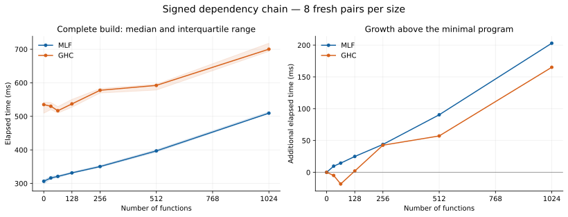

Further optimization stays on this signed shape. The GC setting reduces runtime
overhead but cannot substitute for reducing growing frontend/artifact work.

Qualification receipt SHA-256: `1bf8bee5ea34a627b651b6a819d71c6e2b0f1971424446df0d249a45b78fe0e7`.
Producer receipt SHA-256: `415a564e50d0ec2f6e730e276f448689688cb70a0023d7d17b209574f1df1736`.
Cohort receipt SHA-256: `feed59eeb00e56312dbbc88c3569dc56df3751bd99ebca06b112e2defbcb47ea`.

## Previous follow-up: candidate selection, 2026-11-16

Evidence is under `.mlf-build/signed-chain-metadata-followup-20261116`. The
preceding compact-name producer and its source/evidence pins were authenticated
before mutation. Six fresh profiling runs (two each at N=0/256/1024) matched that
producer’s interface, object and LLVM exactly. Growth remained concentrated in
object assembly, prepared metadata and query-index publication. The profile also
showed 14.48 MB attributed to candidate selection. Instrumented profile times are
diagnostic, not acceptance timings.

### Isolated alternatives

Each timing screen uses N=0/256/1024, one warmup and four alternating measured
pairs: 30 compiles and 90 native results with exact interface/object/LLVM bytes.
Memory uses three alternating pairs at N=0/1024. The compiler-plus-Clang subprocess
sum is distinct from the complete-worker acceptance boundary. Screens are not pooled.

| Prototype | N=1024 allocated-byte delta | N=1024 seconds before / after |
| --- | ---: | ---: |
| `flat-prepared` | +10,025,896 | 0.474508 / 0.478724 |
| `candidate-scan` | -5,390,224 | 0.461751 / 0.462161 |
| `canonical-fields` | -1,305,176 | not timed |

The tagged flat prepared-key representation increased allocation and did not
improve the large-case time, so it is rejected. Checking canonical framing while
parsing saved too little allocation to justify a second parser; it is not retained
and no timing screen or formal cohort was run for it. The simple candidate merge
reduced allocation/live heap but showed no established time gain. Its mechanism
is retained only with the independently verified long-gap correction below.

### Retained structure and native boundary

`selectCandidates` merges ascending integer-set ordinals with the finite name
inventory. Negative and out-of-range indices contribute nothing. It preserves
repeated names at different ordinals and the complete ordered superclass/given
tail; no name is deduplicated and no candidate scope is omitted. There is no new
cache, representation protocol or primitive. The query and artifact formats are
unchanged. Primitive ABI remains `mlf-primitive-136-v11`, builtin interface 15.
The builtin and lock are regenerated from the final sources; current identity:
`builtin-source-v1:575a169d21c53acc47b3e5a474c511cb1ef310c22eb5fb045636cf43a51780de`.

A new sparse-list control exposed SIGSEGV (exit -11) at 65,536 entries under
native O0. The exact same driver with the legacy implementation also failed;
both passed at O2. These comparison receipts are preserved. The final algorithm
divides long skips, with at most 256 list drops per leaf, keeping local recursion
bounded and the split stack logarithmic. Exact source-body controls now pass
65,536 and 131,072 entries at O0 and O2, including extreme signed indices. This
does not claim a general fix for native tail calls or unrelated codec stack limits.

### Final allocation measurement

Three alternating RTS pairs use each immutable producer’s own authenticated
builtin and exactly match that producer’s formal interface/object/LLVM bytes.
These runs are separate from timing.

| N | Metric | Before | Retained |
| ---: | --- | ---: | ---: |
| 0 | Allocated bytes | 276,089,256 | 276,078,184 |
| 0 | Maximum live heap, bytes | 1,479,368 | 1,479,288 |
| 1024 | Allocated bytes | 1,051,448,368 | 1,047,517,568 |
| 1024 | Maximum live heap, bytes | 14,597,160 | 14,556,672 |

At N=1024, cumulative allocation changes by **-3,930,800 bytes
(-0.37%)**; maximum live heap changes by **-40,488 bytes**.
These are separate from the approximately 40.82% artifact-size reduction of the
preceding compact-name change. This selector change makes no further wire-size claim.

### Final validation

- 18 build actions across 137 shared modules; 18 regression actions and 15 direct
  commands, including 153 ordered-map, 200 CRC and 123 JSON commands.
- 13 query/cache/offline actions; 18 signed CLI cases (13 native outputs and five
  expected rejections); independent artifact/open-file Python suites.
- Actual Classes API checked against independent Set-based ordinal selection for
  8,254 host cases and two lazy-demand controls. Exhaustive small subsets, repeated
  spellings, negative/out-of-range indices and bitset-word boundaries are covered.
- Exact production selector bodies isolated for 12 interpreter vectors and 44
  native vectors each at O0/O2; all final cases pass. The host fixture uses the
  authenticated actual Classes module, not a copied function.
- Six independent full artifact/semantic audits across N=0/256/1024 and 12 final
  allocation runs with exact within-snapshot artifact/LLVM equality.

The first portable driver lacked a qualified Std import; its failed receipt is
preserved. The next driver exposed the long-list failure above. Neither failure
is removed or relabeled as a successful test. Final validation uses a fresh output
directory and the rebuilt bounded-gap producer. Qualification remains the
**GHC-hosted compiler and generated native programs**; the isolated selector
is not full native compiler self-bootstrap. Installed `emlf SOURCE`, the previous
QuerySnapshotProbe gap and older native O0 raw-codec long-symbol failures remain
outside completed qualification.

### Fixed GHC comparison

Seven fixed sizes, eight fresh alternating pairs per size, `crate-fused-v1`.
All **112 compiles and 336 native outputs pass**. No source edits, tests or
memory measurements overlap the timing cohort. No pooling, dropped points or
unchanged-source rerun to seek acceptance is used.

| Functions | MLF seconds | GHC seconds |
| ---: | ---: | ---: |
| 0 | 0.302779 | 0.510997 |
| 32 | 0.312563 | 0.521908 |
| 64 | 0.319359 | 0.550530 |
| 128 | 0.333298 | 0.523837 |
| 256 | 0.360809 | 0.553118 |
| 512 | 0.406803 | 0.594239 |
| 1024 | 0.514393 | 0.688350 |

| Growth statistic | MLF | GHC |
| --- | ---: | ---: |
| OLS ms/function | 0.203255 | 0.164140 |
| Endpoint ms/function | 0.206654 | 0.173196 |
| Fitted power p | 0.979072 | 1.171207 |
| Power p bootstrap 95% | [0.912004, 1.043678] | [0.895303, 1.529726] |

Paired bootstrap (2,000 draws, seed 20261115): slope difference (MLF minus GHC)
95% interval **[0.025467, 0.054775] ms/function**; exponent difference
95% interval **[-0.583464, 0.092363]**. Finite-range offset-power fits do not
establish an asymptotic time-complexity class.

| Acceptance check | Result |
| --- | --- |
| `all_positive_medians_lower` | pass |
| `lower_ols_point` | fail |
| `lower_endpoint_point` | fail |
| `lower_power_point` | pass |
| `lower_ols_95` | fail |
| `lower_power_95` | fail |

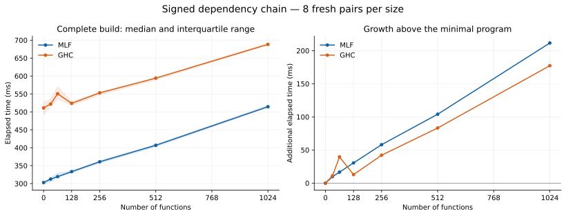

Further investigation stays on this signed shape. The rejected prepared-key and
canonical-parser alternatives are diagnostic evidence, not maintained compiler
implementations. A fresh profile must distinguish remaining growth from startup
and backend costs before another optimization.

Qualification receipt SHA-256: `fd45c72c18e8850c54e77c7ab99f79c154d0d7f2235ea72d16570c526b006eaa`.
Producer receipt SHA-256: `f6d479f59ef3ea8773fa45f17dc0fbffb9a4087dfba5cb522bc2fe4cebae9417`.
Cohort receipt SHA-256: `d5dfc724260f924b454bc5697c5d762158af826c39422e771f92864ad37443e5`.

## Previous follow-up: compact declaration names, 2026-11-16

Evidence is under `.mlf-build/signed-chain-map-cost-followup-20261116`.
The preceding field-framing producer and all pinned evidence were authenticated
before mutation. A fresh six-run profile (two each at N=0/256/1024) identified
growth in artifact assembly, nested query metadata, text copying and ordered maps.
A registry-digest prototype saved 27.4 MB at N=1024 but showed no useful time
improvement, and was not retained. No new registry cache/hash protocol is kept.

### Retained implementation and compatibility

The shared `compactName` encoding preserves ordinary ASCII letters and digits,
escapes `z` as `zz`, and escapes other Unicode scalars with delimited minimal
hexadecimal. Components contain no underscores, so full crate and entity
components remain unambiguously separated. The complete entity key still includes
module, spelling, namespace/role and parent. There are no hashes, shortened
identities, ordinals, normalization or discarded fields. See
[the exact protocol](compact-declaration-names.md).

`MLF-OPEN-GROUP-3` factors an exact crate prefix from sorted value/type names.
Unknown names are retained verbatim; owner v2 and legacy readers remain available.
The c1 declaration marker changes the generated name representation. **Artifacts
with old declaration names require dependency rebuilding**; accepting an old owner
envelope alone does not provide declaration-name compatibility. A diagnostic load
of the old builtin was rejected, and the builtin and package lock were regenerated.
Primitive ABI `mlf-primitive-136-v11`, builtin interface version 15, MLFBIN schema
and typed structural tags remain unchanged. The current builtin source identity is
`builtin-source-v1:2667c9cb6db8e3913e9200d9142400d8aa1af46d29aee3ed18da110872f0db1c`.

An extended native control exposed a new O0 stack failure on a continuous 65,536
ASCII-character name, which the first mixed-character corpus missed. The retained
scanner bounds each ASCII run at 256 characters without changing its bytes. Both
native O0 and O2 now pass 255/256/257, 4,096 and 65,536 ASCII runs, mixed escapes at
chunk boundaries and a 72,000-character mixed input. The failed receipt is preserved.
This fixes the c1 scanner failure; the older raw-codec long-symbol failures remain
a separate, unresolved qualification gap.

### Space and allocation

The retained before/after measurements use each immutable producer and its own
authenticated builtin. Three alternating RTS pairs at N=0/1024 are separate from
timing; each matches its own formal cohort artifacts and LLVM exactly.

| N | Metric | Before | Retained |
| ---: | --- | ---: | ---: |
| 0 | Allocated bytes | 290,167,624 | 276,085,904 |
| 0 | Maximum live heap, bytes | 1,530,936 | 1,479,368 |
| 1024 | Allocated bytes | 1,096,453,640 | 1,051,444,480 |
| 1024 | Maximum live heap, bytes | 14,668,288 | 14,597,160 |

At N=1024, cumulative allocation falls **45,009,160 bytes (4.10%)**. Maximum
live heap falls by only **71,128 bytes (0.48%)**; this does not establish a
substantial peak-memory improvement.

| N | Artifact | Before bytes | Retained bytes |
| ---: | --- | ---: | ---: |
| 0 | interface | 1,062 | 752 |
| 0 | object | 1,798 | 1,338 |
| 256 | interface | 58,843 | 27,964 |
| 256 | object | 115,795 | 75,283 |
| 1024 | interface | 237,662 | 112,521 |
| 1024 | object | 470,796 | 306,731 |

At N=1024 the combined interface/object size falls from **708,458 to 419,252
bytes (40.82%)**. Independent readers verify the full wire envelope, checksums,
content hashes and referenced identities. An independently implemented inverse
rename then compares complete interfaces, bodies, types, scopes and use inventories
at N=0/256/1024. Six actual compiler semantic audits recompute stamps and produce
LLVM byte-identical to each corresponding fused build.

### Validation

All retained checks pass on the final bounded-scan producer:

- 18 build actions, 137 shared modules; 18 regression actions and 15 direct
  commands, including 153 ordered-map, 200 CRC and 123 JSON commands.
- 13 query/cache/offline actions; 18 signed CLI cases (13 native results and
  five expected rejections); 45 artifact and 78 open-file Python tests.
- Actual host name/owner API controls, an independent scalar-hex oracle, about
  19,000 scalar/pair strings and 1,050 complete entity combinations. Identity
  namespace/parent distinctions, malformed owners, Unicode limits and separators
  are covered. No frozen oracle is generated from candidate output.
- Exact production codec bodies isolated for 20 interpreter vectors and 30
  native vectors each at O0/O2, including the long continuous ASCII regression.
- Six independent full artifact comparisons/actual semantic audits, and 12
  retained allocation runs with exact within-snapshot artifact/LLVM checks.

Qualification remains the **GHC-hosted compiler and generated native programs**.
The isolated codec checks are not native full-compiler self-bootstrap. Installed
`emlf SOURCE`, the prior QuerySnapshotProbe gap and prior native O0 raw-codec
long-symbol failures remain outside the completed qualification.

### Fixed GHC comparison

The endpoint remains `crate-fused-v1`, seven fixed sizes with eight fresh
alternating pairs per size. All **112 compiles and 336 native outputs pass**.
No edits, builds, tests or memory runs overlap the timing cohort. No cohorts are
pooled, no points are dropped and unchanged source is not rerun to seek acceptance.

| Functions | MLF seconds | GHC seconds |
| ---: | ---: | ---: |
| 0 | 0.298068 | 0.512797 |
| 32 | 0.319263 | 0.541764 |
| 64 | 0.319760 | 0.520651 |
| 128 | 0.330714 | 0.529222 |
| 256 | 0.355708 | 0.557418 |
| 512 | 0.407191 | 0.590716 |
| 1024 | 0.517206 | 0.701453 |

| Growth statistic | MLF | GHC |
| --- | ---: | ---: |
| OLS ms/function | 0.206053 | 0.175089 |
| Endpoint ms/function | 0.214002 | 0.184235 |
| Fitted power p | 1.019793 | 1.318884 |
| Power p bootstrap 95% | [0.933433, 1.128480] | [0.901646, 1.605636] |

Paired bootstrap (2,000 draws, seed 20261115): slope difference (MLF minus GHC)
95% interval **[0.020691, 0.046450] ms/function**; exponent difference
95% interval **[-0.582149, 0.151559]**. Finite-range offset-power fits do not
establish an asymptotic time-complexity class. The slope requirement still fails.

| Acceptance check | Result |
| --- | --- |
| `all_positive_medians_lower` | pass |
| `lower_ols_point` | fail |
| `lower_endpoint_point` | fail |
| `lower_power_point` | pass |
| `lower_ols_95` | fail |
| `lower_power_95` | fail |

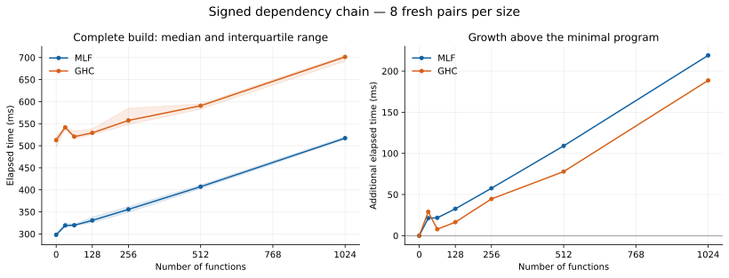

The next investigation stays on this signed shape and profiles the retained
compiler for remaining metadata/assembly costs. Prototype screens used unbounded
c1 scanners and are diagnostic only; final acceptance uses the rebuilt bounded
producer above. The first compact-name memory receipt is incomplete because its
driver shadowed a receipt variable; a bounded continuation completed the missing
size, preserving both receipts. Neither diagnostic failure is omitted.

Qualification receipt SHA-256: `3c813457934ed4098cf5ce24d9bfcfccdb1569cdbdcdaa70a758a7e2fc2c5dba`.
Producer receipt SHA-256: `671941f287a4de69c3e5bd4cf561b1f49bd15e0527d6f1e874bc4687713ac687`.
Cohort receipt SHA-256: `06f6c48120486afa2c2fac8cd333d01c1dd3b30e3431cdd949f77bebd2bc5bbb`.

## Previous follow-up: string-field framing, 2026-11-16

Evidence is under `.mlf-build/signed-chain-growth-cost-followup-20261116`.
The preceding packed-writer producer and its evidence were authenticated before
mutation. A fresh six-run profile (two each at N=0/256/1024) identified growth in
field framing, nested metadata packing, ordered maps and candidate selection.
The following alternatives were screened independently with the preceding
builtin held fixed. Each screen has one warmup and four alternating pairs at
N=0/256/1024, with 30 compiles and 90 native results. The 150 query reports across
all five screens are byte-identical within each size and prototype.

| Prototype | N=1024 allocation change, bytes | Before seconds | After seconds |
| --- | ---: | ---: | ---: |
| `framed-prepared` | +13,599,640 | 0.485488 | 0.487298 |
| `registry-memo` | -17,346,312 | 0.484706 | 0.485791 |
| `pack-direct` | +56,782,664 | 0.493395 | 0.490438 |
| `pack-flat` | -39,870,488 | 0.486808 | 0.473830 |
| `candidate-index` | +1,379,952 | 0.486336 | 0.487446 |

Only the `pack-flat` mechanism is retained, after implementing and validating
it through the shared primitive interface and native runtime. The prepared-key
builder increases allocation; candidate indexing adds cost; the direct host
buffer writer allocates more under the production GHC flags. A bounded exact
registry memo saves allocation, but its large-case time does not improve and
its extra cache state is not retained in this round. None of these diagnostic
samples is pooled into the acceptance cohort.

### Retained implementation and compatibility

`packStringFields :: [] String -> String` emits each field's decimal Unicode
scalar count, a colon and its unchanged payload. `Bootstrap.Separate.pack` now
calls it directly. The host implementation combines framing with the existing
text concatenation traversal, eliminating the source list of three fragments
per field. The native implementation first forces and validates fields in
source order, then allocates one output buffer and copies headers and payloads.
The full list, current field and result remain rooted during collection.

The field framing bytes and legacy wire format are unchanged. This is **not a
smaller serialized encoding**. Primitive code 135 is appended; existing codes
retain their meanings. The ABI becomes `mlf-primitive-136-v11`, and the builtin
interface/crate identity becomes version 15. Prepared builtins are regenerated,
the package lock is refreshed and stale builtin identities remain rejected.
Artifact byte identity across the old and new ABI is not claimed. The builtin
source identity is `builtin-source-v1:57dfbcf2cf1333938d9bdecdd2072d0d9acf06d2e8df8829178778f556ce83a1`.

The independent typed artifact contract explicitly adds code 135 and moves the
rejected upper bound to 136. Existing structural tags and previous primitive
codes are preserved. No independent oracle is regenerated from candidate
output. The historical reconciliation transition now pins 43 paths.

### Retained memory measurement

Three alternating instrumented pairs at N=0/1024 use the before and after
producers' own qualified builtins. Entry modules are linked against each
producer's immutable object/interface inventory. Each run matches its own
cohort's interface, object and LLVM bytes exactly; the old source is not
silently recompiled against the new ABI. These RTS runs are separate from timing.

| N | Metric | Before | Retained |
| ---: | --- | ---: | ---: |
| 0 | Allocated bytes | 296,282,624 | 290,169,952 |
| 0 | Maximum live heap, bytes | 1,529,968 | 1,530,944 |
| 1024 | Allocated bytes | 1,135,996,864 | 1,096,456,464 |
| 1024 | Maximum live heap, bytes | 14,288,104 | 14,668,224 |

At N=1024, cumulative allocation falls **39,540,400 bytes (3.48%)**. Sampled
maximum live heap increases **380,120 bytes**, so this is not evidence of a
lower live peak. The isolated prototype's approximately 13 ms improvement is
not an established complete-build improvement for the regenerated production
compiler. The formal cohort below still fails the slope requirement.

### Validation

All retained checks pass:

- 18 build actions covering 137 shared modules, 18 regression actions and
  15 direct test commands. These include 153 ordered-map, 200 CRC and 123 JSON
  commands; JSON retains 112 native executions.
- 13 query graph, cache and offline checks; 18 signed CLI cases, including
  13 native results and five expected rejections; five frozen codec commands.
- Field framing: 238 independent host vectors in three lanes, scalar indexing,
  slicing, decoder round trips and six host demand checks per lane.
- Shared fixture: host 42 vectors, interpreter 14, native O0/O2 42 each, plus
  12 demand checks per backend. Expected bytes come from a Python scalar-length
  oracle and are also checked against a legacy concatenation reference.
- 26 direct C runtime checks at O0/O2, including both primitive entry routes,
  malformed lists, overflow, lazy head/tail order and repeated GC, with interior
  pointer recognition enabled and disabled. Generated LLVM calls the new helper.

The initial diagnostic direct-buffer control attempted to link a mixed copied
object inventory. Its failed receipt remains preserved. Rebuilding the actual
`--make` dependency closure corrected the harness; both host prototype controls
then passed. This did not affect the fresh authenticated production build.

Qualification remains the **GHC-hosted compiler and generated native programs**.
Native compiler self-bootstrap and installed `emlf SOURCE` are outside this
measurement. The earlier QuerySnapshotProbe gap and two native O0 long-symbol
codec stack failures remain unresolved; the new framing checks do not fix or
supersede that qualification gap.

### Fixed GHC comparison

The endpoint remains `crate-fused-v1`, with seven fixed sizes and eight fresh
alternating pairs per size. No source edits, builds or tests run concurrently
with the cohort. All **112 compiles and 336 native outputs pass**. There is no
pooling, discarded point or repeated unchanged-source acceptance attempt.

| Functions | MLF seconds | GHC seconds |
| ---: | ---: | ---: |
| 0 | 0.305423 | 0.495802 |
| 32 | 0.318318 | 0.504690 |
| 64 | 0.326638 | 0.509597 |
| 128 | 0.336135 | 0.514021 |
| 256 | 0.363543 | 0.537163 |
| 512 | 0.407510 | 0.577609 |
| 1024 | 0.530125 | 0.683263 |

| Growth statistic | MLF | GHC |
| --- | ---: | ---: |
| OLS ms/function | 0.212226 | 0.179516 |
| Endpoint ms/function | 0.219435 | 0.183067 |
| Fitted power p | 1.080564 | 1.186221 |
| Power p bootstrap 95% | [0.994134, 1.144818] | [1.038716, 1.455247] |

Paired bootstrap, 2,000 draws, seed 20261115:
OLS slope difference (MLF minus GHC) 95% interval
**[0.020884, 0.046594] ms/function**;
exponent difference 95% interval **[-0.382466, 0.031540]**.
The lower exponent point estimate does not imply a smaller measured slope:
the fitted scale coefficient also matters. Finite-range fits do not establish
an asymptotic time-complexity class.

| Acceptance check | Result |
| --- | --- |
| `all_positive_medians_lower` | pass |
| `lower_ols_point` | fail |
| `lower_endpoint_point` | fail |
| `lower_power_point` | pass |
| `lower_ols_95` | fail |
| `lower_power_95` | fail |

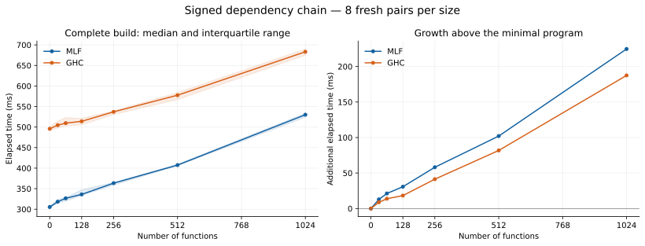

The next bounded investigation should profile the retained producer, keeping
this cohort fixed, and revisit the remaining growth in map construction,
query metadata and artifact assembly. The shared registry and candidate-index
prototypes are available as rejected or unretained evidence, not maintained
implementations. Continue this signed shape before starting another shape.

Qualification receipt SHA-256: `99b18eb161d3df0f52f22f841485e15288cb225328b4efc1b20be0f8e8b275c1`.
Producer receipt SHA-256: `80614a75625b9e6039017de6f3da639aba26f7108fc99be666c2cad2f228b26e`.
Cohort receipt SHA-256: `5b74e4cd9f73cb8afa93bf08402cd8e6526c6ac6bc996a0a542d3d05c3be2746`.


## Previous follow-up: packed writer allocation, 2026-11-16

Evidence is under `.mlf-build/signed-chain-serialization-followup-20261116`.
The preceding JSON producer and its source/evidence hashes were authenticated
before the first experiment. A fresh six-run profile (two runs each at
N=0/256/1024) found approximately 81 MB of growth-attributed allocation in
`packedBits` variants. Final GHC STG showed a lazy byte expression capturing
six values of bit state and a final-varint continuation carrying state that
was no longer needed.

Two changes are retained in `Bootstrap.Bitstream`: force the computed byte
inside the nonzero-width branch, after the owned encoder's planning and
layout admission; and pass the caller's continuation directly for the last
varint byte. The public buffer-update routine and the wire format are
unchanged. This is an allocation improvement, with no artifact-size reduction
claimed. It does not justify making arbitrary public callbacks stricter.

Code inspection also ruled out proposed duplicate work: query publication
already batches its serialized payloads, and template serialization already
has a bounded memo. Imported metadata hashing contributed about 15.7 MB at
both N=0 and N=1024; it is a constant in this experiment, not evidence of the
higher growth slope.

### Memory and isolated alternatives

Three alternating instrumented pairs at N=0/1024 hold the previous builtin
bytes fixed to isolate the writer change. All interface, object and LLVM bytes
are identical. These diagnostic runs are separate from the final regenerated
builtin and complete-worker acceptance cohort.

| N | Metric | Before | Combined writer |
| ---: | --- | ---: | ---: |
| 0 | Allocated bytes | 299,198,056 | 296,298,624 |
| 0 | Maximum live heap, bytes | 1,530,008 | 1,530,104 |
| 0 | Maximum individual process RSS, bytes | 30,998,528 | 31,965,184 |
| 1024 | Allocated bytes | 1,162,117,376 | 1,135,592,816 |
| 1024 | Maximum live heap, bytes | 14,588,752 | 14,588,712 |
| 1024 | Maximum individual process RSS, bytes | 68,009,984 | 68,009,984 |

At N=1024, allocation falls **26,524,560 bytes (2.28%)**. Maximum live heap
changes by only **-40 bytes**; this provides no evidence of a lower live peak.
The complete compiler-plus-Clang screen at N=0/256/1024 measured
0.254628/0.313581/0.489091 seconds before and
0.254727/0.308713/0.486151 seconds after.
The roughly 3 ms large-case difference is insufficient to establish a growth
advantage. Retention rests on the allocation reduction and simpler final-byte
control flow, with frozen-wire and native validation.

Isolated results are preserved separately:

- Forcing only the computed byte saves 20,629,960 bytes at N=1024.
- Removing only the last-varint continuation saves 5,891,632 bytes.
- Forcing all packed state arguments saves only 8,206,128 bytes; that broader
  strictness change is not retained.
- Combining the host byte-write checks into one evaluated tuple increases
  allocation by 8,088,984 bytes; it is rejected.
- Guarded host unsafe shifts save only 604,856 bytes, with no large-case time
  benefit; the host shift implementation is unchanged.

Three diagnostic screens (byte forcing, host shifts, combined writer) each
check 30 compiles and 90 native outputs, with one warmup and four alternating
measured pairs. All 90 query reports are byte-identical to their lane's baseline
at the same size. No rejected variant or diagnostic sample is pooled into
acceptance timing. Host byte-write and shift prototypes have independent
value/error/demand controls; they remain discarded prototypes.

### Rebuilt compiler and codec checks

Bitstream belongs to the builtin preparation closure. Unlike the preceding
JSON change, this round regenerates `BuiltinPreludeData.hs` and its source
identity, then refreshes the lock and reconciliation manifest. The new identity
is `builtin-source-v1:243948f0edf5fef7f590e3c5ccba7bd5f23e10024677f6a9bc7cdbe8ee90c437`. ABI `mlf-primitive-135-v10` and interface/object
version 14 remain unchanged.

The frozen encoder differential passes exact wire bytes, signed/bit extrema,
reference-width transitions, Unicode, natural and forced hash collisions,
resource limits and the 4 MiB bulk/streaming boundary. The retained fixture is
compiled against the fresh producer's actual dependency objects.

An independent Python schema-7 corpus checks the actual `CodecProbe` module:
**110 cases (17 accepted, 93 rejected)** all pass on the GHC host and generated
native O2 code. Accepted results include the exact reencoded digest; rejected
outputs match. A frozen pre-change Bitstream compiled by the same retained
compiler also passes the complete native O2 corpus.

The newly added native O0 lane exposes **two existing stack failures**:
`scan-symbol-cap` and `scan-symbol-over-cap` (65,533/65,534-character symbols).
The initial suite stops at the first SIGSEGV and that failed receipt is retained.
A complete five-lane differential then checks 550 executions: host, pre-change
O2, retained O2, pre-change O0 and retained O0. The O0 results are identical before
and after: 108 cases pass and these two fail with SIGSEGV. The first current
crash report identifies a stack-guard access. **Native O0 codec qualification
remains incomplete**; this is recorded as an existing issue, not a passing
boundary case. All native executables use the same O2 runtime object. This
round establishes O2 corpus correctness and no observed O0 outcome regression,
not native compiler self-bootstrap or a fix for the O0 long-symbol issue.

The fresh authenticated producer passes 18 build actions for 137 modules.
All 18 regression actions, 15 direct commands, 153 ordered-map commands,
200 CRC commands, 123 JSON commands, 13 query/cache/offline actions and
18 signed CLI cases pass. The JSON suite retains 112 native executions at
O0/O2 and its long-string stack regression. The signed CLI checks include
13 native results and five expected rejections.

A diagnostic generator wrapper initially rejected the successful output
because comments precede the module declaration. Its prefix check was fixed;
the existing successful generator output was validated and used without
rerunning generation. Both receipts are preserved.

### Fixed GHC comparison

The seven sizes, eight alternating pairs, fresh output/query directories,
complete `crate-fused-v1` worker boundary, O2 bootstrap producer and 2,000 paired
bootstrap draws (seed 20261115) are unchanged. **All 112 compiles and 336 native
outputs pass.** The cohort runs without concurrent tests, builds or source edits.

| Functions | MLF seconds | GHC seconds |
| ---: | ---: | ---: |
| 0 | 0.312158 | 0.496553 |
| 32 | 0.324067 | 0.512097 |
| 64 | 0.331850 | 0.523379 |
| 128 | 0.331589 | 0.498739 |
| 256 | 0.362429 | 0.534109 |
| 512 | 0.414700 | 0.578234 |
| 1024 | 0.532874 | 0.680984 |


| Growth measure | MLF | GHC |
| --- | ---: | ---: |
| OLS slope, ms/function | 0.212004 | 0.174384 |
| Endpoint slope, ms/function | 0.215543 | 0.180109 |
| Offset-power exponent p | 1.133391 | 1.307542 |
| Exponent bootstrap 95% interval | [1.036944, 1.251256] | [1.049460, 1.528740] |

The paired MLF-minus-GHC OLS interval is **[0.025006, 0.049638]
ms/function**; the exponent interval is **[-0.413472, 0.138283]**.

| Acceptance check | Result |
| --- | --- |
| `all_positive_medians_lower` | pass |
| `lower_ols_point` | fail |
| `lower_endpoint_point` | fail |
| `lower_power_point` | pass |
| `lower_ols_95` | fail |
| `lower_power_95` | fail |

**The signed chain is not yet accepted.** No point is removed, no cohort is
pooled and no unchanged compiler is rerun to seek acceptance. Differences from
older cohorts are not controlled speedups. Finite-range exponents do not
establish a strictly lower Big-O complexity.

Qualification covers the **GHC-hosted bootstrap and generated native programs**.
Native compiler self-bootstrap, the earlier native QuerySnapshotProbe gap and
the installed `emlf SOURCE` timing boundary remain outside this qualification.

- Qualification SHA-256: `fa634587be4b6288d7660b7b7f5765267187895cdaa15a7a2b5222545b09b1d4`.
- Producer receipt SHA-256: `3f68ac8eb2f2de8cdd09381f1bfd129888c3a6b018dc4ba6b05ba17c12ec1fd7`.
- Fixed cohort receipt SHA-256: `ef3bea5c5c269fc758bc18ff769de59fa209ead59e9375ce49c9db5cb7b51c2b`.
- Detailed pins, rejected prototypes, memory and validation counts:
  `qualification.json`; current source profile: `profile-current/receipt.json`;
  frozen-wire controls: `retained-codec-controls/receipt.json`;
  independent host/native differential: `native-codec-differential/receipt.json`;
  original O0 failure: `native-codec-controls/receipt.json`.

## Preceding follow-up: JSON allocation and bounded scanning, 2026-11-16

Evidence is under `.mlf-build/signed-chain-sharing-followup-20261116`. A fresh
profile of the preceding authenticated compiler found a captured slice helper
allocated inside every iteration of `CrateQuery.jsonSpans`. The final GHC STG
confirmed that allocation before the character branch. Moving the helper to
top level removes it. The shared scanner also emits a span at most every 256
characters; the concatenated JSON spelling is unchanged.

The bound fixes a failure exposed by the new native controls. On the preceding
source, Clang O0 output segfaulted while escaping 13,312 ordinary ASCII
characters; macOS recorded a stack-guard violation. The same source passed at
O2. Lifting the helper alone, forcing the next index, and combining those two
changes all retained the O0 failure. Bounded scanning passed at both O0 and O2,
including 53,248 ordinary ASCII characters. The failing original receipts are
preserved, and the long cases remain in the maintained tests.

Only `CrateQuery.hs` changes compiler behavior in this round. The host adapter
is unchanged. The Prelude bytes and source identity are unchanged because
CrateQuery is outside that preparation closure; a fresh producer and locked
package plan nevertheless validate the current source. The lock and historical
reconciliation transition were refreshed. There is no primitive ABI or artifact
wire-format change, and no artifact-size reduction is claimed for this change.

### Memory and screening

Three alternating instrumented pairs at N=0/1024 preserve exact interface,
object and LLVM bytes. These are allocation diagnostics, separate from the
complete-worker acceptance timing.

| N | Metric | Before | Bounded scanner |
| ---: | --- | ---: | ---: |
| 0 | Allocated bytes | 299,274,392 | 299,195,704 |
| 0 | Maximum live heap, bytes | 1,530,080 | 1,530,040 |
| 0 | Maximum individual process RSS, bytes | 30,932,992 | 30,998,528 |
| 1024 | Allocated bytes | 1,190,970,320 | 1,162,080,856 |
| 1024 | Maximum live heap, bytes | 14,288,240 | 14,588,608 |
| 1024 | Maximum individual process RSS, bytes | 67,928,064 | 68,026,368 |

At N=1024, allocation falls **28,889,464 bytes (2.43%)**, while maximum live
heap rises **300,368 bytes (2.10%)**. Less total allocation does not imply a
lower peak. The isolated complete-build screen at N=0/256/1024 measured
0.264722/0.317729/0.489055 seconds before and
0.254779/0.316610/0.497791 seconds after. This screen does not establish a
speed gain; retention rests on the verified allocation reduction and native
stack fix. Each screen used one warmup plus four alternating measured pairs,
30 compiles and 90 native outputs.

Other isolated alternatives were rejected: forcing the next index and hoisting
the length did not reduce allocation; changing the host `stringCodeAt` demand
wrapper increased N=1024 allocation by 74,189,960 bytes. Helper lifting alone
saved allocation but retained the native O0 crash. All five screens preserve
complete query-report bytes as well as interface/object/LLVM bytes. No diagnostic
screen or instrumented memory run is pooled into acceptance timing.

### Fixed GHC comparison

The seven sizes, eight alternating pairs, fresh output/query directories,
complete `crate-fused-v1` worker boundary, O2 bootstrap producer and 2,000 paired
bootstrap draws (seed 20261115) are unchanged. **All 112 compiles and 336 native
outputs passed.** The cohort ran without concurrent tests, builds or source edits.

| Functions | MLF seconds | GHC seconds |
| ---: | ---: | ---: |
| 0 | 0.317628 | 0.539143 |
| 32 | 0.328503 | 0.532912 |
| 64 | 0.328380 | 0.540345 |
| 128 | 0.340054 | 0.528904 |
| 256 | 0.365045 | 0.562453 |
| 512 | 0.421093 | 0.601550 |
| 1024 | 0.539974 | 0.707379 |

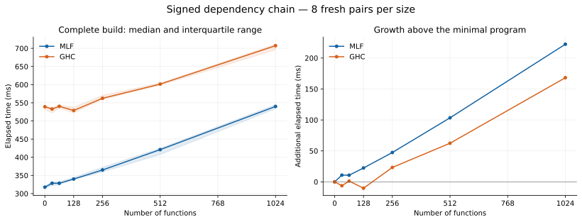

| Growth measure | MLF | GHC |
| --- | ---: | ---: |
| OLS slope, ms/function | 0.216024 | 0.171350 |
| Endpoint slope, ms/function | 0.217135 | 0.164293 |
| Offset-power exponent p | 1.130514 | 1.399055 |
| Exponent bootstrap 95% interval | [1.033097, 1.298809] | [1.147191, 1.531363] |

The paired MLF-minus-GHC OLS interval is **[0.034105, 0.058787]
ms/function**; the exponent interval is **[-0.406986, 0.010124]**.

| Acceptance check | Result |
| --- | --- |
| `all_positive_medians_lower` | pass |
| `lower_ols_point` | fail |
| `lower_endpoint_point` | fail |
| `lower_power_point` | pass |
| `lower_ols_95` | fail |
| `lower_power_95` | fail |

**The signed chain remains unaccepted.** No point was removed, no cohort was
pooled and no unchanged compiler was rerun to seek acceptance. Differences
from older cohorts are not a controlled speedup. Finite-range fitted exponents
do not establish a strictly lower Big-O complexity.

### Validation and evidence

A fresh authenticated producer passed 18 build actions for 137 shared modules.
All 18 artifact/compiler/package regression actions, 15 direct commands,
13 query/cache/offline actions and 18 signed CLI cases passed. The direct suite
includes 153 ordered-map commands and 200 CRC commands. The signed CLI cases
check 13 native results and five expected rejections.

The new JSON suite has 123 commands. At both host O0 and O2 it compiles the
actual CrateQuery dependency closure and checks 4,705 strings at four suffix
positions, all 1,112,064 legal Unicode scalars, four demand controls and an
independent literal report. Its 112 native executions cover escaping,
Unicode, long strings, report output and runtime error order at both Clang
O0 and O2. The native subject is the exact extracted maintained JSON function
block; it is **not** a full native CrateQuery closure or compiler self-bootstrap.
The first baseline attempt lacked the fixture's `boolean` dependency; its
failed receipt remains separate from the corrected fixture's genuine crash.

Qualification covers the **GHC-hosted bootstrap and generated native programs**.
Native compiler self-bootstrap, the earlier native QuerySnapshotProbe gap and
the installed `emlf SOURCE` timing boundary remain outside this qualification.

- Qualification SHA-256: `48e778fffb67eb824723a088f2cea9087c3d9d7f78b9dc7e49105682b5073dbb`.
- Producer receipt SHA-256: `efeba22d63edd7593c60d5b9a7b5ee1c6241ad021d0781d86882f674b161555f`.
- Fixed cohort receipt SHA-256: `4d46f4d2603093e9045d28dc23cf4cb46f21703d4e79aa83a541370ef9e35331`.
- Detailed pins, rejected prototypes, memory statistics and validation counts:
  `qualification.json`; source profile: `profile-current/receipt.json`;
  native failure comparison: `native-json-variants/receipt.json`;
  independent JSON controls: `root-direct-tests/query-json/receipt.json`.

## Preceding follow-up: Map union structure and memory, 2026-11-16

Evidence is under `.mlf-build/signed-chain-scope-followup-20261116`. This round
retains a shared-source Map union change: split the right map around a left
root, merge corresponding subtrees, then join the ordered results. Empty maps
reuse the other tree; singleton cases use insertion. This avoids inserting
every right entry from the root of the accumulated left tree. Duplicate keys
retain the complete left representative and `combine leftValue rightValue`;
stored values and the combine result remain lazy. The algorithm assumes valid
ordered maps; the internal tree shape is not preserved.

The retained source exactly matches the tested prototype. `Module.hs` and the
GHC host adapter are unchanged in this round. The generated Prelude was rebuilt
and verified for the new shared source, with identity
`builtin-source-v1:37ad800816203b70c0f8bad30b2a3c386804142735e7931540c908028989afc8`.
The lock and existing 41-path historical reconciliation transition were refreshed
and validated. The primitive ABI remains `mlf-primitive-135-v10`; this change
does not add a primitive or change the interface/crate wire version.

### Controlled memory result

Three alternating RTS-instrumented pairs at N=0 and N=1024 used the same source
fixtures, the pre-change builtin and host C objects. Interface, object and
LLVM outputs match exactly. These diagnostic runs compare the isolated Map
change; they are separate from acceptance timing.

| N | Metric | Previous union | Split/join union |
| ---: | --- | ---: | ---: |
| 0 | Allocated bytes | 306,540,416 | 299,273,832 |
| 0 | Maximum live heap, bytes | 1,529,952 | 1,530,080 |
| 0 | Maximum individual process RSS, bytes | 31,064,064 | 30,867,456 |
| 1024 | Allocated bytes | 1,216,401,472 | 1,191,002,160 |
| 1024 | Maximum live heap, bytes | 14,518,864 | 14,288,344 |
| 1024 | Maximum individual process RSS, bytes | 68,124,672 | 67,878,912 |

At N=1024, allocation falls **25,399,312 bytes (2.09%)**, maximum live heap
falls **230,520 bytes (1.59%)**, and individual peak RSS falls **240 KiB**.
At N=0 the live-heap maximum increases by 128 bytes; not every metric improves.
The verified allocation and live-heap reductions justify retaining this small
structural change without claiming that it meets the time-growth objective.

### Screening and rejected alternatives

All four screens used N=0/256/1024, one warmup and four alternating measured
pairs: 30 compiles, 90 native outputs, fresh output/query directories and exact
interface/object/LLVM checks each. The boundary is compiler-plus-Clang subprocess
sum. Separate screens are not pooled or subtracted from each other.

| Screen | N=0 before / after, seconds | N=256 before / after | N=1024 before / after |
| --- | ---: | ---: | ---: |
| Split/join union | 0.263081 / 0.252653 | 0.311254 / 0.310662 | 0.489332 / 0.490834 |
| Preserve tree during qualification | 0.254158 / 0.261928 | 0.313160 / 0.315896 | 0.492071 / 0.494756 |
| Unpack host Text | 0.258930 / 0.272515 | 0.326066 / 0.330871 | 0.493075 / 0.494716 |
| Unchanged-source rebuild control | 0.263021 / 0.252290 | 0.314238 / 0.318340 | 0.489423 / 0.491617 |

The unchanged-source rebuild reuses a byte-identical host `Base.o`; only Main
and linking differ. It also shows millisecond-scale shifts, so the similarly
small screen differences cannot establish a causal speed gain or regression.
This control is not a correction factor and is not used to alter acceptance
measurements. In particular, the union's 1.50 ms large-case difference does not
establish a regression. Retention rests on its independent memory result and
semantic validation, followed by the fixed cohort below.

The qualified-interface prototype copied the valid tree while prefixing keys,
avoiding a list conversion and map reconstruction. It passed 264 prefix/order
cases, 60 scope/export cases and two lazy-payload controls. At N=1024 it saved
only 4,540,264 allocated bytes (0.37%); its small benefit did not justify keeping
another implementation change. The first two fixture attempts failed syntax
admission and remain recorded separately from the passing third attempt.

Unpacking `Text` inside the GHC host String passed host concat controls but
increased N=1024 allocation by **38,958,192 bytes**, despite a lower live-heap
maximum. It was rejected. Neither alternative changed maintained compiler
source, and no native compiler performance claim is inferred from host layout.

### Fixed GHC comparison

The seven sizes, eight alternating pairs, fresh output/query directories,
complete `crate-fused-v1` worker boundary, O2 bootstrap producer and 2,000 paired
bootstrap draws (seed 20261115) are unchanged. **All 112 compiles and 336 native
outputs passed.** No other test workload or source edit ran during the cohort.

| Functions | MLF seconds | GHC seconds |
| ---: | ---: | ---: |
| 0 | 0.306894 | 0.498346 |
| 32 | 0.317036 | 0.510353 |
| 64 | 0.321701 | 0.507205 |
| 128 | 0.333453 | 0.515491 |
| 256 | 0.364296 | 0.538864 |
| 512 | 0.420432 | 0.578975 |
| 1024 | 0.528779 | 0.675694 |

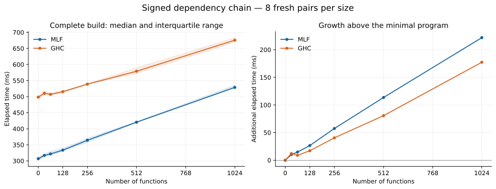

| Growth measure | MLF | GHC |
| --- | ---: | ---: |
| OLS slope, ms/function | 0.216288 | 0.170703 |
| Endpoint slope, ms/function | 0.216685 | 0.173191 |
| Offset-power exponent p | 0.985112 | 1.146577 |
| Exponent bootstrap 95% interval | [0.903070, 1.079175] | [0.957441, 1.335726] |

The paired MLF-minus-GHC OLS interval is **[0.030806, 0.061863]
ms/function**; the exponent interval is **[-0.384731, 0.047470]**.
Every median-time check passes, but both slope point checks and the paired
slope check fail. The exponent point estimate is lower, while its paired
interval includes zero. **The signed chain remains unaccepted.** No point was
removed, no cohort was pooled and no unchanged compiler was rerun to seek
acceptance. Differences from the earlier string-comparison cohort are not a
controlled old/new speedup. Finite-range fits do not prove Big-O.

### Validation and qualification boundary

- A fresh authenticated producer completed 18 build actions for 137 shared
  modules; the generated Prelude verifier and locked package plan passed.
- The independent `Data.Map.Lazy` host oracle checks 16,745 map pairs at O0
  and O2, including overlap, disjoint ranges, imbalance, reversed/duplicate
  inputs and extrema. It independently checks contents, left representatives,
  noncommutative combination, cached sizes and balance, plus nine demand
  controls. The O0 lane rebuilds the actual Map closure at O0.
- Native controls check 72 union mode/size combinations and three lazy/error
  cases. The existing 19,581 host construction cases, five demand checks and
  63 native construction cases also pass. The ordered-map suite has 153
  recorded commands; the full direct suite has 14, including 200 CRC commands.
- Seventeen artifact/compiler/package regression actions passed on the first
  attempt. Direct validation initially stopped because a successful O0 closure
  compile printed existing `star-is-type` and deprecation warnings. The test
  now suppresses those two known categories; the entire direct suite passed
  in a fresh directory. Original failed receipts remain unchanged, and
  `validation-resumed.json` explicitly pins the 17 reused actions and repaired
  direct run rather than relabeling the failed receipt as complete.
- Thirteen query/cache/offline actions and 18 signed CLI cases passed, including
  13 expected native results and five expected rejections. Producer source,
  tool and generated-output identities were checked again after validation.

Qualification covers the **GHC-hosted bootstrap and generated native programs**.
Native compiler self-bootstrap, the earlier native QuerySnapshotProbe gap and
the installed `emlf SOURCE` timing boundary remain outside this qualification.
There is no acceptance commit, push or transition to the next program shape.

### Evidence pins for this follow-up

The final qualification record pins all prototype, memory, failed/repaired
validation and comparison receipts, plus the retained source and chart hashes.

| Path under `.mlf-build/signed-chain-scope-followup-20261116` | SHA-256 |
| --- | --- |
| `producer-union/receipt.json` | `f567819483cbdf1d657482b5ce158da90a3159b4706123ddee2d701b1d8b6df0` |
| `union-comparison/cohorts/confirmation/receipt.json` | `aa282ec8fa3d3cc4463f098769bcc6b29142141dc1a845d902d4017abed6e0d7` |
| `qualification.json` | `1fb61701ecf3cc7012dbd49ac199e8739e36e67b3a2977ae5a782f604c675a57` |

## Earlier follow-up: concat and encoder allocation, 2026-11-16

Evidence is under `.mlf-build/signed-chain-concat-followup-20261116`. Three
isolated implementation experiments were rejected. **No compiler change is
retained in this follow-up**; at that stage the string-comparison producer and
its fixed GHC cohort below remained authoritative. This round retains a correction to the
concat regression fixtures for the already-existing CRC32 opcode 134.

A fresh profile of the retained comparison producer ran twice at N=0/256/1024,
with query phase timers disabled. All six interface, object and LLVM outputs
matched the current formal producer exactly. N=1024-minus-N=0 mean own costs
include GC at 46.55 ms, Map balancing at 13.05 ms / 64.13 MB, `Text.concat` at
7.65 ms / 36.22 MB, host concat collection at 5.50 ms / 25.52 MB, and encoder
`planTasks` at 5.20 ms / 32.20 MB. These diagnostic costs guided the experiments;
they are not acceptance timings.

### Isolated screens and rejection decisions

Each screen used N=0/256/1024, one warmup and four alternating measured pairs,
fresh query/output directories, exact interface/object/LLVM comparisons, and
three native outputs per compilation: 30 compiles and 90 outputs per prototype.
No other workload or source edits ran during a timed screen. Each row's before
and after medians belong to its own screen; the three screens are not pooled.
The timing boundary is compiler-plus-Clang subprocess sum, separate from the
complete worker boundary used for acceptance below.

| Prototype | N=0 before / after, seconds | N=256 before / after | N=1024 before / after |
| --- | ---: | ---: | ---: |
| Two-pass direct concat | 0.254544 / 0.265168 | 0.313475 / 0.318011 | 0.488670 / 0.493537 |
| Reverse-chunk buffer copy | 0.250908 / 0.260922 | 0.311883 / 0.313390 | 0.490700 / 0.491210 |
| Direct encoder value dispatch | 0.261525 / 0.265097 | 0.323818 / 0.326915 | 0.497117 / 0.494943 |

The direct concat validates sizes and then scans the original fragment list to
fill one buffer. The reverse-copy version preserves the original collection
step but fills the buffer backwards, avoiding `reverse` and a repeated size scan.
Both preserve the empty/singleton paths, byte bounds and observable head-before-
tail demand. Both passed the maintained host semantic fixture, but neither
improved the screen enough to retain; allocation also increased as shown below.
The direct variant keeps the original String list alive through the copy. That
structural difference is a hypothesis about liveness, not a measured causal
explanation of its additional allocation.

The encoder variant processes an available value directly instead of allocating
an `EncodeOne` task which the next dispatch immediately consumes. It still keeps
unfinished child lists and closing nodes on the explicit task stack. Against the
unchanged frozen codec it passed 3,396 complete-plan cases, 10,188 root-budget
cases, 136 exact wire comparisons and four demand-order cases. The N=1024 screen
saved only 2.17 ms, while smaller cases were slower; the allocation reduction was
only 0.46%. This restructuring was also rejected.

### Memory measurements

Three RTS-instrumented runs per lane and size used the same current builtin,
source fixtures and host C objects. The concat experiment rotated three lanes;
the encoder experiment alternated two lanes. Every interface, object and LLVM
output matched the formal reference. These are separate diagnostic memory runs,
not acceptance timings. Bytes below are decimal MB for allocation and binary MiB
for maximum live heap and maximum individual process RSS.

| Experiment | N | Lane | Allocation MB | Maximum live heap MiB | Peak RSS MiB |
| --- | ---: | --- | ---: | ---: | ---: |
| concat-memory | 0 | before | 306.537688 | 1.459045 | 29.609375 |
| concat-memory | 0 | direct | 320.420256 | 1.459000 | 30.281250 |
| concat-memory | 0 | reverse | 326.911944 | 1.459053 | 29.296875 |
| concat-memory | 1024 | before | 1216.398608 | 13.846321 | 64.968750 |
| concat-memory | 1024 | direct | 1276.508616 | 13.522583 | 63.671875 |
| concat-memory | 1024 | reverse | 1310.723792 | 13.757088 | 64.656250 |
| task-elision-memory | 0 | before | 306.542680 | 1.459084 | 29.625000 |
| task-elision-memory | 0 | task-elision | 305.809920 | 1.459114 | 29.578125 |
| task-elision-memory | 1024 | before | 1216.403880 | 13.846306 | 64.968750 |
| task-elision-memory | 1024 | task-elision | 1210.852280 | 13.836037 | 64.875000 |

At N=1024, direct concat allocates 60,110,008 additional bytes and reverse concat
94,325,184 additional bytes, despite modest reductions in maximum live heap and
RSS. Encoder task elision saves 5,551,600 allocated bytes, 10,768 live-heap bytes
and 96 KiB RSS. None supplies a sufficient time/memory tradeoff to replace the
maintained implementation. Smaller source code or fewer explicit intermediate
lists alone did not predict the allocation result.

### Retained test repair and validation

The unchanged compiler first reproduced the pre-existing concat-fixture failure:
`metadata: append-only opcode inventory`. The fixture bound was 133 at the start
of this follow-up; the existing primitive table already ends at CRC32 code 134.
Both host and native fixtures now independently assert that exact code and the
full inventory through 134. Expected output and receipt metadata both count nine
metadata oracles. The frozen balanced concat reference is unchanged, including
its pinned file and body hashes. This is a test repair, not a new opcode or ABI
change; the earlier Int64 fixture adaptation is not a new change in this round.

The complete maintained `test_string_concat.py --mode all` suite passed:

- Host: three engines, nine metadata oracles, three interpreter-payload oracles,
  16 literal cases, 1,555 finite fragment lists, five large cases and 13 demand
  cases (39 engine evaluations).
- Native: 90 executions at O0/O2 across stdlib, primitive and frozen reference;
  all six 32,768-fragment stress runs observed at least two actual GC collections.
- Interpreter: 45 executions, including exact expected failure diagnostics;
  interpreter stress uses 128 fragments, not the native stress size.
- C runtime: 24 executions covering bytes, scalar indices, singleton sharing,
  overflow, malformed lists, demand order and GC.

The current producer was authenticated before and after this suite. The suite's
own receipt correctly leaves compiler-source provenance false; the external
`concat-validation-auth.json` records that additional authentication. Qualification
remains the GHC-hosted producer and generated native programs, not native compiler
self-bootstrap, the earlier native QuerySnapshotProbe gap or the installed
`emlf SOURCE` endpoint. No current compiler, ABI, builtin, lock or historical
migration endpoint changed. No fresh GHC cohort was run on identical compiler
source to seek acceptance. Both slope gates and the paired exponent interval
remain unresolved; there is no acceptance commit, push or next shape.

### Evidence pins for this follow-up

| Path under `.mlf-build/signed-chain-concat-followup-20261116` | SHA-256 |
| --- | --- |
| `profile-current/receipt.json` | `c814aec55ba35cc5194080eee0a7c6fbb7180b6b6934a558a91a0947d4fbe485` |
| `profile-current/delta.json` | `34b130d5c9814a5bc657598dd7f8ae2b2c884657999a56587b65edec4a548a46` |
| `concat-baseline/receipt.json` | `e55fbd5f9fae14a2eca3565ac6c836a7338c004a086670f166383a51ca382cf9` |
| `concat-baseline-fixed/receipt.json` | `859efeaf198cddb66237bb03919d85621a48fb249114e6bcb7fe4575a0f67295` |
| `concat-direct/receipt.json` | `c1bce0c419fc5f34677083268be39763192802a677e26eed4c545cacd4c6ae35` |
| `concat-screen/receipt.json` | `b92803c082b8bf23b671e0be971cccda87ec40fbc2042166e6946955cbad9846` |
| `concat-reverse/receipt.json` | `a538c03191a037a8fcc5d7f6c2b2eb7ace5edbc65e91926e8339208a40168718` |
| `concat-reverse-screen/receipt.json` | `7dfc0d92250d3bdd241ca818991a3d31c568c1ffbbf65d9042aec34ede495a33` |
| `task-elision/receipt.json` | `fbc9cef235b45f63c8ec640b6fe1bb7c81a02ab32e5a5ef83e9fcd2992b169c8` |
| `task-elision-screen/receipt.json` | `9854b819c97187604a04f55a90c50d1e7f56d17fde6ca093f43a97d9a3f37aac` |
| `concat-memory/receipt.json` | `2532be652ee5f2ccab644eb906e89c412bff8aea7b7def5cf712801ca586163f` |
| `task-elision-memory/receipt.json` | `45dc2d30b2f16215eb370bf1bdbd5e78c3bca506eedf936671dc8f261b11b1b8` |
| `concat-validation/receipt.json` | `4cd357acb7698a02da7e9aab5abf22d8ed08d9f876eb2a6d7a1967fc807e3c69` |
| `concat-validation-auth.json` | `68b2f6f0313334867e8a3e0cb71e738a0d78da240bd73e53855eb3e0bbe68092` |
| `qualification.json` | `ccc1612ffcf220c7f592ba2dc7c9bf99722274d9419cf7e13bd80c51f1db136c` |

## Earlier candidate: string comparison, 2026-11-16

Evidence is under `.mlf-build/signed-chain-root-followup-20261116`. This round
retains a small change to the **GHC host adapter**. `compareString` now establishes
left-operand demand outside the comparison and then examines the right string,
avoiding a guarded right-operand thunk on hot map comparisons. Unicode scalar
ordering, invalid-scalar diagnostics, left-to-right failure order, lazy partial
application and unused branches are preserved. The shared compiler source,
native runtime, primitive ABI, builtin identity and lock bytes are unchanged in
this round. The performance result applies to the GHC-hosted compiler.

### Fresh diagnosis and controlled screen

A fresh profile of the preceding retained signed-root version used two compiles
at each of N=0/256/1024, with query phase clocks disabled. All six interface,
object and LLVM outputs matched the retained reference exactly. Its
N=1024-minus-N=0 mean own costs included GC at **46.4 ms**, `Map.balance` at
**12.95 ms / 64.15 MB**, and the three string-comparison cost centres at
**20.55 ms / 18.14 MB** combined. Inclusive prepared-input construction still
cost **27.9 ms / 131.21 MB**; inclusive values overlap and must not be summed.
This is a pre-change diagnostic profile, not acceptance timing or a profile of
the new host adapter.

The isolated screen kept N=0/256/1024, one warmup and four alternating measured
pairs per size: **30 compiles, 90 native outputs**, and exact interface/object/LLVM
bytes. Before/after compiler-plus-Clang medians were **0.262703 / 0.254160**,
**0.318482 / 0.314093**, and **0.503285 / 0.493812 seconds**. The large case saves
9.47 ms. Much of this screen's gain is fixed cost: its endpoint slope changes
only from 0.234944 to 0.234035 ms/function. This diagnostic subprocess boundary
is separate from the complete worker boundary below. Historical cohorts remain
separate and are not an old/new causal comparison.

### Fixed GHC comparison

The seven sizes, eight alternating pairs, fresh output/query directories,
complete `crate-fused-v1` worker boundary, strict O2 bootstrap build and 2,000
paired bootstrap draws (seed 20261115) remain fixed. All **112 compiles and 336
native outputs passed**. No other test workload or source edit ran during this
cohort. This qualifies the GHC-hosted bootstrap and generated native programs,
not native compiler self-bootstrap or the installed `emlf SOURCE` endpoint.

| Functions | MLF seconds | GHC seconds |
| ---: | ---: | ---: |
| 0 | 0.307384 | 0.496167 |
| 32 | 0.317520 | 0.501043 |
| 64 | 0.325928 | 0.503247 |
| 128 | 0.344981 | 0.511935 |
| 256 | 0.362771 | 0.538190 |
| 512 | 0.427255 | 0.581113 |
| 1024 | 0.539442 | 0.674505 |

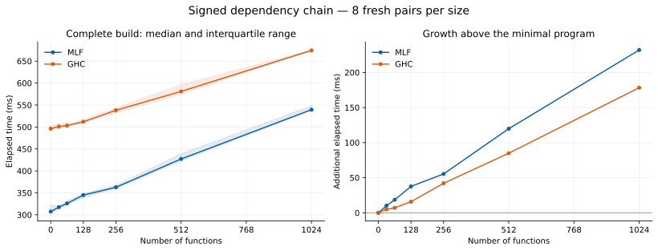

| Growth measure | MLF | GHC |
| --- | ---: | ---: |
| OLS slope, ms/function | 0.224082 | 0.175711 |
| Endpoint slope, ms/function | 0.226619 | 0.174158 |
| Offset-power exponent p | 0.979008 | 1.068224 |
| Exponent bootstrap 95% interval | [0.893335, 1.147434] | [0.904263, 1.219651] |

The paired MLF-minus-GHC OLS interval is **[0.040478, 0.062649]
ms/function**; the exponent interval is **[-0.223667, 0.117846]**.
All median-time checks pass, but both slope point checks and the paired slope
interval fail. The exponent point estimate is lower, while its paired interval
includes zero. **The shape is not accepted.** There is no acceptance commit,
push or move to the next shape. No point was removed, no cohort was pooled, and
no timing run was repeated to seek acceptance. Finite-range offset-power fits
do not establish a lower asymptotic complexity class.

### Controlled memory comparison

Three alternating RTS-instrumented pairs at N=0 and N=1024 used the same current
builtin, source fixtures and host C object. The two proper module closures differ
only in `compareString`; the retained source equals the isolated candidate apart
from its explanatory comment. Interface, object and LLVM bytes match exactly.
These are diagnostic memory runs, separate from acceptance timing.

| N | Metric | Previous comparison | Explicit ordered demand |
| ---: | --- | ---: | ---: |
| 0 | Heap allocation, decimal GB | 0.317047 | 0.306535 |
| 0 | Maximum live heap, MiB | 1.458931 | 1.458916 |
| 0 | Maximum individual process RSS, MiB | 29.484375 | 29.609375 |
| 1024 | Heap allocation, decimal GB | 1.285155 | 1.216296 |
| 1024 | Maximum live heap, MiB | 14.871635 | 13.836205 |
| 1024 | Maximum individual process RSS, MiB | 65.812500 | 64.968750 |

At N=1024, total allocation falls **5.36%** (68,859,224 bytes),
maximum live heap falls **6.96%**, and individual peak RSS falls
**864 KiB**. At N=0, allocation falls by 10,512,472 bytes and live heap by
16 bytes, while RSS rises **128 KiB**. The retained change therefore improves
large-case memory and allocation without implying that every metric improves
at every size.

### Validation

- The isolated candidate and frozen previous host each passed **11,664 Unicode
  codepoint pairs** against independent Haskell list ordering, plus six
  differential demand/error cases.
- The maintained `tests/shared-host/StringCompareProbe.hs` checks **11,664 pairs
  and eight demand/error cases per host/primitive lane**, at both **O0 and O2**.
  It is integrated into the existing host harness. Sixteen focused host commands
  passed, including the existing 89-contract, integer-demand and 722-numeric
  controls at both optimizations. This is focused host qualification, not a claim
  that every platform-specific command in the full host harness ran here.
- The fresh authenticated producer passed all **18 build commands for 137 shared
  modules**, generated-Prelude equality, source/interface audits and a locked
  package plan. The builtin identity remains
  `builtin-source-v1:d706eb86db0ca6a69089fd674283ad2127f0673ce0e2464fd40665e84b5e39c0`;
  no generated Prelude rewrite was needed.
- All **18 regression actions** passed, including the new comparison fixture
  linked to authenticated producer objects, artifact admission, cache/profile,
  signed/unsigned chains, flat/inferred cases and package builds. The direct suite
  passed 14 commands, including **71 ordered-map** and **200 bulk-CRC** commands;
  expected rejections are counted as passing checks.
- All **13 query/host actions** passed, including declaration reads, 1,032 graph
  controls, publication, 19 query-generation tests, 86 shape-contract tests and
  13 historical reconciliation tests. The 18-case retained CLI corpus passed
  13 independently expected native outputs and five expected rejections.
- The final historical manifest remains a 41-path performance transition. Only
  the current host-adapter endpoint changed in this round; all historical
  endpoints remain pinned. Its SHA-256 is
  `963cbab2338325f25ac4dabb006637a88b4f6b21a87f65617abea249b95a181a`.
- Earlier native compiler self-bootstrap and the 600-second native
  `QuerySnapshotProbe` gap remain unresolved and are not claimed here.

### Evidence pins for this round

| Path under `.mlf-build/signed-chain-root-followup-20261116` | SHA-256 |
| --- | --- |
| `profile-current/receipt.json` | `b016b6603f44408a7e7f2d4c8fcde405edf1084ea05ea1b2ff68e8d910b8ad7d` |
| `profile-current/delta.json` | `af4d1b37dc3fa4965705599b3a1e5ea7f56600b596269ee9651acf6004b477e0` |
| `profile-current/callers.json` | `1483ba8367cd98c9ee441714ced88426801ddf4e46f14f3342ee55bf8717fe0c` |
| `compare-strict/receipt.json` | `085160b71a04de5afe084b2319e6b9eecdf448d83b6972c73dd5a9b6ca8b1889` |
| `compare-screen/receipt.json` | `ead83f135ec819559939d3f1af195994ccfb9b250c7f8e4309f4a1db37ddfbca` |
| `memory-compare/receipt.json` | `cb3792824b50519a28ce5819144636ef21a90b8fcf8eba2069fb1555eb0e730e` |
| `host-controls/receipt.json` | `9003051ceadf5c144cd3d3743c10e4f987f8df1687a1e140f9a7a5794570c077` |
| `producer-compare/receipt.json` | `d510098f002ec13747539ab756ddc2955bc30667bf63c57473d944c3f1b7aeb6` |
| `compare-regression/receipt.json` | `5092e93e984e728c77c3467a6e820281a9b1695287bca947d024adb9c2a5aa7a` |
| `root-direct-tests/receipt.json` | `3464ff8108b942a2048fc70126ba435c15547049adfb101b6c5795efc24e36ad` |
| `root-direct-tests/ordered-map/receipt.json` | `b048d20cadea8d5228d3a35c1aa355384c2e1105985e2bb1be4af8083be564b0` |
| `root-direct-tests/bulk-crc/receipt.json` | `c5f4dd8707730ee437b8079c5304d846f856a1516dca921cbab1feef858dd6af` |
| `compare-query-host-controls/receipt.json` | `44c54ed019f3c65dbd404da904dc5cbae114b1b6c1eb94b597e6a225f3a6e37d` |
| `retained-cli/receipt.json` | `47fa50355fbd4f70311177699bee981c31ce227af5fe718b85e852ca25ca31b3` |
| `compare-comparison/cohorts/confirmation/receipt.json` | `b5928f7c189a195b751c6b1e033b9a002d9224210db720eb4f90c10efe413a8b` |
| `compare-analysis.json` | `396b554945cf6f3f15d42bccc1f712af65021af6ff3e3b33f3573ed471a77578` |
| `qualification.json` | `bfd17dbd9a15ae9474f04518d19db7340b6d176028ad0f1679c7de53c3616e79` |

## Previous candidate: signed singleton preparation, 2026-11-16

Evidence is under `.mlf-build/signed-chain-symbol-index-20261116`. This round
retains a source-preparation change and rejects an encoder symbol-index change.
The preceding post-CRC profile identified repeated grouped-source lowering and
prepared-input construction as allocation contributors; it is a profile of the
previous version, not of this retained candidate.

For an indexed, nonrecursive singleton with an eligible unqualified explicit
signature, `SourceInference` now uses the existing signed-expression planner
without constructing and extracting a top-level let group. The resolver-owned
SCC self-edge controls eligibility. Type translation, scope checks, class solving,
checked body construction, final inference and query publication remain in their
existing stages. Prepared fields and query-slot reads agree with the old route.
Explicit qualified or existential annotations, copied definitions and recursive
SCCs retain the grouped path. The named compatibility entry is unchanged.

The isolated screen used N=0/256/1024, one warmup and four alternating measured
pairs per size: **30 compiles, 90 native outputs**, and exact interface/object/LLVM
bytes. Before/after compiler-plus-Clang medians were **0.265223 / 0.264183**,
**0.326107 / 0.314786**, and **0.511489 / 0.494210 seconds**. The large case saves
17.28 ms in this controlled diagnostic. This subprocess sum excludes the complete
worker overhead and is not the acceptance boundary. Independent earlier GHC
cohorts are not an old/new causal comparison of this change.

The maintained source was then rebuilt and authenticated, and its builtin pair
was regenerated outside the timed boundary. The primitive ABI remains
`mlf-primitive-135-v10`, with builtin interface/crate 14 and unchanged wire
encoding. The new Prelude source identity is `builtin-source-v1:d706eb86db0ca6a69089fd674283ad2127f0673ce0e2464fd40665e84b5e39c0`.

### Fixed GHC comparison

The seven sizes, eight alternating pairs, fresh target/query directories,
complete `crate-fused-v1` worker boundary, strict O2 bootstrap build and 2,000
paired bootstrap draws (seed 20261115) remain fixed. All **112 compiles and 336
native outputs passed**. Source and concurrent test load were held fixed during
timing. This qualifies the GHC-hosted bootstrap and generated native programs;
it does not qualify native compiler self-bootstrap or the installed `emlf SOURCE`
endpoint.

| Functions | MLF seconds | GHC seconds |
| ---: | ---: | ---: |
| 0 | 0.320586 | 0.502385 |
| 32 | 0.331512 | 0.509555 |
| 64 | 0.332595 | 0.506540 |
| 128 | 0.347941 | 0.520729 |
| 256 | 0.366614 | 0.537524 |
| 512 | 0.437579 | 0.575815 |
| 1024 | 0.568936 | 0.690097 |

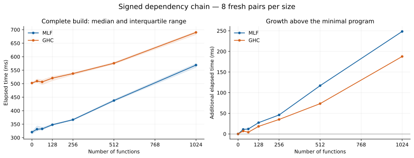

| Growth measure | MLF | GHC |
| --- | ---: | ---: |
| OLS slope, ms/function | 0.241883 | 0.180846 |
| Endpoint slope, ms/function | 0.242529 | 0.183313 |
| Offset-power exponent p | 1.152257 | 1.315879 |
| Exponent bootstrap 95% interval | [1.061747, 1.235291] | [1.184755, 1.466890] |

The paired MLF-minus-GHC OLS interval is **[0.048650, 0.078214]
ms/function**; the exponent interval is **[-0.333909, -0.007778]**.
Median times and both exponent checks pass; both slope point checks and the
paired slope interval fail. **The shape is not accepted.** There is no acceptance
commit, push or switch to the next shape. No point was removed and no cohort was
rerun to seek acceptance. These offset-power fits describe this finite size
range, including fixed startup and IO costs; they do not prove a lower Big-O class.

### Controlled memory comparison

Three alternating RTS-instrumented pairs at N=0 and N=1024 use the same current
regenerated Prelude, host C object and source closure. Only `SourceInference`
differs: the control shadows it with the saved pre-change source. Both binaries
were rebuilt with their proper module closures. Every interface, object and LLVM
output is **byte-identical**, without normalization. These runs are separate from
acceptance timing.

| N | Metric | Grouped control | Signed singleton |
| ---: | --- | ---: | ---: |
| 0 | Heap allocation, decimal GB | 0.317083 | 0.317049 |
| 0 | Maximum live heap, MiB | 1.458809 | 1.458763 |
| 0 | Maximum individual process RSS, MiB | 29.453125 | 29.515625 |
| 1024 | Heap allocation, decimal GB | 1.301726 | 1.284194 |
| 1024 | Maximum live heap, MiB | 15.035355 | 14.923370 |
| 1024 | Maximum individual process RSS, MiB | 65.828125 | 65.875000 |

At N=1024, allocation falls **1.35%** (17,531,736 bytes)
and maximum live heap falls **0.74%**. Individual peak RSS rises
**48 KiB**. At N=0, allocation and live heap fall slightly while RSS
rises 64 KiB. This reduces allocation and live heap in the controlled final run,
not every memory metric. An earlier prototype memory screen used the previous
builtin context and showed higher live heap; it remains separate evidence and
does not replace this current-context comparison.

### Validation and rejected symbol-index experiment

- A fresh authenticated build passed all 18 commands for 137 shared modules,
  including generated-Prelude equality and source/interface audits. The current
  lock was regenerated and the locked package plan passed.
- Fifteen artifact, profile, signed/unsigned chain, flat/inferred and package
  regression actions passed: nine before a fixture repair, then six in an
  explicitly linked continuation. The direct suite passed all 14 commands and
  the retained bulk-CRC gate all 200 commands, including expected rejection cases.
- The signed cache gate passed all 40 commands. Its new maintained fixture makes
  **140 complete prepared-field/query-slot comparisons** against the unchanged
  named compatibility route, with positive fast-path and fallback checks. A
  separate **140-case frozen-module comparison** also covers distinct resolver
  identities with duplicate display names.
- Eighteen prototype CLI cases matched the previous implementation exactly:
  13 accepted cases had equal interface/object/LLVM bytes and checked native
  outputs; five rejected cases had equal diagnostics and no partial LLVM.
  All 18 were repeated on the authenticated retained producer with the current
  builtin and runtime object. They cover polymorphism, higher rank, ordinary and
  managed classes, local signatures/shadowing, aliases, recursion, mutual groups,
  data patterns, and invalid result/argument/type/constraint/rank cases.
- Twelve query/host actions passed before a metadata repair, including declaration
  reads, 1,032 graph controls, query publication, 19 generation tests and 86 shape
  contract tests. All 13 historical reconciliation tests passed after the repair.
  Frozen endpoints remain pinned; the current transition still covers 41 paths.
- The first new fixture incorrectly demanded unknown-type rejection during
  preparation. Both routes defer that rejection to final checking. The type stays
  in the preparation comparison; a CLI negative now checks rejection and retention
  of the last good query generation. Original failure receipts remain intact.
- The first migration refresh captured a stale `mlf.lock` hash while lock
  regeneration finished. Refreshing its current successor after completion fixed
  reconciliation; no frozen endpoint changed. The final manifest SHA-256 is
  `5b1c1b31ca538660187e6fd4ccc1950104d337ced4df9fa0d7802599036efc95`.
- Earlier native compiler self-bootstrap and the 600-second native
  `QuerySnapshotProbe` gap remain unresolved and are not claimed here.

The rejected encoder index grouped strings by length and their last three
Unicode scalars in an `IntMap`, with full-string equality and a balanced-map
collision fallback. It passed **3,396 plan cases, 10,188 root-budget cases,
136 exact wires and four demand-order checks**, including 1,024 intentional
bucket collisions, Unicode/NUL values and resource bounds.

Its separate 30-compile/90-output screen gave before/after medians of
0.264221 / 0.264978, 0.323430 / 0.318859 and 0.508766 / 0.507056 seconds at
N=0/256/1024. At N=1024, allocation increased by 1,002,648 bytes, maximum live
heap by 34,552 bytes, and RSS by 80 KiB. The small timing difference does not
justify the extra index and memory lifetime. Maintained `Bitstream` matches its
pre-experiment bytes; the prototype remains outside the source tree.

### Evidence pins for this round

| Path under `.mlf-build/signed-chain-symbol-index-20261116` | SHA-256 |
| --- | --- |
| `producer-signed-root/receipt.json` | `e63092062b37a2835a5398d2276d560cada9c63423a458e7aa7cfab344af829e` |
| `root-regression-final/receipt.json` | `04743fab3b003521360074630d2548fbb7f7dcbb00f996ef2ff0af738f7a4c6e` |
| `root-regression-continued/receipt.json` | `b586873033453c45c41991c8ef9ad470e3e8c91c821bfefc05f5a8d834ac8b91` |
| `root-final-controls-signed-chain/receipt.json` | `ea2d704774bffacc866a8928a359d361c94084d0ededdfc26b76d968357a6e5a` |
| `root-direct-tests/receipt.json` | `bff3c8e029536a72aa4d8f23b76338095a12a5aa06c712efbebe1f966c201c13` |
| `root-direct-tests/bulk-crc/receipt.json` | `133d73f6c1807e547dbb8c073ec53d3eb704c9294a08485092ccdb2053e3ee7b` |
| `root-query-host-controls/receipt.json` | `a1283895f06502e87fe9e95af56dd787c544429b98b574fd082b3534406d0fe0` |
| `post-continued.json` | `980ad45de87c736e4d70b7621ff25693c6c89dfb9f2888c085248e6db9e6c1e4` |
| `signed-root-controls-v3/receipt.json` | `dca123807fdf6ff0997b10674447505609d43568c6e18202ee99dc20ed90dd3c` |
| `signed-cli/receipt.json` | `5bdc7d4fc9b4912c67307283b21406df39a6ada6241ff4e449d2df5bbc1f9ede` |
| `retained-cli/receipt.json` | `c8b926394f626ec41395589eea2fb40362e3b6855136207afbaa85d78f33c524` |
| `signed-root-screen/receipt.json` | `4465684b29977ad0b62da8566dd8c940bf36dce58707bad9c9377cbd1ee47427` |
| `memory-retained-root/receipt.json` | `141939bb13d29042a322e09cdc1254902097bdfb52a3113f00d900bb73579c57` |
| `symbol-controls/receipt.json` | `125ae316bb11071ab017a125d16b64f697b8c7a4d99628613f233b3870acdfc1` |
| `symbol-index-screen/receipt.json` | `ad02f3a93a68f471d6382d9371a62e66919f4e43b823f0f50ded89631db66ab0` |
| `memory-symbol-index/receipt.json` | `67cbcf184832acd5296e332d9cb33ad6b7b5864321e12c7c0e67f7af14c62c8a` |
| `root-comparison/cohorts/confirmation/receipt.json` | `ca66fce9e54abe11414e776f23d1b4b28640ece75cfd20224e1c15c2d967d64b` |
| `root-analysis.json` | `5dd789b1c8c6a50f60c3d8c5d7bbebc56d3e6064e4e9ff0c7e0f69b2838647e1` |
| `qualification.json` | `85344bb6266b45e9c77784b07daf139ccec824cdbdfd2b16ede0d71f889f11c6` |

## Previous candidate: bulk CRC, 2026-11-16

Evidence is under `.mlf-build/signed-chain-codec-20261116`. This round retains a
bulk byte-array CRC operation across the GHC host, shared interpreter and native
runtime. The encoder uses it only after completing a bounded plan, for owned
buffers of at least 1024 bytes. A portable read-only C recurrence replaces the
per-byte boxed operations; header bytes 76..79 are still logically zero. The
public prefix-length checksum and raw writers retain their existing paths.

[The primitive contract](byte-array-crc32.md) appends code **134** without
renumbering earlier codes. The builtin interface/crate identity advance to
`/14` and `:14`, with ABI `mlf-primitive-135-v10` and a required native link
marker. The wire CRC, graph encoding and content-hash rules are unchanged.
The isolated prototype produced identical interface, object and LLVM bytes.
The maintained ABI extension intentionally changes builtin metadata and the LLVM
link marker; its checked builtin pair was rebuilt outside the timed boundary.
The regenerated Prelude identity is
`builtin-source-v1:80bd8d1c901ed78221bdc71a46fee06f964d659a03f987108dd56e82c88bb9ac`.

### Fixed GHC comparison

The seven sizes, eight alternating pairs, fresh target/query directories,
complete `crate-fused-v1` worker boundary, `-O2 -fpedantic-bottoms
-fno-state-hack`, and 2,000 paired bootstrap draws (seed 20261115) remain fixed.
All **112 compiles and 336 native outputs passed**. This qualifies the GHC-hosted
bootstrap and generated native programs, not native compiler self-bootstrap or
the installed `emlf SOURCE` endpoint. Previous cohorts remain separate.

| Functions | MLF seconds | GHC seconds |
| ---: | ---: | ---: |
| 0 | 0.313384 | 0.498037 |
| 32 | 0.318260 | 0.522993 |
| 64 | 0.329398 | 0.514290 |
| 128 | 0.339454 | 0.501334 |
| 256 | 0.371253 | 0.525617 |
| 512 | 0.438603 | 0.564555 |
| 1024 | 0.555328 | 0.677310 |

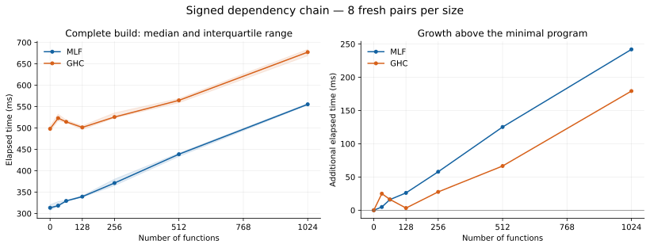

| Growth measure | MLF | GHC |
| --- | ---: | ---: |
| OLS slope, ms/function | 0.238954 | 0.165704 |
| Endpoint slope, ms/function | 0.236274 | 0.175071 |
| Offset-power exponent p | 0.993360 | 1.633276 |
| Exponent bootstrap 95% interval | [0.921111, 1.082744] | [1.408273, 1.975091] |

The paired MLF-minus-GHC slope interval is **[0.062344, 0.086736]
ms/function**; the exponent interval is **[-0.973568, -0.412678]**.
Median times and both exponent checks pass; both slope point checks and the
paired slope interval fail. **The shape is not accepted.** No acceptance commit,
push or next shape has started. Small-size GHC medians are nonmonotonic in this
window. Startup and wall-clock variation affect these finite-range fits; the
exponent is not an asymptotic complexity proof. No point is removed or cohort
rerun to obtain a passing result.

### Controlled memory comparison

Three alternating RTS-instrumented pairs at N=0 and N=1024 compare the same
current ABI and source closure, changing only owned CRC dispatch between the
shared checksum and bulk implementation. Every interface, object and LLVM output
matches exactly. These diagnostic runs are separate from acceptance timing.

| N | Metric | Shared checksum control | Bulk CRC |
| ---: | --- | ---: | ---: |
| 0 | Heap allocation, decimal GB | 0.321195 | 0.317073 |
| 0 | Maximum live heap, MiB | 1.458733 | 1.458809 |
| 0 | Maximum individual process RSS, MiB | 29.421875 | 29.453125 |
| 1024 | Heap allocation, decimal GB | 1.383329 | 1.301713 |
| 1024 | Maximum live heap, MiB | 15.078377 | 15.034904 |
| 1024 | Maximum individual process RSS, MiB | 65.796875 | 65.812500 |

At N=1024, allocation falls **5.90%** (81,616,400 bytes) and maximum live
heap falls **0.29%**. Individual peak RSS rises **0.024%** (16 KiB).
At N=0, allocation falls, while live heap and RSS rise slightly. Thus the retained
change reduces allocation, not every memory metric. The initial prototype's
slightly lower RSS does not override this final controlled result.

### Validation and rejected prototypes

- Fresh authenticated 18-command build of all 137 shared modules, generated
  Prelude equality, source/interface audits and a successful locked plan.
- Fifteen artifact, profile, cache, signed/unsigned chain, flat/inferred and
  package regression commands passed. The full direct suite passed all 14 commands.
- Final bulk-CRC gate passed 200 commands: **80 host, 80 native and 9 interpreter
  vectors**, plus **8 demand/bounds checks per backend**. Independent Python zlib
  and SHA-256 expectations check masked ranges, empty arrays, boundaries, retained
  IO actions after mutation, nonmutation, argument order, deferred construction
  and overflowing/negative range values.
- A freshly compiled artifact fixture checks the explicit new constructor and
  all **135** primitive codes, with exact independent canonical bytes. Negative
  codes remain -1, 135 and 2147483647. Native foundation checks also pass the
  complete 0..134 sequence and the preserved 0..94 legacy sequence.
- Thirteen query/host control commands passed, including declaration reads,
  graph ownership, publication, 19 generation tests, 86 shape-contract tests and
  13 historical reconciliation tests. Historical predecessor endpoints remain
  pinned; the current transition explicitly covers 41 source paths.
- The first artifact regression stopped on its obsolete negative-code-134
  assertion. It was corrected to 135 and the new positive case was added and
  independently checked. The initial standalone CRC driver had copied Map
  summary labels; the final direct-suite run uses the corrected driver. Original
  receipts remain intact, with the qualification ledger recording both repairs.
- Earlier native compiler self-bootstrap and the 600-second native
  `QuerySnapshotProbe` gap are not resolved or claimed by these tests.

Each screen below used N=0/256/1024, one warmup and four alternating measured
pairs, 30 compiles and 90 native outputs, and exact interface/object/LLVM equality.
These subprocess sums are diagnostics rather than the complete worker boundary.

| Prototype | N=0 before / after, seconds | N=1024 before / after, seconds | Decision |
| --- | ---: | ---: | --- |
| Fused short binary fields | 0.263580 / 0.264705 | 0.509354 / 0.508662 | No stable growth gain; reject |
| Natural-run Map.fromList construction | 0.258057 / 0.268657 | 0.507004 / 0.510123 | Large case slower; reject |
| Host Haskell bulk CRC loop | 0.263360 / 0.264533 | 0.513757 / 0.522826 | Slower; reject |
| Portable C bulk CRC prototype | 0.260197 / 0.257763 | 0.510821 / 0.505928 | Retain after full backend and memory qualification |

The natural-run Map prototype passed 19,581 host cases and five demand checks,
but was not retained or promoted to a native qualification. Its `fromListWith`
remained unchanged because arbitrary combining functions are not associative.
The separate C prototype also passed 80 independently generated zlib vectors.
No rejected experiment changed the retained Map or field-packing implementation.
The post-CRC follow-up below supplies a fresh profile. The preceding profiles
remain historical evidence rather than measurements of this retained version.

### Evidence pins for this round

| Path under `.mlf-build/signed-chain-codec-20261116` | SHA-256 |
| --- | --- |
| `producer-crc/receipt.json` | `9d073fc3da4dd34efb055c67b991068a819b12843ffbb0285f770b3b8fa716ae` |
| `crc-regression-final/receipt.json` | `d7c4c5947c0a6de4ba10868668952c963126768b9c1cfb1bc4075916251b463b` |
| `crc-direct-tests/receipt.json` | `fa353d15b1f2fc2019731a0afc989060ce4db0c67272c7bed47f45cdbba04350` |
| `crc-direct-tests/bulk-crc/receipt.json` | `5be996cc3005bd85f12d0b5ddabfcea450e1a81a71b662534854442537fb8dba` |
| `crc-extra-controls/receipt.json` | `178e9cb78a905a5f8fdd4c4ca6bbdb5196fd89550d919d013b28f11be3bc98cb` |
| `crc-query-host-controls/receipt.json` | `62761e94a84d7d5db5d9200a645a29d0c81bffac96e94e48c968f71ea7f29524` |
| `foundation-controls/receipt.json` | `ad622500c281e71e9a8ecdc62eaa2740952a6138642bf907e0d10ab696c1185f` |
| `crc-comparison/cohorts/confirmation/receipt.json` | `3f97fca8e1a0680c9ed7f8b5fce3a7331e5d6c1fac77b4fc4d00ba82b1539bbe` |
| `crc-analysis.json` | `758cc9708d0bbce4492eb294ada14c6612b9c0aa4e1ac341f7517689ed131751` |
| `memory-retained/receipt.json` | `0bebba365bb15d4598a552d45f356385167dd6c7f42fb592fd7962b0d2222507` |
| `memory-build.json` | `76a9024fa68eaa1be5daa38d7941f8f4e99eca166ca213f2fd478672a22c93ed` |
| `prefix-screen/receipt.json` | `557ee1ee955e0dff6429411f6faef6e9f95a649a03ffe93b65dc65859f304705` |
| `natural-screen/receipt.json` | `f5c0046744ce31a73f2bc8bb0de926f1de2467befa12bad03c7285d96dd9e04e` |
| `natural-controls/receipt.json` | `e786a06a13f2054b2e8196e2570f8d9809a643790b97a6e8c41986954397241f` |
| `crc-screen/receipt.json` | `0e0770d05288c3db02cbc05267f6d21e31ab2891d035bb2b9d3af108d7744c3d` |
| `crc-c-screen/receipt.json` | `3bbb5b0aa2a7ba2a19c697601dce2d5848175ab8f7fb8963a9445532c4ede48a` |
| `crc-c/c-controls.json` | `5456cb71573a099843d54129d19ab157330311d5b5a305e9707ae95f7e3b8735` |
| `qualification.json` | `3895c2779674a33b86657be8f1eeb0ee5190f76967d679b4b96b3804385ed2fa` |

## Post-CRC follow-up: allocation and structure, 2026-11-16

This bounded investigation retains **no new compiler change**. Evidence is in
`.mlf-build/signed-chain-post-crc-20261116`. At that checkpoint the authenticated bulk-CRC producer
matched the maintained source, so its preceding fixed GHC cohort remained
the acceptance result. No new GHC run was made to seek a favorable sample; both
slope gates still fail and the signed shape remains open.

Two fresh profiled compiles at each of N=0/256/1024 produced exactly the retained
interface, object and LLVM bytes. The N=1024-minus-N=0 mean own costs put GC at
45.5 ms, `Map.balance` at 14.45 ms / 64.14 MB allocated, the two string-comparison
cost centres at 18.3 ms combined, and `Text.concat` at 7.9 ms / 35.91 MB. Profiling
clocks themselves are visible in the trace; the `allocaBytesAligned` time is
mostly this instrumentation and is not a normal compilation hotspot. These
samples diagnose costs; they are not acceptance timings.

Three isolated prototypes used the same diagnostic protocol: one warmup and
four alternating measured pairs at N=0/256/1024, fresh query/output directories,
and the fused compiler plus Clang subprocess sum. Each passed 30 compiles,
90 generated-program outputs and exact interface/object/LLVM byte comparison.
This diagnostic boundary excludes the complete worker overhead and must not be
substituted for the formal comparison.

| Prototype | N=0 before / after, seconds | N=256 before / after, seconds | N=1024 before / after, seconds |
| --- | ---: | ---: | ---: |
| Local Map child-demand removal | 0.257509 / 0.263124 | 0.335683 / 0.331596 | 0.523736 / 0.522051 |
| Direct identifier / parser dispatch | 0.262915 / 0.260287 | 0.322854 / 0.320344 | 0.510334 / 0.514880 |
| Shared declaration-key index | 0.260235 / 0.254143 | 0.327163 / 0.312063 | 0.506391 / 0.502686 |

Separate RTS binaries used three alternating pairs at N=0 and N=1024. Their
interface, object and LLVM bytes also matched. At N=1024:

| Prototype | Allocation before / after, decimal MB | Maximum live heap before / after, MiB | Individual peak RSS before / after, MiB |
| --- | ---: | ---: | ---: |
| Local Map child-demand removal | 1301.718264 / 1301.717344 | 15.034920 / 15.034920 | 65.828125 / 65.734375 |
| Direct identifier / parser dispatch | 1301.721864 / 1287.812808 | 15.034958 / 13.898552 | 65.812500 / 64.781250 |
| Shared declaration-key index | 1301.720560 / 1298.399136 | 15.034958 / 15.159210 | 65.812500 / 65.781250 |

- Local `bin` / nonrotating `balance` construction avoided demanding child trees
  a second time after their sizes had been read. The public `node` and ordered
  balance tests were unchanged. It passed 24,649 raw-shape pairs, 400 mutation
  steps, 30 demand/order cases, and 19,581 ordered-map cases plus five demand
  checks. Allocation differed by only 920 bytes at N=1024 and live heap was
  unchanged, indicating the host already removes this redundancy. The small
  large-case timing gain came with a larger empty-program penalty; reject.
- Direct identifier parsing and direct `pMap` / `pBySyntax` passed **3,270**
  state/value/error/consumption and backtracking comparisons against frozen
  originals, plus **99 successful full-module AST comparisons and four expected
  syntax failures**. Error text and complete token positions matched. Allocation
  fell 1.07%, maximum live heap fell 7.56%, and RSS fell 1.57%; nevertheless the
  large case was slower and endpoint growth increased. Reject this tradeoff.
- A lazy key index shared by declaration-symbol snapshots passed the existing
  **1,032 SCC/reach comparisons**, query/package checks and all declaration-query
  controls. It saved 0.255% allocation at N=1024 while increasing maximum live
  heap by 0.826%. The endpoint growth rose from 0.240387 to 0.242717 ms/function.
  The added cache lifetime and representation change are not justified here;
  reject. RSS and live heap moved in different directions.

All prototype sources remain outside the maintained source tree. Map, Parser,
Parsec and Dependency hashes match their pre-experiment versions; authenticated
producer revalidation passed. The first parser shadow build had a script escape
error; the first differential fixture used the wrong `Either` constructors.
Both failed logs remain separate from the corrected successful runs. No native
compiler self-bootstrap qualification is claimed by these host-side probes.

### Follow-up evidence pins

| Path under `.mlf-build/signed-chain-post-crc-20261116` | SHA-256 |
| --- | --- |
| `profile-crc/receipt.json` | `5a8025f1109c524b8a1dc4a3a527370e06d8c20de8cdeadab71bb0233ed137e9` |
| `profile-crc/delta.json` | `bf1b73b624817efab5a50e930b4ced41ac85ab97a2891fe51171660a72eeeb89` |
| `map-demand-controls/receipt.json` | `4a0256dac2f42443b4d6d7fa5d53acbc73ab1bd801e02305cf391c625a2c5308` |
| `parser-controls-v2/receipt.json` | `ee082cac48ee93c705dff980db84f04968a6e4288b5b295bb7646ce3f6681f56` |
| `symbol-controls/receipt.json` | `77125223d0f4881fc045460249d9ca6e56f12d021d1d1a516bd60989a2eddb08` |
| `map-demand-screen/receipt.json` | `9c0571bde6648d58600f74a4c6e4d8c3c7ebcda31dd547629b37098198ee5acb` |
| `memory-map-demand/receipt.json` | `c8177a9d2d6562e9bfeacce37113eb3bb90c812d85e93ac7cf9a3c2eb580be8c` |
| `parser-direct-screen/receipt.json` | `2ea9127befb1474f42bf02f1b07ceba6dd2b5e426ea3c1eb0f61f59efad2d163` |
| `memory-parser-direct/receipt.json` | `b925b8a8abd2726cc3c9a7c8f01a4868f6b5d9f5d9f39d8f1c02ad304fbdc0db` |
| `symbol-cache-screen/receipt.json` | `59d0491136c8f4c7a2cf738958041ba2b9e7ab4d73183974c17b3b4a89219755` |
| `memory-symbol-cache/receipt.json` | `5a31365a2e4d5236dd32b29fc79e7e0db5a41d40c648c66883227bfe691bd583` |
| `qualification.json` | `e8fe6c58c6c0ea902e92fb5ba14f06dd91ed014dd4c70553e13cd16690d3a832` |

## Prepared-source and bootstrap-backend follow-up, 2026-11-16

This investigation retains **no new compiler change**. Evidence is under
`.mlf-build/signed-chain-prepared-20261116`; the bulk-CRC producer was
reauthenticated against the maintained source at that checkpoint. Its preceding
fixed GHC cohort remained the acceptance result, with both slope gates failing. These
experiments do not establish native compiler self-bootstrap qualification.

A diagnostic trace of the 32-function case compared the original and lowered
prepared-member encodings. Only **one of 35 pairs** was identical. Original
members carry call-site source spans, while lowered members carry checked type
information; simply omitting one encoding is not an equivalent optimization.
The trace compiler still produced identical interface, object and LLVM bytes.

A direct framing prototype specialized the existing structural-key grammar to
length-counted text builders, avoiding intermediate `SourceKey` and `FramedKey`
trees. It passed **72 exact expression/member encoding comparisons**, five
explicit demand-order cases and the existing **54 query-encoding audit checks**.
Controls include source locations, global/scoped references, wanted references,
nonfinite and signed-zero literals, indexed patterns and deeply nested terms.

A separate experiment rebuilt the unchanged bootstrap source using the local
**LLVM 16.0.6** GHC backend, preserving `-O2 -fpedantic-bottoms -fno-state-hack`
and Core lint. This used fresh objects and the same current CRC host object.
An earlier LLVM 23 smoke build emitted GHC's unsupported-version warning; it
was not timed. The LLVM 16 diagnostic binary is not an authenticated maintained
producer, and no backend option or dependency was added to the build driver.

Both screens used N=0/256/1024, one warmup and four alternating measured pairs,
fresh output/query directories, and the fused compiler plus Clang subprocess
sum. Each passed **30 compiles and 90 generated-program outputs**, with exact
interface, object and LLVM equality. This excludes the complete worker overhead
and is not substituted for the formal GHC comparison.

| Prototype | N=0 before / after, seconds | N=256 before / after, seconds | N=1024 before / after, seconds |
| --- | ---: | ---: | ---: |
| Direct prepared-source framing | 0.263515 / 0.262090 | 0.323198 / 0.323448 | 0.517487 / 0.516197 |
| LLVM bootstrap backend | 0.259376 / 0.264594 | 0.315300 / 0.323773 | 0.507435 / 0.517458 |

The framing screen's endpoint slope changes from
0.248019 to 0.248152 ms/function.
The roughly 1.3 ms large-case timing difference provides no growth improvement.
Three separate RTS-instrumented pairs at N=0 and N=1024 also preserved exact
artifacts and LLVM. At N=1024, allocation **increases by 2,242,312 bytes**,
from 1,301,722,856 to 1,303,965,168;
maximum live heap rises from 15,765,296 to
15,771,416 bytes and individual peak RSS rises
by 32 KiB. Reject the additional builder structure.

The LLVM backend is slower at all three sizes and raises the endpoint slope
from 0.242245 to
0.246937 ms/function. Reject it; no full
regression qualification or formal GHC cohort was run for either rejected
candidate. Maintained `CrateGraph` and `CrateQuery` hashes match their saved
pre-experiment versions, and the retained producer's full input authentication
passed again.

A further breakdown of the preceding two-run profiles groups `Map.balance`
own costs by caller. The two largest binary-interner stacks account for
8.71 MB of its N=1024-minus-N=0 allocation; the remaining allocation is spread
across class validation, module scopes, declaration reads, linking, optimization
and query publication. This is diagnostic evidence for choosing subsequent
work, not proof that another map replacement will improve performance.

### Prepared-source follow-up evidence pins

| Path under `.mlf-build/signed-chain-prepared-20261116` | SHA-256 |
| --- | --- |
| `trace-case/decoded.json` | `fc606bf923f9c945f3054b1ed5f6441a435db58e45f4f3b3a9eb3691654e303d` |
| `frame-controls/receipt.json` | `cef89192240a1f99b82ae112e0dc608922fd50be886fde8572d5117902592864` |
| `frame-encoding-screen/receipt.json` | `7be77913a80b64f97d315d3177cf16f088764dd0027138d5732ca0685ee8cedc` |
| `memory-frame-encoding/receipt.json` | `f787033b793310fa7fb982779d5d194c1387ee585656df2ea42549dff3f1acf9` |
| `llvm16/receipt.json` | `af4997ab57139fcd70ea1cc6c0547e1315b3677ee23762c0a03d858ae8114190` |
| `llvm16-screen/receipt.json` | `17a412f9864f2c13a1c110e3cbb437c010e0e95b39c0fa7ccbdac411c30162d3` |
| `map-balance-callers.json` | `8cf8b1ae5a7c0456c0f76ea07240880b57b49f7241632c70618b9d48c47c453a` |
| `qualification.json` | `98b4f33337fbb12465bca3caceb9f736530570d5ef08ce5cb6237ea3fd1a99ec` |

## Previous candidate: adaptive maps and lexer dispatch, 2026-11-16

Evidence is under `.mlf-build/signed-chain-lexical-20261116`. The fresh
`producer-lexical` build retains all preceding optimizations and the same
`-O2 -fpedantic-bottoms -fno-state-hack` flags. The seven sizes, eight alternating
pairs, fresh caches, complete `crate-fused-v1` boundary and 2,000 paired bootstrap
draws (seed 20261115) remain fixed. All **112 compiles and 336 native outputs
passed**. This qualifies the GHC-hosted bootstrap and generated native programs,
not native compiler self-bootstrap or the installed `emlf SOURCE` endpoint.

The lexer dispatches its fixed operator-character alphabet directly and shares
ordered sets for punctuation and qualified operators. Map construction collects
an ascending prefix, combines equivalent keys with the existing `combine(new,
old)` order, and builds the distinct prefix in linear time in its entry count
(comparison cost aside). It retains the newest equivalent key representative,
forces keys, and keeps values lazy. At the first ordering break, ordinary
insertion handles the remaining entries. Existing balancing operations are
unchanged. The internal tree shape can change; exact tree representation is
not claimed to remain compatible.

The prepared Prelude checks canonical map shape as well as contents. The first
isolated Map prototype retained stale generated data and was correctly rejected
with `prepared Prelude source names are inconsistent`, causing the full-Prelude
fallback and different LLVM. That failed screen is retained. The check was not
weakened: the generated data was rebuilt with the new implementation, then full
verification and exact interface/object/LLVM comparisons passed. The maintained
builtin identity is `builtin-source-v1:e94e6d01c6822596d81cc85004a9cca8bf3eca6636b89033bea2490f721aafa4`.

| Functions | MLF seconds | GHC seconds |
| ---: | ---: | ---: |
| 0 | 0.313384 | 0.486411 |
| 32 | 0.315028 | 0.492921 |
| 64 | 0.327180 | 0.502244 |
| 128 | 0.340215 | 0.493173 |
| 256 | 0.379563 | 0.528202 |
| 512 | 0.437493 | 0.568399 |
| 1024 | 0.566833 | 0.671362 |

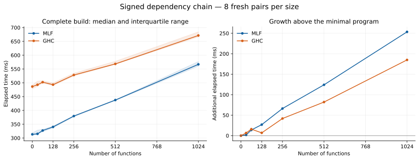

| Growth measure | MLF | GHC |
| --- | ---: | ---: |
| OLS slope, ms/function | 0.250158 | 0.179718 |
| Endpoint slope, ms/function | 0.247509 | 0.180616 |
| Offset-power exponent p | 0.994933 | 1.185711 |
| Exponent bootstrap 95% interval | [0.945761, 1.087841] | [1.011679, 1.338941] |

The paired MLF-minus-GHC slope interval is **[+0.050914, +0.085246]
ms/function**; the exponent interval is **[-0.336602, +0.001857]**. All positive
median times pass; both slopes and the paired slope interval fail. The exponent
point estimate passes, but its paired interval does not. **The shape remains
unaccepted.** In particular, a fitted value near one does not prove a lower
asymptotic class, and this cohort is not rerun or pooled to obtain a passing
interval. Earlier confirmation cohorts are separate measurement windows.

### Isolated effects and memory

Separate screens at N=0/256/1024 each used one warmup and four measured
alternating pairs, with 30 compiles and 90 checked native outputs. The lexer
screen's N=1024 median changed **0.531958 to 0.521680 seconds**. On top of that
lexer, the regenerated Map screen changed **0.522836 to 0.509804 seconds**.
These sums of compiler/linker subprocesses are diagnostic, not replacements for
the complete worker-boundary GHC cohort. Interface, object and LLVM bytes match
exactly in both successful screens.

Three separately instrumented alternating pairs compare the preceding direct
singleton candidate with the current candidate. All interface, object and LLVM
bytes again match. Memory diagnostics are outside the timing acceptance cohort.

| N | Metric | Direct singleton | Adaptive map and lexer |
| ---: | --- | ---: | ---: |
| 0 | Heap allocation, decimal GB | 0.323277 | 0.320945 |
| 0 | Maximum live heap, MiB | 1.456741 | 1.458595 |
| 0 | Maximum individual process RSS, MiB | 29.343750 | 29.531250 |
| 1024 | Heap allocation, decimal GB | 1.444131 | 1.384297 |
| 1024 | Maximum live heap, MiB | 15.524124 | 15.095032 |
| 1024 | Maximum individual process RSS, MiB | 64.718750 | 65.921875 |

At N=1024, cumulative allocation falls **4.14%** and maximum live heap falls
**2.76%**, but process peak RSS increases **1.86%**. At N=0, allocation falls
slightly while live heap and RSS increase slightly. Thus this change reduces
allocation, not every measure of memory consumption. No causal claim about the
RSS difference is established by these three pairs.

### Validation and remaining cost

- Fresh authenticated build of all 137 shared modules, generated builtin equality,
  shared-interface audit, exact source identities and a successful locked plan.
- Fourteen artifact, phase, signed/polymorphic cache, flat/inferred and package
  regression commands passed. The complete 13-command direct suite passed,
  including both generated-native semantic partitions and the new Map driver.
- The maintained Map driver compares 19,581 cases to independent `Data.Map.Lazy`
  oracles, with invariants, duplicate ordering and full key representatives. Five
  host demand checks and 63 native checks also pass. Native integer results use
  an independent Python dictionary and signed-64-bit arithmetic oracle. The
  driver is invoked by the existing CI `test_direct.py` entry.
- The existing explicitly migrated Map balance suite also passes unchanged:
  24,649 raw-shape pairs, 400 mutation steps and 30 demand/order checks. No frozen
  tree oracle was rewritten to accommodate the new constructor.
- The isolated lexer comparison covers 1,114,113 character values plus Int64
  boundaries, 16,521 token classifications, 9,826 token adjacency cases, malformed
  inputs, and 113 maintained shared source files. Tokens, locations and errors
  match the frozen prior lexer. This is host evidence, not native lexer qualification.
- Twelve query-host/offline commands and all 13 reconciliation tests pass.
  Two harness/metadata failures remain recorded: the first new Map driver omitted
  C transports at link time, and the changed direct test entry was initially
  absent from the pinned source transition. The driver now compiles transports
  from authenticated sources; the complete direct suite was rerun successfully.
  The exact test-entry transition was added and all reconciliation controls passed.
  `qualification.json` references the original receipts and successful replacements;
  failed receipts were not relabeled as complete.
- Six new profiled compiles at N=0/256/1024 exactly match the formal producer's
  interface, object and LLVM bytes; own ticks/allocation sum to every profile's
  totals. N=1024-minus-N=0 own costs include Map balancing **13.40 ms / 64.13 MB**,
  string comparison **20.30 ms**, checksum **9.80 ms / 77.35 MB**, and GC
  **43.95 ms**. Bitstream work attributed to final package encoding is
  **17.85 ms / 109.65 MB**, and to query encoding **16.20 ms / 103.64 MB**.
  Profiling overhead and query-clock FFI allocation are not compiler hotspots.
  Encoding, string comparisons and the remaining allocations guide the next
  experiment; their profiled timings are not acceptance samples.
- The preceding native QuerySnapshotProbe timeout remains an explicit gap;
  no new successful native query probe or native compiler self-bootstrap is claimed.

| Evidence under this study root | SHA256 |
| --- | --- |
| `producer-lexical/receipt.json` | `845a686573151ab8a0915e30a346029a99e594ec296a824cd063445b5bb5e70f` |
| `lexical-analysis.json` | `31689a3f00932061dedbcec0ba92718384532f0c1e5e375e0b0c1de593bb78da` |
| `lexical-comparison/cohorts/confirmation/receipt.json` | `542a431d7d11c8cf82249a9bae00d2da42b7c82cd134b936fb53fc5549548e57` |
| `sets-screen/receipt.json` | `180501b713a73e3a5ed3e492f9e64f4716d62cb0f1fcacdb6ad12db63bbf284e` |
| `adaptive-screen/receipt.json` | `3980ee04814388a0de940f802968a13b8b0627e3622224a382afe1928353d6bf` |
| `adaptive-refreshed-screen/receipt.json` | `418c6deb9d319ec68de181b8d08c6de41fa16a536e8dd046937ef550e61298a9` |
| `prototype-controls/receipt.json` | `c37f0cbebcdf481adaa0f1170fd80dfd330bae4fe33450330bc1012fc941a879` |
| `memory-lexical/receipt.json` | `873236ea392e3dcf339cfd04ecd611600dcbb4144bb2dc119d440eb77928d4ec` |
| `qualification.json` | `d216b0cd2ffd3b6772eba733efe9ebd71a0f755ff162b1dced9d193cee3d975d` |
| `qualified-direct-tests/receipt.json` | `5056b4748dfc3eb3dfd2880aef7ee44cce52dcf654daabb4251fb45e17224764` |
| `qualified-direct-tests/ordered-map/receipt.json` | `87cde99e7d2c5db396901a6658a380d1d0ccb7b5a56ac4bbce967f2c8b955235` |
| `map-balance-controls/receipt.json` | `cec1afb06178cb779a0cc50519e4dec94d5aadac92f0783351f3eba3ef0ae311` |
| `locked-plan.json` | `4024fa92c5eb354ab7fdc4e8941107efcb2ff03eb3c55f945820752c89b7cf1b` |
| `profile-lexical/receipt.json` | `37cc1eac8f3b619edc34ed8b8fc5641187e0826a34e8620beeddf4fc4ba38586` |
| `profile-lexical/delta.json` | `a6eb011b562914122a751fa4236e31359dbda2b140970cfd0dfcf64041f330a8` |

## Preceding candidate: direct singleton finalization, 2026-11-16

The fresh authenticated `producer-direct` build retains the structured index and
scope changes below, with `-O2 -fpedantic-bottoms -fno-state-hack`. Evidence stays
under `.mlf-build/signed-chain-structure-20261116`. The fixed seven sizes, eight
alternating pairs, fresh caches, complete `crate-fused-v1` boundary and 2,000
paired bootstrap draws (seed 20261115) are unchanged. All **112 compiles and
336 native outputs passed**. This is GHC-hosted bootstrap qualification plus
generated native applications; it does not qualify native compiler self-bootstrap
or the installed `emlf SOURCE` endpoint.

After all existing finalization, final-parameter, content-hash and optional audit
checks, a singleton output can directly record its Binding when its body is
retained, its final content hash equals the raw hash, its ordered environment
references are unchanged, and no evidence requests were resolved. That Binding
records the **complete ordered finalization dependencies**, including Prepared
metadata, Scope and final bindings. It never substitutes a raw-only dependency.
Metadata-only contract changes therefore remain visible even when the raw body
hash is unchanged. Other groups and the public `recordFinishCached` entry retain
the existing FinishScc path. The actual final object and its checks are unchanged.

| Functions | MLF seconds | GHC seconds |
| ---: | ---: | ---: |
| 0 | 0.316664 | 0.491477 |
| 32 | 0.321272 | 0.493159 |
| 64 | 0.331228 | 0.497888 |
| 128 | 0.342156 | 0.496931 |
| 256 | 0.377802 | 0.529785 |
| 512 | 0.438985 | 0.561051 |
| 1024 | 0.583256 | 0.666515 |

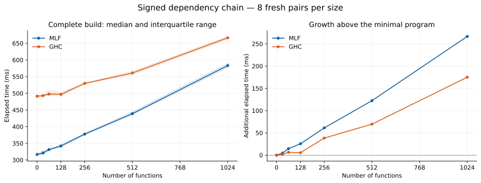

| Growth measure | MLF | GHC |
| --- | ---: | ---: |
| OLS slope, ms/function | 0.260826 | 0.171874 |
| Endpoint slope, ms/function | 0.260345 | 0.170935 |
| Offset-power exponent p | 1.097735 | 1.251666 |
| Exponent bootstrap 95% interval | [1.026535, 1.178355] | [1.124321, 1.383029] |

The paired MLF-minus-GHC slope interval remains **[+0.080536, +0.097066]
ms/function**; the exponent interval is **[-0.291253, -0.020869]**. All positive
median times and the finite exponent criterion pass; both slopes and the slope
interval fail. **The shape is not accepted; no next shape or acceptance commit/push.**
These fitted exponents do not establish asymptotic complexity. Preceding cohorts
are separate measurement windows, not pooled before/after estimates.

### Isolated effect, space and memory

The independent prototype screen used N=0/256/1024, one warmup and four measured
alternating pairs, fresh complete compilation/linking and 90 checked native
outputs. At N=1024 its medians were **0.546484 to 0.527103 seconds**. This screen
sums compiler/linker subprocesses and does not replace the whole-worker GHC
cohort above. All interface, object and LLVM bytes matched exactly.

Fifteen independent cache-generation comparisons check content addresses,
compiler identity, canonical reencoding, typed tables, complete ordered reads
and exact raw payload bytes. The new graph equals precisely the old graph with
each eligible Binding's FinishScc edge replaced by that FinishScc's ordered
reads, and that intermediate node removed. All other rows and digests match.
At N=1024 the index shrinks **426,889 to 343,187 bytes (19.61%)**; interface,
object and raw payload sizes do not change.

Three separately instrumented alternating pairs measure memory, outside the
acceptance cohort. Every interface, object and LLVM byte again matches.

| N | Metric | Structured | Direct singleton |
| ---: | --- | ---: | ---: |
| 0 | Heap allocation, decimal GB | 0.323392 | 0.323277 |
| 0 | Maximum live heap, MiB | 1.456871 | 1.456741 |
| 0 | Maximum individual process RSS, MiB | 29.437500 | 29.343750 |
| 1024 | Heap allocation, decimal GB | 1.489645 | 1.444131 |
| 1024 | Maximum live heap, MiB | 16.013664 | 15.524124 |
| 1024 | Maximum individual process RSS, MiB | 65.812500 | 64.718750 |

At N=1024, cumulative heap allocation falls **3.06%**, maximum live heap
**3.06%**, and median individual-process peak RSS **1.66%** in this paired
screen. These improvements are additional to, and measured separately from,
the preceding columnar/shared-scope work.

### Validation and remaining cost

- Fresh authenticated build, generated builtin equality, shared interface
  audit, source identity and a successful locked package plan.
- All 15 maintained regression driver commands passed, including artifact
  admission/bounds, phases, signed and polymorphic cache reuse, flat/inferred
  functions, package builds/smoke and the full 12-command direct suite with
  both generated-native semantic partitions.
- Thirteen current query-host/offline commands passed. Declaration controls
  exercise actual cold/warm provider paths and authority changes; additional
  direct-finalization controls check exact ordered dependencies, protection-only
  contract changes under the same raw hash, and fallback for changed content,
  evidence and multiple outputs. Existing graph, publication/rollback,
  independent generation, shape-contract and reconciliation suites also pass.
- Six fresh profiled compiles at N=0/256/1024 reproduce exact formal-producer
  interface, object and LLVM bytes. Summed own ticks and allocation equal each
  profile's totals. N=1024-minus-N=0 own-cost deltas include Map balancing
  (18.40 ms, 91.64 MB), string comparison (20.85 ms), checksum (10.05 ms,
  77.35 MB), and GC (44.90 ms). Codec own work attributed to final package
  encoding is 17.75 ms/109.65 MB and query encoding 15.70 ms/103.63 MB.
  These guide further work; profile timings are not acceptance samples.
- The earlier standalone native QuerySnapshotProbe timeout remains an explicit
  validation gap. Its actual GHC reader/writer corpus passed, and QueryGraph
  itself is unchanged by this finalization step. No successful native query
  probe or native compiler self-bootstrap is claimed.

| Evidence under this study root | SHA256 |
| --- | --- |
| `producer-direct/receipt.json` | `094e16a15b2fb9528540216fe46dbf61a95aa773837b2c216355120ac664b0cb` |
| `direct-analysis.json` | `9b65882f974ad5b01046704772041b4e7801eca72421cd6366c15daf06e7c1e3` |
| `direct-comparison/cohorts/confirmation/receipt.json` | `83f1ec8d4b5a0a0710074ec5dc144056596daaee6665653e0ea6b10fb06c6fd1` |
| `direct-finish-screen/receipt.json` | `3b2a81fef85bbaf7521ae94b2c8b8dcf6ba813fd1759afdfc9a4049c8cfd2eb5` |
| `direct-finish-cache-checks.json` | `37e9444ede6f6b72ae0331c1d653e0adcd6bb8ba9225355c6beb5a57fa0b5bef` |
| `memory-direct/receipt.json` | `4b4ee169b641f55ec62c36b1e65819d28df66f4513b68b78f9ad52bbe247aa3b` |
| `direct-regression/receipt.json` | `6d5d99750de184b0ef733ca3f37ea1f7fbcc63981f12add70ce546ed62d05812` |
| `direct-direct-tests/receipt.json` | `d13a419d33181e90ea9c8aa44c1a29290ff223f178e06f480f1b7888e7b46817` |
| `direct-query-host-controls/receipt.json` | `529cbf46d76bc9eec4336dcb26760bea86c8dd8bce44f80ca38f224c3628df79` |
| `direct-locked-plan.json` | `272cca091bbacca972fbb470aa2766c891ed15588b13dca44fbe00d5f0a25450` |
| `profile-direct/receipt.json` | `93587ffe809d6756a1b258f0dd78024a6da9b204868c181838edfbfaa167d090` |
| `profile-direct/delta.json` | `2df96855cb58683da9a3371d0ebf591595baee99bbfdebf81db746cf677e77a9` |

## Preceding candidate: columnar index and shared empty scopes, 2026-11-16

Evidence is under `.mlf-build/signed-chain-structure-20261116`. The authenticated
`producer-structured` build retains `-O2 -fpedantic-bottoms -fno-state-hack`.
Its regenerated builtin identity is
`builtin-source-v1:34826b49363d085340fc4de0c814c22c1f61a7cdd7137772561cba58aded60b6`.
The measured endpoint remains `crate-fused-v1`: fresh complete compilation,
checked on-disk artifacts, query publication and Clang linking. This qualifies
the GHC-hosted bootstrap and generated native programs, not native compiler
self-bootstrap or the installed-source endpoint.

The version-3 query index keeps the same four typed identity tables and stores
keys, hashes, read counts, read targets and payload row numbers as columns.
It removes per-row and per-read-list wrappers. Counts preserve every edge's
order and repetition; payload addresses equal their row hashes. All old formats
remain independently admitted and are republished in the new format. Normal
compilation starts a fresh `query-graph-v3` directory.

Empty inventory/scope records use two separate constant identities, never the
identity of the first declaration. Nonempty scopes retain their group identities.
Each provider supplies its current inventory. Before inference reuse, validation
also compares the complete current read list: a route change cannot be hidden by
an old empty scope kept live by a different group. Prepared and evidence-site
identities remain distinct. The wire contract is documented in
[crate-query-graph.md](crate-query-graph.md).

| Functions | MLF seconds | GHC seconds |
| ---: | ---: | ---: |
| 0 | 0.319604 | 0.494895 |
| 32 | 0.334617 | 0.503838 |
| 64 | 0.332509 | 0.502640 |
| 128 | 0.350488 | 0.506300 |
| 256 | 0.380261 | 0.525519 |
| 512 | 0.446551 | 0.555122 |
| 1024 | 0.612601 | 0.674392 |

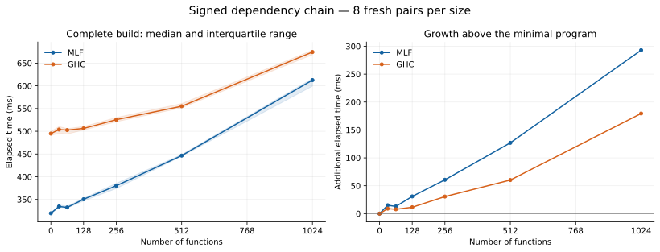

| Growth measure | MLF | GHC |
| --- | ---: | ---: |
| OLS slope, ms/function | 0.282035 | 0.169824 |
| Endpoint slope, ms/function | 0.286130 | 0.175290 |
| Offset-power exponent p | 1.202875 | 1.560741 |
| Exponent bootstrap 95% interval | [1.117164, 1.262715] | [1.345265, 1.746956] |

All 112 compiles and 336 native outputs passed. The paired MLF-minus-GHC
slope interval is **[+0.099042, +0.118158] ms/function**; the exponent interval is
**[-0.570799, -0.142885]**. Thus the time and finite exponent checks pass in this
cohort, while the slope checks fail. The seven sizes, eight pairs, complete-build
boundary and 2,000-draw paired bootstrap with seed 20261115 remain unchanged.

### Memory, space and validation

Three alternating diagnostic pairs compare indexed and structured source builds
under the same compiler options, with RTS statistics enabled. These are separate
from acceptance timings. Every interface, object and LLVM byte matches.

| N | Metric | Indexed | Structured |
| ---: | --- | ---: | ---: |
| 0 | Heap allocation, decimal GB | 0.323622 | 0.323394 |
| 0 | Maximum live heap, MiB | 1.457008 | 1.456886 |
| 0 | Maximum individual process RSS, MiB | 30.640625 | 29.453125 |
| 1024 | Heap allocation, decimal GB | 1.603915 | 1.489648 |
| 1024 | Maximum live heap, MiB | 19.655769 | 16.013664 |
| 1024 | Maximum individual process RSS, MiB | 80.031250 | 65.812500 |

At N=1024, allocation falls **7.12%**, maximum live heap **18.53%**, and median
individual-process peak RSS **17.77%**. The diagnostic query index shrinks from
502,487 bytes to 426,889 bytes (**15.04%**); interface and object sizes do not
change in this step. The columnar-only prototype accounts for 10.50% index
reduction; constant scopes reduce its remaining index by a further 5.08%.

- Two isolated screens each used N=0/256/1024, one warmup plus four alternating
  measured pairs, complete compilation/linking and 90 checked native outputs.
  Columnar-only N=1024 medians were 0.629489 to 0.610321 seconds; the subsequent
  scope-sharing screen was 0.563088 to 0.542890. These are separate screens,
  not a pooled estimate or substitutes for the GHC cohort.
- Fifteen cache-generation pairs per screen passed independent address, typed
  table, edge-order, repetition and exact payload-byte checks. Scope sharing
  matches precisely the substitution of the two constant authorities; all
  other graph nodes, dependencies and payloads are preserved.
- The fresh build checks all shared inferred interfaces, profile conformance,
  generated builtin equality and current source identity. The first build
  found an unconstrained host `IsString` on `takeColumnTargets`; its explicit
  `Int`/`String` signature corrected that before the successful fresh build.
- All 15 maintained regression driver commands passed, including artifact
  admission and bounds, diagnostic phases, signed/polymorphic chain caches,
  flat/inferred functions, package fused builds, package smoke and the full
  12-command direct suite with both generated-native semantic partitions.
- Current query/declaration controls pass empty-to-nonempty-to-empty authority
  transitions, repeat warm reuse, slot drift and rebinding, mixed source and
  dictionary SCCs, and a counterexample where every old dependency stays green
  while the provider chooses a new read list. DAG/package controls, legacy
  publication/rollback controls, 19 independent query tests, 86 shape contracts
  and 13 reconciliation tests also pass.
- Fifty independently authored snapshots pass the actual GHC reader/writer:
  eight accepted and 42 rejected, including column shape/count/payload failures,
  malformed descriptors, duplicate/missing/cyclic identities and 4096/4097 depth
  in both row orders. Accepted typed graphs reencode with exactly the same
  logical keys, hashes, payloads and ordered/repeated reads.
- **Validation limit:** the standalone shared-source query probe's native LLVM
  emission did not finish within 600 seconds. The runner terminated and reaped
  its process group; no native query-probe result is claimed. Its failed receipt
  is retained separately. No baseline experiment establishes whether that
  timeout is a regression. Native generated application outputs above passed.

A fresh six-run `-fprof-late -pj` diagnostic at N=0/256/1024 checks exact artifacts
and LLVM against the formal producer. N=1024-minus-N=0 own-cost deltas still
include Map balancing (18.95 ms, 95.32 MB), string comparison (23.45 ms), checksum
(10.35 ms, 82.37 MB), and GC (47.8 ms). Codec own work attributed to query encoding
is 18.10 ms/122.72 MB and final package encoding 17.90 ms/109.65 MB. These exact
tick/allocation sums guide the next experiment; profiling time is not an
acceptance measurement.

| Evidence under this study root | SHA256 |
| --- | --- |
| `producer-structured/receipt.json` | `88c92cfa84b62dc0eac3705a4fba96f2d9d5db3b7e2ff1d9cedc97b865e9b256` |
| `structured-analysis.json` | `f456f8b766f204a94a5bb3864d0fd29175112c57d4d250c132b2ccb1fb3add92` |
| `structured-comparison/cohorts/confirmation/receipt.json` | `bc31ed33f3e825bc9ab0ed8527fbaae6ced733e0bef9b6ccd9d782c28c5ad1a0` |
| `memory-structured/receipt.json` | `a7be8c1c7b09d26d5223c7978c8841ace06b6fd604d4843d252f5e1ff726208d` |
| `structured-regression/receipt.json` | `e63dc83d747a3ae6e39ac9e7778edc9054d5cd01fe77541a91713038a8d48ed7` |
| `structured-direct-tests/receipt.json` | `b9bf5df5c6cfb11bd81dd6ebc29cdcc90632a6a88e7060898116d9790d4b8393` |
| `query-host-controls/receipt.json` | `99d28205aa28c7bab70f4de879fa2f2e351f57d26c4210851e9c004aa3262480` |
| `query-column-host-controls/receipt.json` | `0c06904f893016251c9e180f26586e95f06a7b4086caee96ff14b4f5fdaa7214` |
| `query-column-controls/receipt.json` | `6fa1fff152f45476ee7d559d8745a1565726940566ffb1a7052608a4f49a388d` |
| `columnar-cache-checks.json` | `4d93ba9fce84130144a8677cd1f12759b7d0c2a8df57fd6012f0572b7a6557a0` |
| `scope-cache-checks.json` | `d6329c6ea932a5c46cdcb9632abf6d8936952d251eb46baf77045ac7221ad020` |
| `profile-structured/receipt.json` | `af6d049b8b5fd30642771de1bf8412737fe95d0b2a8f73f526ca0721c978bdf5` |
| `profile-structured/delta.json` | `ceccc9f68513d83b4845477ae8dd62821c3c628cf5bf5465deaf85ef3dbec8d6` |

## Preceding candidate: encoder and resolved query indexes, 2026-11-16

Evidence is under `.mlf-build/signed-chain-growth-20261116`. The authenticated
`producer-indexed` build compiles all 137 shared modules with the same
`-O2 -fpedantic-bottoms -fno-state-hack` options. Its builtin identity is
`builtin-source-v1:feb7fa7c034960c40dd61b8afa994eebef00c0d7e9479939532d4a0b99095a4e`.
This remains GHC-hosted bootstrap qualification, with native generated outputs;
it does not claim a native self-bootstrap qualification.

The retained changes are:

- Index integer and bit-pattern entries by their exact integer keys. Hash-narrow
  other structural keys with full equality and balanced collision buckets.
- Intern a text symbol and its node together. Repeated occurrences reuse the
  saved node ID while still charging all expanded text work and resource limits.
- Encode bounded shallow node keys injectively into at most 63 bits for lookup.
  Arity, tags and child IDs have disjoint fields; larger keys use the full-key
  fallback. The actual wire format, node order, CRC and artifact bytes do not change.
- Retain the already validated dense query-edge references through index encoding.
  Publication avoids a second string-key map and duplicate edge resolution.
  Closure, recorded versions, cycles, depth and payload checks remain enforced.

Planner state constructors and task/interning helpers are now private to Bitstream.
No repository caller used them; supported value/planning/encoding entry points
remain available. This is a source API narrowing for external users of raw internals,
not a serialized-format change.

| Functions | MLF seconds | GHC seconds |
| ---: | ---: | ---: |
| 0 | 0.361884 | 0.624740 |
| 32 | 0.355444 | 0.576934 |
| 64 | 0.351435 | 0.566667 |
| 128 | 0.427310 | 0.660828 |
| 256 | 0.412610 | 0.629503 |
| 512 | 0.509267 | 0.654535 |
| 1024 | 0.688702 | 0.759386 |

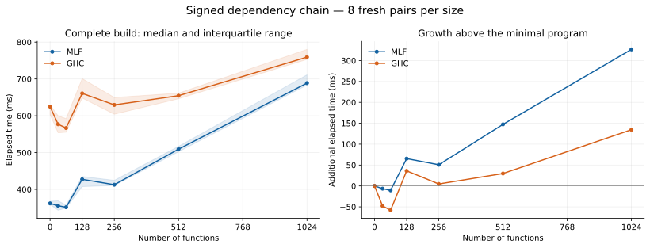

| Growth measure | MLF | GHC |
| --- | ---: | ---: |
| OLS slope, ms/function | 0.324847 | 0.153085 |
| Endpoint slope, ms/function | 0.319158 | 0.131490 |
| Offset-power exponent p | 1.111743 | 1.264128 |
| Exponent bootstrap 95% interval | [1.014744, 1.276284] | [0.785827, 2.160681] |

All 112 compiles and 336 native outputs passed. The paired slope interval is
**[+0.146504, +0.199789] ms/function**;
the exponent interval is **[-1.001734, +0.355977]**.
The acceptance gate remains red. The same seven sizes, fresh cache policy,
complete-build endpoint and 2,000-draw paired bootstrap were retained.

### Allocation and validation

Three alternating diagnostic pairs compare the preceding `producer-single-profile`
with this candidate. Both use authenticated object sets relinked with RTS statistics.
Interface, object and LLVM bytes match exactly. These timings are excluded from
performance acceptance.

| N | Metric | Preceding candidate | Indexed candidate |
| ---: | --- | ---: | ---: |
| 0 | Heap allocation, decimal GB | 0.330329 | 0.323616 |
| 0 | Maximum live heap, MiB | 1.456970 | 1.456978 |
| 0 | Maximum individual process RSS, MiB | 30.578125 | 30.640625 |
| 1024 | Heap allocation, decimal GB | 1.724778 | 1.603908 |
| 1024 | Maximum live heap, MiB | 18.446571 | 19.655746 |
| 1024 | Maximum individual process RSS, MiB | 77.937500 | 79.984375 |

At N=1024 allocation falls about **7.0%**, while maximum live heap rises about
**6.6%** and peak RSS also rises. This is an allocation-volume improvement;
peak memory remains an optimization target. The wire-storage reduction from the
earlier compact owner format is unchanged; this index change preserves wire bytes.

Validation passed: 15 regression driver commands and all 12 direct-suite commands;
frozen codec comparison with finite limit diagnostics, CRC vectors, wide Unicode
buffers, collision cases and shallow-key boundary cases; 110 independently authored
native/GHC codec cases (17 valid roundtrips and 93 rejections); reconciliation (13),
owner comparison (78), modular artifact (45), shape contract (86), query-generation
and string-concatenation controls. The declaration-query fixture also passed all
eight identity, slot-drift, fallback, recursive calling-convention and cache-reuse
checks against authenticated objects with Core lint. Concat fixtures were repaired for the existing
Int64 host API and independently checked append-only opcode inventory 0..133.
No frozen oracle was regenerated. A diagnostic wrapper initially rejected normal
unittest stderr despite exit 0; the corrected wrapper records merged output and
test exit status, and the complete rerun passed.

For 45 alternating pairs, payload bytes and every canonical query-index table were
also compared. Only the index configuration compiler SHA was normalized after
checking it against the actual executable; CURRENT/generation hashes and payload
content addresses were independently checked first.

Discarded experiments in this series: a conservative GHC constructor-barrier
plugin, direct-buffer string concatenation, immutable shared CRC tables, and eager
query-reference projection. None established a sufficient growth improvement;
the last projection reduced maximum live heap slightly without establishing the
complete performance criteria. Prototypes and diagnostic receipts remain outside
maintained source.

Current evidence: `producer-indexed/receipt.json`, `indexed-analysis.json`,
`indexed-comparison/cohorts/confirmation/receipt.json`, `indexed-regression/receipt.json`,
`indexed-direct-tests/receipt.json`, `indexed-pure-tests-final/receipt.json`,
`indexed-final-codec-controls/receipt.json`, `native-codec-controls/receipt.json`,
`query-cache-byte-controls.json`, `query-declaration-controls/receipt.json`, and
`memory-indexed/receipt.json`.

### Further diagnostic screens

Three subsequent prototypes were tested against the unchanged indexed producer.
Each screen used N=0, 256 and 1024, fresh target/cache directories, alternating
lanes, one warmup and four measured pairs per size. All 90 compiles/links and
270 native outputs passed; interface, object and LLVM bytes matched the
reference. These small diagnostic cohorts do not replace the fixed GHC cohort
above and do not establish a fitted-exponent advantage.

| Prototype | N=0 before / after, seconds | N=1024 before / after, seconds | Decision |
| --- | ---: | ---: | --- |
| Machine `Int` on this 64-bit GHC host, preserving 64-bit FFI conversion | 0.292504 / 0.282637 | 0.628556 / 0.625662 | Startup gain exceeded large-input gain; reject |
| Bounded C bit-field writes in the private owned encoder | 0.291368 / 0.292052 | 0.632102 / 0.630314 | About 2 ms at N=1024 does not justify a new cross-backend primitive; reject |
| GHC barrier removal for lexically proven WHNF variables and value lambdas | 0.292940 / 0.293874 | 0.701503 / 0.705775 | No measured improvement; reject |

The plugin was kept in a private diagnostic package database. Review corrected
its treatment of erased type lambdas, followed by a forced rebuild before any
measured run. An additional inlining probe stopped at compilation because the
array primitives already carried the proposed INLINE pragmas. None of these
experiments changed maintained compiler source or received full semantic
qualification for release.

The current indexed source was also profiled at N=0, 256 and 1024, twice each,
using exact JSON cost-centre ticks and allocation bytes. N=1024 minus N=0
still includes about 100 MB in `Map.balance`, 87 MB in the checksum loop,
and 128 MB across the packed-bit writer cost centres. These are diagnostic
allocation totals, not peak memory, and profiling overhead prevents treating
their timings as acceptance results. They show that the remaining work is
distributed across indexing, serialization and collection; a local reduction
in writer operations did not translate into a material complete-build gain.

Additional evidence: `machine-int-screen/receipt.json`,
`bulk-bits-screen/receipt.json`, `known-total-screen/receipt.json`,
`profile-indexed/receipt.json`, `profile-indexed/delta.json`, and
`bounded-review-checks.json`. The qualified producer and the acceptance status
are unchanged. No next shape, acceptance commit or push was started.

## Preceding candidate: one source-profile validation


The final build is `producer-single-profile` under
`.mlf-build/signed-chain-continue-20261115`. It retains the changes described
below and removes a second complete profile-validation scan from automatic
source-profile discovery. `sourceSyntax` already validates the immutable
source, marker, filename and extension profile. Explicit profile selection
still performs its own selection/marker validation before entering the common
layout/parser body. Both public entry paths therefore validate once.

The isolated alternating screen measured N=1024 complete compilation at
0.674633 s before and 0.667323 s after; N=32 was 0.306774 s before and
0.314357 s after. These small screen results are not substituted for the
formal cohort. The refactoring is also retained for removing an unnecessary
full source traversal and giving the two entry paths one parsing body.

All 137 shared modules were freshly compiled, with the original `-O2
-fpedantic-bottoms -fno-state-hack` options. The regenerated builtin source
identity is `builtin-source-v1:3a19b2a19fea994b917d3656f1a3786647f30fad857aeb15b6c1717bd0f999f4`;
the lock and source-migration receipts match the final sources.

| Functions | MLF seconds | GHC seconds |
| ---: | ---: | ---: |
| 0 | 0.351603 | 0.594162 |
| 32 | 0.371628 | 0.582301 |
| 64 | 0.368389 | 0.572890 |
| 128 | 0.398302 | 0.597078 |
| 256 | 0.428424 | 0.632936 |
| 512 | 0.557584 | 0.698089 |
| 1024 | 0.727749 | 0.785104 |

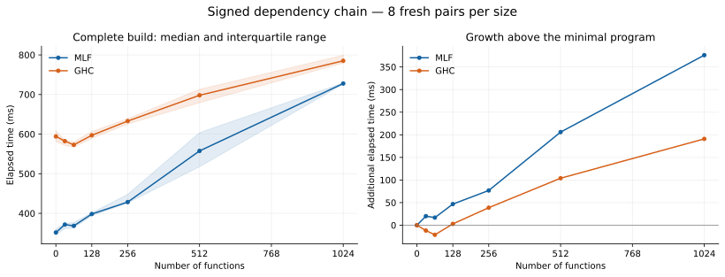

| Growth measure | MLF | GHC |
| --- | ---: | ---: |
| OLS slope, ms/function | 0.372228 | 0.207926 |
| Endpoint slope, ms/function | 0.367330 | 0.186467 |
| Offset-power exponent p | 1.004699 | 0.989967 |
| Exponent bootstrap 95% interval | [0.828378, 1.210320] | [0.856854, 1.226135] |

All 112 compilations and 336 native outputs passed. The paired MLF-minus-GHC
slope interval is **[+0.136362, +0.183434] ms/function** and the exponent
interval is **[-0.254864, +0.219031]**. Only the elapsed-time criterion passes.
Both local curves are approximately linear in this cohort, and the exponent
difference is unresolved. The two cohorts demonstrate why an exponent from
this short range must not be treated as an established complexity advantage.

### Final memory measurement and validation

Three fresh alternating pairs compare the unchanged original producer with
the final producer. Both are relinked from authenticated objects with RTS
statistics enabled; these diagnostic timings are excluded from acceptance.
Complete interface and object syntax, stamps and LLVM remain equal after the
same exact owner-version expansion and object-SHA verification used below.

| N | Metric | Original producer | Final candidate |
| ---: | --- | ---: | ---: |
| 0 | Heap allocation, decimal GB | 0.383463 | 0.330336 |
| 0 | Maximum live heap, MiB | 1.452942 | 1.457001 |
| 0 | Maximum individual process RSS, MiB | 30.828125 | 30.671875 |
| 1024 | Heap allocation, decimal GB | 2.181664 | 1.724458 |
| 1024 | Maximum live heap, MiB | 18.628777 | 18.814644 |
| 1024 | Maximum individual process RSS, MiB | 78.812500 | 79.187500 |

At N=1024 the retained changes reduce cumulative allocation by **20.96%**,
but neither peak live heap nor peak RSS decreases in the final measurement.
The earlier RSS reduction below is therefore not a stable demonstrated benefit.
The compact-owner storage reduction remains 22.9% for `.mlfco`, or 16.5% for
the combined interface/object pair. Smaller artifacts and less allocation do
not imply a smaller resident-memory peak.

The final regression receipt passed all 15 driver commands: artifact
constructor/admission/base64/source/bounds controls, phase profiling, signed
and unsigned chains with fused/cached codegen, signed and inferred independent
functions, package builds, package smoke, and the direct suite. The direct
suite passed all 12 commands, including frontend diagnostics and both native
partitions. Reconciliation (13), historical owner comparison (78), modular
artifact (45) and shape-contract (86) tests also passed. No frozen oracle was
regenerated. The previously verified host SHA and demand controls remain
applicable to unchanged host sources.

Additional discarded experiments were byte masks in the bit writer, a pure
owned planning loop, qualifier lookahead, and scalar prefix probes. Each was
screened against complete artifact bytes and native results. The prefix probe
combined with single validation reduced diagnostic allocation by about 2.1%
but increased maximum live heap; its small timing change did not justify the
extra code. Only the source-validation factoring from this final series is
retained.

Final local evidence: `producer-single-profile/receipt.json`,
`single-profile-analysis.json`,
`single-profile-comparison/cohorts/confirmation/receipt.json`,
`single-profile-regression/receipt.json`,
`single-profile-direct-tests/receipt.json`,
`single-profile-pure-tests/receipt.json`, and
`memory-single-profile/receipt.json`. Earlier receipts are preserved separately.

## Preceding continued candidate and measured result

The preceding candidate is the authenticated `producer-qualified` build in
`.mlf-build/signed-chain-continue-20261115`. All 137 shared modules were freshly
compiled with the existing demand-preserving options. The workload, seven
sizes, source bytes, compiler flags, fresh cache policy, complete-build timing
boundary and 2,000-draw paired bootstrap remain as described below.

| Functions | MLF seconds | GHC seconds |
| ---: | ---: | ---: |
| 0 | 0.369867 | 0.588457 |
| 32 | 0.369149 | 0.593953 |
| 64 | 0.380523 | 0.599068 |
| 128 | 0.405557 | 0.603924 |
| 256 | 0.435319 | 0.618408 |
| 512 | 0.527453 | 0.659470 |
| 1024 | 0.721639 | 0.784746 |

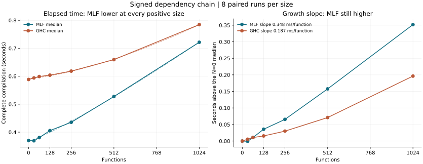

| Growth measure | MLF | GHC |
| --- | ---: | ---: |
| OLS slope, ms/function | 0.347788 | 0.187430 |
| Endpoint slope, ms/function | 0.343528 | 0.191688 |
| Offset-power exponent p | 1.154229 | 1.479895 |

All 112 compilations and 336 native outputs passed. The MLF-minus-GHC slope
95% interval is **[+0.149059, +0.182658] ms/function**; the exponent interval
is **[-0.601623, -0.104979]**. Thus elapsed time and exponent pass, while both
point slopes and the slope interval fail. These new timings are not pooled
with the earlier cohorts later in this document.

The following changes augment the three earlier retained optimizations:

- Reuse the already validated Shared Haskell token scan in layout handling.
- Remove a GHC `lazy` barrier only around an already constructed `Int64` with
  an unlifted payload. Unknown computations retain their ordered demand.
  Actual wrapping arithmetic, nested failures, zero/negative shifts, division
  boundaries and lazy branches passed at both `-O0` and `-O2` with Core lint.
- Use the existing system SHA-256 facility for byte-array hashing on Apple,
  retaining the portable implementation and its failure fallback. Independent
  Python `hashlib` comparisons cover both selected-system and forced-portable
  file and byte-array paths, including block and chunk boundaries.
- Resolve the fixed reserved-word vocabulary into one shared set per syntax
  profile. Each identifier now uses one membership test. The first experiment
  used three separate sets and was discarded; this form also simplifies the
  parser condition. Operator spellings remain unchanged.
- Share each crate's encoded definition-name prefix during name resolution.
- Factor repeated crate prefixes in open group owners without dropping any
  identity. The complete crate and every member suffix or raw name remain.

### Memory and storage

Separate relinks of the frozen before/after producer objects enable GHC RTS
allocation reporting. Their timings are **not** used for performance
acceptance. Three alternating pairs at N=0 and N=1024 use fresh targets;
complete interface, AST, content stamps and LLVM output are equal after exact
owner expansion and verification of the actual object SHA. Source object pins
are checked before and after the diagnostic runs.

| N | Metric | Before | Continued candidate |
| ---: | --- | ---: | ---: |
| 0 | Heap allocation, decimal GB | 0.383 | 0.331 |
| 0 | Maximum live heap, MiB | 1.453 | 1.466 |
| 0 | Maximum individual process RSS, MiB | 30.719 | 31.578 |
| 1024 | Heap allocation, decimal GB | 2.182 | 1.748 |
| 1024 | Maximum live heap, MiB | 18.013 | 17.659 |
| 1024 | Maximum individual process RSS, MiB | 77.328 | 74.484 |

At N=1024, cumulative allocation falls about 20% and peak RSS about 3.7%.
At N=0, peak RSS increases slightly. Allocation volume is not peak live memory;
the guard's separately sampled process-tree RSS can miss short peaks.

The isolated compact-owner change reduces N=1024 `.mlfco` from **610,465** to
**470,796 bytes** (22.9%). `.mlfci` remains **237,644 bytes**, so the combined
pair falls 16.5%. That isolated change did not measurably lower peak RSS.
The source program and emitted LLVM stay unchanged.

### Compact owner framing and compatibility

`pack` frames each string as its Unicode-scalar length, a colon, and its
complete contents. Owner version 2 is
`pack(["MLF-OPEN-GROUP-2", crate, pack(memberRecords)])`. Sort the **full** member
names first. For a name beginning exactly with `module_ + encoded(crate) + z_`,
store `pack(["value", suffix])`; for the corresponding `Module_` prefix, store
`pack(["type", suffix])`; otherwise store `pack(["raw", fullName])`.
`encoded(crate)` retains the existing decimal-scalar encoding. There are no
hash-only identities, omitted names or reordered memberships.

Current readers accept exact version-2, version-1 and legacy query owners.
Old readers do not understand version-2 owners. The MLFBIN codec and checked
artifact invariant are unchanged; the version marker identifies the new owner
representation. Actual compiler controls and independent Python controls cover
Unicode/NUL framing, unknown prefixes, changed crates, complete membership,
duplicates, malformed tags and trailing bytes. Mixed version spellings cannot
bypass canonical owner uniqueness in the historical comparison adapter.

### Validation and retained evidence

That candidate passed artifact constructor/admission/bounds controls,
phase profiling, signed and unsigned fused/cached chains, signed and inferred
independent functions, package builds and package smoke tests, plus all 12
direct commands including both native frontend partitions. Signed controls
include 41 CLI checks and four semantic fixtures. Pure controls passed:
13 source reconciliation, 78 historical owner comparisons, 45 modular
artifact controls and 86 benchmark contract tests. Frozen historical codec,
schema and source oracles were not regenerated.

An initial diagnostic owner-fixture link included unrelated stale objects and
failed; linking only its actual dependency closure corrected it. The first
full regression then rejected a new fixture's partial `head` warning. The
fixture now names the known first member explicitly; the corrected signed
suite and remaining suites passed. Those failed receipts remain retained.

Other screened experiments were reverted: mutable node interning, prepared
value memoization, a larger packed-word accumulator, larger GHC inlining
budgets, parser-combinator fusion, redundant map demand removal, a 16 MiB
allocation area and forced string-comparison inlining. Their measured benefits
did not justify keeping them. The new owner representation and prefix sharing
were reconsidered after the user explicitly included memory, storage and code
structure as useful outcomes.

Local evidence under `.mlf-build/signed-chain-continue-20261115`:
`producer-qualified/receipt.json`, `qualified-analysis.json`,
`qualified-comparison/cohorts/confirmation/receipt.json`,
`final-regression/receipt.json` (superseded signed-fixture failure),
`supplemental-regression/receipt.json`, `final-direct-tests/receipt.json`,
`qualified-controls-signed-chain/receipt.json`, `host-controls-verified/receipt.json`,
`memory-qualified/receipt.json` and the individual `screen-*/receipt.json` files.

## Earlier cohort and initial work

The initial requested commit and push were completed before this study:
`4ee64797` records the preceding compiler work; merge commit
`63fbd13d253a3f1a54170311dcbe076f1d0718f4` incorporates the remote fixes and was
pushed normally to `origin/codex/flat-functions-performance`. The remote ref
was verified. Changes described below are subsequent working-tree changes.
Unrelated untracked skill-manager infrastructure was excluded from the commits.
No other new program shape has been declared optimized or accepted here.

## Fixed workload and comparison boundary

- Existing `compiler-shapes` family `dependency_chain`, unchanged source generator.
  Every function has an explicit `Int -> Int` signature; each adds one and calls
  its predecessor. The final function is invoked using a runtime argument, so
  the source chain is live. Both compilers receive identical source bytes.
- N = 0, 32, 64, 128, 256, 512, 1024. N=0 measures the complete minimal program.
  Discovery uses 3 pairs per size; each confirmation uses 8 pairs. Cell order is
  seeded, with alternating compiler order within pairs. Cohorts are not pooled.
- The unchanged `crate-fused-v1` endpoint includes the Python worker, source
  compilation, checked object and query-cache publication, retained-root LLVM
  generation, Clang optimization and native linking. Target/query directories
  start empty for every leg. Fixed builtin, primitive package and runtime inputs
  may be reused. No target artifacts are reused.
- Apple M1 Max, macOS 26.6.2, GHC 9.14.1, Clang 23.1.3. GHC uses `-O2 -j1
  -fforce-recomp`; the MLF producer retains `-O2 -fpedantic-bottoms
  -fno-state-hack`. Existing time, work, memory and query-depth bounds remain.
  RSS protection is sampled on macOS, not a hard address-space guarantee.
- This is an authenticated GHC-hosted bootstrap compiler. The repository's
  native stage-1 input tool is unavailable here, so the native self-bootstrap
  path in `CONTRIBUTING.md` was not qualified. The benchmark outputs and the
  native semantic regression programs are actual native executables.

## Retained changes

1. **Checked templates for signed dependency groups.** The singleton template
   path now admits closed monomorphic annotations with dependencies. Its key
   contains the full annotation, resolved source structure, dependency schemes
   and datatype context. `SChecked` wrappers from the real lowered source are
   included. A reused fragment must export the declared scheme. Declaration
   identities, per-group dependency reads, audits and bounded cache size remain.
   The unsigned key format is unchanged. An initial implementation missing
   `SChecked` passed an overly small fixture but missed the actual benchmark;
   the fixture now includes that real source pattern.
2. **Composition of checked integer translations.** A narrow pass recognizes
   unary identity/add/subtract-literal functions and compositions of known
   translations. It combines their wrapping Int64 offsets, preserves demanded
   input evaluation and masks summaries at every binder. Unknown, captured,
   effectful and constant functions keep the existing path. The raw legacy
   optimizer interface is unchanged. At N=1024, LLVM output falls from
   1,006,552 bytes to 10,018 bytes; checked `.mlfci` and `.mlfco` bytes remain
   unchanged in the isolated comparisons.
3. **Owned symbol output.** After a successful finite wire plan, buffers of at
   most 4 MiB use the existing bulk UTF-8 conversion to fill symbol text and
   zero placeholders, then write binary fields. Larger buffers stream text
   with the private IO loop. Public raw writers, wire layout, CRC, limits and
   decoding/admission rules are unchanged. This bounds the size of each bulk
   temporary; it is not a claim that total transient allocation is only 4 MiB.

The first major isolated source screen reduced N=1024 from 0.8808 to 0.5152 s
when the actual signed template hit. With that change already present, the
translation pass reduced an isolated complete build from 1.5468 to 0.7075 s.
The private text loop alone improved an isolated complete build from 0.7106 to
0.7015 s; the subsequent bulk writer improved 0.6990 to 0.6832 s. These screens
use four measured pairs after a warmup, preserve exact checked artifacts, and
check native output. Their timer sums compiler and linker subprocesses and
excludes the common dispatcher, so these numbers are not pooled with the formal
whole-worker cohorts.

CRC/node-loop IO wrappers and a linear prepared-input text renderer did not
produce sufficient complete-build gains and were reverted. Their receipts are
retained. An early fused-screen driver failed before the fused measurements;
its incomplete receipt remains separate from the corrected run. The first
bulk-codec control driver retained the module's private export list and failed
to compile the control fixture; the corrected private renamed test copy passed.
No failed sample was substituted into an acceptance cohort.

## Earlier paired result

| Functions | MLF seconds | GHC seconds | MLF/GHC |
| ---: | ---: | ---: | ---: |
| 0 | 0.316350 | 0.498231 | 0.635 |
| 32 | 0.338424 | 0.509984 | 0.664 |
| 64 | 0.350941 | 0.516501 | 0.679 |
| 128 | 0.367136 | 0.512914 | 0.716 |
| 256 | 0.424826 | 0.536521 | 0.792 |
| 512 | 0.519647 | 0.571758 | 0.909 |
| 1024 | 0.739998 | 0.674196 | 1.098 |

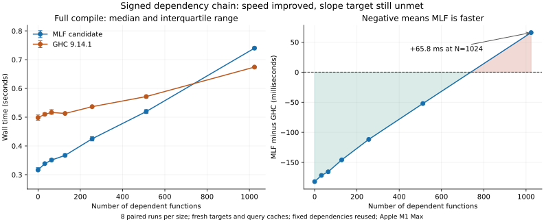

Every one of the 112 timed compilations completed, and all 336 scheduled native
outputs matched the independent fixture oracle. The table includes startup,
publication, code generation and linking, not just the optimized inference pass.

| Growth measure | MLF | GHC |
| --- | ---: | ---: |
| OLS slope, ms/function | 0.406714 | 0.165580 |
| Endpoint slope, ms/function | 0.413718 | 0.171841 |
| Offset-power exponent p | 1.042249 | 1.277178 |
| Conditional bootstrap 95% interval for p | [0.989561, 1.120897] | [1.134038, 1.500161] |
| Exponent using source bytes | 1.031869 | 1.272609 |

The fit is `T(n) = a + b * (n / max(n))^p`, with nonnegative a/b and
`0.1 <= p <= 3`. The predeclared 2,000 paired bootstrap draws use seed 20261115.
The MLF-minus-GHC slope interval is **[+0.232428, +0.251237] ms/function**;
the exponent interval is **[-0.450618, -0.064059]**. Thus the lower-exponent
condition passes, while elapsed time at N=1024 and both slope conditions fail.
The N>=32 and N>=128 MLF exponents are 1.0901 and 1.0641 respectively.
The three-point N>=256 fit is an interpolation with three parameters and should
not be treated as independent complexity evidence. The linear and n-log-n
model residuals are also retained in the analysis JSON.

The initial discovery slopes were 1.5564 vs 0.1775 ms/function, with exponents
1.3793 vs 1.1915. The first candidate confirmation, before the owned writers,
measured 0.7686 vs 0.6899 s at N=1024 and slopes 0.4310 vs 0.1726. These are
separate windows, not paired before/after causal estimates. The isolated
screens above supply the evidence for retaining each optimization.

## Remaining cost and limits

An instrumented source-only run on the final producer takes 0.5149 s at N=1024.
Its reported phases are graph/input bookkeeping 68 ms, cache loading 4 ms,
inference 8 ms, finishing 16 ms, object output 97 ms and query publication
89 ms. Parsing, source preparation and process overhead lie outside those six
internal buckets. Diagnostic timers are not the acceptance measurements.

A cost-centre build of the first candidate attributed substantial cost to
parsing/preparation, prepared-input encoding, package encoding and query-index
publication; it was not used for ordinary timing. The final N=1024 checked
object remains 610,465 bytes and its interface 237,644 bytes. Large repeated
identity text and generic graph encoding remain real work; this study did not
change name identities, formats, cache publication semantics or admission
requirements to obtain a favorable result.

The measured curve is now close to linear, but its variable cost is still too
high. No asymptotic `O(n)` versus `O(n^1.28)` claim follows from these data, and
no unmeasured shape or larger input is covered. The first-shape target and the
broader sequential optimization request remain unfinished.

## Validation

- Fresh authenticated `producer-final` build and regenerated builtin source
  identity; lockfile refresh followed by a successful locked plan.
- 15 serial regression driver commands, including artifact constructors and
  admission/bounds, profiling, signed and unsigned polymorphic-chain caches,
  independent signed/inferred functions, fused package build and package smoke.
- The authenticated direct suite completed all 12 commands, including the
  maintained frontend, two native semantic partitions, async/process checks
  and build-receipt controls.
- Signed-cache controls pass all 41 assertions, including changed signatures,
  shared-payload corruption/repair, same-scheme predecessor edits, rollback,
  ICH verification and disk/fused LLVM/cache-key parity. The signed template
  fixture compares direct inference and an independent checker. The translation
  fixture checks 150 cases at original, algebraic-pass and full-optimizer
  stages, plus binder masking, fallbacks, overflow and demanded/lazy failures.
- Codec controls compare every wire byte with frozen source from
  `4d7724484b39ad9438236ea719ca2ce45c1cf12c`, SHA256
  `f25fe195b5a287fd0c365286acb31839118edac2227f463ea5cc85eb26daedb8`.
  They cover reference widths, exact hash collisions, expanded-work accounting,
  42 independent CRC vectors, short-buffer errors, Unicode/NUL, and ASCII and
  Unicode buffers on both sides of the 4 MiB bulk/streaming threshold.
- 48 additional native outputs from both compilers at N=32/128/1024 match an
  independent Python signed-64-bit wrapping oracle, including min/max integers.
- Pure suites: reconciliation 13, owner comparison 78, modular artifacts 44,
  compiler-shapes contracts 84 tests, all passed. Only exact current source
  endpoints were refreshed in the migration metadata; frozen predecessors and
  historical oracle hashes were preserved.

## Reproduction and local evidence

All local evidence is under `.mlf-build/shapes-sequential-20261115/` (ignored).
`dependency-chain-final/commands.json` contains exact setup and cohort commands.
The final comparison can be repeated into new output directories with:

```sh
python3 -B tools/performance/compiler-shapes/prepare.py \
  --producer .mlf-build/shapes-sequential-20261115/producer-final \
  --builtin-prefix .mlf-build/compiler-shapes-scaling-20261114-fc300bc9/setup/builtin \
  --output NEW/setup --ghc /Users/ares/.ghcup/bin/ghc-9.14.1 \
  --clang /opt/homebrew/opt/llvm/bin/clang --endpoint crate-fused-v1
python3 -B tools/performance/compiler-shapes/run.py \
  --setup NEW/setup/setup.json --output NEW/cohorts/confirmation \
  --endpoint crate-fused-v1 --cohort confirmation --repeats 8 \
  --family baseline --family dependency_chain \
  --size 32 --size 64 --size 128 --size 256 --size 512 --size 1024
```

`validate-final.py` records the regression commands. `run-codec-controls.py`
compiles private renamed current/frozen codecs against retained producer
objects; it does not alter either production module's exports.
`analyze-scaling.py` lives in the preceding `two-stage-phases-20261115` evidence
root. Historical producer receipts are frozen evidence, not certificates for
the current changed source. `producer-final` authenticates that historical snapshot; the latest build is
identified in the first candidate section above.

| Evidence path under the study root | SHA256 |
| --- | --- |
| `dependency-chain-plan.json` | `764e41579a37f5905e28e333787830a78c97e10df302b132138df0cb733b2962` |
| `producer-baseline/receipt.json` | `81b6122104d59f3820df8ca1cdff0ab16e3bdfdcda6b608485d09e12e67178f8` |
| `producer-candidate/receipt.json` | `3ec5c2bd76b2bddef72ed8585903e5f280bffdb46d88d4c2fef241315d51f642` |
| `producer-final/receipt.json` | `c55c7be9526ab63ae0d2b19c1927bb3a722e89e6916dae357e2f84bcba15491b` |
| `dependency-chain-baseline/cohorts/discovery/receipt.json` | `ef58a3b813da28b4e6f43c4613b4d9ac452b0dab78e8172b8653b9188134ad90` |
| `dependency-chain-candidate/cohorts/confirmation/receipt.json` | `e4a6c995427bc4ea5d380f51ba311d3dde8c991e6763a429ef46aaaeaa78f42a` |
| `dependency-chain-final/cohorts/final-confirmation/receipt.json` | `95fd811ee63ad93d3cdef5139aa94f88d13839ff3e523a226f1060fa9468587c` |
| `dependency-chain-final-analysis.json` | `1f2b8fdb712c36b1d68fe26985f3b2e6ca5ed12db3ef8254d9123c4fc100ce31` |
| `screen-fused-v2/receipt.json` | `911a3879d2e3ade2e68111024dfd05439fc46417ff75ba3da9f67fe68e61e2e9` |
| `screen-owned-fused/receipt.json` | `ed568f03577dd4d4108f2455f172f08253708291adfd4f7a292c87105033f96f` |
| `screen-bulk-symbols/receipt.json` | `fbfc6a96496948c173ee06b389e162c4f9e412e790ccbff24f3cb1b5ce828659` |
| `screen-owned-loops/receipt.json` | `1d2688ea1af52469d8ec1c3f0cfbf8bb1996291cbf4af29d8946c7777c2b5739` |
| `screen-linear-prepared/receipt.json` | `58e1198dcad077fe620357418982aefdacc7aa89dc466fa9c6a0d47d1eeef3a7` |
| `bulk-codec-controls-v2/receipt.json` | `4fab542901ef3215e0343265f29ca38fec4445e8f7df9779e8b1dffc6ff2dc29` |
| `final-regression/receipt.json` | `4d77665d4e549f00743290f0861903c5a2caf58718a633c9a7cdb786aa5eea03` |
| `final-pure-tests.json` | `3732790b9a4e20623556933499281a93d5f03091c797b348c10e171d9b70cfd8` |
| `native-integer-boundaries.json` | `dcae4f7685699ffc4d276ed54bec27c1f5e8d601d98356d8bd26c4e8427d83da` |
| `source-profile-final/receipt.json` | `555add0cd3dbfc61374782f093f8fe942342db7d5968bb98ca6aab3bf8100d58` |
