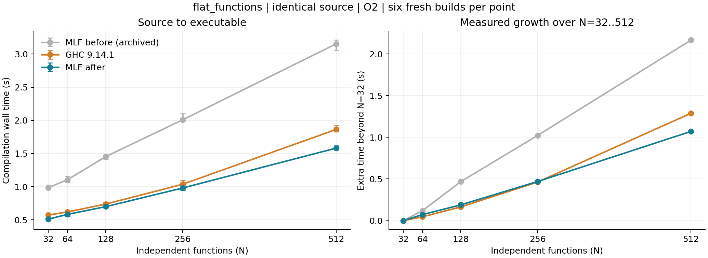

# Independent-function compilation study, 2026-11-14–15

This change optimizes the existing `compiler-shapes` `flat_functions` family on
`main` at `fc300bc9fdc389b585cbef0630fc8915d53e89c5`. It is an implementation and
finite scaling experiment, not a claim about the asymptotic complexity of MLF
inference in general. The family uses independent functions with explicit closed
monomorphic signatures; other source shapes and polymorphic inference retain
the general path.

## Scope and method

The endpoint is the existing `crate-bootstrap-v1`: a GHC-hosted O2 MLF bootstrap
compiler, compiling source to checked crate artifacts, LLVM and an executable.
GHC 9.14.1 compiles exactly the same source bytes with `--make -j1 -O2
-fforce-recomp`. Both lanes reuse fixed dependencies. LLVM uses the same Clang,
GMP/BDWGC and runtime setup as the preceding main study. This is not an installed
native MLF compiler or a self-hosting measurement.

The acceptance plan was fixed before the final cohort: N=32,64,128,256,512,
six repetitions per compiler and size, plus the existing empty-family baseline.
Each MLF invocation has a fresh inference cache, and all N+3 groups must actually
be inferred. Each executable runs against three independent runtime inputs.
The benchmark's scheduling, flags, guard limits and correctness oracles are
unchanged. The reported median wall time includes the complete compiler leg,
including startup, target code generation and linking; fixed dependency setup
is outside the timed leg.

Acceptance requires MLF's median below GHC at every measured size, a lower
N=32-to-512 incremental cost per function, and a lower ordinary least-squares
wall-time slope over the five sizes. The fitted slope includes an intercept.
The optional bootstrap interval resamples the six paired measurement rounds
across all sizes and recomputes medians and slopes; it is descriptive evidence,
not a proof about larger programs.

## Implementation

- A partial type-directed elaborator checks signed nonrecursive monomorphic
  groups, including exact parameter/result types and resolved declaration IDs.
  The independent xMLF checker still constructs the opaque open-fragment proof.
  Unsupported syntax, polymorphic imports and failed attempts use the existing
  solver. Differential tests compare types and erasures with that solver and
  the frozen independent checker.
- Closed monomorphic entry values avoid inferring synthetic declarations. Import
  type checks remain, and noncanonical legacy schemes retain their rejection.
- The command-line linker can reuse the compiler-owned Prelude only after both
  physical images match its generated, build-verified images byte for byte.
  The full literal is independently checked at runtime. Only its transitively
  needed declarations enter the final whole-program check and LLVM generation.
  Other artifacts retain ordinary admission; changed or unrecognized Prelude
  images fall back to it.
- A crate invocation reuses its already admitted metadata snapshot. Small raw
  fragments use the existing bounded identity scan before full DAG planning.
- Query graphs record imported contracts and datatypes on demand. Initial
  imports stay separate from local producers. Nodes reconstructed each run
  retain their hashes and edges without unused payload files; inference and
  evidence payloads remain stored and checked on reload. Atomic publication
  uses relative paths under the same cache directory, retaining its byte/count
  bounds, checksums and failure points.
- Prepared-source keys and finish receipts keep the complete logical value and
  the existing wire planner checks, then hash domain-separated, length-framed
  text directly. Unused binary encoding and CRC work is removed. Unsupported or
  oversized framing retains ordinary binary hashing; stored payload formats and
  checksums are unchanged. Literal framing, Unicode, boundary and mutation
  controls cover the new path.

The generated Prelude was regenerated from fresh preparation. Its term and
binary-image bytes are unchanged; only the implementation source identity
changed. `mlf.lock` was regenerated with the authenticated GHC-hosted package
manager, and its locked plan was checked.

## Results

All three prespecified performance criteria passed in the second final cohort.
The 72 compiler invocations and 216 native runtime oracles all passed, with no
guard failures and no inference-cache hits.

| Functions | Archived main MLF (s) | Final MLF (s) | Paired GHC (s) | MLF time reduction vs GHC |
| ---: | ---: | ---: | ---: | ---: |
| 32 | 0.986 | 0.511 | 0.574 | 11.0% |
| 64 | 1.105 | 0.583 | 0.619 | 5.9% |
| 128 | 1.454 | 0.700 | 0.739 | 5.2% |
| 256 | 2.008 | 0.980 | 1.037 | 5.5% |
| 512 | 3.153 | 1.582 | 1.863 | 15.1% |

The fitted incremental cost fell from **4.525 to
2.230 ms/function**. GHC measured **2.712 ms/function**;
MLF's fitted slope is **17.8% lower**. The endpoint increments are
2.231 versus 2.686 ms/function. The paired-round bootstrap's
descriptive 95% interval for MLF minus GHC slope is [-0.609, -0.384]
ms/function (10,000 draws, seed 20261114).

At N=512, MLF takes about half the archived main time. Its final median stages
are 0.809 s source-to-checked, 0.391 s checked-to-LLVM and 0.334 s LLVM-to-executable.
Medians of separate stages need not sum to the median complete compiler leg.
The empty-family baseline fell from 0.891 s on main to 0.451 s, versus 0.561 s
for the final paired GHC lane. Both fixed work and per-function cost decreased.

This is an overall slope result. The first adjacent interval, N=32 to 64, still
has a larger increment for MLF; subsequent adjacent increments are smaller.
The measurements do not establish a lower asymptotic complexity class.

The first final candidate failed at N=128 and N=256, and its endpoint slope was
not below GHC. Its six-round cohort and negative acceptance result remain in
`benchmark/cohorts/flat-final-20261114` and `results/flat-comparison.json`.
After removing unused binary encoding of rebuilt keys/receipts, the second
candidate was rebuilt and rerun at all sizes with six new repetitions. The
reported result is that complete second cohort, not selected samples from both.

The paired final measurement ran on Apple M1 Max, arm64 macOS 26.6.2, with GHC
9.14.1 and Homebrew Clang 23.1.3. Fresh builds mean fresh target outputs and
inference caches; the OS page cache was not flushed. macOS resource qualification
uses sampled RSS, with no hard address-space guarantee. The archived main line
is historical reference data; final MLF and GHC were measured together.



Left-panel whiskers show the range of all six samples. The right panel subtracts
each compiler's N=32 median to expose incremental cost.


## Validation and limitations

The final authenticated producer is `producer-v3`. On that producer:

- Forced O2 build, all 137 shared-module syntax/name checks, inferred-interface
  audit, implementation identity and fresh Prelude verification passed.
- `test_direct.py` passed all 12 command invocations: async/process controls,
  full shared frontend, native-first/native-second semantics and build receipts.
  The frontend includes the new monomorphic differential and rebuilt-hash
  framing, Unicode, domain, fallback and allocation-bound checks.
- `test_flat_compiler.py` passed 15 assertions across 24 command invocations:
  cold/warm identity, precise body invalidation, used/unused import contract
  changes, failed-generation rollback, one-group recovery after raw payload
  corruption, independent generation inspection, physical Prelude corruption
  rejection and retained dictionary dependencies.
- The exact 55 source-field/ABI checks passed, including cold/warm producers and
  consumers, noncanonical legacy schemes and forged layout rejection.
- The regenerated root lock and `--locked plan` passed. The package manager used
  for these two metadata operations is the authenticated GHC bootstrap binary.

Supplemental unchanged-path controls also passed: 69 compiler-shapes harness
checks, 9 independent query-index checks, 5 independent generation checks and
production QueryGraph pure/publication fixtures (including all failpoints and a
path containing spaces and Unicode). The prior producer-v2 legacy-context subset
passed 29 commands. These passes do not make the following incomplete gates green.

The machine-readable inventory is stored locally as
`.mlf-build/compiler-flat-opt-20261114/qualification-summary.json`.


The complete legacy source-context harness fails at its session scratch cleanup
assertion. The same `query-key.new` residue was reproduced with the archived,
unchanged main producer objects, whose sources match the base Git commit. Its
legacy-query-only subset passes. The standalone maintained SourceSCC fixture
also predates main's `SourcePlan` constructor change (10 fields in the fixture,
8 in main) and does not compile. Neither failure is counted as a passing gate,
and neither fixture was edited to hide it.

The root native build could not start because this checkout has no installed
native seed/package manager. The bootstrap build and tests do not replace native
self-hosting qualification. No asymptotic bound or improvement to other benchmark
families is claimed.

## Evidence and reproduction

Final cohort: `.mlf-build/compiler-flat-opt-20261114/benchmark-v2/cohorts/flat-final2-20261114/`.
Analysis script: `.mlf-build/compiler-flat-opt-20261114/analyze-flat-v2.py`.
The acceptance plan, producer receipts, raw stage logs, executable hashes and
all samples remain under `.mlf-build/compiler-flat-opt-20261114/` on the measurement
machine; this ignored directory is not part of the PR. Failed exploratory runs
and validation attempts are retained there alongside successful ones.

```sh
python3 -B tools/shared/build.py --bootstrap-only --optimization 2 \
  --ghc /Users/ares/.ghcup/bin/ghc-9.14.1 \
  --cc /opt/homebrew/opt/llvm/bin/clang --build-dir NEW_PRODUCER

python3 -B tools/shared/test_flat_compiler.py \
  --build-receipt NEW_PRODUCER/receipt.json \
  --builtin EXISTING_BUILTIN_PREFIX --output NEW_CONTROLS

python3 -B tools/performance/compiler-shapes/bench.py prepare \
  --producer NEW_PRODUCER --builtin-prefix EXISTING_BUILTIN_PREFIX \
  --ghc /Users/ares/.ghcup/bin/ghc-9.14.1 \
  --clang /opt/homebrew/opt/llvm/bin/clang --workdir NEW_BENCH
python3 -B tools/performance/compiler-shapes/bench.py run \
  --workdir NEW_BENCH --cohort flat-final --family flat_functions \
  --size 32 --size 64 --size 128 --size 256 --size 512 --repeats 6
python3 -B tools/performance/compiler-shapes/bench.py analyze \
  --workdir NEW_BENCH --cohort flat-final
```
