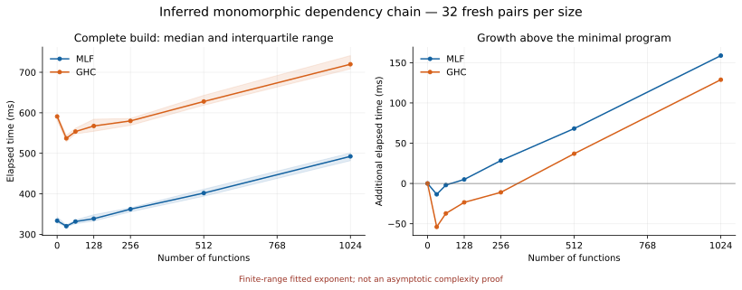

# Inferred monomorphic dependency-chain performance, 2026-11-17

This shape is **not yet accepted**.
The study begins at `d8325d909c249fd82d4ad6173d44d8818cc6f8bf`, after the
accepted signed dependency-chain milestone. The maintained `inferred_chain`
generator is unchanged: `f0 x = addInt x 1`, then
`fi x = fprevious (addInt x 1)`, without signatures on generated functions.
The entry and IO harness retain their signatures. The closed result is `x+n`.

## Measurement and discovery

Both compilers receive identical source bytes and fresh target/cache directories.
The endpoint remains `crate-fused-v1`: GHC-hosted MLF, a single checked-crate-to-LLVM
call, then ordinary Clang O2. GHC 9.14.1 uses `--make -j1 -O2 -fforce-recomp`.
Whole-worker timing includes common dispatcher startup. Fixed builtin, primitive
package and runtime preparation is excluded. These are not installed-native-CLI
measurements. Builds, regression, profiling, memory and timing are serialized.

The plan fixes sizes 0, 32, 64, 128, 256, 512 and 1024; six discovery pairs and
one 32-pair formal confirmation. There is no sample deletion, pooling or
unchanged-source confirmation retry. Acceptance requires lower elapsed medians
at every positive size, lower OLS and endpoint slopes, a lower offset-power
exponent, and paired 95% upper bounds below zero for both slope and exponent
differences. A bound-constrained exponent cannot qualify.

Discovery found N1024 elapsed medians of
0.779619 s for MLF and
0.652231 s for GHC.
OLS slopes were 0.464284 and
0.150564 ms/function.
The exponents were both close to one; this established a much larger incremental
cost, not a higher asymptotic complexity class.

## Hotspot and retained change

A fresh 96-module profiling build runs twice at N=0/256/1024, with query-phase
timers disabled. Every profiled interface, object and LLVM output exactly matches
the ordinary producer. N1024-minus-N0 business-owner growth is 103 ms in
`QueryGraph.moveResults`, 54.2 ms in `stageValues`, and 63.85 ms / 273.37 MB
allocated in `encodeHashed`. These instrumented figures identify targets; they
are not ordinary elapsed times. Ordinary inference is a much smaller cost.

`CrateGraph.inferenceTemplateKey` previously allowed unsigned singleton templates
only when at least one dependency was polymorphic. It now accepts any nonempty
dependency list subject to the existing closed-scheme, resolved-source grammar,
datatype-context and identity checks. The first occurrence still runs ordinary
checked inference. Later matching declarations share the immutable checked
template and canonical query payload. Each declaration retains its own source
key and dependency reads. No checking rule, binary format or resource guard is
weakened; independent unsigned roots retain their ordinary admission path.

The fixed private screen has one warmup plus six measured pairs at each of
N=0/256/1024. Across 42 compiles and 126 native results, user interface/object/LLVM
bytes remain exact. N1024 compiler-plus-Clang medians fall from 0.725591 to
0.404002 s. This subprocess-sum boundary is diagnostic and separate from the
formal whole-worker GHC comparison.

## Alpha-renaming regression found before formal measurement

The broader template admission exposed an existing overly specific key: lambda
nodes included the binder's display spelling even though bound references were
already represented by canonical positions. The unchanged `DeclQueryControls`
fixture changes declaration slots and renames a local binder. The original
producer and compatibility path reused all groups; the first candidate
unnecessarily rechecked one group. Its regression run stopped and is preserved.
The diagnostic probe first failed to compile because the host string has no
`Show` instance; the corrected probe then confirmed counts `0/0` versus `1/0`.

The retained fix removes the display name from the lambda key and keeps its
canonical body and binding positions. The unchanged declaration fixture now
passes every assertion. The maintained independent template fixture additionally
renames the local binder along with its owner and dependency; it fails on the
first candidate and passes on the corrected one. A separate fixed 42-compilation
screen preserves exact artifacts/LLVM and all 126 native results. N1024 medians
are 0.411340 s for the first candidate and 0.413756 s for the correction; the
correction is retained to preserve cache semantics, not as a measured speedup.
Neither screen substitutes for or is pooled into the formal GHC cohort.

The first candidate's full direct gate passed. After the alpha-key correction,
current-source frontend, query, cache, package and native-output checks are rerun;
unchanged foundation CRC/UTF8/Map checks remain separately recorded prior evidence.

## Current-source validation

All 137 shared modules and 18 build actions complete. The builtin preparation
closure does not include CrateGraph, so its source identity and generated literal
remain unchanged: `builtin-source-v1:b54f095675c2c7bd91b804689ab3de3775c0461ab982dc24bfc8d08477d88b6f`. The package lock and declared source
migration receipts are refreshed; the locked plan passes.

The new maintained `InferredTemplate` control compares reuse with direct inference,
exact erasure and an independent xMLF checker. It checks changed dependency types,
literal/context key differences, identity capture, duplicate parameters, open
types, recursive groups and unresolved references. The old producer fails the
specific new template-admission assertion, establishing that the control detects
this change; the candidate and existing signed-template control pass.

The inferred CLI cache gate passes 26 commands and 37 checks, including cold/warm
builds, ICH verification, exact fused/disk LLVM, shared codegen-cache keys, corrupt
payload repair, same-type body edits, rejected type changes, and preservation of
the last valid generation. Current-source frontend/native semantics, signed/polymorphic cache,
package, query, artifact and native-output regression gates also pass. Six disk
reopens preserve complete normalized interface/body/type/scope semantics and
exact cross-producer LLVM; 42 extra integer-boundary outputs pass.

Old/new cache transitions use the same source with ICH verification enabled.
All produce exact original user artifacts and LLVM. Version changes recheck
before subsequent same-version warm reuse:

| Transition | Inferred groups | Reused groups |
| --- | ---: | ---: |
| old-cold | 35 | 0 |
| new-upgrade | 35 | 0 |
| new-warm | 0 | 35 |
| old-downgrade | 35 | 0 |
| old-warm | 0 | 35 |

Native compiler self-bootstrap, the installed CLI, and previously documented
native codec / QuerySnapshotProbe gaps remain outside this qualification.

## Formal GHC comparison

One fixed cohort completes 448 compilations and 1,344 exact native-output checks.
Values below are medians from 32 fresh pairs at each size.

| Functions | MLF, s | GHC, s |
| ---: | ---: | ---: |
| 0 | 0.333643 | 0.590924 |
| 32 | 0.320145 | 0.536964 |
| 64 | 0.331643 | 0.553696 |
| 128 | 0.338623 | 0.567466 |
| 256 | 0.362102 | 0.579925 |
| 512 | 0.401842 | 0.627913 |
| 1024 | 0.492442 | 0.719807 |

| Estimate | MLF | GHC |
| --- | ---: | ---: |
| OLS slope, ms/function | 0.164411 | 0.158357 |
| Endpoint slope, ms/function | 0.155077 | 0.125862 |
| Offset-power exponent | 1.149821 | 1.399410 |

Paired 95% MLF-minus-GHC OLS interval, ms/function:
`[-0.009424114008165015, 0.013309177421581263]`.
Paired 95% fitted-exponent difference:
`[-0.3875409604761922, -0.14251464278507753]`.

The shape remains open. Failed checks: lower_ols_point, lower_endpoint_point, lower_ols_95. Qualified fits: True. Do not advance or commit an acceptance milestone.

The N=0 median exceeds some positive-size medians in both lanes. These
nonmonotonic observations are retained exactly; baseline-subtracted growth is
negative at small sizes. No point is removed or smoothed to change the verdict.

The fitted model is `T(n)=a+b*(n/1024)^p`, with a nonnegative offset and
coefficient. Finite-range fitted exponents cannot prove a lower Big-O class.
The analyzer also retains source-byte fits and range sensitivity diagnostics.



## Memory and query footprint

Separate three-pair RTS runs use each retained producer's own qualified artifacts.
Allocation is cumulative, maximum live heap is an RTS observation, and peak RSS
is a process high-water observation. They measure different quantities.

| Functions | Lane | Allocated bytes | Maximum live bytes | Peak RSS bytes |
| ---: | --- | ---: | ---: | ---: |
| 0 | before | 269,573,400 | 1,414,272 | 35,274,752 |
| 0 | after | 269,569,176 | 1,422,576 | 35,274,752 |
| 1024 | before | 1,118,123,208 | 14,677,560 | 72,318,976 |
| 1024 | after | 862,880,984 | 11,233,224 | 62,865,408 |

N1024 fresh query-cache footprint, before cleanup by the benchmark runner:

| Lane | Payload files | Payload bytes | All files | All bytes |
| --- | ---: | ---: | ---: | ---: |
| before | 1027 | 716,251 | 1030 | 1,003,426 |
| after | 5 | 2,735 | 8 | 218,865 |

Discovery and the first candidate are retained under
`.mlf-build/inferred-chain-growth-20261117`; the corrected candidate and final
qualification are under `.mlf-build/inferred-chain-template-alpha-20261117`.
`study-plan.json`, `commands.json` and `candidate-commands.json` preserve the
frozen settings and exact command arguments. `qualification.json` authenticates
current sources, archived pre-change sources and the separate evidence sets.

To run the maintained inferred cache regression against a newly built producer:

```sh
python3 -B tools/shared/test_poly_chain_compiler.py \
  --build-receipt PRODUCER/receipt.json --builtin SETUP/builtin \
  --output FRESH_OUTPUT --inferred --fused --cached-codegen
```
