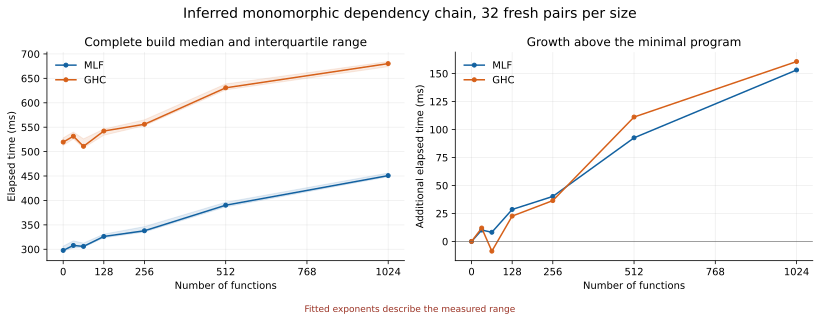

# Shared frontend costs on inferred dependency chains

This study measures full builds of the unsigned monomorphic dependency chain. The compiler retains two frontend changes. 4 of the six fixed comparison criteria pass in this cohort. The shape remains open.

## Frontend changes

Shared parsing already rejects duplicate top-level names and produces annotations with an empty existential binder list. Once these checks succeed, every declaration group can be bound. The normal parser now checks module syntax directly. The public validator for constructed modules still builds declaration groups and reports open recursive signatures and duplicate names. In two profiles per size, the discarded binding pass grew by 3.50 sampled ms and 12.42 MB of allocation between 0 and 1,024 functions.

Surface lowering returns an expression unchanged when its constructors require no pattern compilation or fresh names. A case, equation or do block uses ordinary lowering. The shared-do pass also eliminates legacy do blocks during descent, allowing the ordinary path to omit a second complete do-expansion pass. Binder IDs, hints, annotations, source spans, and the order of errors remain observable in the differential tests.

## Isolated measurements

Each row compares medians against the preceding compiler on identical frozen inputs, with an alternating lane order and a separate warmup at each size. The screen used six measured pairs and the confirmation used twelve. The table reports the compiler subprocess at 1,024 functions.

| Candidate | Screen before / after (ms) | Confirmation before / after (ms) |
| --- | ---: | ---: |
| Parser | 279.276 / 279.630 | 278.524 / 275.697 |
| Parser and surface lowering | 288.998 / 279.260 | 293.083 / 288.906 |

Across both experiments, 240 timed builds produced byte-identical interfaces, objects and LLVM and passed 720 native output checks. Query generation data matched after verifying each executable’s own compiler hash. The following sizes refer to one pair of those identical inputs and outputs at each size.

| Functions | Interface bytes | Object bytes |
| ---: | ---: | ---: |
| 0 | 738 | 1,338 |
| 256 | 27,430 | 74,257 |
| 1024 | 110,451 | 302,673 |

## Fixed full-build comparison

The existing compiler-shapes worker ran the GHC-hosted eMLF compiler plus Clang at O2 against GHC 9.14.1 with a forced, single-job O2 build. Each of seven sizes has 32 fresh alternating pairs. All 448 compiles completed and all 1,344 native outputs matched the arithmetic oracle.

| Functions | MLF median (ms) | GHC median (ms) |
| ---: | ---: | ---: |
| 0 | 297.675 | 519.505 |
| 32 | 307.844 | 531.505 |
| 64 | 305.879 | 510.816 |
| 128 | 326.248 | 542.166 |
| 256 | 337.895 | 556.000 |
| 512 | 390.270 | 630.661 |
| 1024 | 450.854 | 680.232 |

| Growth metric | MLF | GHC |
| --- | ---: | ---: |
| OLS slope (ms/function) | 0.150745 | 0.167992 |
| Endpoint slope (ms/function) | 0.149589 | 0.156960 |
| Fitted exponent by function count | 0.849959 | 0.846572 |
| Fitted exponent by source bytes (sensitivity) | 0.811065 | 0.792823 |

The paired 95% intervals for MLF minus GHC are [-0.022500, -0.011466] ms/function for the OLS slope and [-0.050341, 0.079992] for the exponent. The fixed analysis uses 2,000 paired resamples, seed 20261115, and the model `a + b (n/1024)^p`. The exponent describes the measured range. An asymptotic bound requires a separate algorithmic argument.

## Memory and correctness

These values are median bytes from three separate RTS-instrumented pairs at 1,024 functions. Each retained producer used its own builtin and reproduced its cohort artifacts and LLVM.

| Metric | Before | After |
| --- | ---: | ---: |
| Allocated heap | 843,052,928 | 818,427,616 |
| Maximum live heap sampled by RTS | 9,173,768 | 9,646,880 |
| Bytes copied by GC | 89,901,696 | 88,581,680 |
| Peak compiler process RSS | 59,785,216 | 60,833,792 |

The parser controls compared complete source-module trees or exact errors in 46 cases, and checked eight arbitrary constructed modules. The lowering controls compared 6,156 exact trees or errors and 11 demand probes. Maintained frontend tests cover raw duplicate and open recursive declarations, preserved scope metadata and a nested invalid equation.

The hosted producer passed the locked package plan, frontend and generated native semantics, cache upgrades and downgrades, query and artifact controls, package and CLI regression tests. The regenerated builtin interface and object matched their preceding bytes. The retained disk and fused paths agreed at three sizes, with 42 additional native integer boundary results. The measurements cover the hosted compiler and its generated executables. Native compiler self-bootstrap and installed CLI qualification remain open.

## Reproduction

The fixed command, original inputs, lane order, per-leg resources, output oracles and exact flags are recorded in the study directory. The full worker receipt has SHA-256 `83a6cc0f723e21ae2ee55ac2b58eafcbe3bba411d6de682f0cbaf5c8099bf277`.

- `.mlf-build/inferred-chain-dependency-observation-20261118/candidate/cohorts/confirmation/receipt.json`
- `.mlf-build/inferred-chain-dependency-observation-20261118/candidate-analysis.json`
- `.mlf-build/inferred-chain-dependency-observation-20261118/retained-memory/receipt.json`
- `.mlf-build/inferred-chain-dependency-observation-20261118/retained-validation.json`
