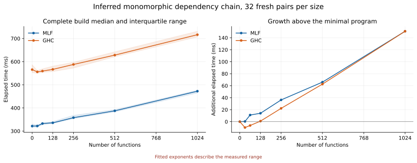

# Removing unused declarations before renaming

This study measures full builds of the unsigned monomorphic dependency chain. The compiler retains two compiler changes. 5 of the six fixed comparison criteria pass in this cohort. The shape remains open.

## Checked backend and source validation

After arithmetic and iterator simplification, the checked backend now walks the outer declaration spine backwards before alpha-renaming it. An unused nonrecursive binding drops together with its initializer. The free references of a retained initializer are computed in its outer scope. Recursive groups stay intact, with their binders in scope throughout the group. The final optimized erased trees matched the preceding optimizer on the actual linked programs.

| Functions | Nonrecursive bindings before / after | Recursive bindings before / after |
| ---: | ---: | ---: |
| 0 | 3 / 2 | 77 / 77 |
| 32 | 35 / 2 | 77 / 77 |
| 256 | 259 / 2 | 77 / 77 |
| 1024 | 1027 / 2 | 77 / 77 |

Shared-source validation also advances through runs of ordinary printable ASCII. A run ends before a quote, a potential comment or pragma opener, a line break or another character that needs the general validator. Each scalar in a run advances the source column by one. Tests checked subsequent errors after Unicode, at nonzero offsets, near wrapping column values and after a run of 65,536 characters.

## Isolated measurements

The first row compares early liveness with the preceding frontend producer. The second isolates the ASCII run change with early liveness in both compilers. Both experiments use identical frozen inputs, alternating lane order and a separate warmup at each size. The screen used six measured pairs and the confirmation used twelve. The table reports the compiler subprocess at 1,024 functions.

| Candidate | Screen before / after (ms) | Confirmation before / after (ms) |
| --- | ---: | ---: |
| Early liveness | 271.934 / 265.568 | 274.444 / 272.322 |
| ASCII run validation | 278.724 / 276.899 | 281.492 / 279.409 |

Across both experiments, 240 timed builds produced byte-identical interfaces, objects and LLVM and passed 720 native output checks. Query generation data matched after verifying each executable’s own compiler hash. The following sizes refer to one pair of those identical inputs and outputs at each size.

| Functions | Interface bytes | Object bytes |
| ---: | ---: | ---: |
| 0 | 742 | 1,338 |
| 256 | 27,434 | 74,257 |
| 1024 | 110,455 | 302,673 |

## Fixed full-build comparison

The existing compiler-shapes worker ran the GHC-hosted eMLF compiler plus Clang at O2 against GHC 9.14.1 with a forced, single-job O2 build. Each of seven sizes has 32 fresh alternating pairs. All 448 compiles completed and all 1,344 native outputs matched the arithmetic oracle.

| Functions | MLF median (ms) | GHC median (ms) |
| ---: | ---: | ---: |
| 0 | 321.577 | 565.653 |
| 32 | 321.909 | 555.873 |
| 64 | 332.651 | 559.288 |
| 128 | 335.617 | 566.562 |
| 256 | 357.875 | 587.887 |
| 512 | 387.551 | 628.302 |
| 1024 | 472.403 | 716.499 |

| Growth metric | MLF | GHC |
| --- | ---: | ---: |
| OLS slope (ms/function) | 0.146622 | 0.156799 |
| Endpoint slope (ms/function) | 0.147291 | 0.147311 |
| Fitted exponent by function count | 1.113600 | 1.229850 |
| Fitted exponent by source bytes (sensitivity) | 1.106204 | 1.221604 |

The paired 95% intervals for MLF minus GHC are [-0.023249, -0.001641] ms/function for the OLS slope and [-0.337164, 0.036334] for the exponent. The fixed analysis uses 2,000 paired resamples, seed 20261115, and the model `a + b (n/1024)^p`. The exponent describes the measured range. An asymptotic bound requires a separate algorithmic argument.

## Memory and correctness

These values are median bytes from three separate RTS-instrumented pairs at 1,024 functions. Each retained producer used its own builtin and reproduced its cohort artifacts and LLVM.

| Metric | Before | After |
| --- | ---: | ---: |
| Allocated heap | 818,416,952 | 790,922,712 |
| Maximum live heap sampled by RTS | 9,647,032 | 11,101,048 |
| Bytes copied by GC | 88,593,296 | 86,913,880 |
| Peak compiler process RSS | 61,079,552 | 65,126,400 |

The backend controls checked 2,058 scoped free-name comparisons, nine interpreter outcomes at four stages, 150 independently evaluated translation cases and four real linked programs. The lexer controls compared 17,154 source validations, 11,436 profile selections, three raw cursor outcomes and 1,540 additional run boundaries. Maintained tests exercise shadowing, recursive RHS dependencies, discarded initializers and the source column of a tab after a long run.

The hosted producer passed the locked package plan, frontend and generated native semantics, cache upgrades and downgrades, query and artifact controls, package and CLI regression tests. The regenerated builtin interface and object matched their preceding bytes. The retained disk and fused paths agreed at three sizes, with 42 additional native integer boundary results. The measurements cover the hosted compiler and its generated executables. Native compiler self-bootstrap and installed CLI qualification remain open.

## Reproduction

The fixed command, original inputs, lane order, per-leg resources, output oracles and exact flags are recorded in the study directory. The full worker receipt has SHA-256 `8372b092189e74cef139897bdbaa8fa791f9e0b1e62831a7753d7cf0f4cc91ba`.

- `.mlf-build/inferred-chain-live-lets-20261118/candidate/cohorts/confirmation/receipt.json`
- `.mlf-build/inferred-chain-live-lets-20261118/candidate-analysis.json`
- `.mlf-build/inferred-chain-live-lets-20261118/retained-memory/receipt.json`
- `.mlf-build/inferred-chain-live-lets-20261118/retained-validation.json`
