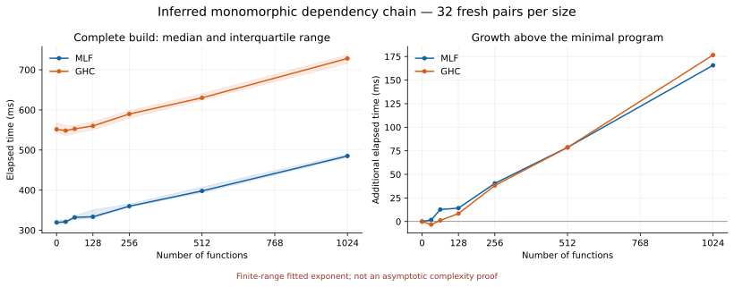

# Inferred chain: compact binding types in metadata receipts

The unsigned monomorphic `inferred_chain` **does not pass** all original acceptance checks in this fresh fixed GHC cohort. This study retains a reduction in maximum live heap. It does not establish a large-size elapsed-time improvement or a process-RSS improvement.

Evidence: `.mlf-build/inferred-chain-metadata-structure-20261117`. The preceding [uncounted-index study](compiler-inferred-chain-uncounted-index-2026-11-17.md) authenticates 309 source pins and 10173 evidence pins. Earlier retained changes are preserved. The affected prior sources are archived under `pre-adoption`.

## Fresh attribution

Six fresh profiles (two each at N=0/256/1024) use the previous qualified producer with late cost centres, F4 and a 0.1 ms tick interval. All interface/object/LLVM bytes match its formal cohort. Own ticks/allocation reconcile to the profile totals. Instrumented measurements diagnose ownership, not formal compilation speed.

| Inclusive owner | N1024 minus N0 sampled ms | Allocation growth MB |
| --- | ---: | ---: |
| `Bootstrap.OpenFragment / makePackage` | 16.650 | 74.665 |
| `Bootstrap.CrateArtifact / writeOpenObject` | 4.550 | 20.298 |
| `Bootstrap.CrateArtifact / openPackageMetadataReceipt` | 3.550 | 17.102 |

Required interface serialization accounts for most of `writeOpenObject`; its metadata comparison is a small time target. The receipt also retains an expanded generic `W.Value` tree after hashing, including one type projection per binding. The private study therefore targets live retention, rather than attributing all 20.298 MB of growth to redundant work.

## Two bounded candidates

The first candidate retained all typed interface fields and introduced a comparator for all thirteen fields. It passed independent frozen-encoding comparisons and admission controls, but its initial 1.22 ms N1024 compiler improvement did not repeat: the fixed independent confirmation was 2.31 ms slower. Its extra schema-specific comparison logic was not adopted.

The retained, narrower candidate shares the ordinary encoder's generic values before and after the binding field, and stores binding `XType`s in their original compact form. The expanded binding encoding can be collected after canonical hashing. Existing generic equality handles all other fields. Only the seven `XType` constructors need exact typed equality. Prefix fields, bindings and suffix fields remain compared in wire order, preserving short circuit demand.

The opaque receipt still requires successful canonical schema-6 encoding with the original finite limits. It cannot be manufactured from a supplied hash. Bound-variable IDs and constructor tags remain exact; alpha-equivalent types and `XBot` versus `XBotKind Star` remain distinct. The ordinary interface encoder excludes method bodies, so the retained receipt neither forces nor keeps those source bodies. Package manifest and object-fingerprint checks remain at publication. The compiler-internal receipt helpers now accept `CrateInterfaceFields` instead of arbitrary `W.Value`. Persisted formats, digests and checker identities are unchanged.

Each candidate has one fixed six-pair screen and one separate twelve-pair confirmation, each with one discarded warmup pair at N=0/256/1024 and alternating order. Memory uses three separate alternating pairs at N=0/1024, with RTS statistics excluded from speed runs.

| N1024 private measurement | Full typed candidate | Compact binding candidate |
| --- | ---: | ---: |
| Screen compiler seconds, before / after | 0.280453146 / 0.279237459 | 0.297956500 / 0.300949833 |
| Confirmation compiler seconds, before / after | 0.275184396 / 0.277493167 | 0.294562604 / 0.294785167 |
| Confirmation compiler + Clang seconds, before / after | 0.401757854 / 0.404284250 | 0.429279854 / 0.429853876 |
| Allocated bytes, before / after | 849,554,384 / 848,747,904 | 849,555,368 / 848,957,720 |
| Maximum live bytes, before / after | 10,882,800 / 10,237,272 | 10,882,808 / 10,353,432 |
| Peak child RSS bytes, before / after | 60,604,416 / 60,555,264 | 60,686,336 / 60,866,560 |

The compact candidate reduces N1024 maximum live heap by 529,376 bytes (4.86%) and cumulative allocation by 597,648 bytes (0.0703%). Peak child RSS increases by 180,224 bytes (0.297%). Its independent N1024 compiler median increases by 0.223 ms (0.076%). Retention is justified specifically by less live data and less duplicated schema logic than the full typed alternative; it is not an RSS or speed win.

Across both variants, 240 timed compiles preserve exact interface/object/LLVM bytes and produce 720 correct native arithmetic results. All 24 instrumented compiles preserve the same bytes. Neither private endpoint is substituted for the formal full-worker endpoint.

## Current-source validation

The private differential fixtures mutate a frozen generic wire model and independently decode 483 cases covering every interface field, order/multiplicity, source/type constructors, exact IDs and tags. They test canonical projection/digest parity, excluded method-body demand, absent-receipt laziness, manifest rejection and depth-limit diagnostics. The narrower fixture additionally checks prefix/binding/suffix demand order. The maintained 483-case control is integrated into `tools/shared/test_direct.py`; it compares actual cached receipts to the separate generic encoding route and tests 1,932 case comparisons plus targeted controls.

An initial auxiliary fixture link picked up an unused stale `PreparedLibraryLiteral.o` from the copied producer directory and failed with undefined old `toBool` worker symbols. Both private control closures were subsequently rebuilt and linked using GHC `--make` with the actual candidate sources. The successful coherent receipts supersede that failed auxiliary link. The retained producer is a fresh complete source build; stale orphan objects are not used as qualification.

After builtin regeneration, the locked plan, new metadata controls, query/graph and offline contracts, inferred/polymorphic/signed cache paths, artifact constructor/admission/base64/source/typed-bound controls, fused package build, package smoke, frontend/native semantic modes and eighteen CLI acceptance/rejection cases pass. The builtin literal differs only in its source identity; builtin interface/object bytes remain exact. Source identity: `builtin-source-v1:6df551d58a75d1944b757c58d22de4ecb7b59b44a6f2bf8331e850c1b6ab04de`.

Actual old-cold/new-upgrade/new-warm/old-downgrade/old-warm transitions pass ICH verification with exact artifacts/LLVM. Warm runs reuse checked groups. Independent artifact and open-file Python suites pass. At N=0/256/1024, independent complete interface/object inspection, actual disk-reader semantic audit, disk/fused and cross-lane exact LLVM equality, and 42 native integer boundary/wraparound outputs also pass.

Native compiler self-bootstrap and the installed CLI remain unqualified by this study. The previously recorded native O0 codec and QuerySnapshotProbe gaps are not claimed resolved.

## Fixed GHC scale comparison

The unchanged `crate-fused-v1` endpoint includes one GHC-hosted MLF crate-to-LLVM invocation, Clang O2 and full worker launch. GHC 9.14.1 uses fresh `--make -j1 -O2 -fforce-recomp`. There are 32 alternating pairs per size: 448 successful compiles and 1,344 correct native outputs. Builds, tests, profiles, memory and timing are serialized.

| Functions | MLF median ms | GHC median ms |
| ---: | ---: | ---: |
| 0 | 319.498 | 551.686 |
| 32 | 321.171 | 548.447 |
| 64 | 332.221 | 552.871 |
| 128 | 333.701 | 560.113 |
| 256 | 359.964 | 589.856 |
| 512 | 398.135 | 630.269 |
| 1024 | 485.167 | 728.272 |

| Metric | MLF | GHC |
| --- | ---: | ---: |
| OLS slope ms/function | 0.162394969 | 0.178136081 |
| Endpoint slope ms/function | 0.161786255 | 0.172447571 |
| Offset-power fitted p | 1.055560900 | 1.123600171 |

Paired 95% MLF-minus-GHC intervals: OLS **[-0.022945764, -0.006671229] ms/function**; exponent **[-0.211244725, 0.038065958]**. Bootstrap: unchanged 2,000 resamples, seed 20261115.

Model: `a+b*(n/max(n))^p`, a,b≥0, p∈[0.1,3]. Both fits interior: **True**. All baseline/positive points are retained. Finite-range fitted exponents are not asymptotic Big-O proofs.

- `all_positive_medians_lower`: **True**.
- `lower_ols_point`: **True**.
- `lower_endpoint_point`: **True**.
- `lower_power_point`: **True**.
- `lower_ols_95`: **True**.
- `lower_power_95`: **False**.

## Separate retained memory

Three alternating instrumented pairs compare each immutable producer with its own exact cohort artifacts. Instrumented times are excluded from the formal timing results.

| N | Metric (bytes) | Previous producer | Current producer |
| ---: | --- | ---: | ---: |
| 0 | Allocated heap | 267,737,240 | 267,735,336 |
| 0 | Maximum live heap | 1,463,072 | 1,461,648 |
| 0 | Peak child RSS | 34,308,096 | 34,209,792 |
| 1024 | Allocated heap | 849,549,928 | 848,842,592 |
| 1024 | Maximum live heap | 10,882,800 | 10,609,608 |
| 1024 | Peak child RSS | 62,062,592 | 61,751,296 |

The current-source N1024 maximum live heap falls by 273,192 bytes (2.51%). This retained-producer measurement, rather than the larger private-screen reduction, is the final memory result. The current RSS median falls modestly, while the earlier private RSS median rose; no general RSS improvement is inferred.

Shape acceptance follows all six original checks and interior fits, independently of the memory change. The shape remains open. Do not advance, make an acceptance commit/push or retry an unchanged-source formal cohort.
