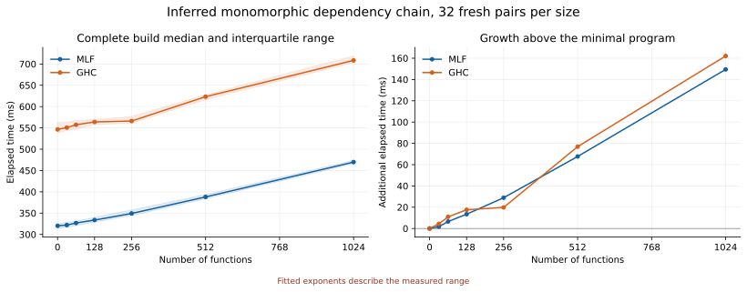

# Node headers and child references on inferred dependency chains

5 of six fixed comparisons pass over 0 to 1,024 functions. This shape remains open.

The owned artifact writer now writes a node kind, tag and arity as one field whenever the tag fits in two varint bytes and the arity fits in one. It can also write two adjacent child indices at once when each takes at most 28 bits. The previous wide-field paths preserve larger tags, arities and reference widths. On the 1,024-function object, 10,294 of 10,295 structural nodes fit the shorter header path and the 25,718 children include 9,775 pairs. Both changes use the existing on-disk representation.

An earlier combined experiment also changed the planner task traversal. These two writer changes were isolated and measured on the current compiler with the planner held fixed. [Earlier combined experiment](compiler-inferred-chain-followup-2026-11-17.md)

## Isolated measurements

Each size used a warmup and six measured alternating pairs in the screen, then a warmup and twelve measured pairs in the independent confirmation. The table shows before / candidate medians for the compiler process at 1,024 functions. Memory measurements used separate instrumented binaries and three pairs. The reference for paired child indices already includes combined headers. The other two variants use the preceding compiler.

| Change | Screen (ms) | Confirmation (ms) | Allocated heap (MB) | Maximum live heap (MB) |
| --- | ---: | ---: | ---: | ---: |
| Combined node headers | 279.260 / 279.450 | 270.190 / 260.364 | 784.584 / 781.928 | 11.051 / 11.051 |
| Paired child indices | 282.826 / 279.873 | 278.801 / 278.832 | 781.929 / 781.023 | 11.051 / 11.051 |
| Chunked fragment stamp rendering | 265.722 / 268.995 | 277.174 / 281.563 | 784.585 / 781.347 | 11.051 / 11.051 |

The first two changes reduce allocation. The second confirmation shows essentially identical elapsed time for paired indices. The string-rendering alternative reduced allocation by 3.24 MB but increased compiler time in both cohorts, so the previous renderer stays in use. Across 360 diagnostic builds, 1,080 native program results matched their oracles. Interfaces, objects and LLVM matched byte for byte at each comparison size. At 0, 256 and 1,024 functions the object occupied 1,338, 74,257 and 302,673 bytes.

## Complete build with GHC

MLF used the current GHC-hosted compiler, the fused crate endpoint and Clang O2. GHC 9.14.1 used the same source bytes with `--make -j1 -O2 -fforce-recomp`. Each of seven sizes had 32 fresh paired builds. The timer includes the worker process.

| Functions | MLF median (ms) | GHC median (ms) |
| ---: | ---: | ---: |
| 0 | 320.328 | 546.363 |
| 32 | 322.012 | 550.706 |
| 64 | 326.881 | 557.322 |
| 128 | 333.733 | 563.938 |
| 256 | 349.214 | 566.148 |
| 512 | 387.992 | 623.234 |
| 1024 | 469.782 | 708.440 |

| Growth | MLF | GHC |
| --- | ---: | ---: |
| OLS (ms/function) | 0.147080 | 0.158472 |
| Endpoint (ms/function) | 0.145951 | 0.158278 |
| Offset-power exponent | 1.155902 | 1.232837 |

- OLS slope (ms/function) difference, MLF minus GHC, paired 95% interval [-0.018078, -0.004505].
- Offset-power exponent difference, MLF minus GHC, paired 95% interval [-0.237954, 0.026652].

The exponent estimates describe this range. The 448 builds produced 1,344 independently checked executable outputs.

## Retained memory and regression results

| Retained compiler at 1,024 functions | Before (bytes) | After (bytes) |
| --- | ---: | ---: |
| Total heap allocation | 784,580,840 | 781,042,424 |
| Maximum live heap | 11,050,864 | 11,050,560 |
| GC copied bytes | 87,941,448 | 87,479,440 |
| Peak RSS | 65,273,856 | 65,142,784 |

The differential probes covered 18,000 node-header and 29,056 adjacent-reference cases using the previous implementation and independent integer arithmetic. The rejected renderer had 2,562 checked term renderings and stamps plus 1,000 precedence/suffix cases. The maintained writer controls exercise all eight bit offsets against the public generic writer. A further 80 generated native node entries matched independently computed whole-buffer digests, padding, sentinels and final bit positions. The existing packed-field/byte controls, locked plan, compiler frontend, package, fused/disk and cache migration regressions also passed. The regenerated builtin has the same interface and object bytes. The native stage-1 self-bootstrap is outside the measured endpoint.

The complete build receipt has SHA-256 `5d0503f31d7ecdf2af5b7b7d88ff3efca6457f30fc5726884ec07b09c771daed`. The commands, individual samples, native comparisons and allocation measurements are in `.mlf-build/inferred-chain-node-headers-20261118`.
