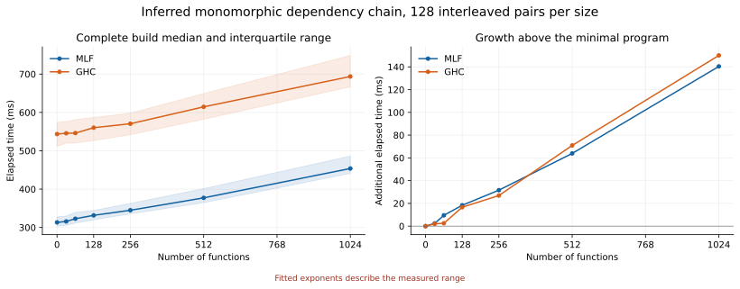

# Prepared Prelude reads on inferred dependency chains

5 of six prespecified comparisons pass. The shape remains open.

Six fresh compiler profiles covered 0, 256 and 1,024 functions, with two profiles per size. Every profile produced the ordinary compiler’s exact interface, object and LLVM. Between 0 and 1,024 functions, ordered maps allocated an additional 76.75 MB. Their growth exceeded a linear extrapolation from 0 and 256 by 8.89 MB. One allocation site in Prelude linking accounted for 6.76 MB at 1,024 functions. It built sets of names read by the user continuation, then used them to select declarations from the fixed Prelude. The cost-centre stack led from `finishLinked` to `declarationVariableReads`.

The independent Prelude check proves that every binder in its term has a numeric identity below the saved fresh serial. The selection can discard reads at or above that limit as it visits user terms. Negative identities remain eligible. Transitive Prelude dependencies, name representatives, the final closed-term check and the full linker fallback keep their existing semantics. The public unfiltered traversal still returns the complete name set.

## Isolated changes

Each experiment compares the same preceding compiler with one variant. Each size had six measured pairs for the screen and twelve different pairs for confirmation, plus a warmup in each. Allocation and residency came from three other instrumented pairs at 0 and 1,024 functions. The elapsed columns show the compiler subprocess at 1,024 functions.

| Variant | Screen before / after (ms) | Confirmation before / after (ms) | Allocated before / after (MB) | Maximum live heap before / after (MB) | Decision |
| --- | ---: | ---: | ---: | ---: | --- |
| Filter user reads using the checked Prelude serial | 264.561 / 263.829 | 265.291 / 263.793 | 777.885 / 771.108 | 10.525 / 10.525 | Retained |
| Skip duplicate-spelling counts for a unique declaration index | 262.954 / 264.361 | 263.757 / 264.485 | 777.884 / 776.486 | 10.525 / 10.063 | Dropped |
| Flush two complete field bytes per writer iteration | 265.067 / 262.758 | 263.411 / 263.248 | 777.883 / 772.373 | 10.525 / 10.063 | Retained |

Filtering user reads reduced allocation by 6.78 MB and reduced compiler time by 0.73 and 1.50 ms in the two independent comparisons. The two-byte writer reduced allocation by 5.51 MB. Its elapsed gains were 2.31 and 0.16 ms.
The unique-spelling shortcut saved 1.40 MB but cost 1.41 and 0.73 ms at 1,024 functions. The original declaration-scope implementation is retained.

Across all 360 diagnostic compiles the emitted interfaces, objects and LLVM matched byte for byte. The executable tests checked 1,080 native arithmetic results. Each graph generation had the verified producer SHA and the same independently decoded nodes and edges. The object used 1,338, 74,257 and 302,673 bytes at 0, 256 and 1,024 functions.

A separate size model decoded the stored interface, object and query graph at all seven sizes. Encoding references to the nearest 16 preceding nodes with one flag and four distance bits would save 14,819 bytes of reference fields in the 302,673-byte object at 1,024 functions (4.90%), about 326 bytes in the interface and 714 bytes in the query graph. These estimates exclude any changes to framing or alignment. The retained writer uses the existing file format.

## Complete builds with GHC

Hosted MLF used its fused checked-crate-to-LLVM path and Clang O2. GHC 9.14.1 used `--make -j1 -O2 -fforce-recomp` on identical shared-source bytes. The fresh-output timer includes worker launch, compilation and native linking. Each of 128 seeded rounds visited all seven sizes and kept the compilers adjacent at each size. The paired 95% intervals use the preceding study’s identical estimator, seed 20261115 and 2,000 resamples. Fixed runtime and builtin preparation was outside the timer. [Preceding paired comparison](compiler-inferred-chain-symbols-and-atoms-2026-11-18.md)

| Functions | MLF median (ms) | GHC median (ms) |
| ---: | ---: | ---: |
| 0 | 313.382 | 543.603 |
| 32 | 315.815 | 545.629 |
| 64 | 322.900 | 546.140 |
| 128 | 331.727 | 560.225 |
| 256 | 344.997 | 570.506 |
| 512 | 377.299 | 614.548 |
| 1024 | 453.799 | 693.697 |

| Growth | MLF | GHC |
| --- | ---: | ---: |
| OLS (ms/function) | 0.135791 | 0.148997 |
| Endpoint (ms/function) | 0.137125 | 0.146576 |
| Offset-power fitted exponent | 1.094515 | 1.123962 |
| Exponent using source bytes | 1.087342 | 1.113790 |

| 95% interval for MLF minus GHC | OLS (ms/function) | Exponent |
| --- | ---: | ---: |
| Prespecified independent within-size resampling | [-0.026862, -0.002089] | [-0.250826, 0.218203] |
| Whole-round sensitivity | [-0.025185, -0.000019] | [-0.182246, 0.212142] |

These exponents describe the measured interval. The minimal program includes startup, processing and native linking. The gap from GHC to MLF grows from 230.22 ms at zero functions to 239.90 ms at 1,024.

## Build stages

| Stage | 0 functions (ms) | 1,024 functions (ms) | OLS (ms/function) |
| --- | ---: | ---: | ---: |
| MLF checks, artifacts and LLVM | 129.357 | 273.183 | 0.140298 |
| Clang links the native executable | 134.446 | 135.005 | -0.000414 |
| GHC compiles and links | 493.500 | 644.885 | 0.150996 |

Each stage has its own median. The complete-build timer also includes worker startup.

## Retained compiler memory and regression

| 1,024 functions | Before (bytes) | After (bytes) |
| --- | ---: | ---: |
| Total allocated | 777,879,936 | 765,639,352 |
| Maximum live heap | 10,524,520 | 10,063,296 |
| Copied by GC | 88,322,688 | 87,166,728 |
| Peak RSS | 64,225,280 | 63,029,248 |

The complete worker includes child processes. Each entry below is the median of its periodically sampled peak RSS over 128 builds. The separate RTS table above compares the two MLF producers.

| Functions | MLF complete-worker peak RSS (MB) | GHC complete-worker peak RSS (MB) |
| ---: | ---: | ---: |
| 0 | 64.45 | 370.71 |
| 32 | 62.16 | 371.83 |
| 64 | 61.50 | 370.52 |
| 128 | 61.43 | 364.31 |
| 256 | 59.35 | 366.16 |
| 512 | 56.31 | 380.26 |
| 1024 | 84.02 | 401.52 |

The frozen controls compared 608 complete sets of variable reads, including name representatives, 5,472 bounded sets, 2,432 Prelude selections and 33 final checked terms or exact errors. Declaration scope was checked in 2,484 cases against the old compiler and an independent count of duplicate names. The field writer had 18,000 independent buffer checks including sentinels. An initial scope fixture failed to compile due to Haskell layout. Correcting the fixture allowed the comparison to run.

The retained producer passed the locked package plan, frontend and native output cases, signed/inferred/polymorphic checks, query and cache transitions, artifact tests, disk/fused compatibility, 42 integer-boundary outputs and the package smoke test. The generated builtin interface and object remained byte-identical. The benchmark consumed 1,792 fresh compilations and 5,376 successful executable oracles. Native compiler self-bootstrap is outside the timed endpoint.

To reproduce the fit from the complete cohort, run `python3 tools/performance/compiler-shapes/fit_growth.py COHORT_DIRECTORY --family inferred_chain` in a NumPy environment. The fit agreed with the prospectively fixed implementation. The proof of the serial bound applies to the prepared Prelude selection. Whole-compiler asymptotic complexity remains undetermined.

Raw receipt SHA-256 is `bbc887cfd271b68e79467d3b57f8d087513fabd3c61b02b25e90abcf5473eb86`. Profiles and paired data are in `.mlf-build/inferred-chain-closure-lookup-20261118`.
