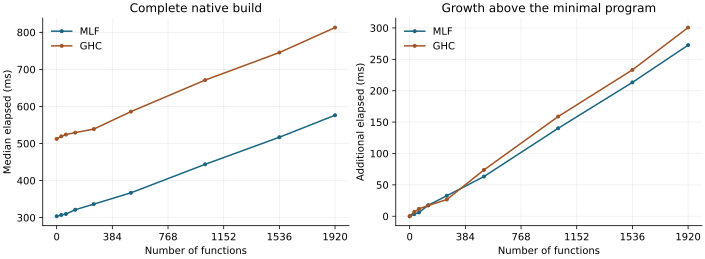

# Prepared-input hashing on inferred monomorphic dependency chains

At 1,920 functions the median complete build took 576.28 ms with MLF and 812.93 ms with GHC. The 0–1,920 fit gives 1.0764 for MLF and 1.0774 for GHC. Its paired 95% exponent-difference interval is [-0.04404, +0.03206].

The first six-pair discovery at commit `d8325d909` took 779.62 ms for MLF at 1,024 functions and 652.23 ms for GHC. Its MLF slope was 0.46428 ms/function. Across all retained changes the new measurements at the same size are 443.83 ms and 671.14 ms. These are separate cohorts. [Initial profile and measurements](compiler-inferred-chain-2026-11-17.md)

## Direct hashing of prepared declarations

The checker already owns the definition names, original and lowered syntax, and authority metadata as typed text. It now hashes these fields directly when the complete framed input fits the existing node, scalar, depth, byte and work bounds. Both paths share the same canonical framing. Larger inputs use the existing tree planner. Name validation precedes syntax validation, followed by metadata validation, in wire traversal order. The persistent interface, object, and query formats retain their existing versions.

A first prototype changed which invalid field was reported first. A frozen comparison reproduced the difference. The corrected order passed all nine demand cases, 201 independent digest comparisons and the maintained suite. Two linker-side alternatives also ran through separate screens. Looking up a row number by subtree rank increased GC copying. Numbering a shared tree in a separate traversal increased median compiler time in both comparisons.

## Complete native builds

The nine sizes and 128 pairs per size were fixed before timing this producer. Each randomized round visits every size and keeps the compiler pair adjacent. The fresh target worker includes process dispatch, compilation, and native linking. MLF uses the GHC-hosted compiler and Clang O2. GHC 9.14.1 uses its native backend with forced recompilation at O2. Both compile identical generated source bytes. Builtin and runtime preparation precede measurement. All 2,304 fresh builds passed all 6,912 native execution checks.

| Functions | Source bytes | MLF median (ms) | GHC median (ms) | MLF median peak RSS (MB) | GHC median peak RSS (MB) |
| ---: | ---: | ---: | ---: | ---: | ---: |
| 0 | 396 | 303.69 | 512.29 | 63.95 | 373.12 |
| 32 | 1,206 | 307.08 | 519.31 | 62.23 | 371.88 |
| 64 | 2,038 | 309.74 | 524.08 | 63.46 | 371.28 |
| 128 | 3,758 | 321.22 | 529.39 | 89.16 | 362.82 |
| 256 | 7,342 | 336.40 | 538.90 | 61.41 | 364.25 |
| 512 | 14,510 | 366.92 | 586.03 | 56.57 | 464.86 |
| 1,024 | 28,894 | 443.83 | 671.14 | 85.46 | 400.97 |
| 1,536 | 44,254 | 516.96 | 745.49 | 83.03 | 505.61 |
| 1,920 | 55,774 | 576.28 | 812.93 | 109.87 | 413.97 |

| Fit range | Metric | MLF | GHC | Paired 95% interval for MLF minus GHC |
| --- | --- | ---: | ---: | --- |
| 0–1,024 | OLS slope (ms/function) | 0.136118 | 0.153474 | [-0.02156, -0.01203] |
| 0–1,024 | Endpoint slope (ms/function) | 0.136852 | 0.155132 | — |
| 0–1,024 | Fitted fixed offset (ms) | 304.29 | 515.25 | — |
| 0–1,024 | Power-fit RMSE (ms) | 1.60 | 3.08 | — |
| 0–1,024 | Offset-power exponent | 1.091713 | 1.203681 | [-0.17948, -0.03060] |
| 0–1,920 | OLS slope (ms/function) | 0.141532 | 0.155916 | [-0.01656, -0.01256] |
| 0–1,920 | Endpoint slope (ms/function) | 0.141975 | 0.156585 | — |
| 0–1,920 | Fitted fixed offset (ms) | 304.06 | 513.18 | — |
| 0–1,920 | Power-fit RMSE (ms) | 1.49 | 3.85 | — |
| 0–1,920 | Offset-power exponent | 1.076426 | 1.077421 | [-0.04404, +0.03206] |

The full-range exponent difference is -0.000995 for MLF minus GHC. The full-range exponent difference remains statistically unresolved.

The power fit is a nonnegative fixed offset plus a positive multiple of the normalized size raised to the estimated exponent. The two fits use the same new cohort and contain every prespecified observation from their respective ranges. Intervals resample the two compilers together within each size with 2,000 replicates and seed 20261115. The exponent describes this family, toolchain and finite range.

The growing identifiers use more digits as declarations are added. A secondary fit against the exact extra source KiB above the minimal program gives full-range OLS slopes of 5.0378 ms/KiB for MLF and 5.5493 ms/KiB for GHC. The corresponding exponents are 1.0309 and 1.0323.

The original range passes 6 of the six recorded comparisons. The expanded range passes 5. The requested point comparisons, including both slope estimates, pass on the original range and pass on the full range.

A supplementary bootstrap keeps all nine sizes in each sampled round together. Its 95% exponent-difference intervals are [-0.17458, -0.03745] on the original range and [-0.04368, +0.02807] on the full range.



## Allocation and compatibility

Separate instrumented binaries use the ordinary producer objects and identical RTS settings. Each cell is the median of three compilations. Both binaries use the same absolute source, builtin, output and cache paths. Each run starts with an empty cache and reproduces the same ordinary interface, object, query report and LLVM bytes. MB denotes one million bytes.

| Functions | Allocated before / after (MB) | Maximum live heap before / after (MB) | Copied by GC before / after (MB) | Peak child RSS before / after (MB) |
| ---: | ---: | ---: | ---: | ---: |
| 0 | 265.247 / 265.239 | 1.517 / 1.517 | 16.291 / 16.259 | 35.324 / 35.488 |
| 1024 | 765.655 / 762.673 | 10.063 / 11.051 | 87.091 / 86.847 | 62.767 / 64.029 |
| 1920 | 1216.896 / 1211.312 | 16.196 / 16.166 | 160.926 / 161.337 | 88.195 / 88.408 |

With all paths held fixed, the changes at 1,920 functions were -5.584 MB allocated, -0.029 MB maximum live heap, and +0.213 MB peak child RSS. At 1,024 functions the sampled maximum live heap changed by +0.987 MB. A separate set using each compiler’s own cohort directory measured -4.703 MB of allocation change at 1,920 functions.

The maintained host regression passed 9,910 checks over 53 syntax variants. The portable fixture passed 205 interpreter or native checks. The cache transition covered cold, upgrade, warm, downgrade and warm builds with incremental verification. The parser, query, package and CLI checks exercised the fused build and separated cache paths. Across the two formal cohort directories, objects, LLVM, query reports and cached result files matched at all nine sizes. Interfaces embedded the actual absolute path of their checked builtin. Prepared-input hashes included the original source location. In 36 separate path controls, both producers compiled at matching paths and the source and builtin paths were varied independently. With paths held fixed, interface, object, LLVM and report bytes matched exactly, as did every logical graph row, ordered read and cached result address after checking the producer fingerprint. All 54 additional native output checks passed. The checked builtin literal, identity, interface and object were byte-identical across the change.

The full production build identified two overloaded host string literals in the first source revision. Explicit boundary types fixed both. The final GHC build audited the inferred interfaces of all 137 shared modules. The resulting MLF compiler also parsed and resolved those same 137 modules. The timing and memory cohorts use that final producer.

## Reproduce the comparison

With an O2 producer and a prepared fused-endpoint setup, the maintained commands below generate a fresh cohort and fit all nine sizes. The same-cohort original comparison takes the first seven sizes before calling the same growth function. [Compiler-shapes setup and analysis](../tools/performance/compiler-shapes/README.md)

```sh
python3 tools/performance/compiler-shapes/run.py --setup /path/to/setup.json --output /path/to/fresh-cohort --endpoint crate-fused-v1 --cohort confirmation --repeats 128 --interleave-pairs --cohort-output-gib 42 --family baseline --family inferred_chain --size 32 --size 64 --size 128 --size 256 --size 512 --size 1024 --size 1536 --size 1920
python3 tools/performance/compiler-shapes/fit_growth.py /path/to/fresh-cohort --family inferred_chain --output growth.json
```

The frozen plan, pre-correction failure, validation, raw timings and executable checks are under `.mlf-build/inferred-chain-ranked-closure-20261118`. [Previous measurement over the extended range](compiler-inferred-chain-supported-range-2026-11-18.md)
