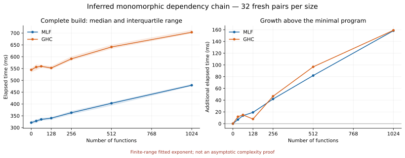

# Inferred chain: prepared layouts and constant colon escaping

The unsigned monomorphic `inferred_chain` **does not pass** all six original acceptance checks and the interior-fit requirement in this fresh fixed GHC cohort. This study retains one small source change: the constant encoding of `:`. It rejects an additional prepared-source layout cache.

Evidence: `.mlf-build/inferred-chain-prepared-structure-20261118`. The previous [body-template study](compiler-inferred-chain-body-templates-2026-11-18.md) authenticates 316 source pins and 22423 evidence pins. Earlier retained changes are preserved. The six affected prior files are archived under `pre-adoption`; old binaries are checked against their immutable receipts and archived source bytes, not incorrectly treated as current-source builds.

## Prepared-layout experiment

The first private candidate added a bounded original-source framing layout to `LoweredSyntax`. It reused shape and scalar lengths but checked fresh leaves on every call, preserving exact current source identities. The existing lowered-source equality path, depth/node/text bounds and fallback encoder remained. This differs from the earlier rejected fresh framing builder: it attempts to reuse geometry across calls.

The existing prepared controls pass 9,904 checks across 53 variants. An additional 670 checks cover shape changes, fresh contents, Unicode, bounds and demand. The first auxiliary fixture had a Haskell `$`/lambda whitespace parse error; its failed receipt and source remain separate from the corrected V2 fixture. The new layout field is lazy, so a strict retention bound for an unforced original-key computation was not qualified.

A six-pair screen suggested a 5.18 ms improvement at N=1024. The independent twelve-pair confirmation reversed it: compiler median +3.715 ms and compiler-plus-Clang +5.049 ms, with higher endpoint slopes. The compiler difference interval includes zero. Maximum live heap fell about 4.35%, but allocation rose by 277,744 bytes. This extra cache structure was not adopted.

## Retained colon escape

`Separate.entityEncoding` frames four identity fields with colon delimiters. The previous current-source profile attributes N1024-minus-N0 growth of 2.65 ms and 12.072 MB to `CrateArtifact.$wordinaryDefinitionNameEncoded`, including repeated compact escape construction. The earlier complete-prefix factory had already failed to demonstrate a useful gain and was not retried.

The retained change renders scalar 58 directly as the constant `"z3az"`, alongside the existing `z` escape. Other scalars still use the general lowercase hexadecimal encoder. ASCII run length remains bounded at 256. Identity framing, injectivity, owner formats, checker identity, primitive ABI and persisted schemas are unchanged. Encoded bytes and their size do not change; the improvement avoids repeated temporary construction.

Both candidates use one six-pair screen and one independent twelve-pair confirmation, with one discarded warmup pair at each of N=0/256/1024 and alternating before/after order. Each has three separate memory pairs at N=0/1024. Together they complete 240 timed compiles, 720 native output checks and 24 memory compiles. Exact interface/object bytes, LLVM and independently decoded query rows are checked. Query generations retain and verify each actual compiler executable hash; identity differences are not blindly erased.

| N1024 private colon measurement | Before | Candidate |
| --- | ---: | ---: |
| Screen compiler ms | 279.209 | 275.231 |
| Confirmation compiler ms | 277.058 | 274.910 |
| Confirmation compiler plus Clang ms | 403.123 | 400.607 |
| Allocated bytes | 848,840,672 | 843,020,512 |
| Maximum live bytes | 10,609,600 | 9,173,960 |
| Peak child RSS bytes | 60,588,032 | 58,458,112 |

The independent colon confirmation has lower compiler medians at all three sizes and lower endpoint slopes. N1024 compiler median falls 2.148 ms; compiler-plus-Clang falls 2.516 ms. These are diagnostic point estimates, not the formal GHC result or a claim that every small-size full-build timing improves.

## Current-source qualification

The private control driver rebuilds a coherent host source closure with Core lint. The independent scalar/identity oracle checks Unicode, owner/role/crate fields, old owner forms, injectivity and boundaries. The exact candidate codec also passes 20 interpreter vectors, 30 native O0 vectors and 30 native O2 vectors, including long ASCII, repeated escaping, NUL and scalar boundaries. Its initial relocated driver lacked `tools/shared` on the import path and stopped before producing output; the failed source and explicit repair are retained.

The complete maintained-source producer was rebuilt after adoption. The maintained compact-name controls repeat the host and 80 portable vectors successfully. Builtin regeneration changes only the literal source identity; builtin interface and object bytes remain exact. The locked plan, query/graph contracts, inferred/polymorphic/signed cache paths, constructor/admission and package regression, frontend modes and eighteen CLI acceptance/rejection cases pass. New source identity: `builtin-source-v1:659c3f083b2ec7aa4368033f24385d2b3c3f3b2c468b6b248fdae9d2642ebeca`.

Old-cold/new-upgrade/new-warm/old-downgrade/old-warm cache transitions pass ICH verification with exact artifacts and LLVM. Independent artifact and open-file Python suites pass. At N=0/256/1024, complete independent interface/object inspection, actual disk-reader semantic audit, disk/fused and cross-producer LLVM parity, and 42 integer boundary/wraparound native outputs pass.

Native compiler self-bootstrap and the installed CLI remain unqualified. The earlier native O0 codec and QuerySnapshotProbe gaps are not claimed resolved by isolated codec or generated-program tests.

## Fixed GHC comparison

The original `crate-fused-v1` full-worker endpoint includes one GHC-hosted MLF compile-to-LLVM invocation and Clang O2. GHC 9.14.1 uses fresh `--make -j1 -O2 -fforce-recomp`. Seven sizes have 32 alternating pairs each: 448 successful compiles and 1,344 correct native outputs. Builds, tests, profiles, timing and memory are serialized. Private compiler-plus-Clang medians exclude some worker overhead and are not substituted for these measurements.

| Functions | MLF median ms | GHC median ms |
| ---: | ---: | ---: |
| 0 | 321.033 | 544.399 |
| 32 | 327.945 | 556.202 |
| 64 | 334.678 | 559.288 |
| 128 | 340.206 | 552.235 |
| 256 | 362.970 | 591.045 |
| 512 | 402.922 | 641.136 |
| 1024 | 479.306 | 703.387 |

| Metric | MLF | GHC |
| --- | ---: | ---: |
| OLS slope ms/function | 0.153700470 | 0.158576284 |
| Endpoint slope ms/function | 0.154563802 | 0.155261271 |
| Offset-power fitted p | 0.969100361 | 0.892459441 |

Paired 95% MLF-minus-GHC intervals: OLS **[-0.012823353, -0.000341922] ms/function**; exponent **[0.001738160, 0.180821528]**. The unchanged bootstrap uses 2,000 resamples and seed 20261115.

Model: `a+b*(n/max(n))^p`, a,b≥0, p∈[0.1,3]. Both fits interior: **True**. All baseline and positive points remain; no cohorts are pooled and no unchanged-source formal retry is used. A fitted exponent on this finite range does not establish an asymptotic Big-O class.

- `all_positive_medians_lower`: **True**.
- `lower_ols_point`: **True**.
- `lower_endpoint_point`: **True**.
- `lower_power_point`: **False**.
- `lower_ols_95`: **True**.
- `lower_power_95`: **False**.

## Separate retained-producer memory

Three alternating instrumented pairs compare each immutable producer with its own exact cohort artifacts. Instrumented times are excluded from the formal timing comparison.

| N | Metric (bytes) | Previous producer | Current producer |
| ---: | --- | ---: | ---: |
| 0 | Allocated heap | 267,736,168 | 266,634,880 |
| 0 | Maximum live heap | 1,461,680 | 1,484,136 |
| 0 | GC copied bytes | 13,030,192 | 12,867,360 |
| 0 | Peak child RSS | 34,226,176 | 34,390,016 |
| 1024 | Allocated heap | 848,843,680 | 843,049,352 |
| 1024 | Maximum live heap | 10,609,624 | 9,173,328 |
| 1024 | GC copied bytes | 90,700,776 | 89,908,696 |
| 1024 | Peak child RSS | 61,964,288 | 59,949,056 |

These retained-producer results supersede private memory estimates for the final source. Maximum live heap is the RTS sampled residency measure, not process RSS. Memory savings and structural simplicity do not waive any of the six shape acceptance gates.

The shape remains open. Continue only this shape; do not make an acceptance commit/push or rerun an unchanged formal cohort.
