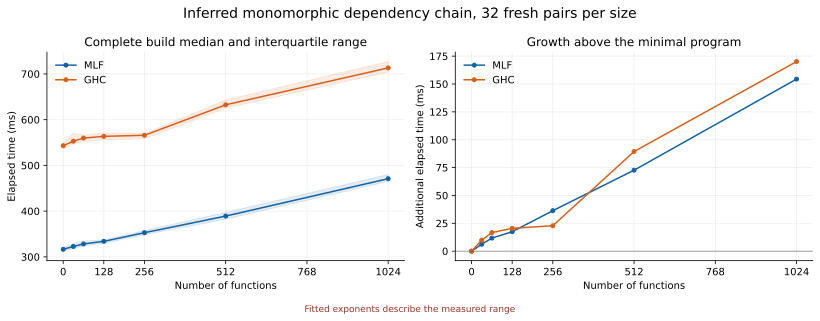

# Query identity framing on inferred dependency chains

5 of six fixed comparison criteria pass. The shape remains open.

Each fresh query identity consists of decimal lengths and Unicode scalar payloads. The compiler now reads each length once and checks its canonical spelling in place. The previous reader rebuilt the whole string to compare it with the input. The ordinary artifact reader still accepts padded lengths. The canonical reader returns a later malformed or truncated frame before reporting an earlier padding error, as the previous complete parse did. The wire schema and artifact contents are identical on the comparison inputs.

## Three isolated comparisons

Each candidate was built separately against the same preceding compiler. Each cell gives before / candidate for 1,024 functions. The screen and independent confirmation used six and twelve measured alternating pairs per size, respectively, with a separate warmup. Memory came from three separately instrumented pairs.

| Candidate | Screen compiler (ms) | Confirmation compiler (ms) | Heap allocated (MB) | Peak live heap (MB) |
| --- | ---: | ---: | ---: | ---: |
| Rank in an existing ordered set | 286.394 / 278.926 | 288.673 / 289.630 | 790.927 / 791.171 | 11.101 / 11.117 |
| Single-pass decimal framing | 279.112 / 285.577 | 286.856 / 285.073 | 790.930 / 784.502 | 11.101 / 11.051 |
| Direct UTF-8 signed integer formatting | 278.624 / 286.855 | 277.852 / 285.878 | 790.925 / 799.051 | 11.101 / 10.856 |

Only the framing implementation is retained. Its measured allocation reduction explains the choice despite mixed short timing results. Reusing ordering ranks and directly emitting signed decimals both increased allocated bytes. The frozen comparison included 9,297 ordered-set rank probes, 33 query encodings, 10,514 raw/canonical framing comparisons, 8,598 offset comparisons, six independent framing expectations and 119,094 signed decimal cases. All 360 timed builds checked exact interface, object and LLVM bytes, independently decoded query data and three native outputs. On identical inputs, the object at 0, 256 and 1,024 functions occupied 1,338, 74,257 and 302,673 bytes, respectively, in both framing implementations.

## Complete builds

GHC 9.14.1 received the same source with `--make -j1 -O2 -fforce-recomp`. Hosted MLF and Clang O2 used the fused crate endpoint. All seven sizes use 32 fresh paired builds. The timing includes the full worker. Fixed toolchain and runtime preparation is outside both lanes.

| Functions | MLF median (ms) | GHC median (ms) |
| ---: | ---: | ---: |
| 0 | 316.559 | 543.057 |
| 32 | 322.776 | 552.933 |
| 64 | 328.300 | 559.749 |
| 128 | 334.008 | 563.515 |
| 256 | 352.882 | 565.881 |
| 512 | 389.210 | 632.476 |
| 1024 | 470.964 | 713.187 |

| Growth | MLF | GHC |
| --- | ---: | ---: |
| OLS (ms/function) | 0.148981 | 0.165176 |
| Endpoint (ms/function) | 0.150786 | 0.166142 |
| Offset-power exponent | 1.082464 | 1.147913 |

- OLS slope (ms/function) difference, MLF minus GHC, paired 95% interval [-0.024841, -0.009526].
- Offset-power exponent difference, MLF minus GHC, paired 95% interval [-0.199634, 0.062130].

The fit is interior for both lanes (True). These exponents describe the measured range. All 448 builds passed 1,344 native output checks.

## Memory and compatibility

| Retained compiler at 1,024 | Before (bytes) | After (bytes) |
| --- | ---: | ---: |
| Total allocated | 790,925,792 | 784,579,144 |
| Maximum live heap | 11,101,080 | 11,050,856 |
| Copied in GC | 86,920,472 | 87,934,992 |
| Peak RSS | 65,175,552 | 65,208,320 |

The extracted shared framing functions also passed 21 cases after MLF compiled them to a native executable. The retained hosted compiler passed the locked package plan, source and generated native semantics, query publication and cache transitions, artifact controls and fused/disk regression suites. The builtin interface and object matched their preceding bytes. The installed native compiler self-bootstrap was outside the measured endpoint.

The 448-build receipt SHA-256 is `bd816d794a537740f24d97524c9e710e2749dc2f36dff1c51ff0789ccb0e298e`. Raw commands, samples, memory runs, frozen differential results and the fitted model are under `.mlf-build/inferred-chain-query-ranks-20261118`.
