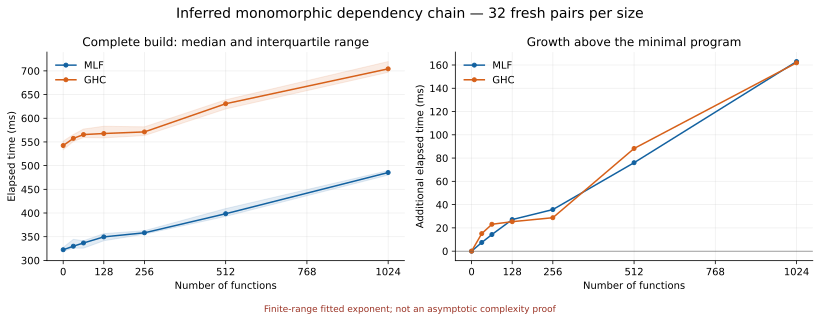

# Inferred chain: bulk package-reference construction

The unsigned monomorphic `inferred_chain` **does not pass all original acceptance conditions** in this new
fixed cohort. This study retains one small compiler simplification and measures
it on the same full-worker endpoint as GHC. It does not pool observations with
previous studies, discard points, or change the original acceptance rules.

Evidence: `.mlf-build/inferred-chain-package-references-20261117`.
The preceding final audit authenticates 304 maintained sources and 5,582 evidence
pins. Old source bytes for affected files are preserved under `pre-adoption`;
earlier template work and unrelated lifecycle files remain intact.

## Retained change

`OpenFragment.referenceTable` now calls the existing natural-run
`Map.fromList`. Previously it reversed the input, looked up every reference and
inserted only unseen keys. Both retain the last equivalent key and its lazy
value, then expose references in sorted order. The replacement removes the
bespoke loop and avoids repeated balanced-tree construction for unique entries.
It does not change which dependencies are checked or hashed, work/depth limits,
fragment bodies, identities, read lists, publication, or the wire schema.

The existing Map implementation and its independent last-value/key and demand
controls are unchanged. The new call is additionally exercised through actual
package construction, reader/admission, cache, and native output checks. Its
worst-case sorting bound alone does not prove a different whole-compiler
complexity class.

OpenFragment is in the builtin source closure. The generated builtin was
regenerated, the source identity and lock updated, and migration pins refreshed.
The resulting identity is `builtin-source-v1:df1682c3ae18c80def0bca61b84a69096996f553ace5e27eacdcc73110e788ef`.
An explicit parity record verifies that the generated Haskell literal differs
only in its source identity; the old/new builtin `.mlfci` and `.mlfco` files are
byte-for-byte identical. No primitive ABI or artifact schema changes.

## Separate diagnostic selection

A private shadow first runs one warmup plus six alternating measured pairs at
N=0/256/1024. One separately declared confirmation runs one warmup plus twelve
measured pairs. These are compiler-plus-Clang subprocess diagnostics, excluding
formal worker launch overhead, and are not pooled with the GHC cohort.

| Functions | First compiler before / after, s | Confirmation compiler before / after, s | Confirmation subprocess sum before / after, s |
| ---: | ---: | ---: | ---: |
| 0 | 0.126301 / 0.127444 | 0.127518 / 0.125417 | 0.253064 / 0.252250 |
| 256 | 0.159749 / 0.159122 | 0.159885 / 0.160004 | 0.285343 / 0.285852 |
| 1024 | 0.282851 / 0.277836 | 0.309382 / 0.305253 | 0.449009 / 0.441672 |

The N1024 compiler reduction is present in both diagnostics; the confirmation
reduces it by about 4.13 ms (1.33%). The tiny N256 increase is retained in the
record. Three separate alternating RTS pairs per N=0/1024 show N1024 allocation
862,891,328 → 861,071,400 bytes, a saving of 1,819,928 bytes (0.21%). Maximum live
heap rises slightly, 11,233,256 → 11,281,856 bytes. This is an allocation saving,
not a demonstrated peak-memory reduction. The small measured benefit and smaller
implementation justify retention; they do not themselves establish GHC acceptance.

All 120 diagnostic compiles preserve exact interface, object and LLVM bytes,
with 360 checked native arithmetic results. Twelve separate memory compiles
preserve the same bytes. Seven private host-control actions pass.

## Current-source validation

The retained producer is rebuilt from source after builtin regeneration. Its
locked package plan passes. Query/graph and offline contracts, inferred and
polymorphic/signed cache paths, artifact constructor/admission/base64/source and
typed-bound checks, string comparisons, fused package construction and package
smoke tests pass. Current-source frontend and native semantic modes pass, along
with eighteen independent CLI acceptance/rejection cases.

Old-cold, new-upgrade, new-warm, old-downgrade and old-warm executions pass actual
ICH verification; warm runs reuse checked groups. Exact artifacts and LLVM are
preserved. Independent artifact/open-file Python suites also pass.

For N=0/256/1024, independent complete interface/object inspection, actual disk
reader with semantic audit, per-lane disk/fused LLVM equality, cross-lane LLVM
equality, and 42 native checks including signed integer wraparound pass.
These checks do not qualify native compiler self-bootstrap or the installed CLI;
the previously recorded native-codec/QuerySnapshotProbe gaps remain outside this
study's qualification.

## Fixed GHC scale comparison

The endpoint remains `crate-fused-v1`: one GHC-hosted MLF crate-to-LLVM call,
Clang O2 and full worker launch; GHC 9.14.1 uses its existing fresh `--make -j1
-O2 -fforce-recomp` lane. There are 32 alternating fresh pairs at every size:
448 successful full compiles and 1,344 correct native results. No benchmark or
compiler build runs concurrently with these measurements.

| Functions | MLF median, ms | GHC median, ms |
| ---: | ---: | ---: |
| 0 | 322.486 | 542.409 |
| 32 | 329.949 | 557.505 |
| 64 | 336.774 | 565.525 |
| 128 | 349.638 | 567.751 |
| 256 | 358.234 | 571.160 |
| 512 | 398.510 | 630.652 |
| 1024 | 485.428 | 704.282 |

| Metric | MLF | GHC |
| --- | ---: | ---: |
| OLS slope, ms/function | 0.154629 | 0.152832 |
| Endpoint slope, ms/function | 0.159123 | 0.158078 |
| Offset-power exponent p | 1.090406 | 1.069608 |

The paired 95% MLF-minus-GHC intervals are
**[-0.010135, 0.008698] ms/function**
for OLS slope and **[-0.134674, 0.172465]** for p.
The bootstrap uses the unchanged 2,000 resamples and seed 20261115.

The model is `a + b * (n / max(n))^p`, with a,b ≥ 0 and p in [0.1,3].
Both fits are interior: **True**. The baseline point and all positive points
remain in the fit even when a baseline median exceeds a small positive case.
No unstable endpoint or finite-range exponent is presented as an asymptotic
Big-O proof.

- `all_positive_medians_lower`: **True**.
- `lower_ols_point`: **False**.
- `lower_endpoint_point`: **False**.
- `lower_power_point`: **False**.
- `lower_ols_95`: **False**.
- `lower_power_95`: **False**.

## Separate retained memory

Three alternating instrumented pairs at N=0/1024 compare each immutable producer
against its own exact qualified cohort artifacts. Instrumented timing is excluded
from elapsed results. N1024 median bytes:

| Metric | Previous retained producer | Current retained producer |
| --- | ---: | ---: |
| Cumulative heap allocation | 862,885,904 | 861,195,816 |
| Maximum live heap | 11,233,248 | 11,228,080 |
| Maximum individual process RSS | 62,767,104 | 63,143,936 |

The current shape decision follows all six original checks and interior fits,
not just lower elapsed medians or a smaller allocation count. Other program
shapes remain separate experiments.
