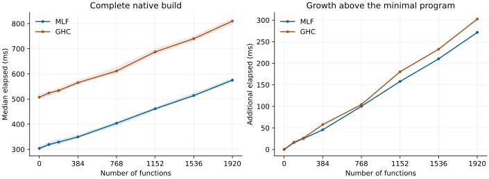

# Scaling inferred monomorphic chains to 1,920 functions

At 1,920 functions, a complete MLF build took 575.42 ms and GHC took 810.10 ms. Across the expanded range, the fitted exponents were 1.098 and 1.096, respectively. The paired 95% interval for their difference was [-0.0725, +0.0820].

The earlier graph-depth limit was observed at 2,048 functions. Reading all seven saved generations from the preceding producer revealed an observed longest dependency path of `2n + 8` at every original size. The range and separate capacity probes were fixed before running larger programs. All seven positive sizes here were new to this retained compiler’s comparison. [Earlier 0–1,024 study](compiler-inferred-chain-prelude-reads-2026-11-18.md)

## Complete builds on identical sources

The existing shape generator, hosted MLF producer and prepared dependencies were reused. Each of 32 seeded rounds visited all eight sizes and kept the compiler pair adjacent. The full worker timer includes compiling and native linking into an empty target and query directory. GHC 9.14.1 used its native backend with `--make -j1 -O2 -fforce-recomp`. MLF used the fused checked crate entry point and Clang O2. Both wrote their normal artifacts. All 512 fresh builds passed 1,536 native execution checks. Every observation was included.

| Functions | MLF median (ms) | GHC median (ms) | MLF median sampled peak RSS (MB) | GHC median sampled peak RSS (MB) |
| ---: | ---: | ---: | ---: | ---: |
| 0 | 303.73 | 507.43 | 63.29 | 376.83 |
| 96 | 319.38 | 524.09 | 65.13 | 367.79 |
| 192 | 329.03 | 533.92 | 60.64 | 364.91 |
| 384 | 349.35 | 565.18 | 58.10 | 364.37 |
| 768 | 403.89 | 611.65 | 77.59 | 478.13 |
| 1,152 | 461.48 | 687.73 | 87.78 | 395.44 |
| 1,536 | 514.07 | 740.17 | 78.84 | 506.63 |
| 1,920 | 575.42 | 810.10 | 108.76 | 414.38 |

| Metric | MLF | GHC | Paired 95% interval for MLF minus GHC |
| --- | ---: | ---: | ---: |
| OLS (ms/function) | 0.140188 | 0.155996 | [-0.0189, -0.0124] |
| Endpoint (ms/function) | 0.141505 | 0.157639 | — |
| Offset-power fitted exponent | 1.097835 | 1.095659 | [-0.0725, +0.0820] |

Both exponents were interior fits (True). The fit uses 2,000 paired bootstrap resamples, seed 20261115. The broader comparison passes 4 of the six prespecified numerical comparisons. The original 128-pair cohort keeps its own five-of-six result. Changing the range can change the ordering of point estimates. A finite-range fit cannot establish a whole-compiler asymptotic class.

Across the same 512 ordinary builds, the MLF compiler subprocess median grew from 124.80 to 397.80 ms. The Clang/link subprocess medians were 129.12 and 128.16 ms. The compiler-only MLF OLS slope was 0.14014 ms/function, alongside 0.14019 for the entire worker. The GHC process includes its native link and had a slope of 0.15615 ms/function. The small component medians and whole-worker medians are computed separately.

## Checked capacity and allocation

At 2,044 functions MLF built the executable and passed three native cases. The saved query generation contained 6,143 nodes and its observed longest path was 4,096.

At 2,045 functions the compile failed. The compiler reported `cyclic/deep query graph`. This capacity probe contributes no timing sample to the fitted curve.

At four larger sizes two separate profiles of the retained MLF compiler reproduced the ordinary interface, object, query report and LLVM bytes. Two GHC diagnostic builds per size recorded pass allocations and passed three native cases each. These measurements use instrumented binaries or flags and stay outside the elapsed cohort.

| Functions | Profiled MLF heap allocation (MB) | GHC heap allocation (MB) | GHC renamer/typechecker (MB) | GHC simplifier passes (MB) |
| ---: | ---: | ---: | ---: | ---: |
| 768 | 649.08 | 330.72 | 103.04 | 122.89 |
| 1,152 | 842.85 | 501.31 | 163.32 | 193.88 |
| 1,536 | 1041.38 | 701.40 | 237.58 | 278.57 |
| 1,920 | 1235.86 | 922.27 | 318.90 | 375.62 |

MLF growth across equal steps of 384 functions is shown below. Values are inclusive of children and scopes can overlap. Sampling can move CPU time between adjacent passes.

| MLF operation | 768→1,152 (ms / MB) | 1,152→1,536 (ms / MB) | 1,536→1,920 (ms / MB) |
| --- | ---: | ---: | ---: |
| `Bootstrap.OpenFragment.makePackage` | 6.40 / 26.82 | 6.90 / 28.02 | 5.30 / 27.59 |
| `Bootstrap.CrateGraph.preparedInputCached` | 5.60 / 23.74 | 6.80 / 23.83 | 5.25 / 23.85 |
| `Bootstrap.QueryGraph.publish` | 4.85 / 20.61 | 5.85 / 21.28 | 5.90 / 20.84 |
| `Bootstrap.QueryGraph.resolveClosure` | 1.10 / 2.23 | 0.75 / 2.23 | 1.05 / 2.23 |
| `Bootstrap.CrateQuery.reportJSON` | 0.55 / 4.21 | 0.70 / 4.19 | 1.25 / 4.19 |

The raw build receipt has SHA-256 `9946695da2bed0a866345d7421fc07772621e962ec6bb845851d3915c5e21007`. The plan, all samples, independently decoded graph depths, separate capacity probes and profiles are under `.mlf-build/inferred-chain-supported-range-20261118`. [Query and object size experiments](compiler-inferred-chain-query-demand-2026-11-18.md)
