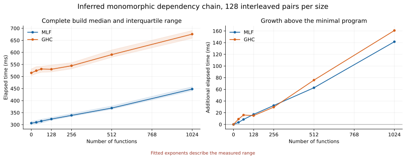

# Symbol indexing and variable parsing on inferred dependency chains

5 of six prespecified comparisons pass. The shape remains open.

The linker now uses the size of its declaration index to detect duplicate names. Previously it built a separate set over the same keys. Slot numbering follows input order, and the original duplicate-name diagnostic is preserved. The shared expression parser tries a variable reference directly for a token beginning with an ASCII lower-case letter. Successful references keep their spans. A failed attempt uses the full grammar, preserving keyword precedence, error locations and consumption.

## Isolated compiler changes

Each row compares the preceding compiler and one source variant at 1,024 functions. Screens and separate confirmations used six and twelve measured alternating pairs per size, respectively, with a warmup. The RTS memory measurements used three separate pairs. All three variants were measured against the same source revision.

| Variant | Screen (ms) | Confirmation (ms) | Total allocated (MB) | Maximum live heap (MB) |
| --- | ---: | ---: | ---: | ---: |
| Build a name table once per linked crate, with index uniqueness | 282.705 / 284.130 | 283.031 / 284.189 | 781.045 / 778.153 | 11.051 / 11.051 |
| Use the existing symbol index for uniqueness | 281.880 / 282.612 | 293.084 / 284.193 | 781.046 / 780.315 | 11.051 / 11.051 |
| Dispatch ordinary variable atoms directly | 284.646 / 282.377 | 292.866 / 287.255 | 781.046 / 778.606 | 11.051 / 10.063 |

The batch linker reduced allocation but took longer in both timing comparisons. Only the simpler symbol check and the parser change are retained. The 360 diagnostic compiles produced 1,080 verified native outputs with identical interface, object and LLVM bytes. On these inputs the objects at 0, 256 and 1,024 functions still contain 1,338, 74,257 and 302,673 bytes.

## Prespecified complete-build comparison

The preceding 32-pair study estimated the exponent difference with a 95% interval of [−0.2380, +0.0267]. Its measured half-width suggested about 115 pairs for a target half-width of 0.07 under square-root sampling. Before the new compiler was adopted, the next single experiment was fixed at 128 pairs per size. Each round visits all seven sizes in seeded random order. The two compilers are adjacent at each size and alternate which compiler starts. This fit uses only the current experiment. The isolated comparisons above quantify individual source changes. Absolute timings across studies also reflect scheduling and load. [Preceding comparison](compiler-inferred-chain-node-headers-2026-11-18.md)

Measurements ran on Apple M1 Max (macOS-26.6.2-arm64-arm-64bit-Mach-O) with Homebrew clang version 23.1.3. Every leg used fresh target outputs. The operating-system file cache remained enabled.
Hosted MLF compiled the shared source through its fused crate-to-LLVM entry and Clang O2. GHC 9.14.1 used the same source bytes with `--make -j1 -O2 -fforce-recomp`. The timed boundary covers the worker launch through its exit. Each native executable is checked with three inputs outside that interval. The larger retained-evidence budget supports 1,792 complete build directories. The per-build resource limits, model and six statistical criteria are the same as in the preceding studies.

| Functions | MLF median (ms) | GHC median (ms) |
| ---: | ---: | ---: |
| 0 | 306.338 | 514.987 |
| 32 | 309.830 | 524.123 |
| 64 | 314.844 | 531.064 |
| 128 | 323.493 | 530.067 |
| 256 | 338.711 | 544.541 |
| 512 | 369.096 | 590.832 |
| 1024 | 447.916 | 675.777 |

GHC minus MLF is 208.65 ms on the minimal program and 227.86 ms at 1,024 functions. The additional gap across the full range is +19.21 ms. The minimal program still incurs worker startup, compilation and native linking.

| Growth | MLF | GHC |
| --- | ---: | ---: |
| OLS (ms/function) | 0.136669 | 0.154234 |
| Endpoint (ms/function) | 0.138260 | 0.157022 |
| Offset-power fitted exponent | 1.120900 | 1.190910 |
| Exponent using source bytes | 1.115044 | 1.187196 |
| Linear fit RMSE (ms) | 2.651 | 5.231 |
| Offset-power fit RMSE (ms) | 1.626 | 3.725 |

| Paired 95% interval for MLF minus GHC | OLS (ms/function) | Exponent |
| --- | ---: | ---: |
| Original per-size bootstrap | [-0.022074, -0.008582] | [-0.202952, 0.054419] |
| Whole randomized round sensitivity | [-0.021182, -0.009873] | [-0.193029, 0.038118] |

Both compilers consumed the same source file at each size, ranging from 396 to 28,894 bytes. The byte-based fit is a size sensitivity check.
The exponent describes the measured interval from 0 to 1,024 functions. The original per-size bootstrap supplies the acceptance check. The supplementary bootstrap resamples the seven sizes in a round together to preserve shared load variation.

## Build stages

| Stage | 0 functions (ms) | 1,024 functions (ms) | OLS (ms/function) |
| --- | ---: | ---: | ---: |
| MLF source to LLVM and checked artifacts | 125.700 | 265.537 | 0.135572 |
| Clang LLVM to executable | 129.412 | 129.173 | -0.001522 |
| GHC source to executable | 466.335 | 626.015 | 0.153590 |

The primary timing also includes worker launch. Each stage has its own median.

## Memory and compatibility

| At 1,024 functions | Before (bytes) | After (bytes) |
| --- | ---: | ---: |
| Total allocated | 781,042,424 | 777,876,344 |
| Maximum live heap | 11,050,560 | 10,524,512 |
| Copied by GC | 87,479,440 | 88,322,696 |
| Peak RSS | 64,897,024 | 63,946,752 |

The complete 1,024-function worker had a median sampled process-tree RSS peak of 85.18 MB for MLF and 400.59 MB for GHC. This includes child processes and uses periodic samples. The preceding retained-compiler table uses a separate RTS measurement.

Each linker experiment checked 1,024 full fragment states, 36 symbol tables, four standalone fragment calls and six independent diagnostic expectations. The parser comparison checked 12,930 cases over three syntax profiles, including spans, backtracking and exact error/consumption outcomes. Both parsers raise the same host exception when a forged token contains an invalid floating-point spelling. The corrected differential fixture records this outcome explicitly. The maintained regressions cover variable versus constructor case, source spans, duplicate names and original slot order.

All 87 benchmark contract tests passed. The current hosted compiler passed the locked package plan, query and cache controls, signed/inferred/polymorphic regressions, frontend/native semantics, native writer controls, package entry points and cross-version cache transitions. Builtin interface and object bytes matched. Additional disk/fused and independent semantic checks covered 42 native integer-boundary results. The installed native compiler self-bootstrap is outside the measured endpoint.

Use `python3 tools/performance/compiler-shapes/run.py` with the qualified setup, a fresh output directory, `--family baseline --family inferred_chain --repeats 128 --interleave-pairs --cohort-output-gib 32` and sizes 32, 64, 128, 256, 512 and 1,024. The default benchmark still runs each size in a block. To reproduce the fitted results from a qualified cohort, run `python3 tools/performance/compiler-shapes/fit_growth.py COHORT_DIRECTORY --family inferred_chain` in a NumPy environment. The maintained analysis reproduced all 14 medians, both slopes, both powers, both confidence intervals and all six decisions exactly. Three synthetic tests exercise family selection, missing or mispaired timings, a known power and the fit boundary.

The 1,792-build receipt has SHA-256 `9c3bee47b1b7bc47f2a580d7abe6015003e1a1914bf0d73358c9ae521b05f373`. Commands, diagnostics, memory samples and both fitted analyses are in `.mlf-build/inferred-chain-link-lookup-20261118`.
