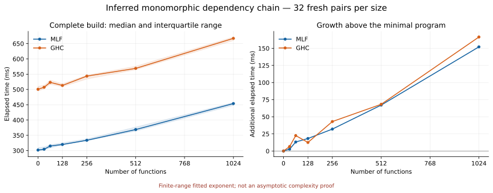

# Inferred chain: private integer indexes without subtree counts

The unsigned monomorphic `inferred_chain` **does not pass** all original acceptance checks in this fresh fixed GHC cohort. This study retains a memory improvement. The initial large-size compiler speed improvement did not repeat in the fixed private confirmation, so it is not represented as an established elapsed-time win.

Evidence: `.mlf-build/inferred-chain-serialization-sharing-20261117`. The preceding [empty-constructor investigation](compiler-inferred-chain-empty-tasks-2026-11-17.md) authenticates 307 source pins and 8156 evidence pins. Its rejected candidate is not included. Prior dirty work is preserved; affected prior source bytes are archived under `pre-adoption`.

## Attribution and retained change

The six already completed current-source profiles are reused without rerunning instrumented compiles. A new full-caller attribution separates `QueryGraph.encodeHashed` by its callers:

| Caller | N1024 minus N0 sampled ms | Allocation growth MB |
| --- | ---: | ---: |
| `Bootstrap.CrateArtifact / makeOpenObject` → `Bootstrap.OpenFragment / makePackage` | 22.600 | 80.127 |
| `Bootstrap.QueryGraph / $wpublication` → `Bootstrap.QueryGraph / encodeHashed1` | 9.850 | 39.877 |
| `Bootstrap.CrateArtifact / openPackageMetadataReceipt` → `Bootstrap.QueryGraph / encodeHashed1` | 4.200 | 17.357 |
| `Bootstrap.CrateGraph / recordRaw` → `Bootstrap.QueryGraph / encodeHashed1` | 0.000 | 0.378 |

Most query encoding growth comes from publication and package metadata, rather than raw inference-result payloads. Instrumented totals diagnose ownership only; they are not formal timing results.

The codec's private scalar/shallow-key and structural-hash-bucket indexes only use lookup and insertion. They previously used general `IntMap`, whose Patricia branches cache subtree cardinalities. Rebuilding each insertion path maintained counts that these private tables never read. `KeyIndex` keeps only the prefix and children, with lazy payloads at leaves. It shares the existing `IntTree` bit-routing operations; source attribution and license notices for the adapted `IntMap` algorithms are preserved.

The general `IntMap`, public graph tables, exact integer comparisons, full-key collision maps and physical `NodeState` counts remain unchanged. No nullary split, fused lookup/insert, task bypass, mutable cache or format change is included. All key paths remain bounded by the 64-bit Patricia depth. Removing count storage/arithmetic does **not** establish a new whole-compiler asymptotic class.

Bitstream is in the builtin source closure. The source identity is regenerated as `builtin-source-v1:e313abd687cc4713a2a65667d71967925f23d1cb2ebf46ca0968fb68585ca02a`; the lock and migration pins are refreshed. Explicit parity checks show that only the source identity in the generated Haskell literal changes, and both builtin interface/object files remain byte-for-byte identical. The primitive ABI and artifact schemas are unchanged.

## Fixed private experiments

One warmup plus six measured alternating pairs at N=0/256/1024 is followed by exactly one independent, predeclared 12-pair confirmation. Compiler-plus-Clang subprocess totals exclude formal worker launch overhead. Cohorts are not pooled.

| N | Screen compiler before / after (s) | Confirmation compiler before / after (s) | Confirmation compiler + Clang before / after (s) |
| ---: | ---: | ---: | ---: |
| 0 | 0.133726583 / 0.127392750 | 0.131637250 / 0.123053021 | 0.266844813 / 0.262347479 |
| 256 | 0.172066958 / 0.171565313 | 0.170593958 / 0.170320500 | 0.304542959 / 0.303792937 |
| 1024 | 0.296704083 / 0.294015354 | 0.294422604 / 0.295116771 | 0.428585292 / 0.429664167 |

The N1024 compiler median improves by about 2.69 ms in the screen but increases by about 0.69 ms in the confirmation. This is not confirmed acceleration. Retention is based on the explicitly authorized memory improvement, with current-source regression and the original GHC gates still required.

Three separate instrumented alternating pairs per N=0/1024 report the following private N1024 medians. Instrumented times are excluded from the speed experiment:

| Metric (bytes) | Before | Private candidate |
| --- | ---: | ---: |
| Cumulative allocated heap | 861,205,832 | 849,456,296 |
| Maximum live heap | 11,228,120 | 10,857,184 |
| Peak child RSS | 61,718,528 | 60,801,024 |

Private allocation falls by 11,749,536 bytes (1.36%), maximum live heap by 370,936 bytes (3.30%) and RSS by 917,504 bytes (1.49%). Cumulative allocation, sampled live heap and OS peak RSS are distinct metrics. The N0 live-heap increase remains in the receipts; no uniform memory improvement at every size is claimed.

All 120 private timed compiles preserve exact interface/object/LLVM bytes and produce 360 checked native arithmetic outputs. All twelve private memory compiles preserve the same bytes.

## Current-source validation

The private index has 373 independent complete-map cases through 70,000 keys, covering signed extrema, powers, repeated last-value updates and mixed prefixes, with seven key/value demand checks. The actual retained codec is checked against the archived pre-change planner: 5,364 complete tables, 16,092 root-budget cases, 166 generic and 166 production-root exact encodings, seven demand orders, ten targeted error priorities, twelve depth/frame controls and eight nullary groups. These are independently specified/frozen results, not oracles regenerated from the candidate.

The retained producer is rebuilt from source after builtin regeneration. The locked plan, query/graph and offline contracts, inferred/polymorphic/signed cache paths, artifact constructor/admission/base64/source/typed-bound cases, fused package construction, package smoke, frontend/native semantic modes and eighteen CLI acceptance/rejection cases pass. The public collision and canonical-graph checks continue to use full structural equality.

Actual old-cold/new-upgrade/new-warm/old-downgrade/old-warm cache transitions pass ICH verification with exact artifacts/LLVM. Warm runs reuse checked groups. Independent artifact and open-file Python suites pass. At N=0/256/1024, independent complete interface/object inspection, actual disk-reader semantic audit, per-lane disk/fused and cross-lane LLVM equality, and 42 native boundary/wraparound outputs also pass.

Native compiler self-bootstrap and the installed CLI remain unqualified by this study. Previously recorded native O0 codec and QuerySnapshotProbe gaps are not claimed resolved.

## Fixed GHC scale comparison

The unchanged `crate-fused-v1` endpoint includes one GHC-hosted MLF crate-to-LLVM invocation, Clang O2 and full worker launch. GHC 9.14.1 uses fresh `--make -j1 -O2 -fforce-recomp`. There are 32 alternating pairs at each size, totaling 448 successful compiles and 1,344 correct native outputs. Builds, tests, profiles, memory and timing are serialized.

| Functions | MLF median ms | GHC median ms |
| ---: | ---: | ---: |
| 0 | 301.819 | 500.680 |
| 32 | 304.515 | 507.231 |
| 64 | 315.000 | 523.223 |
| 128 | 320.084 | 513.175 |
| 256 | 333.847 | 543.719 |
| 512 | 368.914 | 568.944 |
| 1024 | 453.922 | 667.188 |

| Metric | MLF | GHC |
| --- | ---: | ---: |
| OLS slope ms/function | 0.146101655 | 0.156320711 |
| Endpoint slope ms/function | 0.148538086 | 0.162605164 |
| Offset-power fitted p | 1.157344576 | 1.212484902 |

Paired 95% MLF-minus-GHC intervals: OLS **[-0.017764584, -0.005563596] ms/function**; exponent **[-0.205694781, 0.063027571]**. Bootstrap: unchanged 2,000 resamples, seed 20261115.

Model: `a+b*(n/max(n))^p`, with a,b≥0 and p∈[0.1,3]. Both fits interior: **True**. All baseline and positive points are retained. Finite-range exponents are not asymptotic Big-O proofs.

- `all_positive_medians_lower`: **True**.
- `lower_ols_point`: **True**.
- `lower_endpoint_point`: **True**.
- `lower_power_point`: **True**.
- `lower_ols_95`: **True**.
- `lower_power_95`: **False**.

## Separate retained memory

Three alternating instrumented pairs compare each immutable producer with its own exact cohort artifacts. Times from these runs are excluded from formal timing.

| N | Metric (bytes) | Previous producer | Current producer |
| ---: | --- | ---: | ---: |
| 0 | Allocated heap | 269,578,432 | 267,738,840 |
| 0 | Maximum live heap | 1,418,160 | 1,463,088 |
| 0 | Peak child RSS | 35,323,904 | 34,308,096 |
| 1024 | Allocated heap | 861,198,448 | 849,550,544 |
| 1024 | Maximum live heap | 11,228,096 | 10,882,800 |
| 1024 | Peak child RSS | 62,849,024 | 61,784,064 |

Shape acceptance follows all six original checks plus interior fits, independently of the memory improvement. The shape remains open. Do not advance, make an acceptance commit/push or retry an unchanged-source formal cohort.
