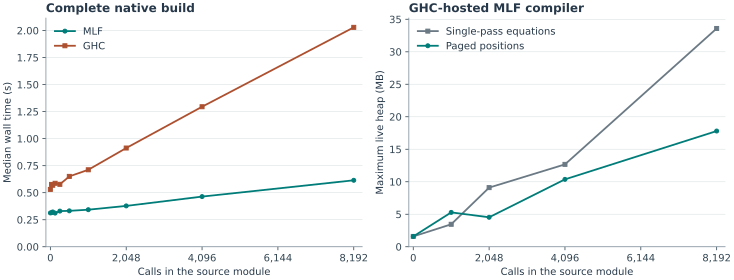

# Monomorphic constructor calls

At 1,024 calls MLF and GHC took 0.343 / 0.727 s to build a native executable. At 8,192 calls the medians were 0.615 / 2.029 s. The fitted exponents were 0.941 / 0.887 on the primary schedule and 1.072 / 1.015 on the extension. The fitted exponent has yet to clear both paired confidence gates.

## Complete native builds

Each term constructs and deconstructs a monomorphic box around the runtime input plus a different integer literal. A balanced sum makes every result observable. Both compilers consume the same generated Haskell module and produce a fresh native executable at O2. The comparison uses the ordinary GHC-hosted fused MLF crate entry with Clang 23.1.3 and the single-job GHC 9.14.1 worker. The timer includes native linking. Each compiler pair runs adjacently, with a fresh target and query cache. The zero-size control reads and prints the input.

| Calls | Previous MLF (s) | Current MLF (s) | Same-round GHC (s) |
| ---: | ---: | ---: | ---: |
| 0 | 0.3104 | 0.3099 | 0.5587 |
| 32 | 0.3119 | 0.3096 | 0.5823 |
| 64 | 0.3140 | 0.3099 | 0.5888 |
| 128 | 0.3134 | 0.3119 | 0.5863 |
| 256 | 0.3230 | 0.3217 | 0.6050 |
| 512 | 0.3321 | 0.3253 | 0.6579 |
| 1,024 | 0.3479 | 0.3434 | 0.7267 |

The previous MLF column uses the 32-pair equation-parser cohort. Discovery at commit `f81ce938` used six pairs per size and appears in the cohort table below. Each subsequent primary cohort contains 32 pairs at every size, 448 complete builds and 1,344 checked native answers. The extended cohort adds 2,048, 4,096 and 8,192 calls and uses six pairs per size, 120 builds and 360 checked answers. The largest module in the primary cohort is 40,354 UTF-8 bytes.

| Cohort | Max calls | Max time MLF / GHC (s) | OLS slope MLF / GHC (ms/call) | Exponent MLF / GHC | Paired 95% interval for exponent difference |
| --- | ---: | ---: | ---: | ---: | ---: |
| Discovery | 1,024 | 0.8711 / 0.7109 | 0.5550 / 0.1634 | 1.0220 / 0.8646 | [-0.2171, +0.3861] |
| Integer arithmetic | 1,024 | 0.4092 / 0.6966 | 0.1048 / 0.1583 | 0.9892 / 0.9521 | [-0.1134, +0.1926] |
| Plain dictionary-free applications | 1,024 | 0.3980 / 0.6916 | 0.0937 / 0.1564 | 0.9921 / 0.9679 | [-0.1002, +0.2131] |
| Separate resource budgets and direct application parsing | 1,024 | 0.3927 / 0.6959 | 0.0862 / 0.1610 | 1.0209 / 0.9732 | [-0.1177, +0.2236] |
| Before resource-budget change, extended | 8,192 | 1.6759 / 1.9594 | 0.1639 / 0.1738 | 1.2940 / 1.0185 | [+0.2296, +0.3400] |
| After resource-budget change, extended | 8,192 | 1.1821 / 1.9761 | 0.1072 / 0.1767 | 1.0851 / 1.0215 | [+0.0408, +0.1129] |
| Constructor projection, bounded templates and parsing | 1,024 | 0.3653 / 0.7046 | 0.0614 / 0.1568 | 0.7898 / 0.9221 | [-0.3020, +0.0689] |
| Constructor projection, bounded templates and parsing | 8,192 | 0.8697 / 1.9952 | 0.0696 / 0.1757 | 1.0733 / 1.0259 | [-0.0364, +0.0942] |
| Ordered dependency collection and shared source projections | 1,024 | 0.3577 / 0.7145 | 0.0458 / 0.1552 | 1.0741 / 0.8223 | [-0.1276, +0.4581] |
| Ordered dependency collection and shared source projections | 8,192 | 0.7505 / 1.9371 | 0.0542 / 0.1747 | 1.0916 / 1.0023 | [+0.0339, +0.1350] |
| Ordinal lookup, validated term reuse and compact query fields | 1,024 | 0.3821 / 0.7706 | 0.0490 / 0.1784 | 0.9411 / 0.9061 | [-0.2784, +0.3871] |
| Ordinal lookup, validated term reuse and compact query fields | 8,192 | 0.6988 / 2.0147 | 0.0465 / 0.1819 | 1.0807 / 1.0319 | [-0.0005, +0.1624] |
| Single-pass application equations and shared wire trees | 1,024 | 0.3479 / 0.7134 | 0.0372 / 0.1609 | 0.8491 / 0.8835 | [-0.3419, +0.4420] |
| Single-pass application equations and shared wire trees | 8,192 | 0.6699 / 1.9671 | 0.0435 / 0.1779 | 1.1321 / 1.0334 | [+0.0126, +0.2112] |
| Paged positions and shared declaration projections | 1,024 | 0.3434 / 0.7267 | 0.0336 / 0.1557 | 0.9405 / 0.8872 | [-0.3863, +0.5026] |
| Paged positions and shared declaration projections | 8,192 | 0.6147 / 2.0292 | 0.0367 / 0.1807 | 1.0723 / 1.0148 | [-0.0498, +0.1520] |

The fit estimates a nonnegative startup offset plus a scaled power of the call count. Intervals use the maintained 2,000 paired bootstrap draws. An exponent describes these finite measurements. Both source byte length and integer spelling grow across the schedule.

The primary run used 32 pairs at seven sizes. The extension used six pairs at ten sizes. Against source length, the primary slopes were 0.884 and 4.089 ms/KiB. The extended slopes were 0.941 and 4.640 ms/KiB, with fitted powers of 1.065 and 1.008.

The release worker also timed each child. The compiler accounts for most of the MLF slope. The separate linker stage includes compilation of LLVM IR.

| Maximum calls | MLF compiler ms/call | Clang ms/call | MLF compiler exponent | GHC child exponent |
| ---: | ---: | ---: | ---: | ---: |
| 1,024 | 0.0325 | 0.0010 | 0.798 | 0.888 |
| 8,192 | 0.0366 | 0.0001 | 1.077 | 1.012 |

## Changes and memory

- The compiler now emits the source part of a large Prepared query key in pages of 128 syntax nodes. Same-file positions use signed coordinate differences. The first 64 distinct spellings receive short codes. The data includes external source spans, full annotations and all unhandled expression forms. Each input is charged against the ordinary writer's limits. The independent reader reconstructs the prior input fields, including signed endpoints and names beyond the dictionary limit.
- Class inventory and query preparation share the indexed projection of an immutable resolved declaration when every source-slot spelling agrees with the generated table. An alternate naming scope projects again from the resolved tree. Scope IDs, including imported globals and overloaded string patterns, survive both paths.

- The parser builds ordinary applications directly across parentheses on an equation right-hand side. On other syntax it retries the established expression grammar once at the equation boundary. The differential corpus compared results, token coordinates, remaining input and diagnostics for 3,936 source spellings plus synthetic tokens across three syntax profiles.
- An immutable checked fragment derives its structural wire tree once for normalization, the raw query writer and the public object writer. A large Prepared group whose descriptor exactly matches its canonical source releases the previous lowered expression. The compiler caches common ordinal spellings.
- The historical Map controls and the compiler again use the same physical host string implementation. The paired diagnostic at 8,192 calls favored the short-offset variant by 3 ms on the alternate position encoder. The equation-parser cohort used the shared-origin format. A separate field round trip on the 1,024-call source measured 233,860 bytes with shared file origins, 134,360 with coordinate differences and 43,299 with pooled spellings. These are the two fields sent to the hash.

- A binary node whose newest child has ordinal c can first appear at c+1. The writer records consecutive entries in 64-entry pages and checks that ordinal directly. Other parents still use the full-key index. Repeated typed variable and primitive nodes can reuse a previously admitted ordinal when their complete payload matches. The writer charges expanded work, UTF-8 bytes and depth for every occurrence.
- The lexer scans same-line identifier, number and operator runs with a scalar index. It reuses short spellings only after comparing every scalar. The ordinal-writer cohort used a shared zero-offset table for short text and ASCII strings on the GHC host.
- The Prepared key can describe the lowered field as a transformation of the canonical source. The encoder first checks names, annotations, application and lambda structure, every omitted source location wrapper and every remaining leaf. The descriptor records the optional checked type. At 1,024 calls the independently reconstructed pair of fields occupied 233,860 bytes, down from 425,799 bytes with just source-origin compression. The uncompressed fields occupied 1,534,846 bytes. These are inputs to the query digest.

- Dependency collection passes the tail of the result through application nodes. Repeatedly copying the accumulated left-hand list had quadratic cost on a left-associated application spine. The collector preserves occurrence order through binders, evidence candidates and type annotations. Stable reference names are resolved after deduplicating declaration IDs, preserving the last representative on a stable-key collision.
- Query planning reuses each resolved expression across protection checking and group preparation when the canonical scope gives it the same names. Ambiguous names take the ordinary projection path. Flat case expressions whose branches and scrutinee already use lowered syntax can keep their existing tree.
- The lexer shares immutable one-character ASCII spellings. Explicit layout frames advance single-character tokens directly. Commas, keywords and layout-sensitive cases retain their own handling. The parser also keeps the coordinates of ordinary unqualified identifiers directly from the consumed token.
- Large Prepared source keys store a repeated file origin once and retain the four coordinates of every reference. Their prefix encoding includes the ordinary representation for unsupported expression forms. Admission accounts for the original UTF-8 wire size. An independent decoder reconstructs the original length-framed field, including Unicode and external locations.

- The LLVM optimizer combines integer sums that reference one resolved binder. It retains evaluation of that binder even when its multiplier wraps to zero. Eliminating a let that immediately returns its binder exposes the arithmetic after constructor projection. At 1,024 calls the emitted LLVM shrank from 1,993,237 to 11,327 bytes. The typed object stayed at 37,023 bytes.
- The class evidence planner represents an ordinary expression with a fresh empty root. Two plain operands produce another plain application. When an operand has evidence dependencies, its enclosing graph still receives both roots and retains its seeds, uses and frames.
- The source geometry check counts expanded nodes and UTF-8 work independently. The 2,048-call trace exposed an exhaustion of the shared text and node counter. Large ordinary groups then paid for interning a complete normalization graph. The revised scan retains per-symbol, aggregate, depth and tag limits, with full admission for inputs outside the fast path. The old task-list helper keeps its scalar-weighted behavior.
- The application parser folds atoms directly into the tree and stops at closing delimiters. Differential controls compare the expression, remaining tokens, committed failures and locations in all three syntax profiles.

- Closed unary functions that construct a value and select its sole field cancel when both fresh binder identities and the constructor match. The field keeps its original demand. Tests exercise mismatched tags, shadowing, a captured field, the default branch and demanded and unused failures.
- Large single definitions use their fully checked per-declaration cache. Speculative cross-declaration templates are limited to 256 syntax nodes and a 65,536-byte key. Identical large definitions can therefore have separate raw payloads. Small definitions retain cross-declaration template sharing.
- Source locations retain the endpoint tokens. Once an operand is complete, closing delimiters return the expression immediately. Differential tests cover all operator pairs and compare located syntax, associativity, failures and residual input.

| Calls and change | Allocated MB before / after | Max live MB before / after | Peak RSS MB before / after |
| --- | ---: | ---: | ---: |
| 1,024, cumulative | 983.6 / 638.7 | 11.3 / 7.1 | 77.6 / 66.1 |
| 2,048, geometry and parsing | 1,222.7 / 1,023.9 | 13.8 / 15.1 | 96.7 / 100.8 |
| 4,096, geometry and parsing | 2,210.6 / 1,801.9 | 25.8 / 25.5 | 156.9 / 163.1 |
| 8,192, geometry and parsing | 4,967.1 / 3,382.0 | 46.9 / 54.5 | 278.4 / 315.0 |
| 1,024, cumulative through constructor projection | 983.6 / 524.7 | 11.3 / 6.2 | 77.6 / 58.9 |
| 4,096, geometry candidate to constructor projection | 1,803.3 / 1,337.1 | 25.5 / 25.4 | 163.2 / 151.0 |
| 8,192, geometry candidate to constructor projection | 3,384.7 / 2,443.3 | 54.5 / 42.0 | 304.0 / 260.1 |
| 1,024, constructor projection to ordered collection | 528.3 / 461.5 | 6.3 / 5.7 | 59.1 / 51.8 |
| 8,192, constructor projection to ordered collection | 2,445.7 / 1,844.2 | 42.1 / 30.9 | 260.1 / 177.9 |
| 1,024, ordered collection to ordinal lookup | 461.5 / 418.8 | 5.7 / 4.1 | 51.8 / 43.2 |
| 4,096, ordered collection to ordinal lookup | 1,048.8 / 885.7 | 16.4 / 14.8 | 94.0 / 84.8 |
| 8,192, ordered collection to ordinal lookup | 1,844.2 / 1,517.0 | 30.9 / 34.8 | 177.9 / 172.9 |
| 1,024, ordinal writer to single-pass equations | 418.8 / 406.4 | 4.1 / 3.5 | 43.2 / 46.4 |
| 4,096, ordinal writer to single-pass equations | 885.7 / 828.7 | 14.8 / 12.7 | 84.8 / 89.0 |
| 8,192, ordinal writer to single-pass equations | 1,517.0 / 1,400.4 | 34.8 / 33.6 | 172.8 / 159.2 |
| 1,024, single-pass equations to paged positions | 406.4 / 397.2 | 3.5 / 5.3 | 46.3 / 45.3 |
| 4,096, single-pass equations to paged positions | 828.7 / 790.5 | 12.7 / 10.4 | 89.0 / 71.5 |
| 8,192, single-pass equations to paged positions | 1,400.4 / 1,322.8 | 33.6 / 17.8 | 159.2 / 114.7 |

Memory measurements use three alternating repetitions and the same source, output and cache paths. The ordinary binary establishes a per-lane artifact reference before the RTS statistics runs. At 8,192 calls the geometry change raised peak RSS on its own. The subsequent constructor-projection candidate reduced both allocation and peak RSS. The six-pair elapsed-time comparison uses the release binary.

The 8,192-call comparison used the same source path and output directory on both compilers. Stored query-result payloads fell from 2,084,862 to 313,232 bytes. Both compilers wrote a 311,931-byte public object. In a separate diagnostic, 5,119 source spans in the 1,024-call original Prepared field repeated one package, module and file. A prototype encoded its 1,342,846 bytes in 233,799 bytes and reconstructed the original exactly. Prepared nodes persist their digest. These figures describe the bytes processed for the key. The latest measured compiler uses a bounded form of this encoding. Only the key digest is written to disk.

The matched 8,192-call run from constructor projection to ordered collection wrote 313,232 and 313,232 bytes of query-result payloads, respectively. The public objects were 311,931 and 311,931 bytes. Bytes copied during GC fell from 541.5 MB to 421.1 MB.

The 8,192-call ordinal-writer run reduced bytes copied during GC from 421.2 MB to 380.7 MB. The maximum live heap increased from 30.9 MB to 34.8 MB. Both producers wrote a 1,189-byte interface, a 311,931-byte object and 313,232 bytes of query-result payloads on the same source and output paths.

At 8,192 calls, bytes copied by GC changed from 380.7 MB to 358.7 MB. Each producer wrote a 1,186-byte interface, a 311,931-byte object and 313,232 bytes of query-result payloads on identical paths.

At 8,192 calls, bytes copied by GC changed from 358.7 MB to 254.1 MB. Each producer wrote a 1,188-byte interface, a 311,931-byte object and 313,232 bytes of query-result payloads on identical paths.

## Compatibility and evidence

At all seven primary sizes the old and current compilers read objects written by each producer. Each reader emitted the same LLVM as its own fresh build for either writer, for 28 comparisons. Upgrade and downgrade invalidated stale query results. The second run on each compiler reused the cache with incremental verification enabled. Native tests include the minimum and maximum signed 64-bit inputs. The translation fixture covers overflow, cancellation, distinct binder identities and the first demanded error.

The retained local evidence is under `.mlf-build/mono-calls-growth-f81ce938ac/`. The standard reproduction uses `tools/performance/compiler-shapes/run.py` with `--endpoint crate-fused-v1 --interleave-pairs --family baseline --family mono_calls`, the sizes above and the indicated repeat count. Run `fit_growth.py` against each complete cohort.

| Evidence | SHA-256 |
| --- | --- |
| `discovery/receipt.json` | `f03c6f87f6115c340160a8ccdb4c2ba2ba469122737f922883fe1f39a9f9c6a5` |
| `final-fit.json` | `ecf0fcb8e2a766d33379e1c9a20ea51ce41fd03411be056491d4e856888b0215` |
| `demand-final/final-fit.json` | `7806da70549a51a66d6813106b9021c15b04a886e9adb13544993ae6518bc5ef` |
| `demand-final/scale-extension-fit.json` | `482617a9373f9af81d1ccd7e1e3a2ac8829616abd62cceef2bdb89b68a2f871d` |
| `demand-final/geometry-trace/branches.json` | `e8dbbd4127be18a122cdb8627041abffcb3de3c5bde10b08fac3ead89cf633e6` |
| `geometry-final/confirmation/receipt.json` | `7e103b1b43395f33c63e1f2bb1c8ac13860d663c7640a8eacb07191509339eb6` |
| `geometry-final/final-fit.json` | `7fa9ce30eb6bc35bc50469c6e2b28bd89ae6b6962aab2a5989a2dd2990af2943` |
| `geometry-final/scale-extension/receipt.json` | `24ba0fdd60e6201976c808052e7275c74a54472ce0fe3b57cfb8cc2fdc306ce8` |
| `geometry-final/scale-extension-fit.json` | `40f17f71a558a4309053781379374fe73f7b366d004f7fe5f3117a29c711420e` |
| `geometry-final/memory/receipt.json` | `a42db42a361c661d318e8f1349ceb58c00565fca08771d242e8624607131cf84` |
| `geometry-final/scale-memory/receipt.json` | `dc16dc2c354026544c2d1b0306111a4fc766925c8be2ac305e2cc810379ba546` |
| `geometry-final/compatibility/receipt.json` | `34e9a102f25d16ad88d14148e44cd301bfa11203ceb88ab6db2cd46165f90ccf` |
| `geometry-final/frontend-controls/receipt.json` | `022d9f7ba0e0461ad2c9e5716ef50b7d9a763001fed825b535aafddb83c55216` |
| `projection-final/adoption.json` | `f35386a21d5093704d328c0be41b3b4b7da0ff077c9c111f151414630df7b16b` |
| `projection-final/confirmation/receipt.json` | `ed8923aeae84bdcea8ea6e41979eaedd5e8e2674f6dfe27353d17b20f1656e9b` |
| `projection-final/final-fit.json` | `248248faf61298e2e275da570aac32c7bda5d82b0440eeb3e7ea51442645647d` |
| `projection-final/scale-extension/receipt.json` | `f967d938c4503d72fc4c390ee71aa401f71596f3760e038540bf65b54c258f7a` |
| `projection-final/scale-extension-fit.json` | `5527cf5a59ca7df6080153522b753b366b1e458b6fec9f385455031c9458d645` |
| `projection-final/sum-controls/receipt.json` | `11dbccb78d4e27635ef93ecfca100d1cff7884bb8833b52b96ea15e90927a4ec` |
| `projection-final/memory/receipt.json` | `f5089f3917f1277c570c4f203758ce991fe551eef0dcd89270752468a834169d` |
| `projection-final/scale-memory/receipt.json` | `de11279190f4b64d79d14f16eb5c4a6c30cafedcf12314241ac793fc65524f1f` |
| `projection-final/compatibility/receipt.json` | `05f70875ab1ba878e24d3058e29b177a6f1d4ae2180325c6b47cc768d98e5cb9` |
| `projection-final/prepared-dump/round-trip.json` | `eff351c9f5d46f85aaa769f8d4281bbe5034f4d035b85e8157f5f4803f068d5b` |

The constructor-projection producer passed all 11 retained suites and 41 source-pin and benchmark qualification commands. The new structure candidate passed all 28 cross-reader comparisons and both cache transitions. Its host Prepared fixture ran 9,974 checks across 53 variants. The ordered-reference, layout and case-lowering controls also passed.

| Additional evidence | SHA-256 |
| --- | --- |
| `projection-final/retained-validation-with-gmp.json` | `8014d192479f88e7c11211fe252872d2176f2cdedf9b31fd54845178b9ae4bfb` |
| `projection-final/qualification/verified/regression-results.json` | `2dc8631e7bfaef1728ee0dece98c01d6331d2342806d794d9d84f608c2c419c2` |
| `structure-final/final-fit.json` | `6df481320ce1e00b1327e3ee45f7965b049220176bfdfe5ba20b7765415aa50e` |
| `structure-final/scale-extension-fit.json` | `39f206d4b1d3e0e5f5165a962c2f28aae05fa849ee0212e49b52ec8e310c06c5` |
| `structure-final/scale-memory/receipt.json` | `808633a0b57fabda2fbc5d890905a14b4958a39e4e8b5325bb586471693b8d0f` |
| `structure-final/compatibility/receipt.json` | `22727101c20d7471c8b32d77075d1bebf8bf2b85e032ab8d292ebe491fe7e1c9` |
| `structure-final/streams-screen/receipt.json` | `619d129f28d7f65b2fd2990dfe3a13e3b7059959dcecfcd8780d099b58202ecf` |
| `structure-final/retained-validation.json` | `77383879852d22a35c4d4b9ee7a437cabaadde867fae76e818792d42cd9d4c84` |
| `structure-final/qualification/maintained/regression-results.json` | `19ab165b0ba819fa5568fdf735acb2a7e27fd44feaf295eeb351a9d4d655e5b2` |
| `structure-final/candidate-selection/receipt.json` | `57cea17c9715b7848445fe5119f3d91717953b55b5b84ec390d433908fa8ad11` |
| `structure-final/canonical-wire-control/receipt.json` | `fc80ff8a1efc3de55f72bfa6e936b7b282e9a6bf2bae2f9fac3976f4b3917f4c` |
| `structure-final/canonical-lexer-control/receipt.json` | `d581a6e25161808a4f2cbf87e90aae4bdc811722b0bef6cb8b4b97175ecc08f6` |
| `structure-final/ordinal-screen/receipt.json` | `840e31979de3fc77a06259116907fe0d0b23e8051e7c4a663a223cc2f16bd3fe` |
| `structure-final/ordinal-parents-ordinal-control/receipt.json` | `0f8ce0569a8c6d9fe546f09817d545190d6cfa645ada867d4142b1a80a36534e` |
| `structure-final/pooled-canonical-delta-controls/receipt.json` | `c37b3a80bab7e1cf35764413ba6d66bdebe473b2a7f219317a7751fec3ce808f` |

The ordered-collection producer passed all eleven retained suites and 41 qualification commands. The selector controls ran 24 interpreter cases and 124 native cases at each of O0 and O2. The qualification suite also checked historical source identities against their archived predecessors.

| Ordinal-writer evidence | SHA-256 |
| --- | --- |
| `stream-final/final-fit.json` | `0b040be8818d4093076bbd2843f4af72491ee3cc9ee4997d0cb602fd4f021f10` |
| `stream-final/scale-extension-fit.json` | `d609c2f95ae60486f51e631f694d3da7f406f4411e644366c6af4deaa74b02e3` |
| `stream-final/confirmation-source-size.json` | `db0e26e8807c0ff3fbeabb73696e4e52c48887c907ab682cb5188b71cba8af22` |
| `stream-final/scale-extension-source-size.json` | `aa3529593c7ecd62185888c8f48291707f27ee438cecc7a80394f2530d4f1e1f` |
| `stream-final/key-size-evidence.json` | `c0990d22f94684165277dd1856eca23fe6860332de76742e21c3b19e8caca50c` |
| `stream-final/compatibility/receipt.json` | `ded3c78f46cc4d444d2e2e33ce2b6c53a487d92af4621c54126385f23f012fd1` |
| `stream-final/scale-memory/receipt.json` | `0e95767be8c93dcf279fc3cf7e4fb5fb3ee2fb4bdcbd3d0dd441085a70412ec1` |

The ordinal-writer producer passed eleven retained suites and all 41 source and benchmark qualification commands. The two Map adapter checks used the 22 physical files from their pinned source revision. The selector checked 24 interpreter cases and 124 native cases at each of O0 and O2.

| Equation-parser evidence | SHA-256 |
| --- | --- |
| `stream-final/application-screen/receipt.json` | `0f0b2d002c52ebc315598fbdb52bb7f95ed74109adbb7cee92fbb3aaece2a8e4` |
| `stream-final/release-screen/receipt.json` | `e0f039681cfc4b5ab039b2cbfe7d282d4ef3494ad1b553fb3dd315ac5879c701` |
| `stream-final/released-parser-entryplain-control/receipt.json` | `5c188946d82a2bb44403f9e876aa45a1426c5b1abf994ec4a8c7f193d122d294` |
| `stream-final/released-parser-parser-control/receipt.json` | `1ea35cb6ff0adbebf468d27c36ff45826697ac63a44017cc199558aed4df4da2` |
| `stream-final/qualification/immutable-map/receipt.json` | `aa9af5448b3be24dd53393ce56fad9f537e53adc6c1c97e78c6292228d380861` |
| `stream-final/position-field-sizes.json` | `b14d9b48efb04e404056101f8df89eb2200d1ff466e9469ca3507eb726754100` |
| `stream-final/qualification/regression-results.json` | `fd282ec70fd0d613a064feca3b6891e599827b94d385254972e148c0ef612758` |
| `stream-final/candidate-selection/receipt.json` | `593ca43cb6bf5ac10c0e3349d78b1c43a3be9ad8de37c517efa0227d1ecb7d26` |
| `position-final/adoption.json` | `9ffe536cf7f9f8737224d9277a4dab289ee4128bdc351ec313fde3f4f5e3de70` |
| `position-final/final-fit.json` | `b1fe7b4d1eb7a47da711b1131a23ae624b40fe9638d5bb55d19397bec8ea721e` |
| `position-final/scale-extension-fit.json` | `5a4990c55e75e0cf09794a680821359e5327ecee1d77b4c7af4dd4b0ca2af995` |
| `position-final/confirmation-source-size.json` | `168ca74d94cff527000bc006a0c7113fdbaa4a669651d926d170a8e0f6a3c6dc` |
| `position-final/scale-extension-source-size.json` | `bf0b1ad1f282cb681ef0d7c0a6fb97ac530f7c2fdab51f2d7dadfc5aa61ac282` |
| `position-final/scale-memory/receipt.json` | `7bdb04648df04ac2184b17465650a62a7b62a2d562b27e3e5bfb20ed774db922` |
| `position-final/compatibility/receipt.json` | `41099a312db560d5a16d1b6029c5cc904a0c7e39d6be16653b92fe184553f796` |
| `position-final/retained-validation.json` | `62c01bb3cd9b0f8726e926c2a9448b442405f2b5a562581b2f287cc6076350ff` |
| `position-final/qualification/regression-results.json` | `27676441ad6ca0d50d063487b0098182265fa60842938c9e517c3833bb2b2f61` |
| `position-final/candidate-selection/receipt.json` | `d32208e534d1d25a01aa3baa012267d99b2dcf8d82dc805e7e08f088a6092e97` |
| `position-final/campaign.json` | `4908b037821f3d987415474728ac6ad2a57f454b3c17a526a6ba613423a219da` |

The equation-parser producer passed all 11 retained suites and all 41 source and benchmark qualification commands against the working tree, including the two historical Map checks. Candidate selection passed 24 interpreter cases and 124 native cases at each of O0 and O2.

The paged-position producer passed all 11 retained suites, all 41 source and benchmark qualification commands, and the native selector at O0 and O2 (124 cases each). It also passed 24 interpreter selector cases. The shared interface audit caught a polymorphic byte count in the first build. The measured implementation gives that count its required Int type.

| Paged-position evidence | SHA-256 |
| --- | --- |
| `position-final/working-set-screen/receipt.json` | `59bc818f41227c8a3b438bb92315f9f2aaa4b438f3e058a4b742f8343e7d1908` |
| `position-final/kernel-allocations/receipt.json` | `fd1d32dda863a31ee3d36d174bea1d388e6850fa1cc18c29bf6ec526c70878db` |
| `position-final/inventory-pages-controls/receipt.json` | `1ccdf25c0443952d1079fdaf560ec1ed50c7f08c8c39f0eb4fbf04509d923b93` |
| `position-final/inventory-pages-graphs-controls/receipt.json` | `9b54fb83cdde95149d0e3422960f38706c19ad24ff88e30e22d2b0e64584cb1e` |
| `position-final/pages-combination-screen/receipt.json` | `74a27d958d121b12746228595c952a968d305868e7ba26e729aa3cc719fd7c54` |
| `position-final/pages-combination-allocations/receipt.json` | `4c755ef399c465c3440ddb2c67c5ef7914d9f1f82c0a05a4f271a800510b73d2` |
| `page-final/adoption.json` | `3da4456e1adcf5e1f788389d49d9f2e4f9a61f5a281bb0b435404768f7ce7643` |
| `page-final/stage-growth.json` | `94460a475237d4109fc318136849c8b3be38f997e3db39653c990c66e09120c2` |
| `page-final/final-fit.json` | `5e8e0836f0f3930ce005f05e0d6da6d85a6de99a3a93a38066916714d3764600` |
| `page-final/scale-extension-fit.json` | `4e43412e1cee19b29c0670d0626a5be5284c2602906c47a38e259c1c5c66fc26` |
| `page-final/confirmation-source-size.json` | `d7e11b6f4bd43346329d43aa54a0974d43d05601a266189c43a0189ee8eec554` |
| `page-final/scale-extension-source-size.json` | `b0204673e1a53860fbc4ded0e956766146dd88b800e872fc9390275a98884ef9` |
| `page-final/scale-memory/receipt.json` | `fe42b3009d0a4e460611f4b70377fcb1bc39d7f8cff462f25ff18a95d2c9d1b1` |
| `page-final/compatibility/receipt.json` | `e98b0ee85d8658cfbca4c139b1c505d551fcbb8ce44941fe121dca7f388cfed3` |
| `page-final/retained-validation.json` | `93ac9be80aaf0210e83510bfaec60619776f292bac54254631c77f7ef8dff0ca` |
| `page-final/qualification/regression-results.json` | `8a8c3dfdda70fb3d9ef40edf8ebde92b95469f584475852254c4ed90e0cbb6c2` |
| `page-final/candidate-selection/receipt.json` | `835dc98818911a2477188558f59f6ed9e869b728eb23c42950a465a0ed776737` |
