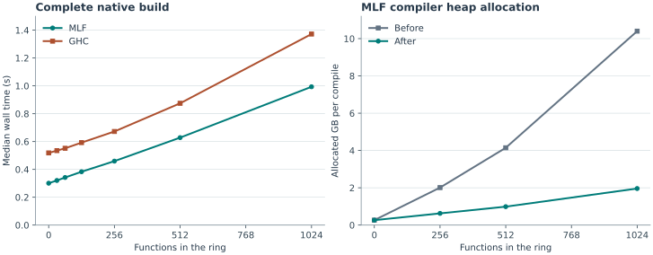

# Mutually recursive signed functions

Across 32 paired fresh builds at each size, MLF compiled every ring faster than GHC. At 1,024 functions the median fell from 4.966 s on the previous MLF compiler to 0.994 s. GHC took 1.372 s in the confirmation cohort.



## Growth measurements

The generator emits the same module bytes for both compilers. Its signed functions form one cycle. Each step decrements a runtime integer and transfers to the next function. The zero-size control reads and prints the input. MLF used the GHC-hosted fused crate compiler and Clang 23.1.3 at O2. GHC 9.14.1 used a single build job, O2 and forced recompilation. Wall time covers the compiler worker through the production of a native executable. Source generation, common tool setup and running the executable are outside the timer. Targets and query caches were fresh for every sample.

| Functions | Previous MLF (s) | MLF (s) | GHC, same confirmation (s) |
| ---: | ---: | ---: | ---: |
| 0 | 0.3006 | 0.3008 | 0.5185 |
| 32 | 0.3661 | 0.3205 | 0.5348 |
| 64 | 0.4280 | 0.3420 | 0.5516 |
| 128 | 0.5885 | 0.3833 | 0.5925 |
| 256 | 1.1414 | 0.4594 | 0.6723 |
| 512 | 2.1668 | 0.6283 | 0.8748 |
| 1,024 | 4.9658 | 0.9935 | 1.3723 |

The previous MLF column uses the six-pair discovery cohort. Its GHC median at 1,024 was 1.356 s. Confirmation used the original seven sizes, 448 complete builds and 1,344 checked native answers. Both compilers ran adjacently in each pair and each round visited every size.

| Growth measure | Previous MLF | MLF | GHC | MLF minus GHC, paired 95% interval |
| --- | ---: | ---: | ---: | ---: |
| OLS slope, ms/function | 4.5687 | 0.6739 | 0.8319 | [−0.1702, −0.1476] |
| Endpoint slope, ms/function | 4.5559 | 0.6765 | 0.8338 | — |
| Fitted exponent | 1.2952 | 1.0715 | 1.2560 | [−0.2161, −0.1480] |

The offset-power fit estimates the exponent in `a + b (n / 1024)^p` from the size medians. The 2,000 resamples keep the two compiler times in a pair together. The MLF fit has a 0.304 s offset and 2.8 ms root-mean-square error. The exponent describes observed growth through 1,024 functions on this host.

## Where the time went

- The LLVM kernel pass previously started a fresh reachability search at each worker. A cycle without a numeric anchor forced every search around the full ring. The sampled allocation attributed to these walks reached 2.86 GB in the profiled compiler. The pass now collects tail-position edges and propagates anchor reachability backwards once. On the ordinary producer, changing only this pass reduced the source-to-LLVM stage from 3.133 s to 2.493 s at 1,024 with byte-identical LLVM.
- The type checker now checks fully signed recursive groups of closed monotypes against the common signatures. It threads fresh term identity across bodies, uses the existing unifier locally and runs the independent open-fragment check. Unsupported forms and failed specializations enter the existing general solver. Changing only this pass reduced source-to-LLVM from 3.135 s to 1.197 s on the same size.
- In large recursive scopes, code generation keeps slots for captured or escaping functions and other recursive values. Direct saturated calls to closed workers can use their worker symbols. The 1,024 unnecessary hole allocations in the emitted module disappeared. In isolation, this reduced the Clang stage from 1.755 s to 1.014 s. Keeping eligible same-ABI branching tail workers out of the inliner reduced the combined candidate’s Clang stage further to 0.444 s. Numeric, producer and different-ABI calls use their existing lowering rules.

The isolated timings come from separate diagnostic builds. The confirmation table uses the ordinary release producer.

## Memory and artifact size

Three alternating RTS-instrumented pairs per size used identical source, dependency, output and cache paths. The measured process was `emlf --compile-crate-to-llvm-gc`. Each statistics-enabled relink reproduced its ordinary producer’s interface, object, LLVM, query report and cached result bytes. The graph configuration records the actual executable digest. The generation and its CURRENT pointer were verified including that digest.

| Functions | Allocated GB, before → after | Maximum live MB, before → after | Peak process RSS MB, before → after |
| ---: | ---: | ---: | ---: |
| 0 | 0.265 → 0.265 | 1.39 → 1.39 | 34.47 → 34.29 |
| 256 | 2.011 → 0.628 | 28.43 → 3.53 | 147.13 → 43.09 |
| 512 | 4.146 → 0.989 | 66.39 → 10.39 | 266.08 → 77.14 |
| 1,024 | 10.401 → 1.961 | 129.45 → 19.87 | 570.64 → 116.26 |

| 1,024-function output | Previous bytes | Current bytes | Change |
| --- | ---: | ---: | ---: |
| Interface | 110,447 | 110,447 | 0.0% |
| Typed object | 418,290 | 251,175 | -40.0% |
| LLVM | 4,297,861 | 1,917,220 | -55.4% |
| Stored query cache | 525,725 | 358,762 | -31.8% |
| Native executable | 579,480 | 296,696 | -48.8% |

The size reduction comes from the smaller checked terms and generated code. The existing binary format encodes both versions. At every size the complete exported interface agreed after resolving the dependency location to its identical contents and verifying the paired object hash. Both readers admitted both writers’ objects with semantic auditing and reproduced their own fused LLVM byte for byte in all 28 cross-checks. Cache upgrade and downgrade rebuilt the groups on the compiler identity change, and both subsequent warm runs reused all four groups with ICH verification.

The worker boundary has an execution-time cost on this synthetic ring. In five alternating runs at 1,024 functions, the 5,000,003-step native computation took a median 20.56 ms before and 23.11 ms after, including process startup. At 1,000,003 steps the medians were 7.70 and 8.24 ms. Every result matched the independent remainder formula.

## Reproduction and regressions

Use a fresh compiler-shapes fused setup for the ordinary O2 bootstrap producer. With that setup, run the maintained benchmark and fitter as follows.

```sh
python3 -B tools/performance/compiler-shapes/run.py --setup "$SETUP" \
  --output "$COHORT" --endpoint crate-fused-v1 --cohort ring-confirmation \
  --interleave-pairs --repeats 32 --cohort-output-gib 16 \
  --family baseline --family recursive_ring \
  --size 32 --size 64 --size 128 --size 256 --size 512 --size 1024
python3 -B tools/performance/compiler-shapes/fit_growth.py "$COHORT" \
  --family recursive_ring --output ring-fit.json
```

The maintained callback audit covers anchor cycles, non-anchors, partial and escaping worker values, ABI differences and ordinary tail-call policy. Frontend differential cases cover recursive declaration identities, an imported polymorphic function, self recursion, mixed signatures and the original type error. The ordinary bootstrap checked all 137 shared modules. Native tail regression exercised 60 O0/O2 results and two GC controls. The historical source reconciliation and related suites ran 980 Python test executions and 168 CI partition mutation controls. The metadata suite checked 483 cases. Fresh package build, cache reuse and split code generation, prepared syntax, query graphs and 20 positive or rejecting CLI programs also passed.

Local measurement records are under `.mlf-build/recursive-ring-discovery-d37094188c/`. SHA-256 identifies the primary receipts.

| Record | SHA-256 |
| --- | --- |
| `ordinary-build.json` | `e4b0962a8e8522c80d9d2954758c88c92f38d692ccad0667acd5edd8486a8d47` |
| `discovery/receipt.json` | `11891b1d4084cc3b4398df10e5379783e92c9a07b47ad4abb8afcb6a5d526206` |
| `confirmation/receipt.json` | `8b4f0ebfd8769dd5d313aa89f41b1ac49decc35dc309a1181d18354086002630` |
| `final-fit.json` | `b151ee239c9121b8889154887eab1f4c805e217848ec5ce6068bd12294d3a671` |
| `memory/receipt.json` | `e14b202d3ca915c81c69cd110073e15a4771b48e0da508d9d7b13b5c8cb3370c` |
| `compatibility/receipt.json` | `d0ca79db148e8ba3a6e16e713d9c7d895036b90f718f74c41e8795c8d02bd07c` |
| `retained-validation.json` | `6bff4dde66f7fecd4bdb38760fb4ee2ff8492c3388ad7a44485d1f0cf03eba2c` |
| `qualification/regression-results.json` | `bf1334b0a48245d46e1253e4a853fde72e570e7e7c200ab146c2d0705ff35902` |
