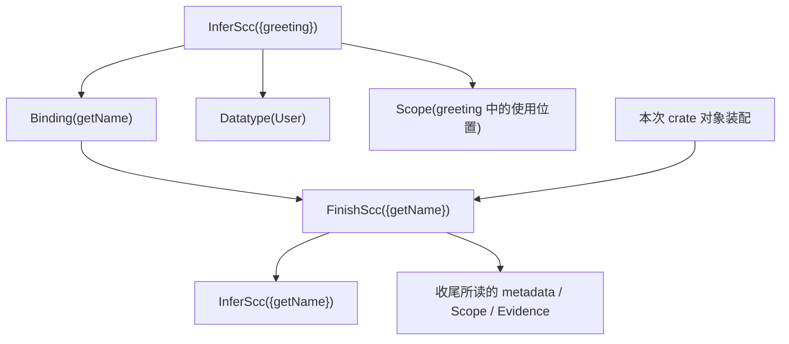

# MLF crate 增量查询缓存设计

状态：第一版已接入实际 source crate 编译路径；实现、验收与配对测量记录见
[`tools/performance/crate-query-graph`](../tools/performance/crate-query-graph/README.md)。固定基线为 PR #29 的
[`3283899e8ab03af048a674ee41988e454dca813a`](https://github.com/mlf-lang/mlf/commit/3283899e8ab03af048a674ee41988e454dca813a)。
下文的「现有」均指该提交，不随 PR 后续更新或本地工作区的版本变化。

每个 crate 维护一张持久化查询依赖图。datatype、函数类型与 contract、evidence
和 SCC 推断产物可以作为 query 结果，由多个调用方共享。成功 SCC 的已检查结果先留在会话内存中，
供本次编译继续使用；整个 crate 检查及正式输出成功后，统一发布缓存的新一代。

## 基线与改动边界

基线的 source query 已按 SCC 缓存 checked raw xMLF，source v7 key 包含原始与 prepared
语法、依赖类型、contracts、有序 evidence 候选、datatype、实际 builtin 字典和编译器身份。
它仍为每组构造完整输入 key，使用 `.mlfq` 保存 raw，使用 `.mlfqc` 共享 datatype context。
两个 source driver 都在 `finishGroup` 成功后立即调用 `writeLocalSourceRecord`。
见 [CrateQuery 的 key 与组循环](https://github.com/mlf-lang/mlf/blob/3283899e8ab03af048a674ee41988e454dca813a/libraries/mlf-crates/Bootstrap/CrateQuery.hs#L1877)
和 [CrateSession 的组循环](https://github.com/mlf-lang/mlf/blob/3283899e8ab03af048a674ee41988e454dca813a/libraries/mlf-crates/Bootstrap/CrateSession.hs#L306)。

本设计把完整输入 key 拆成可追踪的语义输入与共享 query，把逐组发布改为 crate 成功后的代际发布。
保留现有的推断、独立 xMLF 检查、成员归属、参数、datatype、PreparedRaw 和 evidence 检查规则；
查询层的 raw 检查与收尾接口改为显式接收依赖环境。这些规则用于建立或变换 checked 结果，
可信已检查结果的正常加载验证完整性与适用条件，不重新执行 body 类型检查。
正式 `.mlfco` 同样采用 body 加依赖引用，并分配新格式版本；`.mlfci` 保持对外接口的职责，
其与对象关联的指纹随新对象编码更新。语言语义、所有权及跨 crate 可见性规则保持一致。

## 查询和结果

| Query | 返回什么 | 第一版的持久化策略 |
| --- | --- | --- |
| `Datatype(def)` | 一个 datatype 的声明，包括参数、kind、构造器及其顺序、字段 | 本地声明按定义保存一次。外部声明从已检查的 crate 接口恢复 |
| `Binding(def)` | 已检查的类型、class 约束和 protection 标志 | 按值定义保存。本地函数的结果是所属 SCC 收尾结果的投影；外部结果来自已检查的接口 |
| `Scope(site)` | 该使用位置可见的有序 evidence 候选，包括角色、身份和空候选集 | 保存候选序列；候选类型和 contract 引用对应的 `Binding` |
| `Evidence(site, goal)` | 对已确定目标类型解析得到的 evidence，包括所选定义及实例化信息 | 目标及其绑定环境有稳定表示时可以保存。涉及 SCC 内临时推断变量的选择随该 SCC 计算和检查 |
| `InferScc(members)` | 在显式依赖环境中检查过的一组值定义的开放 raw xMLF | 保存每个成功 SCC 的 body、成员及外部定义和 datatype 引用；类型与声明保存在共享节点中 |

这里的 `Binding` 包含完整调用 contract，不能只保存类型。`Scope` 的有序条目保留候选角色，
通过 `Binding` 取得类型、class 约束和 protection；不能只记录最后选中的候选。
`Evidence` 的稳定 goal 包含 class 身份和规范化绑定环境，不包含 solver 分配号或临时变量地址。
依赖组内尚未完成的 binding、局部临时 evidence 的查询也留在组内，不提前发布成独立结果。

### Raw、收尾与递归边界

Raw 是收尾的输入。基线的
[`finishGroup`](https://github.com/mlf-lang/mlf/blob/3283899e8ab03af048a674ee41988e454dca813a/libraries/mlf-crates/Bootstrap/SourceInference.hs#L1086)
会检查 raw authority、成员和参数 protection，并完成 evidence 与最终 contract。
因此 `InferScc` 的 raw SHA 不足以代表最终 contract 或最终对象。

为记录这个边界，图中使用内部收尾节点 `FinishScc(members)`：它读取 raw、prepared metadata、
contracts、scope，以及适用的稳定 evidence 查询，返回最终组对象和成员 contracts。
查询缓存保存收尾记录、它的有序依赖边、raw 和各个 `Binding`。正式 `.mlfco` 保存最终组 body。
收尾也在显式环境中处理开放片段；需要最终对象时，从已检查 raw 运行收尾。
body 和环境未改变时保留已有检查凭据；产生新 body 的变换需要建立相应的新检查凭据。
`Binding(def)` 依赖这个收尾节点，再对该定义的完整 contract 单独计算结果 SHA。

例如，两个 SCC 都调用 `getName`，就都依赖 `Binding(getName)`；查询缓存只保存一份该定义的类型和
contract。加载时把依赖结果接入共享环境，复用调用方已有的 body 检查结论，
不为每个 SCC 恢复外部参数 lambda 或 `XWithData`。
引用顺序只在确有语义或编码要求的地方保留，
外部定义通过稳定身份绑定，不能靠加载次序配对。

递归值组共同推断。组内成员使用本组的递归环境；`InferScc` 和本组收尾都不能读取本组输出的
`Binding`，后续组才通过这些投影读取结果。需要组内临时类型的 evidence 同样在组内解决，
不能形成 `Binding → FinishScc → Evidence → Binding` 的环。

递归 datatype 的声明保存名义身份引用。沿用现有预声明和 datatype 校验；消费者按确定顺序、
带 visited 集合读取所需声明的传递闭包，不让互递归声明变成相互等待的 query。
由此，值递归由 SCC 封装，名义类型递归由声明闭包处理，query 的执行依赖保持无环。

### 共享环境中的开放片段

查询结果的表示由 body、成员身份、外部定义引用和 datatype 引用组成。外部引用包含稳定定义身份及
所用结果 SHA；若 body 使用局部引用槽位，显式记录槽位到定义身份的映射，不能用显示名或分配号猜测。
只有外部依赖移入环境，body 内真正的函数参数、局部绑定和 evidence slots 仍属于 body。

会话按 query 身份和结果版本共享已加载的 `Binding`、datatype 声明及其检查结果。
每个 SCC 使用限定于自身申报依赖的环境视图；视图共享类型和声明，不复制它们，也不扫描重建整个 crate 环境。
所有自由外部引用、类型和构造器查找必须落在该视图及其显式 datatype 闭包中。
不能因 crate 会话中恰好已加载其他定义，就让本组读取没有记录依赖的值。
共享的是已验证的准确声明及环境结构；首次构建新的声明组合时完成冲突、kind 和闭包校验，
加载同一已验证组合时复用该结论。

首次产生 body 时，独立检查器在这个环境中检查完整 body，包括递归定义的 RHS，并核对成员归属、
导出类型、依赖绑定、raw authority、evidence 和 protection。环境中的声明有检查结果，不等于 body 已检查。
新的不透明检查凭据（例如 `CheckedFragment`）必须同时绑定准确 body 与不可变环境视图及其结果版本，
不能把开放 body 填入只表示闭合 term 的旧 `CheckedTerm`，也不能在替换环境后沿用旧凭据。
凭据可由独立检查、保持已检查性质的受控变换，或可信 checked 记录的受控加载产生。
最后一种路径验证记录绑定关系，不再遍历 body 重证其类型。

基线底层的
[`inferWithData` 与 `inferDeclarationSpine`](https://github.com/mlf-lang/mlf/blob/3283899e8ab03af048a674ee41988e454dca813a/libraries/mlf-xmlf/Bootstrap/X/Check.hs#L144)
已接收 `DataEnv` 和 `XEnv`；但
[`Checked.check`](https://github.com/mlf-lang/mlf/blob/3283899e8ab03af048a674ee41988e454dca813a/libraries/mlf-xmlf/Bootstrap/X/Checked.hs#L18)
仍检查闭合 term，`finishGroup` 等接口也从包装中取参数和声明。
实现新增 `OpenFragment.Environment` 与 `OpenFragment.Fragment`，构造器不公开；
缓存准入与收尾读取显式环境，不把开放 body 填入旧的闭合 `CheckedTerm`。

新查询格式只保存一份显式依赖描述，body 的自由引用与该描述独立核对。
这一核对在建立 checked 结果时完成。旧格式中「接口 datatype context 与实际 term context 一致」的检查
仍在旧格式准入边界保留，见
[`validateCached`](https://github.com/mlf-lang/mlf/blob/3283899e8ab03af048a674ee41988e454dca813a/libraries/mlf-crates/Bootstrap/CrateQuery.hs#L768)。
新查询与新正式产物都不靠参数 lambda 或 `XWithData` 承载依赖。
依赖验证的读取顺序、evidence 候选顺序、规范编码顺序和函数自身的参数顺序分别维护。

## `.mlfco` 中的开放片段

`.mlfco` 保存收尾后的 checked body 和显式依赖。与 query raw 使用相同的引用机制，
但保留不同的阶段标记与结果 hash 域：raw 不能冒充已完成 evidence 和 contract 收尾的正式对象。

| 部分 | 内容 |
| --- | --- |
| 对象头 | 格式与检查规则身份、所属 crate、接口关联信息、片段清单及完整性信息 |
| 本地共享表 | 本 crate 定义的类型与 contracts、所需 datatype 声明，每个语义结果保存一次 |
| 外部依赖表 | 所属 crate、稳定定义身份、所需 Binding 或 Datatype 的语义指纹及正式接口定位信息 |
| SCC 片段 | 完整成员集合、final body、外部引用映射、依赖表引用及绑定该环境的 checked 记录 |

文件内可以用紧凑表索引编码引用，但索引必须能还原到稳定身份和结果版本。
本地依赖从对象共享表及配对接口取得；外部依赖从显式声明的正式 crate 产物闭包取得。
对象不能引用增量缓存的临时路径、图节点编号或会被回收的结果文件。
删除整个 query 缓存后，仅凭 `.mlfci`、`.mlfco` 及其正式依赖仍须能加载、链接和生成代码。

加载器取得依赖环境并验证版本、内容和 checked 记录的绑定关系。链接器按定义身份连接 body 的外部引用，
检查实际实现的类型与 contract、datatype 布局、所属 crate、可见性及重复定义，
同时保持局部 binder 的身份隔离。类型引用不携带上游函数体指纹；链接仍取得当前正式对象中的实现。
这些边界检查保留，但不通过重建再拆除参数 lambda 实现，也不逐组重新推断已检查 body。

基线链接器会从片段中取出 `XWithData`、拆开参数，再把参数替换为实际定义，见
[`linkFragmentWithSpine`](https://github.com/mlf-lang/mlf/blob/3283899e8ab03af048a674ee41988e454dca813a/libraries/mlf-crates/Bootstrap/CrateArtifact.hs#L1389)。
新格式直接保存并解析这些引用。只有最终后端或展示接口要求完整闭合程序时，才全局装配声明和入口；
无需给每个 SCC 恢复依赖包装。受控的重命名与组合可以传递检查凭据，不能保持该保证的变换须重新检查。

第一版的引用链接会对最终装配的完整程序执行一次现有检查，尚未引入开放片段的组合证明。
普通 query/对象加载不运行逐 body 的独立类型检查。已有 prepared-native 库字面量 ABI
仍接收闭合 `CheckedTerm`，因此仅该兼容入口调用 `legacyObject` 恢复包装并执行原有准入；
普通 `.mlfco` 读写与引用链接不经过这个适配器。

## rustc 的参考边界

2026-11-04 核对 Rust Compiler Development Guide，并将源码参考固定到
[`a94dce0bbb3aab81bfdcc30e8a55d7dc95bc644d`](https://github.com/rust-lang/rust/commit/a94dce0bbb3aab81bfdcc30e8a55d7dc95bc644d)。

| rustc 的做法 | 本设计采用的原则 |
| --- | --- |
| `.rmeta` 保存类型、签名等 metadata，也可保存供代码生成使用的 MIR；`.rlib` 另外含原生对象。[库与 metadata](https://rustc-dev-guide.rust-lang.org/backend/libs-and-metadata.html) | 正式接口与 body 可以通过引用连接。MLF 的 `.mlfco` 保存 xMLF，不直接等同于 Rust 原生对象 |
| metadata 中的定义引用解码为 `DefId`，其中编码的 crate 编号映射到当前会话，保留对应定义索引。[metadata decoder](https://github.com/rust-lang/rust/blob/a94dce0bbb3aab81bfdcc30e8a55d7dc95bc644d/compiler/rustc_metadata/src/rmeta/decoder.rs#L462) | 固定产物内可用紧凑编号；加载时显式重定位，不能将旧会话编号直接使用 |
| 增量缓存用 `DefPathHash` 恢复当前 `DefId`，因为 crate 编号和定义索引都可能随源码变化。[cache decoder](https://github.com/rust-lang/rust/blob/a94dce0bbb3aab81bfdcc30e8a55d7dc95bc644d/compiler/rustc_middle/src/query/on_disk_cache.rs#L655) | 跨编译的 query 身份采用稳定定义身份；不能把固定文件内的偏移当作增量身份 |
| 类型编码可引用已写出位置；metadata 的 lazy 表按需解码，query 系统缓存解码结果。[序列化](https://rustc-dev-guide.rust-lang.org/serialization.html#shorthands) | 共享表、按需加载与会话 memo 分别负责存储去重、读取和复用 |
| 外部 `type_of`、`fn_sig`、`optimized_mir` 由表查询解码返回，不在这个加载路径重跑源码类型检查。[外部 provider](https://github.com/rust-lang/rust/blob/a94dce0bbb3aab81bfdcc30e8a55d7dc95bc644d/compiler/rustc_metadata/src/rmeta/decoder/cstore_impl.rs#L230) | 可信已计算结果可以直接加载使用，检查结论的建立与结果加载分开 |

这些是引用、共享和复用机制的参考。MLF 的 checked xMLF 与环境绑定记录是本设计自己的约束，
不把 rustc metadata 描述成可独立验证的类型证明，也不据此声称 rustc 的后续阶段没有其他验证。

rustc 的正式 crate metadata 与本地增量缓存使用不同的身份编码，是因为前者绑定固定的依赖产物，
后者必须跨本地源码修改恢复 query。MLF 同样区分这两种使用范围，复用语义节点和编码基础设施，
不让正式对象依赖本地增量缓存的生命周期。

## 身份、指纹与存储引用

每一代索引记录 crate 身份、缓存格式与规范化版本、编译器身份、实际 builtin 字典身份，
以及所有影响推断或收尾的设置。编译器身份继续来自实际可执行文件。
builtin 身份覆盖实际有序声明内容；只有确认与固定字典完全相等时才可使用短标签，
不能把编译器 SHA 当作 builtin 内容的替代。校验强度选项 `-Zincremental-verify-ich` 不改变语义身份。

| 节点字段 | 含义 |
| --- | --- |
| `query_key` | query 种类和稳定身份；不包含本次结果 SHA |
| `result_sha` | 对该 query 的规范化语义结果计算的 SHA-256 |
| `reads` | 按实际读取顺序记录的依赖，每项含 query key 和当时读到的结果 SHA |
| `payload_ref` | 可选的结果位置、编码版本、长度及完整性信息 |

定义身份包含 crate、模块、命名空间、声明角色和规范定义名。reexport 保留原定义身份；
生成的 selector、dictionary 等由所属定义和生成角色确定身份。显示名、图分配号和物理存储偏移不作身份。
SCC 身份包含排序后的完整成员身份集合；实际成员处理顺序另外作为输入记录。
组拆分或合并产生新身份，不能靠首个成员名沿用旧组。

`site` 使用所属定义身份、原始语法中的结构位置和用途角色，避免仅靠行号或推断分配次序定位。
位置或作用域结构无法稳定对应时保守重算。`Evidence` 再以规范化 goal 区分同一位置的不同请求。

结果 SHA 采用带 query 种类与规范化版本的编码，保留影响语义的顺序、字面量位、量词标志、kind、
绑定作用域、evidence 角色和 protection。允许规范化词法 binder，但不能抹去名义定义身份。
共享 payload 引用携带目标身份及结果 SHA；不能只 hash 一个会在下一代指向不同内容的名字或偏移。
类型语法中的名义引用仍只标识定义，所需声明由消费者显式读取闭包，避免递归 datatype 之间循环求 hash。
节点的输入边与结果内容分开：输入改变后，结果相同仍应得到同一个结果 SHA。

基线的 source result ICH 含有输入 SHA，见
[Source query fingerprints](https://github.com/mlf-lang/mlf/blob/3283899e8ab03af048a674ee41988e454dca813a/tools/performance/source-fingerprints/README.md)。
新图不能直接把这个 ICH 用作 red/green 判定；新 `result_sha` 只表达结果语义，
输入身份、依赖边和存储校验分别记录。`Binding` 的结果不包含函数体 SHA，
`InferScc` 与最终组对象的结果则必须包含开放 body 和解释该 body 的显式依赖引用。

磁盘引用绑定到同一可读取快照中的具体结果版本。索引不得将旧参数类型或旧 datatype payload
悄悄接到新节点上。外部声明的恢复依赖已检查接口中的对应语义内容及所有权，
不引入对外部实现 body 的推断依赖。

## 依赖记录和失效

provider 通过 query 读取输入，并在执行时记录边。第一版至少需要以下输入叶节点或等价的显式读取：

| 输入 | 必须追踪的内容 |
| --- | --- |
| 定义源码 | 规范化原始声明和 lowered/prepared 语法，含注解、字面量、绑定与定义引用 |
| 名称与成员清单 | 当前定义是否存在、所属模块、名称解析与 SCC 成员关系；不能只遍历旧图中的定义 |
| Datatype 闭包 | 直接类型引用、构造器所属 datatype、字段与依赖类型的传递闭包及顺序 |
| Prepared metadata | class registry、结果 contract metadata、root authority、evidence slots、参数 protection |
| 被读取的 contract | 前驱与候选的完整 `Binding`，包括使用位置观察到的相关定义 |
| Scope | imports、选择和隐藏、可见实例及局部候选的完整有序清单，包括空集合和查找缺失 |
| 全局语义环境 | 编译器、实际 builtin 字典、推断与收尾设置，以及缓存规范化版本 |

名称解析和 scope 的输入必须覆盖候选清单本身。即使上次没有任何候选，
也要依赖产生该空集合的可见性及声明清单；新增 instance 才能使旧空结果失效。
Scope 和 Evidence 读取候选的 binding 变化，不只追踪曾经胜出的定义。
边必须由实际 provider 读取产生，不能直接把旧 key 拆开后假定依赖已完整。

下一次编译把「结果是否变化」与「是否需要完整值」分开处理：

1. 对当前语义输入求值；首次出现、已删除或版本不兼容的节点不能沿用旧结果。
2. 对旧节点按 `reads` 的原顺序验证依赖。全部未变时可以标记结果未变，无须加载 payload。
3. 遇到第一条变化的边就停止沿旧边继续走，重新执行 provider 并记录新边。
   后面的旧边可能已属于不会再执行的分支。
4. 比较新旧结果 SHA。相同则下游仍可复用；不同才向下游传播结果变化。
   即使结果相同，也保留本次执行产生的新依赖边。
5. 调用方需要完整值时才加载，验证编码、完整性和 checked 记录的适用条件后复用结果；
   没有保存结果、结果缺失或损坏时重新计算。默认加载不重新执行 body 类型检查。

这一验证顺序和按需取值原则参考
[rustc 增量算法](https://rustc-dev-guide.rust-lang.org/queries/incremental-compilation.html)。
会话分别记录节点验证状态和已加载值，避免多个调用方重复求值。
遇到正在验证或求值的同一节点时检测 query 环；损坏图应被拒绝，不能无限递归。
缓存加载、解码和校验产生的内部读取不冒充 provider 的语义依赖。

只改 `getName` 的实现时，其 raw 和最终组对象会更新，本次 crate 装配必须使用新实现。
如果 `Binding(getName)` 的类型、class 约束和 protection 均未变，`greeting` 的 raw 可以复用。
改 `User` 的构造器会使读取相应 datatype 闭包的组重新判断；在 `greeting` 的作用域新增、
删除或重排候选，会使相关 Scope 重新计算，再由结果是否改变决定后续传播。

缓存错误是重新计算的理由，不是跳过检查的理由。损坏的单个结果按该节点 miss 处理；
索引或引用关系无法可信解读时放弃该代图并冷建。若重算或显式审计发现原本标记未变的节点实际结果不同，
必须撤销依赖它的复用决定，必要时放弃本次图复用重新编译，不能继续输出已混用新旧结果的 crate。

## 会话和代际发布

会话保存已完成 query 的共享值、结果 SHA、新依赖边，以及等待发布的 raw 编码字节。
结果首次编码后直接对该字节快照计算 SHA，待发布队列保存同一份字节，避免重复编码及保留展开的
`W.Value` 树。图索引同样复用计算 SHA 时的字节；这个调整不改变磁盘格式或结果 SHA。
一个 SCC 推断和收尾成功后，其最终对象及 contracts 立即供本次编译使用；raw 留待统一发布。
失败或未完成的 SCC 不进入可发布结果集。Haskell 的惰性值不能代替完成检查的凭据：
切换当前代之前，必须确认全部必要检查、编码和 IO 已成功。

crate session 拥有发布事务。现有组循环内部的缓存锁需要上移或延长，
覆盖所用旧代的选择、会话计算、正式输出和缓存切换；嵌套 query 不重复获取同一锁。
第一版沿用协作式写者和串行 crate 内推断，不在此引入并行 SCC 或无锁回收。

发布顺序如下：

1. 完成全部 SCC 及 crate 检查，形成最终接口、对象、query report 和待发布图。
2. 成功写出 `.mlfco`、`.mlfci` 和 `.queries`。发布入口接在
   [现有 crate 输出边界](https://github.com/mlf-lang/mlf/blob/3283899e8ab03af048a674ee41988e454dca813a/libraries/mlf-crates/Bootstrap/CrateSession.hs#L200)
   之后，任何输出失败都不切换缓存。
3. 在同一缓存锁下，将新结果和图索引写入未发布的一代，验证完整性与引用闭包。
   新一代包含仍被引用的旧结果；可复用不可变结果文件，但不能依赖未保留的旧索引或会话内对象。
4. 所需文件全部完成后，最后原子替换当前代指针。失败或进程中断时，旧指针仍指向完整旧代。
5. 成功切换后才允许回收不再需要的临时文件或旧结果。第一版可以保留旧代；
   未实现的回收不能计入空间节省，也不能删除仍可读取的代所引用的结果。

图索引与结果区作为一个快照发布；正式输出仍遵守现有各文件的写出协议，
这个缓存事务本身不提供三个正式输出文件的整体回滚。缓存发布失败继续向调用方报告失败，
旧缓存仍可供下一次编译重新验证后使用。进程中断恢复是第一版要求；
若要声明断电持久性，还须另行落实并验证文件及目录的同步顺序。

全暖且图、依赖边、结果引用和内容均未变时直接沿用当前代，不重写图或结果区。
仅有结果 SHA 相同还不够：重新执行后依赖边变了，或修复了损坏结果，仍需要发布更新。
crate 的最终对象和正式输出照常处理，暖图不能使更改过的实现从最终产物中消失。

两个 source driver 应共享 query 会话和发布机制。底层 source-group API 返回结果与待发布状态，
不自行逐组提交；生产 `--compile-crate` 由外层输出成功后提交。
独立 source-query 测试以整个 source 根操作完成检查和收尾为提交边界，
嵌入 crate 编译时则必须把发布权交给 crate session。

## 格式迁移与检查

新图索引和结果区使用独立版本。首次遇到只有旧 `.mlfq`、`.mlfqc` 的目录时冷建新图，
不从旧记录猜测依赖，也不就地改写旧格式。
新的开放片段 `.mlfco` 使用独立格式版本；旧产物经明确选择的旧读入与检查路径转换为新内存表示，
新写出路径直接保存开放片段。未知版本拒绝，不能将新记录误当旧格式尝试读取。
`.mlfci` 与对象配对的版本、身份及完整性校验必须同步适配。

沿用已确定的信任模型：缓存目录可信、写者协作，允许以 SHA-256 判断内容相等并接受真实碰撞风险。
可信编译器通过受控发布路径产生的本地缓存和正式产物允许复用其已有检查结论；
目录可信这一前提不自动赋予任意外来文件相同资格。外来或无有效检查记录的已支持格式，
先通过完整语义准入，再建立本会话可复用的检查凭据；未知语义版本拒绝。

每份 checked 记录绑定阶段（raw/final）、检查规则身份、准确 body 指纹、依赖环境指纹、
成员及其 contract，以及该阶段所需的 authority。只有相应检查成功后才产生记录。
这些绑定可以复用代/对象头、共享表和已有结果指纹，不要求为每个 body 重复保存类型、环境或一份证明对象。
加载器验证受信任记录所覆盖的编码及内容完整性、身份与版本、引用范围、依赖结果是否匹配，
并通过受控入口恢复不透明的环境绑定凭据。公开 API 不能用任意 AST 加声称的类型构造该凭据。
更换 body、环境、阶段或检查规则后，旧记录失去适用性。

SHA 和校验和不证明生产者身份；这里复用结论依据的是既定可信生产与发布路径。
正常加载继续执行边界、资源上限、编码规范性、校验和、引用类型与范围等结构检查。
缺少依赖、错误版本、raw/final 混用或内容损坏不能命中。
这些检查不再包含独立 xMLF checker 对同一 body 的重复运行，也不重复遍历 body 核对已由记录覆盖的
成员、raw authority 和 evidence 性质。当前链接边界与依赖适配仍需验证，不能只看 body 指纹。

首次推断及不能由受控规则保证正确的 body 变换，继续运行相应独立检查。
读取 raw 不能省掉尚未执行的 source 收尾；但收尾中未改变的 body/环境应复用已有凭据。
正式产物损坏时报告错误并要求重建，不能假定有源码或借本地 query 缓存偷偷修补它。

保留 `-Zincremental-verify-ich` 对全部已加载 source SCC 结果进行语义指纹核验的路径，
在新格式中按新的结果编码复算 SHA。它保持「结果指纹核验」的含义，不等于 body 类型复检或源码重推断。
显式语义审计入口为 `MLF_QUERY_SEMANTIC_AUDIT=1`，重新检查 raw body、成员及 raw authority；
收尾产生的新 evidence adapter 仍按正常路径检查。正式对象加载时该选项审计 final body。
审计发现不合格的 query 结果则重算，正式对象不合格则报错。
干净编译对照继续作为增量正确性的独立验收依据。默认加载、ICH 核验和语义审计分别统计与验收。

## 第一版实现对应关系

| 位置 | 职责 |
| --- | --- |
| `Bootstrap.QueryGraph` | 会话中的新旧节点表、按旧边顺序验证、SHA 结果区、闭包/环校验、代际发布 |
| `Bootstrap.CrateGraph` | SourcePlan 的输入与 query provider、共享环境、稳定 evidence 查询、raw 复用与收尾 |
| `Bootstrap.OpenFragment` | 不透明开放片段及检查凭据、raw/final 编码、可信加载、显式审计 |
| `Bootstrap.CrateSession` | 实际 CLI 的 crate 锁、正式输出和最后的缓存发布 |
| `Bootstrap.CrateArtifact` | 新 `.mlfco` 的接口关联、依赖恢复、开放片段引用链接及旧格式分派 |

缓存路径为 `CACHE/query-graph-v1/`。`CURRENT`、`generations/SHA.mlfqg` 和
`results/SHA.mlfqr` 使用 MLFBIN schema 6；节点索引 tag 411/410，raw tag 425/400，
Binding tag 420，Scope tag 423，Evidence tag 426。图配置包含 crate 身份、完整编译器可执行文件 SHA、
由实际 builtin 声明得到的 `sourceQueryFormat`、开放片段检查规则版本和 source/lowered 模式。
同一语义结果按 SHA 保存；各定义仍保留自己的稳定 query 身份和依赖边。
`.queries` 保留既有计数和组清单；新路径中 `groups[].query_key` 指向 raw payload 的 SHA，
稳定的 `InferScc` 身份及读取边在图索引中，不再用旧输入 key 充当结果地址。

当前 Scope 以 prepared SCC/root authority 为粒度；原始与 lowered 语法中的各使用位置、
候选及顺序仍进入 Prepared 输入。稳定 Evidence 使用完整组身份、边界 slot 序号和规范化目标类型，
其依赖包括有序 Scope 与 datatype 环境。临时推断目标继续在 SCC 内求解。
Binding 与 datatype 的权威值来自本次 checked metadata/收尾，并在内存共享；
已保存的小结果不必为了验证图而重新读盘。raw 和稳定 evidence 只有实际使用时才读入。

查询配置中的 `finish-receipt-1` 使用 tag 427 保存 `FinishScc` 的组名、最终片段的
SHA-256，以及按名字排序的导出 binding 和 contract SHA-256。代际索引的 tag 410 行将完整
SCC 身份、有序读取边及其版本、收尾记录的 SHA-256 一并绑定。下游仍按结果值判断版本，
即便读取边改变，等价的结果也可以保持同一版本。

片段的内容地址统一取组身份、片段和有序环境引用的 tag 425/400 编码。收尾保留原片段且
环境引用相同时，`InferScc` 已验证的 SHA-256 就是这个地址。evidence 改写片段或环境
改变时，对实际 checked 结果按同一方式求摘要。ICH 和语义审计也会重算保留原片段的地址。
每次编译用当次结果重建小记录。交换记录或索引行、文件缺失或损坏都走原有事务修复。
导出 contract 与 `Binding` 节点共用一次编码，正式对象仍接收最终片段本身。

新 `.mlfco` 使用 schema 7、对象 tag 430、final 片段 tag 401；`.mlfci` 保持 schema 3。
对象只保存 body 与引用，类型和声明从本地及外部配对接口恢复。对象内的兼容身份覆盖
artifact ABI、checker 规则版本和实际 builtin 字典；它与 query 缓存的编译器可执行文件身份分开。
同一次构建的 `emlf`、包管理工具和库生成器不是同一个可执行文件，仍须能互读正式产物。
改变 checked-artifact 规则时必须更新 `packageFormat`，不能仅靠不同宿主可执行文件 SHA 判定兼容。
接口关联覆盖完整本地及依赖语义 metadata，排除对象自身校验和和可迁移的物理路径。

新 source API `CrateGraph.compileSourceGroups` 以整个 source 根成功作为提交边界；
crate CLI 调用不发布的 `compile/result`，由外层控制提交。旧 `CrateQuery` API
保留用于旧返回类型的兼容调用和独立对照。生产 `--compile-crate` 的 SourcePlan 分支和
已经完成 lowering 的 fallback 均使用新图和同一发布事务；fallback 不重复 source evidence 收尾，
保持基线的保守 protection contract。`SSourceDefinition` 触发的真实 fallback 在直接 source 控制中覆盖。

`MLF_QUERY_PROFILE=1` 另写 `.query-profile`，不改变 query 身份或正式产物。
发布时先将缺失或损坏结果写入同一缓存目录下的 `staging/`，再按最多 64 个路径、
约 32 KiB 的 UTF-8 参数预算分批 rename 到 `results/`。每批只启动一次 `mv`；
Windows 文件助手只接受单个源文件和完整目标文件名，因此该平台逐文件移动；暂存和最后切代的边界相同。
全部结果就绪后才写图索引并切换 `CURRENT`。正常旧结果不重写，批次中断只产生尚不可达的新结果。

测试故障注入 `MLF_QUERY_FAILPOINT=before-results|after-result-staging|after-result-batch|before-index|before-current`
在对应边界返回失败，不切换当前指针；验收包含跨批次发布到一半时旧代仍可完整读取。
旧代和未发布的结果或暂存文件暂不回收；当前未实现磁盘 GC、并行 SCC、
断电持久性保证或 raw/final 分类型的堆驻留剖析。

CI 的实际 CLI 查询指纹/发布检查使用 `tools/performance/crate-query-graph/verify.py`，
source/fallback 及同进程 Session 失败重试使用 `source_checks.py`。保留的旧查询 API
通过 `test_source_context_cache.py --legacy-query-only` 运行 29 项原有 codec/context/锁检查，
包括 63 个冻结的 decoder 差分子例。旧格式专用的 Session 用例不用于判断新查询图；
新验收验证 crate 失败后不发布成功前置 SCC、保留旧代，并在同一进程内释放锁后重试。

## 验收

以下定义验收范围；已执行的控制与实测数据单独记录在实现目录，不能以历史数据代替。

### 正确性与恢复

source query 和实际 `emlf --compile-crate SPEC -o PREFIX` 两条路径分别验收。
每个变体都与同一源码状态的干净编译对照：按完整 SCC 成员核对重建后的规范 raw、
最终 contracts、接口和对象，并在验收中独立检查其语义，另行走正常加载及链接路径。
raw 对照覆盖开放 body、成员与外部引用映射、依赖类型和 datatype 环境；
与旧基线对照时可在验收适配器中还原闭合表示，不要求查询加载路径做这次还原。
新旧格式间比较规范化 body、依赖、接口语义和链接结果；对象编码改变导致的配对指纹变化应明确列出，
不能要求新的 `.mlfco` 与旧文件逐字节一致。相同新编译器、输入与格式的干净/增量输出，
`.mlfci` 和 `.mlfco` 仍须逐字节一致，不能把旧格式迁移当作放宽同格式确定性的理由。
`.queries` 校验成员、推断/复用计数和来源，不要求冷暖报告字节相同。

| 用例 | 必须观察到的结果 |
| --- | --- |
| 只改函数体，contract 不变 | 所属 SCC 重算；消费者可复用；最终对象含新实现 |
| 改函数类型、class 约束或 protection | 相关 Binding 变化，读取它的 query 重新判断 |
| 改 datatype、构造器所属类型或字段依赖 | 所需声明闭包完整失效；无遗漏的构造器依赖 |
| 增删或重排 evidence 候选，包括空集合变非空 | Scope 及其读取者重新判断；选择、歧义和失败与干净编译一致 |
| 稳定 goal 与临时推断 goal | 前者可共享；后者在 SCC 内完成；不会复用错误实例化或产生自依赖 |
| 递归 SCC 拆分、合并或成员删除 | 按完整新成员集合求值，旧组不能冒充新组 |
| 互递归 datatype、多个调用方共享同一 Binding | 闭包遍历终止，声明和 contract 无重复持久化 |
| 开放 raw 使用未申报依赖或错误绑定映射 | 建立 checked 结果及完整语义准入时拒绝；不能借会话中的额外定义通过检查 |
| checked body 配上不同版本环境、修改过的内容或错误阶段 | 正常加载拒绝复用旧检查记录 |
| 编译器或实际 builtin 改变 | 语义环境失效；包含「保持传入 compiler 身份、实际改变 builtin」的控制 |
| 依赖改变但结果相同；控制流改变所读依赖 | 下游可保持复用，新边替换旧边；遇首条变化后不执行废弃旧分支 |
| 旧缓存、缺失或损坏结果、断裂或错类型引用 | 有界地拒绝并重算；恢复结果与干净编译一致 |
| raw 被替换为 finalized 或 evidence 被篡改 | 阶段或内容完整性不符时正常加载拒绝；校验和自洽的语义错误记录由语义准入/审计拒绝 |
| 可信暖缓存与可信正式对象加载 | 未变 body 的独立类型检查次数为零；新收尾变换的检查单列 |
| 删除缓存后加载正式产物；新旧格式跨 crate 链接 | 仅依赖正式产物闭包；定义身份、类型、布局、所有权及运行结果正确 |
| 后续 SCC 失败、正式输出失败、发布中断 | 未切换的上一代保持完整；重启后无半代缓存可见 |
| 暖编译、结果相同但依赖边变化、多个协作写者 | 纯暖编译沿用旧代；新边正确发布；锁保护完整快照 |

发布故障注入覆盖结果区写入、索引写入、切换前后，并检查当前指针及所有可达结果。
在切换后中断应能读取完整新代，在切换前中断应能读取完整旧代。
全量 ICH 核验和完整语义审计另行运行；不能用只通过 codec 往返或只有命中计数的测试代替语义对照。
测试必须区分「可信生产者的原样结果」与「人为重写内容及所有校验信息的外来记录」，
不能声称默认加载会重新证明后者的语义正确性。

### Foundation 性能与内存

采用基线中的
[14 模块 Foundation 协议](https://github.com/mlf-lang/mlf/blob/3283899e8ab03af048a674ee41988e454dca813a/tools/performance/foundation-query/README.md)
及其 [实际 CLI harness](https://github.com/mlf-lang/mlf/blob/3283899e8ab03af048a674ee41988e454dca813a/tools/performance/foundation-query/compare.py)。
固定同一 GHC、编译选项、源码清单、绝对路径、crate 身份和 builtin 安装状态。
按「基线、候选、候选、基线」运行配对序列，每个序列先清空 query 缓存，
每个阶段启动新进程；冷缓存指 query 目录为空，不宣称清空 OS 页缓存。

| 阶段 | 输入状态 | 推断 / 复用 SCC |
| --- | --- | --- |
| 冷编译 | 原始 14 模块，query 缓存为空，Prelude 已验证安装 | `504 / 0` |
| 暖读 | 相同源码，使用上一阶段缓存 | `0 / 504` |
| 既定单次修改 | `Bootstrap.Version` 中 `0.3.0` 改为 `0.3.1` | `1 / 503` |

这些计数只统计 `InferScc` 是否实际重新推断或复用了已检查 raw。
重新收尾不计为重新推断，也不能用 query 的红绿节点数替代 SCC 计数。

记录准确的源码、可执行文件和设置身份，保留全部样本、日志、失败及缓存状态。
首次 builtin 安装单独测量。source-query 微测量不能代替实际 `--compile-crate` 的端到端结果，
默认策略、全量 ICH 核验和语义审计也分开记录。

时间至少拆出图验证、实际重新推断、结果加载及完整性验证、新 body 的语义检查、组收尾、正式产物写出和缓存代发布，
同时报告端到端 wall/CPU 时间，说明嵌套计时关系，不能直接相加重叠区间。
空间同时报告当前可达缓存逻辑字节、保留旧代后的总磁盘字节、该次新增写入字节和峰值 RSS。
正式 `.mlfci`、`.mlfco` 的字节单列，完整计入其共享表、依赖引用与检查记录。
另记共享环境的加载/校验次数及各组视图的开销，确认共享没有退化为逐组复制或全环境重复扫描。
特别记录待发布 raw 的累计大小、收尾对象驻留及两者重叠的峰值，验证延迟写盘是否增加内存成本。
确认全暖路径确实没有重写缓存，单次修改的 `1/503` 也没有被整代结果重写抵消。
性能结论以这些固定配对实测为准；图结构、共享字节或命中计数本身不构成加速证据。

实现及合入 PR #29 后的验收、配对测量记录见
[集成报告](../tools/performance/crate-query-graph/pr29-integration.md)；
完整源码身份、控制结果和全部样本见
[evidence.json](../tools/performance/crate-query-graph/evidence.json)。
该报告将包含 PR #36 的合并版本与原始 `3283899e` 基线比较，不将整体收益归因于单项修改。
