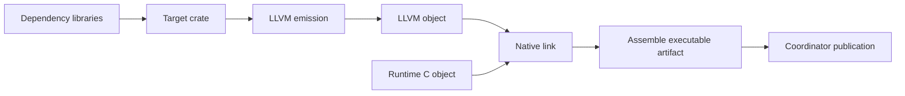

# Parallel package build plan

Status: implemented in this branch; release qualification remains a separate gate.

`mlfpkg --jobs N build`, `test`, and `run` share one invocation graph, with
`--jobs 1` as the default. `Package.Scheduler` resolves and deduplicates actions,
serializes the graph once, and launches one-action workers through
`mlf-build-runner`. Worker receipts and reports live under
`<build>/invocation/jobs/`; the coordinator validates them and the original
inputs before publishing binaries. Test commands still execute serially.

The ten libraries now live under `libraries/`. Targets may select an explicit
`dependencies` array; omission retains every direct package dependency.
The original 63 modules retain their names, and `Package.Scheduler` adds one
package-core module. See [the package guide](package-manager.md) and
[runner protocol](build-runner-protocol.md) for the implemented interfaces.

The checklist below records the design and its acceptance requirements.
Native Windows execution, all six compiler test groups, fresh self-hosting,
and performance measurements must be assessed from their actual test evidence;
implementation or cross-compilation alone does not establish those results.
No full-toolchain speedup is claimed.

## Implementation plan

Implement bounded parallelism across build actions first, then apply the library split. Inference inside each crate remains serial in the first version; the existing inference, erasure-agreement, independent xMLF, metadata, and final-link checks remain required.

### 1. Build one dependency graph per invocation

- Resolve the selected `build`, `test`, or `run` prerequisites once. Model library compilation, target compilation, LLVM emission, LLVM object compilation, runtime C compilation, native linking, and executable assembly as separate jobs.
- Deduplicate shared prerequisites by their full build variant. Library jobs retain compiler identity and `no-prelude`; native jobs retain platform, flags, and PGO target/profile identities.
- Assign stable job IDs and explicit predecessor references. A worker reads the completed predecessor result manifests to obtain artifact locations.
- Preserve current package-wide dependency semantics at this stage. Do not silently remove dependencies based on import guesses.



Runtime compilation can overlap compiler work. Independent libraries and target pipelines can run concurrently. Replace the repeated library traversal performed for every target with this shared plan.

### 2. Isolate job state while execution is still serial

- Give every job a private scratch directory, command-log namespace, and atomically published result manifest.
- Return explicit artifact paths, cache-hit status, validation receipts, and report rows from build actions. Remove the dependence on the last global build-report row.
- Remove shared command numbering and `fingerprint.json` scratch files. Replace shared LLVM `last-query.json` reporting with per-invocation output.
- Keep the coordinator as the only writer of the combined build report and published `bin/` files, including Windows DLLs. Preserve the build-directory lock; internal workers must not acquire the coordinator's lock.
- Preserve content-addressed artifact locks, checksum/closure validation, and atomic publication. Scratch isolation is needed before lock acquisition as well.
- Initially partition LLVM query caches by stable target identity, keeping invocation IDs and job counts out of semantic cache keys. The current cache-wide emission lock must not serialize unrelated targets. Retain the existing per-crate inference lock for the first release.
- Merge report rows in a stable logical order while recording actual timing separately. Perform source/tool/PGO validation before final publication and mark the report complete only after successful completion.

Acceptance: the refactored serial path preserves checked outputs, cache behavior, and source/tool mutation detection.

### 3. Promote the native process runner into a supported build helper

- Reuse the existing benchmark DAG transport as the starting point. Add a versioned protocol, stable task IDs, dynamically sized graphs, a configurable job limit, per-job deadlines, and explicit succeeded/failed/cancelled/blocked results.
- MLF owns graph construction, package resolution, cache policy, and validation. The native helper handles dependency readiness, bounded launch, waiting, process cleanup, and measurements.
- Each internal MLF worker executes exactly one action. It must not recursively invoke the ordinary `build` command.
- Implement matching POSIX and Windows behavior. Make worker, compiler, and helper descendants part of supervised job lifetimes; current POSIX `runProcess` creates fresh process groups, so killing a worker alone is insufficient.
- Handle timeout, cancellation, worker failure, coordinator death, and runner death without leaving compiler descendants or held locks. Preserve structured argv, Unicode paths, redirections, and Windows Job Object cleanup.
- Require a successful transport exit and a complete result document bound to the exact plan. Missing, truncated, stale, or malformed results cannot indicate success; the existing test runner can exit zero while its structured result reports a job failure.
- Build and distribute the helper through POSIX/Windows bootstrap and release packaging, including relocation checks, protocol capability checks, and helper identity hashes. Keep the current seed compiler bootstrap path usable without adding public language primitives.

Acceptance: lifecycle and protocol tests pass on supported POSIX and Windows hosts before enabling concurrent production builds.

### 4. Expose bounded scheduling

Proposed interface:

```sh
./mlfpkg --jobs 1 build
./mlfpkg --jobs 4 build
```

- Use the same scheduler for all job counts, with `1` as the initial default.
- Launch a ready job as soon as capacity is available; avoid barriers between entire dependency levels.
- On failure, stop launching jobs, block dependants, terminate and reap active job scopes, and retain an incomplete report and the previously published binaries.
- Keep nested workers within the invocation's budget. Count active build actions explicitly and measure aggregate process-tree memory before selecting a higher default.
- Build shared prerequisites for `test` and `run` through this scheduler. Keep arbitrary test execution serial initially so parallel builds do not implicitly introduce parallel test-directory or environment semantics.
- Include job dependencies, states, cache provenance, durations, observed concurrency, and output locations in build evidence.

### 5. Split libraries, then shorten executable dependency paths

Apply the proposed library split after the scheduler passes validation, first checking the new layout with `--jobs 1`. The committed baseline contains 63 library modules: 55 bootstrap modules and 8 package-tool modules.

| Proposed library | Responsibility | Baseline modules |
| --- | --- | ---: |
| `mlf-foundation` | Shared representations, collections, host utilities | 11 |
| `mlf-language-core` | Kinds, datatypes, primitives | 4 |
| `mlf-frontend` | Lexer, parser, syntax, module resolution | 9 |
| `mlf-xmlf` | xMLF syntax, parsing, independent checking | 6 |
| `mlf-inference` | Graph solver, constraints, classes, elaboration | 8 |
| `mlf-interpreter` | Checked-program interpreter | 1 |
| `mlf-llvm` | LLVM optimization and emission | 9 |
| `mlf-crates` | Crate artifacts, queries, linking, codegen integration | 7 |
| `mlf-package-core` | Manifests, builds, package commands | 5 |
| `mlf-developer-tools` | Test orchestration, verification, benchmarks | 3 |

All committed library modules are accounted for and this proposed group graph is acyclic. Its main chain is `foundation -> language-core -> frontend -> xmlf`; inference, interpreter, and LLVM can then run concurrently. Crates waits for inference and LLVM, followed by package-core and developer-tools. The maximum independent library width of this grouping is three, not ten.

Use one package manifest per library, retain globally unique module names and explicit direct dependencies, and keep sources within their declaring package roots. Update bootstrap paths, test manifests, and lock data with the split.

In a separate compatibility-preserving schema change, add explicit per-target dependency selection with today's all-package-dependencies behavior as the default. Both root executables currently inherit every direct package dependency; otherwise `emlf` would still wait for package-manager tooling. Validate target dependency visibility and instance/namespace behavior rather than inferring a narrower dependency set silently.

### 6. Validate correctness and measure the gain

| Check | Required result |
| --- | --- |
| Diamond dependency graph | Shared prerequisite executes once; siblings overlap; consumer waits for successful results |
| Configured job bound | Observed active jobs never exceed the limit |
| Failure, timeout, cancellation, owner crashes | No dependent launch, orphan processes, false success, or stale published replacement |
| Concurrent managers sharing a cache | Valid checked artifacts and receipts; correct lock handoff; no torn publication |
| Mixed `no-prelude` and PGO variants | No incorrect deduplication or cross-target reuse |
| Simultaneous LLVM jobs | Each report and cache result belongs to its actual target |
| `--jobs 1` versus `2` and `4` | Equivalent independently checked outputs and runtime behavior; deterministic bytes where existing tests require them |
| Cold, warm-cache, and incremental builds | Repeated isolated measurements of wall time, aggregate peak memory, actual concurrency, and critical path |

Use synchronization-based fixtures to establish overlap and ordering, rather than relying only on sleep-duration guesses. Cover malformed protocols, more than 64 tasks, missing tools, paths with spaces/Unicode, merged streams, interrupted cache writers, and subsequent recovery.

Retain existing corruption-repair, semantic invalidation, independent-root-check, and cache-provenance assertions. Locate report artifacts by stable action/crate identity instead of first/last-row assumptions. Wire scheduler fixtures into the active package test target and keep coverage expectations current.

Final acceptance requires all six native test groups and fresh self-hosting, followed by performance measurements on identical source/tool configurations. Job count and completion order must not alter artifact cache keys. No speedup is claimed until those measurements are complete.

## Source anchors

Baseline: [`ad299fa`](https://github.com/mlf-lang/mlf/commit/ad299fa17296945ca0cf34d6fc4ac35dc5eb0924).

- [Build actions, cache locks, reports, and serial library traversal](https://github.com/mlf-lang/mlf/blob/ad299fa17296945ca0cf34d6fc4ac35dc5eb0924/package/Package/Build.emlf).
- [Command dispatch, build-directory lock, and target orchestration](https://github.com/mlf-lang/mlf/blob/ad299fa17296945ca0cf34d6fc4ac35dc5eb0924/package/Package/Command.emlf).
- [Manifest dependency and target semantics](https://github.com/mlf-lang/mlf/blob/ad299fa17296945ca0cf34d6fc4ac35dc5eb0924/package/Package/Manifest.emlf).
- [LLVM query cache and reporting](https://github.com/mlf-lang/mlf/blob/ad299fa17296945ca0cf34d6fc4ac35dc5eb0924/bootstrap/Bootstrap/CrateCodegen.emlf).
- [Per-crate inference query lock](https://github.com/mlf-lang/mlf/blob/ad299fa17296945ca0cf34d6fc4ac35dc5eb0924/bootstrap/Bootstrap/CrateQuery.emlf).
- [Existing benchmark DAG transport](https://github.com/mlf-lang/mlf/blob/ad299fa17296945ca0cf34d6fc4ac35dc5eb0924/tests/native/host_support.c).
- [POSIX process execution](https://github.com/mlf-lang/mlf/blob/ad299fa17296945ca0cf34d6fc4ac35dc5eb0924/runtime/mlf_system.h) and [Windows process execution](https://github.com/mlf-lang/mlf/blob/ad299fa17296945ca0cf34d6fc4ac35dc5eb0924/runtime/mlf_system_windows.h).
- [Current crate compilation contract](https://github.com/mlf-lang/mlf/blob/ad299fa17296945ca0cf34d6fc4ac35dc5eb0924/docs/crate-compilation.md).
